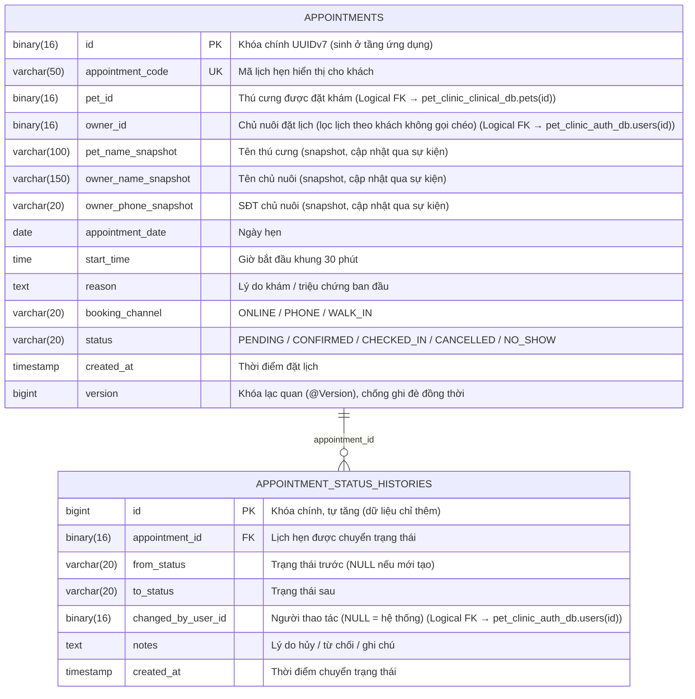
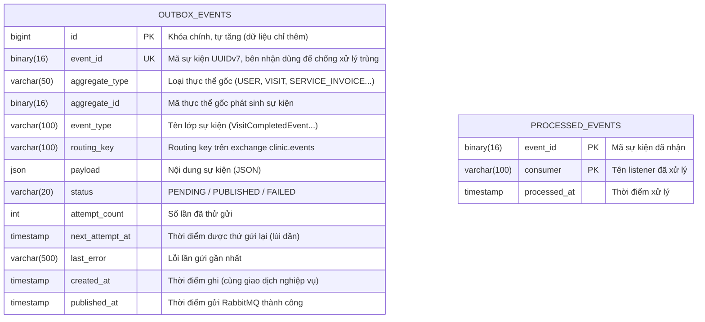

# TÀI LIỆU THIẾT KẾ CƠ SỞ DỮ LIỆU (ERD & DATA DICTIONARY)
## HỆ THỐNG QUẢN LÝ PHÒNG KHÁM THÚ Y (MICROSERVICES ARCHITECTURE)

> **Phiên bản:** 4.0 – Thiết kế lại theo nhận xét chi tiết của Giảng viên hướng dẫn (18/11/2026)
> **Mô hình kiến trúc:** Microservices (Database-per-Service) + mô hình đọc riêng cho báo cáo (CQRS Read Model)
> **Lưu trữ:** MySQL 8.0 Server gồm 5 CSDL logic; Redis 7 giữ hàng đợi đang chạy
> **Tổng số bảng:** 52 bảng (Auth: 9, Appointment: 4, Clinical: 24, Billing-Pharmacy: 10, Reporting: 5). Trong đó 4 bảng `outbox_events` và 4 bảng `processed_events` là bảng hạ tầng sự kiện có cấu trúc giống nhau
> **Tài liệu tham chiếu:** [THIET_KE_KIEN_TRUC_MICROSERVICES.md](THIET_KE_KIEN_TRUC_MICROSERVICES.md), [schema_init.sql](schema_init.sql) (v4.0), [DANH_SACH_KIEU_ENUM_HE_THONG.md](DANH_SACH_KIEU_ENUM_HE_THONG.md)
> **Ảnh ERD đi kèm:** `ERD_1_auth.png` … `ERD_6_infra.png` (cùng nội dung với các sơ đồ Mermaid ở Mục 2, dùng để chèn vào báo cáo)

---

## 1. Nguyên tắc thiết kế CSDL

### 1.1. Database-per-Service
- Hệ thống có **5 CSDL logic** trên một MySQL Server, mỗi service chỉ kết nối CSDL của mình, không JOIN chéo CSDL:

| CSDL | Service | Số bảng | Phạm vi dữ liệu |
| :--- | :--- | :---: | :--- |
| `pet_clinic_auth_db` | `auth-service` (:8081) | 9 | Tài khoản, vai trò, hồ sơ cá nhân, hồ sơ nhân sự, hồ sơ chuyên môn thú y, hồ sơ khách hàng, phiên đăng nhập |
| `pet_clinic_appointment_db` | `appointment-service` (:8082) | 4 | Lịch hẹn và lịch sử trạng thái lịch hẹn |
| `pet_clinic_clinical_db` | `clinical-service` (:8083) | 24 | Danh mục & bảng giá dịch vụ, thú cưng, đợt khám (hành chính), sinh hiệu, hồ sơ khám, chỉ định, kết quả cận lâm sàng, hóa đơn dịch vụ, đơn thuốc, lịch sử phiếu xếp hàng |
| `pet_clinic_billing_pharmacy_db` | `billing-pharmacy-service` (:8084) | 10 | Danh mục thuốc, thành phần, bảng giá thuốc, tồn kho, hóa đơn thuốc, nhật ký kho |
| `pet_clinic_reporting_db` | `reporting-service` (:8086) | 5 | Bảng phẳng phục vụ báo cáo (chỉ ghi bằng sự kiện) |

- **Redis** (không phải bảng): phiếu xếp hàng đang `WAITING` / `IN_SERVICE` của 3 loại hàng đợi (Mục 3).

### 1.2. Chiến lược khóa chính (nhận xét: "khóa BIGINT tự tăng là bad practice")

| Loại dữ liệu | Kiểu khóa | Bảng áp dụng | Lý do |
| :--- | :--- | :--- | :--- |
| Thực thể nghiệp vụ, được tham chiếu qua API / sự kiện / chéo service | **UUID phiên bản 7, lưu `BINARY(16)`** | `users`, `pets`, `appointments`, `pet_visits`, `visit_service_details`, `services`, `medicines`, `service_invoices`, `medicine_invoices`, `prescriptions`, `imaging_results`, `imaging_attachments` | Sinh ở tầng ứng dụng trước khi INSERT nên gắn ngay được vào sự kiện outbox; duy nhất toàn hệ thống (gộp dữ liệu, phát lại sự kiện không đụng khóa); không lộ số lượng bản ghi và không đoán được URL. UUIDv7 có 48 bit đầu là thời gian nên giá trị mới luôn lớn hơn, chèn vào cuối chỉ mục B+Tree như số tự tăng (UUIDv4 ngẫu nhiên gây tách trang). `BINARY(16)` chỉ tốn 16 byte, nhỏ hơn nhiều so với `CHAR(36)` |
| Dữ liệu đơn giản, nhiều dòng, chỉ thêm, không ai tham chiếu từ bên ngoài | `BIGINT AUTO_INCREMENT` | `*_status_histories`, `service_prices`, `medicine_prices`, `vital_signs`, `lab_test_results`, `prescription_items`, `medicine_ingredients`, `medicine_invoice_items`, `inventory_transactions`, `refresh_tokens`, `queue_ticket_histories`, `outbox_events`, `revenue_facts` | Khóa 8 byte gọn nhất cho bảng lớn; không lộ ra API nên không có rủi ro đoán khóa |
| Danh mục tra cứu nhỏ | `SMALLINT AUTO_INCREMENT` + cột `code` duy nhất | `roles`, `species`, `service_categories`, `medicine_categories`, `lab_test_items` | Vài chục dòng; ứng dụng và API dùng `code` ổn định, không dùng id |
| Quan hệ 1–1 mở rộng thông tin | Dùng chung khóa chính của bảng cha | `user_profiles`, `staff_profiles`, `pet_owner_profiles`, `veterinarian_profiles`, `medical_records`, `medicine_stocks` | Bảo đảm 1–1 bằng ràng buộc, không cần khóa đại diện |
| Bảng nối, bảng có khóa tự nhiên | Khóa chính ghép | `user_roles`, `service_lab_test_items`, `lab_test_reference_ranges`, `queue_ticket_history_items`, `processed_events`, `daily_revenue_summaries`, `doctor_daily_performances` | Cặp giá trị vốn đã duy nhất |

- Ứng dụng sinh UUIDv7 bằng Hibernate: `@Id @UuidGenerator(style = UuidGenerator.Style.VERSION_7) private UUID id;` (Hibernate 7 đi kèm Spring Boot 4). Kiểu `java.util.UUID` được Hibernate ánh xạ sang `BINARY(16)` trên MySQL.
- Gỡ lỗi bằng SQL: `BIN_TO_UUID(id)` để đọc, `UUID_TO_BIN('...')` để lọc. API và sự kiện luôn dùng dạng chuỗi chuẩn 36 ký tự.

### 1.3. Toàn vẹn dữ liệu liên dịch vụ
- **Khóa ngoại vật lý** cho mọi quan hệ trong cùng CSDL (ví dụ `prescriptions.visit_id → pet_visits(id)` nay là khóa ngoại thật vì đơn thuốc đã về `clinical-service`).
- **Khóa ngoại logic** (`BINARY(16)` + index, ghi chú `LFK:` trong `schema_init.sql`) cho quan hệ chéo service; kiểm tra tồn tại bằng OpenFeign **chỉ đọc** lúc tạo.
- **Không xóa cứng dữ liệu danh mục và tài khoản** (nhận xét #2): tài khoản chuyển `LOCKED` / `INACTIVE`, dịch vụ / thuốc / vai trò / nhóm chuyển `is_active = FALSE`, thú cưng gán `deleted_at`. Một khóa ngoại logic cũ vì vậy luôn tra được; giao diện hiển thị "Đã khóa" / "Ngừng sử dụng" thay vì lỗi không tìm thấy.
- **Transactional Outbox** (nhận xét #2): mỗi CSDL phát sự kiện có bảng `outbox_events`. Thay đổi nghiệp vụ và dòng sự kiện được ghi trong **cùng một giao dịch**; tiến trình `OutboxRelay` đọc dòng `PENDING`, gửi RabbitMQ, đánh dấu `PUBLISHED`. Không còn trường hợp "đã commit mà mất sự kiện" khi RabbitMQ hoặc service sập giữa chừng.
- **Bên nhận chống xử lý trùng** bằng bảng `processed_events (event_id, consumer)`, INSERT trong cùng giao dịch với thay đổi do sự kiện gây ra.

### 1.4. Snapshot và mô hình đọc cho báo cáo (nhận xét #1)
- **Cột snapshot** (hậu tố `_snapshot`) lưu tên hiển thị của dữ liệu thuộc service khác ngay trên bản ghi (`pet_visits.doctor_name_snapshot`, `pets.owner_name_snapshot`, `appointments.pet_name_snapshot`, `prescription_items.medicine_name_snapshot`, `medicine_invoices.customer_name_snapshot`...). Danh sách 50 đợt khám không còn phát sinh 50 lời gọi sang `auth-service` (lỗi N+1 chéo service). Snapshot được cập nhật bất đồng bộ khi nhận `UserProfileUpdatedEvent`, `PetUpdatedEvent`.
- **`reporting-service`** giữ CSDL đọc riêng `pet_clinic_reporting_db` gồm các bảng phẳng (`visit_facts`, `revenue_facts`, `daily_revenue_summaries`, `doctor_daily_performances`) được dựng từ sự kiện. Báo cáo doanh thu theo tháng chỉ còn một truy vấn trên một CSDL.

### 1.5. Bỏ kiểu ENUM của MySQL (nhận xét #3)
- Danh sách **người dùng có thể mở rộng** chuyển thành **bảng danh mục**: `roles`, `service_categories`, `species`, `medicine_categories`. Thêm vai trò / nhóm dịch vụ mới chỉ cần INSERT, không `ALTER TABLE` khóa bảng.
- Danh sách **gắn với logic chương trình** (trạng thái vòng đời: `VisitStatus`, `PaymentStatus`...) lưu `VARCHAR`, kiểm tra hợp lệ bằng enum Java (`@Enumerated(EnumType.STRING)`); thêm trạng thái chỉ cần sửa code và triển khai lại, không sửa lược đồ. Danh sách đầy đủ ở [DANH_SACH_KIEU_ENUM_HE_THONG.md](DANH_SACH_KIEU_ENUM_HE_THONG.md).

### 1.6. Phân tầng dữ liệu
- **Danh mục (Master Data):** `roles`, `species`, `service_categories`, `services`, `lab_test_items`, `service_lab_test_items`, `lab_test_reference_ranges`, `medicine_categories`, `medicines`, `medicine_ingredients`.
- **Lịch sử giá (Price History):** `service_prices`, `medicine_prices`.
- **Hồ sơ người dùng:** `users`, `user_roles`, `user_profiles`, `staff_profiles`, `veterinarian_profiles`, `pet_owner_profiles`.
- **Giao dịch (Transactional Data):** `appointments`, `pets`, `pet_visits`, `vital_signs`, `medical_records`, `visit_service_details`, `lab_test_results`, `imaging_results`, `imaging_attachments`, `service_invoices`, `prescriptions`, `prescription_items`, `medicine_invoices`, `medicine_invoice_items`, `medicine_stocks`.
- **Theo dõi quá trình & kiểm toán (Audit Trail):** `appointment_status_histories`, `pet_visit_status_histories`, `visit_service_detail_histories`, `inventory_transactions`, `queue_ticket_histories`, `queue_ticket_history_items`.
- **Hạ tầng sự kiện:** `outbox_events`, `processed_events`.
- **Mô hình đọc (Read Model):** 4 bảng của `pet_clinic_reporting_db`.

### 1.7. Chuẩn hóa và các ngoại lệ có chủ đích
- **Không lưu giá trị tính được** trong CSDL giao dịch: tổng tiền, tiền thuế, tồn sau giao dịch, đánh giá chỉ số xét nghiệm, số năm kinh nghiệm (Mục 6).
- **Không lặp thông tin của bảng lịch sử:** người duyệt / hủy, thời điểm bắt đầu / chốt / hoàn tất lấy từ `*_status_histories`.
- **Giá có lịch sử, chứng từ chụp giá:** bảng giá (`service_prices`, `medicine_prices`) trả lời "giá niêm yết đã thay đổi thế nào"; hóa đơn chụp `unit_price`, `vat_rate` tại thời điểm phát sinh để trả lời "khách đã trả bao nhiêu" (chứng từ không đổi khi bảng giá đổi).
- **Ngoại lệ:** `medicine_stocks.quantity_on_hand` lưu để trừ kho nguyên tử, bất biến `= SUM(inventory_transactions.quantity)`; các cột `*_snapshot`; toàn bộ CSDL reporting (mô hình đọc phi chuẩn hóa có chủ đích, có thể dựng lại bằng cách phát lại sự kiện).

---

## 2. Sơ đồ Thực thể – Mối quan hệ (ERD)

Các sơ đồ dùng ký hiệu chân chim, sinh trực tiếp từ [schema_init.sql](schema_init.sql). Khóa ngoại logic sang service khác ghi trong chú thích cột dạng *(Logical FK → database.bảng(id))*; nhãn trên đường nối là cột khóa ngoại. `clinical-service` có 24 bảng nên được chia thành 3 hình; bảng thuộc hình khác được vẽ dạng khối chỉ có `id`. Hai bảng hạ tầng `outbox_events`, `processed_events` giống nhau ở mọi CSDL nên vẽ một lần ở Hình 2.6.


---

### 2.1. `pet_clinic_auth_db` – Tài khoản, vai trò, hồ sơ người dùng
> **Phụ trách:** `auth-service` (:8081) | **9 bảng:** `roles`, `users`, `user_roles`, `user_profiles`, `staff_profiles`, `veterinarian_profiles`, `pet_owner_profiles`, `refresh_tokens`, `outbox_events`.  
> *Đặc điểm:* tài khoản (`users`) chỉ giữ thông tin xác thực; thông tin cá nhân chung ở `user_profiles`; mỗi loại người dùng có bảng hồ sơ riêng (`staff_profiles`, `veterinarian_profiles`, `pet_owner_profiles`). Một tài khoản có thể có nhiều vai trò qua `user_roles`.

*Hình 2.1 (ảnh: `ERD_1_auth.png`)*

```mermaid
erDiagram
    USERS ||--o{ USER_ROLES : "user_id"
    ROLES ||--o{ USER_ROLES : "role_id"
    USERS ||--o| USER_PROFILES : "user_id"
    USERS ||--o| STAFF_PROFILES : "user_id"
    STAFF_PROFILES ||--o| VETERINARIAN_PROFILES : "user_id"
    USERS ||--o| PET_OWNER_PROFILES : "user_id"
    USERS ||--o{ REFRESH_TOKENS : "user_id"

    ROLES {
        smallint id PK "Khóa chính danh mục, tự tăng"
        varchar(30) code UK "Mã vai trò (ADMIN, VETERINARIAN...)"
        varchar(100) name "Tên hiển thị của vai trò"
        varchar(255) description "Mô tả quyền hạn"
        boolean is_system "Vai trò lõi của hệ thống, không cho xóa"
        boolean is_active "Còn sử dụng (thêm / ngừng vai trò không cần ALTER TABLE)"
    }

    USER_ROLES {
        binary(16) user_id PK, FK "Tài khoản"
        smallint role_id PK, FK "Vai trò được gán"
        timestamp assigned_at "Thời điểm gán"
    }

    USERS {
        binary(16) id PK "Khóa chính UUIDv7 (sinh ở tầng ứng dụng)"
        varchar(100) username UK "Tên đăng nhập"
        varchar(255) password_hash "Mật khẩu đã băm BCrypt"
        varchar(20) status "ACTIVE / LOCKED / INACTIVE (không xóa cứng)"
        timestamp last_login_at "Lần đăng nhập gần nhất"
        timestamp created_at "Thời điểm tạo bản ghi"
        timestamp updated_at "Thời điểm cập nhật gần nhất"
        bigint version "Khóa lạc quan (@Version), chống ghi đè đồng thời"
    }

    USER_PROFILES {
        binary(16) user_id PK, FK "Khóa chính đồng thời khóa ngoại tới users (1–1)"
        varchar(150) full_name "Họ và tên"
        varchar(20) phone_number UK "Số điện thoại (tra cứu khách)"
        varchar(150) email UK "Email nhận thông báo"
        varchar(10) gender "MALE / FEMALE / OTHER"
        date date_of_birth "Ngày sinh"
        varchar(255) address "Địa chỉ liên hệ"
        varchar(255) avatar_key "Đường dẫn tương đối ảnh đại diện"
        timestamp updated_at "Thời điểm cập nhật gần nhất"
    }

    STAFF_PROFILES {
        binary(16) user_id PK, FK "Khóa chính đồng thời khóa ngoại tới users (1–1)"
        varchar(20) employee_code UK "Mã nhân viên"
        varchar(20) citizen_id UK "Số CCCD"
        varchar(100) position_title "Chức danh (Bác sĩ thú y, Lễ tân, KTV...)"
        varchar(100) department "Bộ phận (Khám bệnh, Xét nghiệm, CĐHA...)"
        varchar(20) room_number "Phòng làm việc cố định (Bác sĩ / KTV)"
        varchar(20) employment_type "FULL_TIME / PART_TIME"
        date hire_date "Ngày vào làm"
        date termination_date "Ngày nghỉ việc (NULL = đang làm)"
        varchar(150) emergency_contact_name "Người liên hệ khẩn cấp"
        varchar(20) emergency_contact_phone "Điện thoại người liên hệ khẩn cấp"
        text notes "Ghi chú nhân sự"
    }

    VETERINARIAN_PROFILES {
        binary(16) user_id PK, FK "Khóa chính đồng thời khóa ngoại tới staff_profiles (1–1)"
        varchar(50) license_number UK "Số chứng chỉ hành nghề thú y"
        date license_issued_date "Ngày cấp chứng chỉ"
        varchar(150) license_issued_by "Cơ quan cấp chứng chỉ"
        date license_expiry_date "Ngày hết hạn chứng chỉ (nếu có)"
        varchar(50) academic_degree "Học vị (Bác sĩ thú y, Thạc sĩ, Tiến sĩ)"
        varchar(150) specialty "Chuyên khoa (Nội, Ngoại, Da liễu, CĐHA...)"
        varchar(150) graduated_from "Cơ sở đào tạo"
        smallint career_start_year "Năm bắt đầu hành nghề (tính số năm kinh nghiệm)"
        text biography "Giới thiệu hiển thị cho khách khi đặt lịch"
    }

    PET_OWNER_PROFILES {
        binary(16) user_id PK, FK "Khóa chính đồng thời khóa ngoại tới users (1–1)"
        varchar(20) customer_code UK "Mã khách hàng"
        varchar(20) registered_channel "ONLINE / AT_CLINIC (tự đăng ký hay Lễ tân tạo)"
        varchar(20) preferred_contact "PHONE / EMAIL / APP"
        text notes "Ghi chú chăm sóc khách hàng"
        timestamp created_at "Thời điểm trở thành khách hàng"
    }

    REFRESH_TOKENS {
        bigint id PK "Khóa chính, tự tăng (dữ liệu chỉ thêm)"
        binary(16) user_id FK "Người sở hữu phiên"
        char(64) token_hash UK "SHA-256 của refresh token (không lưu token gốc)"
        timestamp expiry_date "Hết hạn sau 7 ngày"
        boolean revoked "Đã thu hồi (đăng xuất / đã xoay vòng)"
        timestamp created_at "Thời điểm cấp token"
    }
```



---

### 2.2. `pet_clinic_appointment_db` – Lịch hẹn
> **Phụ trách:** `appointment-service` (:8082) | **4 bảng:** `appointments`, `appointment_status_histories`, `outbox_events`, `processed_events`.  
> *Đặc điểm:* `owner_id` và các cột snapshot giúp liệt kê lịch theo khách / theo ngày mà không gọi chéo service.

*Hình 2.2 (ảnh: `ERD_2_appointment.png`)*



---

### 2.3. `pet_clinic_clinical_db` – Khám lâm sàng, cận lâm sàng, hóa đơn dịch vụ, đơn thuốc
> **Phụ trách:** `clinical-service` (:8083) | **24 bảng:** `species`, `service_categories`, `services`, `service_prices`, `lab_test_items`, `service_lab_test_items`, `lab_test_reference_ranges`, `pets`, `pet_visits`, `vital_signs`, `medical_records`, `pet_visit_status_histories`, `visit_service_details`, `visit_service_detail_histories`, `lab_test_results`, `imaging_results`, `imaging_attachments`, `service_invoices`, `prescriptions`, `prescription_items`, `queue_ticket_histories`, `queue_ticket_history_items`, `outbox_events`, `processed_events`.

#### Hình 2.3a – Danh mục & bảng giá dịch vụ
> `services` chỉ giữ thông tin; giá nằm ở `service_prices` (mỗi lần đổi giá thêm một dòng). `service_categories` thay cho ENUM, đồng thời quy định nhóm nào phải thu trước và vào hàng đợi nào.

*Hình 2.3a (ảnh: `ERD_3a_clinical_catalog.png`)*

```mermaid
erDiagram
    SERVICE_CATEGORIES ||--o{ SERVICES : "category_id"
    SERVICES ||--o{ SERVICE_PRICES : "service_id"
    SERVICES ||--o{ SERVICE_LAB_TEST_ITEMS : "service_id"
    LAB_TEST_ITEMS ||--o{ SERVICE_LAB_TEST_ITEMS : "lab_test_item_id"
    LAB_TEST_ITEMS ||--o{ LAB_TEST_REFERENCE_RANGES : "lab_test_item_id"
    SPECIES ||--o{ LAB_TEST_REFERENCE_RANGES : "species_id"

    SERVICE_CATEGORIES {
        smallint id PK "Khóa chính danh mục, tự tăng"
        varchar(30) code UK "Mã nhóm (EXAMINATION, LABORATORY, IMAGING...)"
        varchar(100) name "Tên nhóm dịch vụ"
        varchar(20) queue_type "DOCTOR / LABORATORY / IMAGING; NULL = làm tại phòng"
        boolean requires_prepayment "TRUE: thu tiền xong mới phát phiếu xếp hàng"
        smallint display_order "Thứ tự hiển thị"
        boolean is_active "Còn sử dụng (FALSE = ngừng, xóa mềm)"
    }

    SERVICES {
        binary(16) id PK "Khóa chính UUIDv7 (sinh ở tầng ứng dụng)"
        smallint category_id FK "Nhóm dịch vụ"
        varchar(50) code UK "Mã dịch vụ (EXAM_GEN, LAB_CBC...)"
        varchar(150) name "Tên dịch vụ"
        text description "Mô tả dịch vụ"
        varchar(30) unit "Đơn vị tính (lần, mũi, tư thế)"
        smallint estimated_minutes "Thời gian thực hiện dự kiến (phút)"
        varchar(255) preparation_notes "Yêu cầu chuẩn bị (nhịn ăn...)"
        boolean is_active "Còn sử dụng (FALSE = ngừng, xóa mềm)"
        timestamp created_at "Thời điểm tạo bản ghi"
        timestamp updated_at "Thời điểm cập nhật gần nhất"
    }

    SERVICE_PRICES {
        bigint id PK "Khóa chính, tự tăng (dữ liệu chỉ thêm)"
        binary(16) service_id FK "Dịch vụ áp dụng giá"
        decimal(12,2) price "Đơn giá"
        decimal(4,2) vat_rate "Thuế suất VAT"
        datetime effective_from "Bắt đầu hiệu lực"
        datetime effective_to "Hết hiệu lực (NULL = giá đang áp dụng)"
        varchar(255) change_reason "Lý do điều chỉnh giá"
        binary(16) created_by "Người lập giá (ADMIN) (Logical FK → pet_clinic_auth_db.users(id))"
        timestamp created_at "Thời điểm tạo bản ghi"
    }

    SPECIES {
        smallint id PK "Khóa chính danh mục, tự tăng"
        varchar(30) code UK "Mã loài (DOG, CAT)"
        varchar(100) name "Tên loài"
        varchar(255) description "Mô tả loài"
        boolean is_active "Còn sử dụng (FALSE = ngừng, xóa mềm)"
    }

    LAB_TEST_ITEMS {
        smallint id PK "Khóa chính danh mục, tự tăng"
        varchar(50) code UK "Mã chỉ số (WBC, RBC...)"
        varchar(100) name "Tên chỉ số"
        varchar(30) unit "Đơn vị đo"
        varchar(255) description "Ý nghĩa lâm sàng"
        boolean is_active "Còn sử dụng (FALSE = ngừng, xóa mềm)"
    }

    SERVICE_LAB_TEST_ITEMS {
        binary(16) service_id PK, FK "Gói xét nghiệm"
        smallint lab_test_item_id PK, FK "Chỉ số thuộc gói"
    }

    LAB_TEST_REFERENCE_RANGES {
        smallint lab_test_item_id PK, FK "Chỉ số xét nghiệm"
        smallint species_id PK, FK "Loài áp dụng"
        decimal(8,2) min_value "Ngưỡng dưới bình thường"
        decimal(8,2) max_value "Ngưỡng trên bình thường"
    }
```
#### Hình 2.3b – Thú cưng, đợt khám, hồ sơ khám, đơn thuốc, lịch sử hàng đợi
> `pet_visits` chỉ còn thông tin hành chính do Lễ tân nhập. Sinh hiệu ở `vital_signs` (đo nhiều lần được), nội dung chuyên môn của Bác sĩ ở `medical_records` (1–1). Đơn thuốc nay nằm cùng CSDL với đợt khám. Phiếu xếp hàng đang chạy nằm trên Redis; chỉ phiếu đã kết thúc được ghi vào `queue_ticket_histories`.

*Hình 2.3b (ảnh: `ERD_3b_clinical_visit.png`)*

```mermaid
erDiagram
    SPECIES ||--o{ PETS : "species_id"
    PETS ||--o{ PET_VISITS : "pet_id"
    PET_VISITS ||--o{ VITAL_SIGNS : "visit_id"
    PET_VISITS ||--o| MEDICAL_RECORDS : "visit_id"
    PET_VISITS ||--o{ PET_VISIT_STATUS_HISTORIES : "visit_id"
    PET_VISITS ||--o| PRESCRIPTIONS : "visit_id"
    PRESCRIPTIONS ||--o{ PRESCRIPTION_ITEMS : "prescription_id"
    PET_VISITS ||--o{ QUEUE_TICKET_HISTORIES : "visit_id"
    QUEUE_TICKET_HISTORIES ||--o{ QUEUE_TICKET_HISTORY_ITEMS : "history_id"
    VISIT_SERVICE_DETAILS ||--o{ QUEUE_TICKET_HISTORY_ITEMS : "visit_service_detail_id"

    SPECIES {
        smallint id PK "Bảng chi tiết ở Hình 2.3a"
    }

    VISIT_SERVICE_DETAILS {
        binary(16) id PK "Bảng chi tiết ở Hình 2.3c"
    }

    PETS {
        binary(16) id PK "Khóa chính UUIDv7 (sinh ở tầng ứng dụng)"
        binary(16) owner_id "Chủ sở hữu thú cưng (Logical FK → pet_clinic_auth_db.users(id))"
        varchar(150) owner_name_snapshot "Tên chủ nuôi (snapshot, cập nhật qua sự kiện)"
        varchar(20) owner_phone_snapshot "SĐT chủ nuôi (snapshot, tìm nhanh khi tiếp đón)"
        smallint species_id FK "Loài của thú cưng"
        varchar(50) pet_code UK "Mã hồ sơ thú cưng"
        varchar(100) name "Tên thú cưng"
        varchar(100) breed "Giống (Poodle, Mèo Anh...)"
        varchar(10) gender "MALE / FEMALE / UNKNOWN"
        date date_of_birth "Ngày sinh"
        varchar(100) color "Màu lông"
        boolean is_neutered "Đã triệt sản hay chưa"
        varchar(30) microchip_number UK "Số chip định danh (nếu có)"
        text identifying_characteristics "Đặc điểm nhận dạng"
        text allergies "Tiền sử dị ứng thuốc (cảnh báo khi kê đơn)"
        text notes "Tiền sử bệnh, ghi chú"
        timestamp created_at "Thời điểm tạo bản ghi"
        timestamp updated_at "Thời điểm cập nhật gần nhất"
        timestamp deleted_at "Thời điểm xóa mềm (NULL = còn theo dõi)"
    }

    PET_VISITS {
        binary(16) id PK "Khóa chính UUIDv7 (sinh ở tầng ứng dụng)"
        varchar(50) visit_code UK "Mã đợt khám"
        binary(16) pet_id FK "Thú cưng được khám"
        binary(16) appointment_id UK "Lịch hẹn gốc (NULL = khách vãng lai) (Logical FK → pet_clinic_appointment_db.appointments(id))"
        binary(16) doctor_id "Bác sĩ được phân công (Logical FK → pet_clinic_auth_db.users(id))"
        varchar(150) doctor_name_snapshot "Tên Bác sĩ (snapshot, tránh N+1)"
        binary(16) receptionist_id "Lễ tân tiếp đón (Logical FK → pet_clinic_auth_db.users(id))"
        boolean is_emergency "Cấp cứu: phiếu ưu tiên 2, thu sau"
        text reason_for_visit "Lý do đến khám (chủ nuôi khai với Lễ tân)"
        varchar(20) status "Trạng thái đợt khám (7 giá trị, xem VisitStatus)"
        timestamp checked_in_at "Thời điểm tiếp đón"
        bigint version "Khóa lạc quan (@Version), chống ghi đè đồng thời"
    }

    VITAL_SIGNS {
        bigint id PK "Khóa chính, tự tăng (dữ liệu chỉ thêm)"
        binary(16) visit_id FK "Đợt khám"
        decimal(5,2) weight_kg "Cân nặng (kg)"
        decimal(4,1) temperature_c "Thân nhiệt (°C)"
        smallint heart_rate_bpm "Nhịp tim (lần/phút)"
        smallint respiratory_rate_bpm "Nhịp thở (lần/phút)"
        tinyint body_condition_score "Điểm thể trạng BCS (1–9)"
        varchar(30) mucous_membrane_color "Màu niêm mạc"
        decimal(3,1) capillary_refill_sec "Thời gian làm đầy mao mạch (giây)"
        varchar(255) notes "Ghi chú khi đo"
        binary(16) recorded_by "Người đo (Logical FK → pet_clinic_auth_db.users(id))"
        timestamp recorded_at "Thời điểm đo"
    }

    MEDICAL_RECORDS {
        binary(16) visit_id PK, FK "Khóa chính đồng thời khóa ngoại tới pet_visits (1–1)"
        text anamnesis "Bệnh sử, triệu chứng chủ nuôi kể"
        text clinical_findings "Kết quả khám lâm sàng"
        text preliminary_diagnosis "Chẩn đoán sơ bộ (pha 1)"
        text final_diagnosis "Chẩn đoán xác định (pha 2)"
        text treatment_plan "Phác đồ điều trị"
        text doctor_advice "Lời dặn của Bác sĩ"
        date follow_up_date "Ngày hẹn tái khám"
        timestamp created_at "Thời điểm Bác sĩ bắt đầu lập hồ sơ"
        timestamp updated_at "Thời điểm cập nhật gần nhất"
        bigint version "Khóa lạc quan (@Version), chống ghi đè đồng thời"
    }

    PET_VISIT_STATUS_HISTORIES {
        bigint id PK "Khóa chính, tự tăng (dữ liệu chỉ thêm)"
        binary(16) visit_id FK "Đợt khám được chuyển trạng thái"
        varchar(20) from_status "Trạng thái trước"
        varchar(20) to_status "Trạng thái sau"
        binary(16) changed_by_user_id "Người thao tác (NULL = hệ thống) (Logical FK → pet_clinic_auth_db.users(id))"
        text notes "Lý do hủy / ghi chú"
        timestamp created_at "Thời điểm chuyển trạng thái"
    }

    PRESCRIPTIONS {
        binary(16) id PK "Khóa chính UUIDv7 (sinh ở tầng ứng dụng)"
        binary(16) visit_id FK, UK "Đợt khám kê đơn (tối đa 1 đơn, FK vật lý)"
        text doctor_notes "Lời dặn chung về dùng thuốc"
        timestamp created_at "Thời điểm kê đơn"
    }

    PRESCRIPTION_ITEMS {
        bigint id PK "Khóa chính, tự tăng (dữ liệu chỉ thêm)"
        binary(16) prescription_id FK "Đơn thuốc chứa dòng này"
        binary(16) medicine_id "Thuốc được kê (danh mục của billing-pharmacy) (Logical FK → pet_clinic_billing_pharmacy_db.medicines(id))"
        varchar(150) medicine_name_snapshot "Tên thuốc lúc kê (bệnh án đọc độc lập)"
        varchar(30) unit_snapshot "Đơn vị tính lúc kê"
        int quantity "Số lượng Bác sĩ kê"
        varchar(100) dosage "Liều mỗi lần dùng"
        varchar(100) frequency "Số lần dùng mỗi ngày"
        int duration_days "Số ngày dùng"
        text instructions "Hướng dẫn sử dụng"
    }

    QUEUE_TICKET_HISTORIES {
        bigint id PK "Khóa chính, tự tăng (dữ liệu chỉ thêm)"
        binary(16) ticket_id UK "Mã phiếu UUIDv7 sinh khi phát trên Redis"
        varchar(20) queue_type "DOCTOR / LABORATORY / IMAGING"
        date service_date "Ngày phát phiếu"
        int ticket_no "Số in trên phiếu (theo ngày, theo hàng đợi)"
        binary(16) visit_id FK "Đợt khám"
        binary(16) doctor_id "Bác sĩ (chỉ phiếu DOCTOR) (Logical FK → pet_clinic_auth_db.users(id))"
        tinyint priority "2 cấp cứu / 1 quay lại có kết quả CLS / 0 thường"
        varchar(20) final_status "DONE / CANCELLED"
        timestamp issued_at "Thời điểm phát phiếu"
        binary(16) issued_by "Thu ngân phát (NULL = hệ thống tự phát) (Logical FK → pet_clinic_auth_db.users(id))"
        smallint called_count "Số lần được gọi"
        timestamp started_at "Thời điểm bắt đầu phục vụ"
        timestamp ended_at "Thời điểm kết thúc / hủy"
        varchar(255) cancel_reason "Lý do hủy phiếu"
    }

    QUEUE_TICKET_HISTORY_ITEMS {
        bigint history_id PK, FK "Phiếu đã kết thúc"
        binary(16) visit_service_detail_id PK, FK "Dịch vụ XN / CĐHA thuộc phiếu"
    }
```
#### Hình 2.3c – Chỉ định dịch vụ, kết quả, hóa đơn dịch vụ
> Mỗi dòng chỉ định có đúng 1 hóa đơn (`service_invoices`, 1–1). Ảnh CĐHA lưu `file_key` (đường dẫn tương đối), không lưu URL.

*Hình 2.3c (ảnh: `ERD_3c_clinical_service.png`)*

```mermaid
erDiagram
    PET_VISITS ||--o{ VISIT_SERVICE_DETAILS : "visit_id"
    SERVICES ||--o{ VISIT_SERVICE_DETAILS : "service_id"
    VISIT_SERVICE_DETAILS ||--o{ VISIT_SERVICE_DETAIL_HISTORIES : "visit_service_detail_id"
    VISIT_SERVICE_DETAILS ||--o{ LAB_TEST_RESULTS : "visit_service_detail_id"
    LAB_TEST_ITEMS ||--o{ LAB_TEST_RESULTS : "lab_test_item_id"
    VISIT_SERVICE_DETAILS ||--o| IMAGING_RESULTS : "visit_service_detail_id"
    IMAGING_RESULTS ||--o{ IMAGING_ATTACHMENTS : "imaging_result_id"
    VISIT_SERVICE_DETAILS ||--o| SERVICE_INVOICES : "visit_service_detail_id"

    PET_VISITS {
        binary(16) id PK "Bảng chi tiết ở Hình 2.3b"
    }

    SERVICES {
        binary(16) id PK "Bảng chi tiết ở Hình 2.3a"
    }

    LAB_TEST_ITEMS {
        smallint id PK "Bảng chi tiết ở Hình 2.3a"
    }

    VISIT_SERVICE_DETAILS {
        binary(16) id PK "Khóa chính UUIDv7 (sinh ở tầng ứng dụng)"
        binary(16) visit_id FK "Đợt khám"
        binary(16) service_id FK "Dịch vụ được chỉ định"
        int quantity "Số lượng"
        varchar(20) status "PENDING / IN_PROGRESS / COMPLETED / CANCELLED"
        text notes "Ghi chú chỉ định"
        timestamp created_at "Thời điểm chỉ định"
        bigint version "Khóa lạc quan (@Version), chống ghi đè đồng thời"
    }

    VISIT_SERVICE_DETAIL_HISTORIES {
        bigint id PK "Khóa chính, tự tăng (dữ liệu chỉ thêm)"
        binary(16) visit_service_detail_id FK "Dòng chỉ định"
        varchar(20) from_status "Trạng thái trước"
        varchar(20) to_status "Trạng thái sau"
        varchar(30) action "ORDERED / START_PROCESSING / SAMPLE_COLLECTED / COMPLETED / CANCELLED"
        binary(16) changed_by_user_id "Người thao tác (Logical FK → pet_clinic_auth_db.users(id))"
        text reason "Lý do hủy / ghi chú"
        timestamp created_at "Thời điểm thao tác"
    }

    LAB_TEST_RESULTS {
        bigint id PK "Khóa chính, tự tăng (dữ liệu chỉ thêm)"
        binary(16) visit_service_detail_id FK "Dòng chỉ định xét nghiệm"
        smallint lab_test_item_id FK "Chỉ số"
        decimal(8,2) result_value "Giá trị đo"
        decimal(8,2) min_value_snapshot "Ngưỡng dưới tại thời điểm xét nghiệm"
        decimal(8,2) max_value_snapshot "Ngưỡng trên tại thời điểm xét nghiệm"
        binary(16) performed_by "KTV xét nghiệm (Logical FK → pet_clinic_auth_db.users(id))"
        text notes "Ghi chú"
        timestamp created_at "Thời điểm nhập kết quả"
    }

    IMAGING_RESULTS {
        binary(16) id PK "Khóa chính UUIDv7 (sinh ở tầng ứng dụng)"
        binary(16) visit_service_detail_id FK, UK "Dòng chỉ định CĐHA (1–1)"
        text description "Mô tả hình ảnh"
        text conclusion "Kết luận"
        binary(16) performed_by "KTV / Bác sĩ CĐHA (Logical FK → pet_clinic_auth_db.users(id))"
        timestamp performed_at "Thời điểm thực hiện"
    }

    IMAGING_ATTACHMENTS {
        binary(16) id PK "Khóa chính UUIDv7 (sinh ở tầng ứng dụng)"
        binary(16) imaging_result_id FK "Kết quả CĐHA"
        varchar(255) file_key UK "Đường dẫn tương đối trong kho lưu trữ (không lưu URL)"
        varchar(255) original_file_name "Tên tệp gốc khi tải lên"
        varchar(100) content_type "Kiểu MIME (image/jpeg, image/png...)"
        bigint file_size "Kích thước tệp (byte)"
        binary(16) uploaded_by "Người tải lên (Logical FK → pet_clinic_auth_db.users(id))"
        timestamp uploaded_at "Thời điểm tải lên"
    }

    SERVICE_INVOICES {
        binary(16) id PK "Khóa chính UUIDv7 (sinh ở tầng ứng dụng)"
        varchar(50) invoice_code UK "Mã hóa đơn hiển thị"
        binary(16) visit_service_detail_id FK, UK "Dòng chỉ định (1–1)"
        decimal(12,2) unit_price "Đơn giá chụp từ service_prices lúc chỉ định"
        decimal(4,2) vat_rate "Thuế suất chụp từ service_prices lúc chỉ định"
        decimal(12,2) discount_amount "Số tiền giảm giá"
        varchar(20) payment_status "PENDING / PAID / CANCELLED / REFUNDED"
        binary(16) cashier_id "Thu ngân thu tiền (Logical FK → pet_clinic_auth_db.users(id))"
        timestamp paid_at "Thời điểm thanh toán"
        timestamp created_at "Thời điểm lập hóa đơn"
        bigint version "Khóa lạc quan (@Version), chống ghi đè đồng thời"
    }
```

---

### 2.4. `pet_clinic_billing_pharmacy_db` – Thuốc, kho, hóa đơn thuốc
> **Phụ trách:** `billing-pharmacy-service` (:8084) | **10 bảng:** `medicine_categories`, `medicines`, `medicine_ingredients`, `medicine_prices`, `medicine_stocks`, `medicine_invoices`, `medicine_invoice_items`, `inventory_transactions`, `outbox_events`, `processed_events`.  
> *Đặc điểm:* thông tin thuốc (`medicines`, `medicine_ingredients`), giá (`medicine_prices`) và tồn kho (`medicine_stocks`) tách riêng. `medicine_invoice_items` trỏ thẳng `medicines`; `medicine_invoices.prescription_id` là liên kết duy nhất sang đơn thuốc.

*Hình 2.4 (ảnh: `ERD_4_billing_pharmacy.png`)*

```mermaid
erDiagram
    MEDICINE_CATEGORIES ||--o{ MEDICINES : "category_id"
    MEDICINES ||--o{ MEDICINE_INGREDIENTS : "medicine_id"
    MEDICINES ||--o{ MEDICINE_PRICES : "medicine_id"
    MEDICINES ||--o| MEDICINE_STOCKS : "medicine_id"
    MEDICINE_INVOICES ||--o{ MEDICINE_INVOICE_ITEMS : "medicine_invoice_id"
    MEDICINES ||--o{ MEDICINE_INVOICE_ITEMS : "medicine_id"
    MEDICINES ||--o{ INVENTORY_TRANSACTIONS : "medicine_id"
    MEDICINE_INVOICES |o--o{ INVENTORY_TRANSACTIONS : "medicine_invoice_id"

    MEDICINE_CATEGORIES {
        smallint id PK "Khóa chính danh mục, tự tăng"
        varchar(30) code UK "Mã nhóm thuốc (ANTIBIOTIC, VACCINE...)"
        varchar(100) name "Tên nhóm thuốc"
        boolean is_active "Còn sử dụng (FALSE = ngừng, xóa mềm)"
    }

    MEDICINES {
        binary(16) id PK "Khóa chính UUIDv7 (sinh ở tầng ứng dụng)"
        smallint category_id FK "Nhóm thuốc"
        varchar(50) code UK "Mã thuốc"
        varchar(150) name "Tên thương mại"
        varchar(50) dosage_form "Dạng bào chế"
        varchar(50) strength "Hàm lượng hiển thị (250mg)"
        varchar(30) base_unit "Đơn vị bán nhỏ nhất (viên, lọ)"
        varchar(150) packaging_spec "Quy cách đóng gói (Hộp 10 vỉ x 10 viên)"
        varchar(150) manufacturer "Nhà sản xuất"
        varchar(100) country_of_origin "Nước sản xuất"
        varchar(50) registration_number "Số đăng ký lưu hành"
        varchar(255) storage_conditions "Điều kiện bảo quản"
        boolean requires_prescription "Thuốc kê đơn"
        int min_stock_alert "Ngưỡng cảnh báo sắp hết"
        boolean is_active "Còn sử dụng (FALSE = ngừng, xóa mềm)"
        timestamp created_at "Thời điểm tạo bản ghi"
        timestamp updated_at "Thời điểm cập nhật gần nhất"
    }

    MEDICINE_INGREDIENTS {
        bigint id PK "Khóa chính, tự tăng (dữ liệu chỉ thêm)"
        binary(16) medicine_id FK "Thuốc"
        varchar(150) ingredient_name "Tên hoạt chất"
        decimal(10,3) strength_value "Hàm lượng"
        varchar(20) strength_unit "Đơn vị hàm lượng (mg, ml, IU...)"
    }

    MEDICINE_PRICES {
        bigint id PK "Khóa chính, tự tăng (dữ liệu chỉ thêm)"
        binary(16) medicine_id FK "Thuốc áp dụng giá"
        decimal(12,2) sale_price "Giá bán"
        decimal(4,2) vat_rate "Thuế suất VAT"
        datetime effective_from "Bắt đầu hiệu lực"
        datetime effective_to "Hết hiệu lực (NULL = giá đang áp dụng)"
        varchar(255) change_reason "Lý do điều chỉnh giá"
        binary(16) created_by "Người lập giá (ADMIN) (Logical FK → pet_clinic_auth_db.users(id))"
        timestamp created_at "Thời điểm tạo bản ghi"
    }

    MEDICINE_STOCKS {
        binary(16) medicine_id PK, FK "Khóa chính đồng thời khóa ngoại tới medicines (1–1)"
        int quantity_on_hand "Số lượng tồn (= tổng nhật ký kho)"
        timestamp updated_at "Thời điểm biến động gần nhất"
        bigint version "Khóa lạc quan (@Version), chống ghi đè đồng thời"
    }

    MEDICINE_INVOICES {
        binary(16) id PK "Khóa chính UUIDv7 (sinh ở tầng ứng dụng)"
        varchar(50) invoice_code UK "Mã hóa đơn hiển thị"
        binary(16) prescription_id UK "Đơn thuốc gốc (khóa ngoại logic duy nhất sang clinical) (Logical FK → pet_clinic_clinical_db.prescriptions(id))"
        binary(16) visit_id "Đợt khám (tra cứu theo ca) (Logical FK → pet_clinic_clinical_db.pet_visits(id))"
        varchar(150) customer_name_snapshot "Tên khách in trên hóa đơn"
        varchar(20) customer_phone_snapshot "SĐT khách"
        varchar(100) pet_name_snapshot "Tên thú cưng"
        varchar(150) doctor_name_snapshot "Bác sĩ kê đơn"
        decimal(12,2) discount_amount "Số tiền giảm giá"
        varchar(20) payment_status "PENDING (nháp) / PAID / CANCELLED"
        binary(16) cashier_id "Thu ngân bán thuốc (Logical FK → pet_clinic_auth_db.users(id))"
        timestamp paid_at "Thời điểm thanh toán"
        timestamp created_at "Thời điểm tạo nháp (nhận sự kiện)"
        bigint version "Khóa lạc quan (@Version), chống ghi đè đồng thời"
    }

    MEDICINE_INVOICE_ITEMS {
        bigint id PK "Khóa chính, tự tăng (dữ liệu chỉ thêm)"
        binary(16) medicine_invoice_id FK "Hóa đơn thuốc chứa dòng này"
        binary(16) medicine_id FK "Thuốc bán (FK vật lý tới medicines)"
        int prescribed_quantity "Số lượng kê (giá trị lấy từ sự kiện, để đối chiếu)"
        int quantity "Số lượng khách mua (khác số kê được, ≤ tồn kho)"
        decimal(12,2) unit_price "Giá bán chụp từ medicine_prices lúc thu"
        decimal(4,2) vat_rate "Thuế suất chụp từ medicine_prices lúc thu"
    }

    INVENTORY_TRANSACTIONS {
        bigint id PK "Khóa chính, tự tăng (dữ liệu chỉ thêm)"
        binary(16) medicine_id FK "Thuốc biến động"
        varchar(20) transaction_type "IMPORT / EXPORT_SALE / ADJUSTMENT"
        int quantity "Số lượng có dấu (+ nhập, − xuất)"
        decimal(12,2) unit_cost "Giá nhập (chỉ IMPORT)"
        binary(16) medicine_invoice_id FK "Hóa đơn thuốc (khi xuất bán)"
        varchar(255) notes "Lý do điều chỉnh / ghi chú"
        binary(16) created_by "Người thực hiện (Logical FK → pet_clinic_auth_db.users(id))"
        timestamp created_at "Thời điểm giao dịch"
    }
```

---

### 2.5. `pet_clinic_reporting_db` – Mô hình đọc cho báo cáo
> **Phụ trách:** `reporting-service` (:8086) | **5 bảng:** `visit_facts`, `revenue_facts`, `daily_revenue_summaries`, `doctor_daily_performances`, `processed_events`.  
> *Đặc điểm:* bảng phẳng, không có khóa ngoại; mỗi dòng đã chứa đủ tên, nhóm, số tiền để báo cáo không phải JOIN hay gọi service khác.

*Hình 2.5 (ảnh: `ERD_5_reporting.png`)*

```mermaid
erDiagram

    VISIT_FACTS {
        binary(16) visit_id PK "Đợt khám (cùng mã với clinical)"
        varchar(50) visit_code "Mã đợt khám"
        date business_date "Ngày nghiệp vụ"
        timestamp checked_in_at "Thời điểm tiếp đón"
        timestamp completed_at "Thời điểm hoàn tất"
        varchar(20) current_status "Trạng thái mới nhất nhận được"
        boolean is_emergency "Ca cấp cứu"
        binary(16) pet_id "Thú cưng"
        varchar(100) pet_name "Tên thú cưng"
        varchar(30) species_code "Mã loài"
        binary(16) owner_id "Chủ nuôi"
        varchar(150) owner_name "Tên chủ nuôi"
        binary(16) doctor_id "Bác sĩ phụ trách"
        varchar(150) doctor_name "Tên Bác sĩ"
        timestamp updated_at "Thời điểm cập nhật gần nhất"
    }

    REVENUE_FACTS {
        bigint id PK "Khóa chính, tự tăng (dữ liệu chỉ thêm)"
        varchar(20) revenue_type "SERVICE / MEDICINE"
        varchar(20) entry_type "SALE / REFUND (REFUND số tiền âm)"
        binary(16) source_invoice_id "Hóa đơn nguồn"
        varchar(50) invoice_code "Mã hóa đơn"
        binary(16) item_id "Dịch vụ hoặc thuốc"
        varchar(50) item_code "Mã dịch vụ / thuốc"
        varchar(150) item_name "Tên dịch vụ / thuốc"
        varchar(30) category_code "Mã nhóm"
        varchar(100) category_name "Tên nhóm"
        binary(16) visit_id "Đợt khám"
        binary(16) doctor_id "Bác sĩ phụ trách ca"
        varchar(150) doctor_name "Tên Bác sĩ"
        binary(16) cashier_id "Thu ngân"
        date business_date "Ngày ghi nhận doanh thu"
        timestamp occurred_at "Thời điểm thu / hoàn"
        int quantity "Số lượng"
        decimal(14,2) amount_before_vat "Tiền trước thuế"
        decimal(14,2) vat_amount "Tiền thuế"
        decimal(14,2) discount_amount "Giảm giá"
        decimal(14,2) net_amount "Thực thu (âm nếu hoàn)"
    }

    DAILY_REVENUE_SUMMARIES {
        date business_date PK "Ngày"
        varchar(20) revenue_type PK "SERVICE / MEDICINE"
        varchar(30) category_code PK "Mã nhóm"
        varchar(100) category_name "Tên nhóm"
        int line_count "Số dòng doanh thu"
        decimal(16,2) amount_before_vat "Tổng trước thuế"
        decimal(16,2) vat_amount "Tổng thuế"
        decimal(16,2) discount_amount "Tổng giảm giá"
        decimal(16,2) net_amount "Tổng thực thu"
        timestamp updated_at "Thời điểm cập nhật gần nhất"
    }

    DOCTOR_DAILY_PERFORMANCES {
        date business_date PK "Ngày"
        binary(16) doctor_id PK "Bác sĩ"
        varchar(150) doctor_name "Tên Bác sĩ"
        int completed_visits "Số ca hoàn tất"
        int cancelled_visits "Số ca hủy"
        int emergency_visits "Số ca cấp cứu"
        decimal(16,2) service_net_revenue "Doanh thu dịch vụ thực thu"
        timestamp updated_at "Thời điểm cập nhật gần nhất"
    }

    PROCESSED_EVENTS {
        binary(16) event_id PK "Mã sự kiện đã nhận"
        varchar(100) consumer PK "Tên listener đã xử lý"
        timestamp processed_at "Thời điểm xử lý"
    }
```

---

### 2.6. Bảng hạ tầng sự kiện (dùng chung cấu trúc)
> `outbox_events` có trong auth, appointment, clinical, billing-pharmacy (4 CSDL phát sự kiện). `processed_events` có trong appointment, clinical, billing-pharmacy, reporting (4 CSDL nhận sự kiện).

*Hình 2.6 (ảnh: `ERD_6_infra.png`)*



---

## 3. Hàng đợi trên Redis (nhận xét #4 và góp ý "queue nên dùng cơ chế linh động hơn DB")

Phiếu xếp hàng thay đổi liên tục (phát, gọi, gọi lại, bắt đầu, xong, hủy) và chỉ có ý nghĩa trong ngày. v3.0 lưu ở bảng `queue_tickets` có khóa lạc quan: hai thu ngân phát phiếu cùng lúc hoặc Bác sĩ bấm "Gọi" khi phiếu đang được cập nhật sẽ gặp lỗi xung đột phiên bản. v4.0 chuyển phiếu đang chạy sang Redis:

| Khóa Redis | Kiểu | Nội dung |
| :--- | :--- | :--- |
| `queue:{yyyyMMdd}:{queueType}:{doctorId \| UNASSIGNED \| ALL}` | Sorted Set | `member = ticketId`, `score = (2 − priority) × 10^13 + issuedAtEpochMillis`. Đọc tăng dần = ưu tiên cao trước, cùng ưu tiên thì đến trước phục vụ trước. Hàng đợi Bác sĩ theo từng `doctorId`, `UNASSIGNED` là danh sách chờ phân công; phòng XN / CĐHA dùng `ALL` |
| `ticket:{ticketId}` | Hash | `queueType, serviceDate, ticketNo, visitId, doctorId, priority, status (WAITING / IN_SERVICE), issuedAt, issuedBy, calledCount, lastCalledAt, startedAt, vsdIds, petName, ownerName, roomNumber`; hết hạn sau 36 giờ |
| `queue:seq:{yyyyMMdd}:{queueType}` | String (INCR) | Số thứ tự in trên phiếu, tăng nguyên tử, riêng từng ngày và từng loại hàng đợi |
| `queue:dedupe:{eventId}` | String | `ticketId` đã phát cho sự kiện này; nhận lại sự kiện không phát phiếu thứ hai |
| `queue:visit:{visitId}` | Set | Các phiếu đang mở của một đợt khám (hủy ca thì hủy hết) |

- **Thao tác nguyên tử bằng Lua script** (phát phiếu, bắt đầu phục vụ, kết thúc, hủy, chuyển Bác sĩ): Redis chạy từng script trọn vẹn, không xen lệnh khác, nên không cần khóa lạc quan hay khóa bi quan và không còn lỗi xung đột. "Gọi" / "Gọi lại" chỉ `HINCRBY calledCount` và `HSET lastCalledAt`.
- **Ghi lịch sử về MySQL:** khi phiếu `DONE` / `CANCELLED`, dòng `queue_ticket_histories` (+ `queue_ticket_history_items`) được ghi trong cùng giao dịch với việc cập nhật trạng thái đợt khám / dịch vụ; sau khi commit mới xóa phiếu khỏi Redis. `ticket_id UNIQUE` chặn ghi trùng.
- **An toàn dữ liệu:** Redis bật AOF (`appendfsync everysec`). Nếu mất dữ liệu Redis, `QueueRebuildJob` dựng lại hàng đợi từ MySQL: đợt khám `WAITING` đã thu phí khám (hoặc cấp cứu), đợt khám `RESULTS_READY`, dịch vụ XN / CĐHA `PENDING` có hóa đơn `PAID`. MySQL vẫn là nguồn sự thật của trạng thái nghiệp vụ; Redis chỉ giữ thứ tự phục vụ.


---

## 4. Từ điển dữ liệu chi tiết

### 4.1. `pet_clinic_auth_db`
> **Phụ trách:** `auth-service` | 9 bảng

#### Bảng `roles` (Danh mục vai trò (thay ENUM))

| Tên cột | Kiểu dữ liệu | Ràng buộc | Mô tả |
| :--- | :--- | :--- | :--- |
| `id` | SMALLINT | PK, AUTO_INCREMENT | Khóa chính danh mục, tự tăng |
| `code` | VARCHAR(30) | UNIQUE, NOT NULL | Mã vai trò (ADMIN, VETERINARIAN...) |
| `name` | VARCHAR(100) | NOT NULL | Tên hiển thị của vai trò |
| `description` | VARCHAR(255) | NULL | Mô tả quyền hạn |
| `is_system` | BOOLEAN | NOT NULL, DEFAULT FALSE | Vai trò lõi của hệ thống, không cho xóa |
| `is_active` | BOOLEAN | NOT NULL, DEFAULT TRUE | Còn sử dụng (thêm / ngừng vai trò không cần ALTER TABLE) |

#### Bảng `users` (Tài khoản đăng nhập (chỉ thông tin xác thực))

| Tên cột | Kiểu dữ liệu | Ràng buộc | Mô tả |
| :--- | :--- | :--- | :--- |
| `id` | BINARY(16) | PK | Khóa chính UUIDv7 (sinh ở tầng ứng dụng) |
| `username` | VARCHAR(100) | UNIQUE, NOT NULL | Tên đăng nhập |
| `password_hash` | VARCHAR(255) | NOT NULL | Mật khẩu đã băm BCrypt |
| `status` | VARCHAR(20) | NOT NULL, DEFAULT 'ACTIVE' | ACTIVE / LOCKED / INACTIVE (không xóa cứng) |
| `last_login_at` | TIMESTAMP | NULL | Lần đăng nhập gần nhất |
| `created_at` | TIMESTAMP | NOT NULL, DEFAULT NOW() | Thời điểm tạo bản ghi |
| `updated_at` | TIMESTAMP | NOT NULL, DEFAULT NOW(), ON UPDATE NOW() | Thời điểm cập nhật gần nhất |
| `version` | BIGINT | NOT NULL, DEFAULT 0 | Khóa lạc quan (@Version), chống ghi đè đồng thời |

#### Bảng `user_roles` (Gán vai trò cho tài khoản (N–N))

| Tên cột | Kiểu dữ liệu | Ràng buộc | Mô tả |
| :--- | :--- | :--- | :--- |
| `user_id` | BINARY(16) | PK (kép), FK → users(id) | Tài khoản |
| `role_id` | SMALLINT | PK (kép), FK → roles(id) | Vai trò được gán |
| `assigned_at` | TIMESTAMP | NOT NULL, DEFAULT NOW() | Thời điểm gán |

*Ràng buộc mức bảng:* `PRIMARY KEY (user_id, role_id)`

#### Bảng `user_profiles` (Thông tin cá nhân chung (1–1 users))

| Tên cột | Kiểu dữ liệu | Ràng buộc | Mô tả |
| :--- | :--- | :--- | :--- |
| `user_id` | BINARY(16) | PK, FK → users(id) | Khóa chính đồng thời khóa ngoại tới users (1–1) |
| `full_name` | VARCHAR(150) | NOT NULL | Họ và tên |
| `phone_number` | VARCHAR(20) | UNIQUE, NOT NULL | Số điện thoại (tra cứu khách) |
| `email` | VARCHAR(150) | UNIQUE, NULL | Email nhận thông báo |
| `gender` | VARCHAR(10) | NULL | MALE / FEMALE / OTHER |
| `date_of_birth` | DATE | NULL | Ngày sinh |
| `address` | VARCHAR(255) | NULL | Địa chỉ liên hệ |
| `avatar_key` | VARCHAR(255) | NULL | Đường dẫn tương đối ảnh đại diện |
| `updated_at` | TIMESTAMP | NOT NULL, DEFAULT NOW(), ON UPDATE NOW() | Thời điểm cập nhật gần nhất |

#### Bảng `staff_profiles` (Hồ sơ nhân sự phòng khám (1–1 users))

| Tên cột | Kiểu dữ liệu | Ràng buộc | Mô tả |
| :--- | :--- | :--- | :--- |
| `user_id` | BINARY(16) | PK, FK → users(id) | Khóa chính đồng thời khóa ngoại tới users (1–1) |
| `employee_code` | VARCHAR(20) | UNIQUE, NOT NULL | Mã nhân viên |
| `citizen_id` | VARCHAR(20) | UNIQUE, NULL | Số CCCD |
| `position_title` | VARCHAR(100) | NOT NULL | Chức danh (Bác sĩ thú y, Lễ tân, KTV...) |
| `department` | VARCHAR(100) | NULL | Bộ phận (Khám bệnh, Xét nghiệm, CĐHA...) |
| `room_number` | VARCHAR(20) | NULL | Phòng làm việc cố định (Bác sĩ / KTV) |
| `employment_type` | VARCHAR(20) | NOT NULL, DEFAULT 'FULL_TIME' | FULL_TIME / PART_TIME |
| `hire_date` | DATE | NOT NULL | Ngày vào làm |
| `termination_date` | DATE | NULL | Ngày nghỉ việc (NULL = đang làm) |
| `emergency_contact_name` | VARCHAR(150) | NULL | Người liên hệ khẩn cấp |
| `emergency_contact_phone` | VARCHAR(20) | NULL | Điện thoại người liên hệ khẩn cấp |
| `notes` | TEXT | NULL | Ghi chú nhân sự |

*Ràng buộc mức bảng:* `CHECK (termination_date IS NULL OR termination_date >= hire_date)`

#### Bảng `veterinarian_profiles` (Hồ sơ chuyên môn thú y (1–1 staff_profiles))

| Tên cột | Kiểu dữ liệu | Ràng buộc | Mô tả |
| :--- | :--- | :--- | :--- |
| `user_id` | BINARY(16) | PK, FK → staff_profiles(user_id) | Khóa chính đồng thời khóa ngoại tới staff_profiles (1–1) |
| `license_number` | VARCHAR(50) | UNIQUE, NOT NULL | Số chứng chỉ hành nghề thú y |
| `license_issued_date` | DATE | NOT NULL | Ngày cấp chứng chỉ |
| `license_issued_by` | VARCHAR(150) | NOT NULL | Cơ quan cấp chứng chỉ |
| `license_expiry_date` | DATE | NULL | Ngày hết hạn chứng chỉ (nếu có) |
| `academic_degree` | VARCHAR(50) | NOT NULL | Học vị (Bác sĩ thú y, Thạc sĩ, Tiến sĩ) |
| `specialty` | VARCHAR(150) | NULL | Chuyên khoa (Nội, Ngoại, Da liễu, CĐHA...) |
| `graduated_from` | VARCHAR(150) | NULL | Cơ sở đào tạo |
| `career_start_year` | SMALLINT | NULL | Năm bắt đầu hành nghề (tính số năm kinh nghiệm) |
| `biography` | TEXT | NULL | Giới thiệu hiển thị cho khách khi đặt lịch |

*Ràng buộc mức bảng:* `CHECK (license_expiry_date IS NULL OR license_expiry_date > license_issued_date)`

#### Bảng `pet_owner_profiles` (Hồ sơ khách hàng / chủ nuôi (1–1 users))

| Tên cột | Kiểu dữ liệu | Ràng buộc | Mô tả |
| :--- | :--- | :--- | :--- |
| `user_id` | BINARY(16) | PK, FK → users(id) | Khóa chính đồng thời khóa ngoại tới users (1–1) |
| `customer_code` | VARCHAR(20) | UNIQUE, NOT NULL | Mã khách hàng |
| `registered_channel` | VARCHAR(20) | NOT NULL, DEFAULT 'ONLINE' | ONLINE / AT_CLINIC (tự đăng ký hay Lễ tân tạo) |
| `preferred_contact` | VARCHAR(20) | NOT NULL, DEFAULT 'PHONE' | PHONE / EMAIL / APP |
| `notes` | TEXT | NULL | Ghi chú chăm sóc khách hàng |
| `created_at` | TIMESTAMP | NOT NULL, DEFAULT NOW() | Thời điểm trở thành khách hàng |

#### Bảng `refresh_tokens` (Phiên đăng nhập, xoay vòng token)

| Tên cột | Kiểu dữ liệu | Ràng buộc | Mô tả |
| :--- | :--- | :--- | :--- |
| `id` | BIGINT | PK, AUTO_INCREMENT | Khóa chính, tự tăng (dữ liệu chỉ thêm) |
| `user_id` | BINARY(16) | FK → users(id), ON DELETE CASCADE, NOT NULL | Người sở hữu phiên |
| `token_hash` | CHAR(64) | UNIQUE, NOT NULL | SHA-256 của refresh token (không lưu token gốc) |
| `expiry_date` | TIMESTAMP | NOT NULL | Hết hạn sau 7 ngày |
| `revoked` | BOOLEAN | NOT NULL, DEFAULT FALSE | Đã thu hồi (đăng xuất / đã xoay vòng) |
| `created_at` | TIMESTAMP | NOT NULL, DEFAULT NOW() | Thời điểm cấp token |

#### Bảng `outbox_events` (Sự kiện chờ phát (Transactional Outbox))

| Tên cột | Kiểu dữ liệu | Ràng buộc | Mô tả |
| :--- | :--- | :--- | :--- |
| `id` | BIGINT | PK, AUTO_INCREMENT | Khóa chính, tự tăng (dữ liệu chỉ thêm) |
| `event_id` | BINARY(16) | UNIQUE, NOT NULL | Mã sự kiện UUIDv7, bên nhận dùng để chống xử lý trùng |
| `aggregate_type` | VARCHAR(50) | NOT NULL | Loại thực thể gốc (USER, VISIT, SERVICE_INVOICE...) |
| `aggregate_id` | BINARY(16) | NOT NULL | Mã thực thể gốc phát sinh sự kiện |
| `event_type` | VARCHAR(100) | NOT NULL | Tên lớp sự kiện (VisitCompletedEvent...) |
| `routing_key` | VARCHAR(100) | NOT NULL | Routing key trên exchange clinic.events |
| `payload` | JSON | NOT NULL | Nội dung sự kiện (JSON) |
| `status` | VARCHAR(20) | NOT NULL, DEFAULT 'PENDING' | PENDING / PUBLISHED / FAILED |
| `attempt_count` | INT | NOT NULL, DEFAULT 0 | Số lần đã thử gửi |
| `next_attempt_at` | TIMESTAMP | NOT NULL, DEFAULT NOW() | Thời điểm được thử gửi lại (lùi dần) |
| `last_error` | VARCHAR(500) | NULL | Lỗi lần gửi gần nhất |
| `created_at` | TIMESTAMP | NOT NULL, DEFAULT NOW() | Thời điểm ghi (cùng giao dịch nghiệp vụ) |
| `published_at` | TIMESTAMP | NULL | Thời điểm gửi RabbitMQ thành công |

### 4.2. `pet_clinic_appointment_db`
> **Phụ trách:** `appointment-service` | 4 bảng

#### Bảng `appointments` (Lịch hẹn khám đặt trước)

| Tên cột | Kiểu dữ liệu | Ràng buộc | Mô tả |
| :--- | :--- | :--- | :--- |
| `id` | BINARY(16) | PK | Khóa chính UUIDv7 (sinh ở tầng ứng dụng) |
| `appointment_code` | VARCHAR(50) | UNIQUE, NOT NULL | Mã lịch hẹn hiển thị cho khách |
| `pet_id` | BINARY(16) | NOT NULL | **Logical FK** → `pet_clinic_clinical_db.pets(id)`. Thú cưng được đặt khám |
| `owner_id` | BINARY(16) | NOT NULL | **Logical FK** → `pet_clinic_auth_db.users(id)`. Chủ nuôi đặt lịch (lọc lịch theo khách không gọi chéo) |
| `pet_name_snapshot` | VARCHAR(100) | NOT NULL | Tên thú cưng (snapshot, cập nhật qua sự kiện) |
| `owner_name_snapshot` | VARCHAR(150) | NOT NULL | Tên chủ nuôi (snapshot, cập nhật qua sự kiện) |
| `owner_phone_snapshot` | VARCHAR(20) | NOT NULL | SĐT chủ nuôi (snapshot, cập nhật qua sự kiện) |
| `appointment_date` | DATE | NOT NULL | Ngày hẹn |
| `start_time` | TIME | NOT NULL | Giờ bắt đầu khung 30 phút |
| `reason` | TEXT | NOT NULL | Lý do khám / triệu chứng ban đầu |
| `booking_channel` | VARCHAR(20) | NOT NULL, DEFAULT 'ONLINE' | ONLINE / PHONE / WALK_IN |
| `status` | VARCHAR(20) | NOT NULL, DEFAULT 'PENDING' | PENDING / CONFIRMED / CHECKED_IN / CANCELLED / NO_SHOW |
| `created_at` | TIMESTAMP | NOT NULL, DEFAULT NOW() | Thời điểm đặt lịch |
| `version` | BIGINT | NOT NULL, DEFAULT 0 | Khóa lạc quan (@Version), chống ghi đè đồng thời |

#### Bảng `appointment_status_histories` (Lịch sử chuyển trạng thái lịch hẹn)

| Tên cột | Kiểu dữ liệu | Ràng buộc | Mô tả |
| :--- | :--- | :--- | :--- |
| `id` | BIGINT | PK, AUTO_INCREMENT | Khóa chính, tự tăng (dữ liệu chỉ thêm) |
| `appointment_id` | BINARY(16) | FK → appointments(id), ON DELETE CASCADE, NOT NULL | Lịch hẹn được chuyển trạng thái |
| `from_status` | VARCHAR(20) | NULL | Trạng thái trước (NULL nếu mới tạo) |
| `to_status` | VARCHAR(20) | NOT NULL | Trạng thái sau |
| `changed_by_user_id` | BINARY(16) | NULL | **Logical FK** → `pet_clinic_auth_db.users(id)`. Người thao tác (NULL = hệ thống) |
| `notes` | TEXT | NULL | Lý do hủy / từ chối / ghi chú |
| `created_at` | TIMESTAMP | NOT NULL, DEFAULT NOW() | Thời điểm chuyển trạng thái |

#### Bảng `outbox_events`

Cấu trúc giống hệt bảng `outbox_events` ở Mục 4.1.

#### Bảng `processed_events` (Sự kiện đã xử lý (chống xử lý trùng))

| Tên cột | Kiểu dữ liệu | Ràng buộc | Mô tả |
| :--- | :--- | :--- | :--- |
| `event_id` | BINARY(16) | PK (kép) | Mã sự kiện đã nhận |
| `consumer` | VARCHAR(100) | PK (kép) | Tên listener đã xử lý |
| `processed_at` | TIMESTAMP | NOT NULL, DEFAULT NOW() | Thời điểm xử lý |

*Ràng buộc mức bảng:* `PRIMARY KEY (event_id, consumer)`

### 4.3. `pet_clinic_clinical_db`
> **Phụ trách:** `clinical-service` | 24 bảng

#### Bảng `species` (Danh mục loài thú cưng)

| Tên cột | Kiểu dữ liệu | Ràng buộc | Mô tả |
| :--- | :--- | :--- | :--- |
| `id` | SMALLINT | PK, AUTO_INCREMENT | Khóa chính danh mục, tự tăng |
| `code` | VARCHAR(30) | UNIQUE, NOT NULL | Mã loài (DOG, CAT) |
| `name` | VARCHAR(100) | NOT NULL | Tên loài |
| `description` | VARCHAR(255) | NULL | Mô tả loài |
| `is_active` | BOOLEAN | NOT NULL, DEFAULT TRUE | Còn sử dụng (FALSE = ngừng, xóa mềm) |

#### Bảng `service_categories` (Nhóm dịch vụ (thay ENUM), chính sách thu trước & hàng đợi)

| Tên cột | Kiểu dữ liệu | Ràng buộc | Mô tả |
| :--- | :--- | :--- | :--- |
| `id` | SMALLINT | PK, AUTO_INCREMENT | Khóa chính danh mục, tự tăng |
| `code` | VARCHAR(30) | UNIQUE, NOT NULL | Mã nhóm (EXAMINATION, LABORATORY, IMAGING...) |
| `name` | VARCHAR(100) | NOT NULL | Tên nhóm dịch vụ |
| `queue_type` | VARCHAR(20) | NULL | DOCTOR / LABORATORY / IMAGING; NULL = làm tại phòng |
| `requires_prepayment` | BOOLEAN | NOT NULL, DEFAULT FALSE | TRUE: thu tiền xong mới phát phiếu xếp hàng |
| `display_order` | SMALLINT | NOT NULL, DEFAULT 0 | Thứ tự hiển thị |
| `is_active` | BOOLEAN | NOT NULL, DEFAULT TRUE | Còn sử dụng (FALSE = ngừng, xóa mềm) |

#### Bảng `services` (Thông tin dịch vụ (không chứa giá))

| Tên cột | Kiểu dữ liệu | Ràng buộc | Mô tả |
| :--- | :--- | :--- | :--- |
| `id` | BINARY(16) | PK | Khóa chính UUIDv7 (sinh ở tầng ứng dụng) |
| `category_id` | SMALLINT | FK → service_categories(id), NOT NULL | Nhóm dịch vụ |
| `code` | VARCHAR(50) | UNIQUE, NOT NULL | Mã dịch vụ (EXAM_GEN, LAB_CBC...) |
| `name` | VARCHAR(150) | NOT NULL | Tên dịch vụ |
| `description` | TEXT | NULL | Mô tả dịch vụ |
| `unit` | VARCHAR(30) | NOT NULL, DEFAULT 'Lần' | Đơn vị tính (lần, mũi, tư thế) |
| `estimated_minutes` | SMALLINT | NULL | Thời gian thực hiện dự kiến (phút) |
| `preparation_notes` | VARCHAR(255) | NULL | Yêu cầu chuẩn bị (nhịn ăn...) |
| `is_active` | BOOLEAN | NOT NULL, DEFAULT TRUE | Còn sử dụng (FALSE = ngừng, xóa mềm) |
| `created_at` | TIMESTAMP | NOT NULL, DEFAULT NOW() | Thời điểm tạo bản ghi |
| `updated_at` | TIMESTAMP | NOT NULL, DEFAULT NOW(), ON UPDATE NOW() | Thời điểm cập nhật gần nhất |

#### Bảng `service_prices` (Lịch sử giá dịch vụ theo thời gian hiệu lực)

| Tên cột | Kiểu dữ liệu | Ràng buộc | Mô tả |
| :--- | :--- | :--- | :--- |
| `id` | BIGINT | PK, AUTO_INCREMENT | Khóa chính, tự tăng (dữ liệu chỉ thêm) |
| `service_id` | BINARY(16) | FK → services(id), NOT NULL | Dịch vụ áp dụng giá |
| `price` | DECIMAL(12, 2) | NOT NULL | Đơn giá |
| `vat_rate` | DECIMAL(4, 2) | NOT NULL, DEFAULT 0.00 | Thuế suất VAT |
| `effective_from` | DATETIME | NOT NULL | Bắt đầu hiệu lực |
| `effective_to` | DATETIME | NULL | Hết hiệu lực (NULL = giá đang áp dụng) |
| `change_reason` | VARCHAR(255) | NULL | Lý do điều chỉnh giá |
| `created_by` | BINARY(16) | NOT NULL | **Logical FK** → `pet_clinic_auth_db.users(id)`. Người lập giá (ADMIN) |
| `created_at` | TIMESTAMP | NOT NULL, DEFAULT NOW() | Thời điểm tạo bản ghi |

*Ràng buộc mức bảng:* `UNIQUE (service_id, effective_from)`; `CHECK (price >= 0)`; `CHECK (vat_rate >= 0 AND vat_rate <= 1)`; `CHECK (effective_to IS NULL OR effective_to > effective_from)`

#### Bảng `lab_test_items` (Danh mục chỉ số xét nghiệm)

| Tên cột | Kiểu dữ liệu | Ràng buộc | Mô tả |
| :--- | :--- | :--- | :--- |
| `id` | SMALLINT | PK, AUTO_INCREMENT | Khóa chính danh mục, tự tăng |
| `code` | VARCHAR(50) | UNIQUE, NOT NULL | Mã chỉ số (WBC, RBC...) |
| `name` | VARCHAR(100) | NOT NULL | Tên chỉ số |
| `unit` | VARCHAR(30) | NOT NULL | Đơn vị đo |
| `description` | VARCHAR(255) | NULL | Ý nghĩa lâm sàng |
| `is_active` | BOOLEAN | NOT NULL, DEFAULT TRUE | Còn sử dụng (FALSE = ngừng, xóa mềm) |

#### Bảng `service_lab_test_items` (Gói xét nghiệm gồm những chỉ số nào (N–N))

| Tên cột | Kiểu dữ liệu | Ràng buộc | Mô tả |
| :--- | :--- | :--- | :--- |
| `service_id` | BINARY(16) | PK (kép), FK → services(id) | Gói xét nghiệm |
| `lab_test_item_id` | SMALLINT | PK (kép), FK → lab_test_items(id) | Chỉ số thuộc gói |

*Ràng buộc mức bảng:* `PRIMARY KEY (service_id, lab_test_item_id)`

#### Bảng `lab_test_reference_ranges` (Khoảng tham chiếu bình thường theo loài)

| Tên cột | Kiểu dữ liệu | Ràng buộc | Mô tả |
| :--- | :--- | :--- | :--- |
| `lab_test_item_id` | SMALLINT | PK (kép), FK → lab_test_items(id) | Chỉ số xét nghiệm |
| `species_id` | SMALLINT | PK (kép), FK → species(id) | Loài áp dụng |
| `min_value` | DECIMAL(8, 2) | NOT NULL | Ngưỡng dưới bình thường |
| `max_value` | DECIMAL(8, 2) | NOT NULL | Ngưỡng trên bình thường |

*Ràng buộc mức bảng:* `PRIMARY KEY (lab_test_item_id, species_id)`; `CHECK (min_value <= max_value)`

#### Bảng `pets` (Hồ sơ thú cưng (bệnh nhân))

| Tên cột | Kiểu dữ liệu | Ràng buộc | Mô tả |
| :--- | :--- | :--- | :--- |
| `id` | BINARY(16) | PK | Khóa chính UUIDv7 (sinh ở tầng ứng dụng) |
| `owner_id` | BINARY(16) | NOT NULL | **Logical FK** → `pet_clinic_auth_db.users(id)`. Chủ sở hữu thú cưng |
| `owner_name_snapshot` | VARCHAR(150) | NOT NULL | Tên chủ nuôi (snapshot, cập nhật qua sự kiện) |
| `owner_phone_snapshot` | VARCHAR(20) | NOT NULL | SĐT chủ nuôi (snapshot, tìm nhanh khi tiếp đón) |
| `species_id` | SMALLINT | FK → species(id), NOT NULL | Loài của thú cưng |
| `pet_code` | VARCHAR(50) | UNIQUE, NOT NULL | Mã hồ sơ thú cưng |
| `name` | VARCHAR(100) | NOT NULL | Tên thú cưng |
| `breed` | VARCHAR(100) | NULL | Giống (Poodle, Mèo Anh...) |
| `gender` | VARCHAR(10) | NOT NULL, DEFAULT 'UNKNOWN' | MALE / FEMALE / UNKNOWN |
| `date_of_birth` | DATE | NULL | Ngày sinh |
| `color` | VARCHAR(100) | NULL | Màu lông |
| `is_neutered` | BOOLEAN | NOT NULL, DEFAULT FALSE | Đã triệt sản hay chưa |
| `microchip_number` | VARCHAR(30) | UNIQUE, NULL | Số chip định danh (nếu có) |
| `identifying_characteristics` | TEXT | NULL | Đặc điểm nhận dạng |
| `allergies` | TEXT | NULL | Tiền sử dị ứng thuốc (cảnh báo khi kê đơn) |
| `notes` | TEXT | NULL | Tiền sử bệnh, ghi chú |
| `created_at` | TIMESTAMP | NOT NULL, DEFAULT NOW() | Thời điểm tạo bản ghi |
| `updated_at` | TIMESTAMP | NOT NULL, DEFAULT NOW(), ON UPDATE NOW() | Thời điểm cập nhật gần nhất |
| `deleted_at` | TIMESTAMP | NULL | Thời điểm xóa mềm (NULL = còn theo dõi) |

#### Bảng `pet_visits` (Đợt khám – thông tin hành chính (Lễ tân))

| Tên cột | Kiểu dữ liệu | Ràng buộc | Mô tả |
| :--- | :--- | :--- | :--- |
| `id` | BINARY(16) | PK | Khóa chính UUIDv7 (sinh ở tầng ứng dụng) |
| `visit_code` | VARCHAR(50) | UNIQUE, NOT NULL | Mã đợt khám |
| `pet_id` | BINARY(16) | FK → pets(id), NOT NULL | Thú cưng được khám |
| `appointment_id` | BINARY(16) | UNIQUE, NULL | **Logical FK** → `pet_clinic_appointment_db.appointments(id)`. Lịch hẹn gốc (NULL = khách vãng lai) |
| `doctor_id` | BINARY(16) | NULL | **Logical FK** → `pet_clinic_auth_db.users(id)`. Bác sĩ được phân công |
| `doctor_name_snapshot` | VARCHAR(150) | NULL | Tên Bác sĩ (snapshot, tránh N+1) |
| `receptionist_id` | BINARY(16) | NOT NULL | **Logical FK** → `pet_clinic_auth_db.users(id)`. Lễ tân tiếp đón |
| `is_emergency` | BOOLEAN | NOT NULL, DEFAULT FALSE | Cấp cứu: phiếu ưu tiên 2, thu sau |
| `reason_for_visit` | TEXT | NULL | Lý do đến khám (chủ nuôi khai với Lễ tân) |
| `status` | VARCHAR(20) | NOT NULL, DEFAULT 'WAITING' | Trạng thái đợt khám (7 giá trị, xem VisitStatus) |
| `checked_in_at` | TIMESTAMP | NOT NULL, DEFAULT NOW() | Thời điểm tiếp đón |
| `version` | BIGINT | NOT NULL, DEFAULT 0 | Khóa lạc quan (@Version), chống ghi đè đồng thời |

#### Bảng `vital_signs` (Sinh hiệu / tiền trạm (đo được nhiều lần))

| Tên cột | Kiểu dữ liệu | Ràng buộc | Mô tả |
| :--- | :--- | :--- | :--- |
| `id` | BIGINT | PK, AUTO_INCREMENT | Khóa chính, tự tăng (dữ liệu chỉ thêm) |
| `visit_id` | BINARY(16) | FK → pet_visits(id), NOT NULL | Đợt khám |
| `weight_kg` | DECIMAL(5, 2) | NULL | Cân nặng (kg) |
| `temperature_c` | DECIMAL(4, 1) | NULL | Thân nhiệt (°C) |
| `heart_rate_bpm` | SMALLINT | NULL | Nhịp tim (lần/phút) |
| `respiratory_rate_bpm` | SMALLINT | NULL | Nhịp thở (lần/phút) |
| `body_condition_score` | TINYINT | NULL | Điểm thể trạng BCS (1–9) |
| `mucous_membrane_color` | VARCHAR(30) | NULL | Màu niêm mạc |
| `capillary_refill_sec` | DECIMAL(3, 1) | NULL | Thời gian làm đầy mao mạch (giây) |
| `notes` | VARCHAR(255) | NULL | Ghi chú khi đo |
| `recorded_by` | BINARY(16) | NOT NULL | **Logical FK** → `pet_clinic_auth_db.users(id)`. Người đo |
| `recorded_at` | TIMESTAMP | NOT NULL, DEFAULT NOW() | Thời điểm đo |

*Ràng buộc mức bảng:* `CHECK (weight_kg IS NULL OR weight_kg > 0)`; `CHECK (temperature_c IS NULL OR temperature_c BETWEEN 30 AND 45)`; `CHECK (body_condition_score IS NULL OR body_condition_score BETWEEN 1 AND 9)`

#### Bảng `medical_records` (Hồ sơ khám chuyên môn (Bác sĩ, 1–1 đợt khám))

| Tên cột | Kiểu dữ liệu | Ràng buộc | Mô tả |
| :--- | :--- | :--- | :--- |
| `visit_id` | BINARY(16) | PK, FK → pet_visits(id) | Khóa chính đồng thời khóa ngoại tới pet_visits (1–1) |
| `anamnesis` | TEXT | NULL | Bệnh sử, triệu chứng chủ nuôi kể |
| `clinical_findings` | TEXT | NULL | Kết quả khám lâm sàng |
| `preliminary_diagnosis` | TEXT | NULL | Chẩn đoán sơ bộ (pha 1) |
| `final_diagnosis` | TEXT | NULL | Chẩn đoán xác định (pha 2) |
| `treatment_plan` | TEXT | NULL | Phác đồ điều trị |
| `doctor_advice` | TEXT | NULL | Lời dặn của Bác sĩ |
| `follow_up_date` | DATE | NULL | Ngày hẹn tái khám |
| `created_at` | TIMESTAMP | NOT NULL, DEFAULT NOW() | Thời điểm Bác sĩ bắt đầu lập hồ sơ |
| `updated_at` | TIMESTAMP | NOT NULL, DEFAULT NOW(), ON UPDATE NOW() | Thời điểm cập nhật gần nhất |
| `version` | BIGINT | NOT NULL, DEFAULT 0 | Khóa lạc quan (@Version), chống ghi đè đồng thời |

#### Bảng `pet_visit_status_histories` (Lịch sử chuyển trạng thái đợt khám)

| Tên cột | Kiểu dữ liệu | Ràng buộc | Mô tả |
| :--- | :--- | :--- | :--- |
| `id` | BIGINT | PK, AUTO_INCREMENT | Khóa chính, tự tăng (dữ liệu chỉ thêm) |
| `visit_id` | BINARY(16) | FK → pet_visits(id), ON DELETE CASCADE, NOT NULL | Đợt khám được chuyển trạng thái |
| `from_status` | VARCHAR(20) | NULL | Trạng thái trước |
| `to_status` | VARCHAR(20) | NOT NULL | Trạng thái sau |
| `changed_by_user_id` | BINARY(16) | NULL | **Logical FK** → `pet_clinic_auth_db.users(id)`. Người thao tác (NULL = hệ thống) |
| `notes` | TEXT | NULL | Lý do hủy / ghi chú |
| `created_at` | TIMESTAMP | NOT NULL, DEFAULT NOW() | Thời điểm chuyển trạng thái |

#### Bảng `visit_service_details` (Dịch vụ được chỉ định trong đợt khám)

| Tên cột | Kiểu dữ liệu | Ràng buộc | Mô tả |
| :--- | :--- | :--- | :--- |
| `id` | BINARY(16) | PK | Khóa chính UUIDv7 (sinh ở tầng ứng dụng) |
| `visit_id` | BINARY(16) | FK → pet_visits(id), NOT NULL | Đợt khám |
| `service_id` | BINARY(16) | FK → services(id), NOT NULL | Dịch vụ được chỉ định |
| `quantity` | INT | NOT NULL, DEFAULT 1 | Số lượng |
| `status` | VARCHAR(20) | NOT NULL, DEFAULT 'PENDING' | PENDING / IN_PROGRESS / COMPLETED / CANCELLED |
| `notes` | TEXT | NULL | Ghi chú chỉ định |
| `created_at` | TIMESTAMP | NOT NULL, DEFAULT NOW() | Thời điểm chỉ định |
| `version` | BIGINT | NOT NULL, DEFAULT 0 | Khóa lạc quan (@Version), chống ghi đè đồng thời |

*Ràng buộc mức bảng:* `CHECK (quantity > 0)`

#### Bảng `visit_service_detail_histories` (Lịch sử tiến độ thực hiện dịch vụ)

| Tên cột | Kiểu dữ liệu | Ràng buộc | Mô tả |
| :--- | :--- | :--- | :--- |
| `id` | BIGINT | PK, AUTO_INCREMENT | Khóa chính, tự tăng (dữ liệu chỉ thêm) |
| `visit_service_detail_id` | BINARY(16) | FK → visit_service_details(id), ON DELETE CASCADE, NOT NULL | Dòng chỉ định |
| `from_status` | VARCHAR(20) | NULL | Trạng thái trước |
| `to_status` | VARCHAR(20) | NOT NULL | Trạng thái sau |
| `action` | VARCHAR(30) | NOT NULL | ORDERED / START_PROCESSING / SAMPLE_COLLECTED / COMPLETED / CANCELLED |
| `changed_by_user_id` | BINARY(16) | NOT NULL | **Logical FK** → `pet_clinic_auth_db.users(id)`. Người thao tác |
| `reason` | TEXT | NULL | Lý do hủy / ghi chú |
| `created_at` | TIMESTAMP | NOT NULL, DEFAULT NOW() | Thời điểm thao tác |

#### Bảng `lab_test_results` (Kết quả từng chỉ số xét nghiệm)

| Tên cột | Kiểu dữ liệu | Ràng buộc | Mô tả |
| :--- | :--- | :--- | :--- |
| `id` | BIGINT | PK, AUTO_INCREMENT | Khóa chính, tự tăng (dữ liệu chỉ thêm) |
| `visit_service_detail_id` | BINARY(16) | FK → visit_service_details(id), NOT NULL | Dòng chỉ định xét nghiệm |
| `lab_test_item_id` | SMALLINT | FK → lab_test_items(id), NOT NULL | Chỉ số |
| `result_value` | DECIMAL(8, 2) | NOT NULL | Giá trị đo |
| `min_value_snapshot` | DECIMAL(8, 2) | NOT NULL | Ngưỡng dưới tại thời điểm xét nghiệm |
| `max_value_snapshot` | DECIMAL(8, 2) | NOT NULL | Ngưỡng trên tại thời điểm xét nghiệm |
| `performed_by` | BINARY(16) | NOT NULL | **Logical FK** → `pet_clinic_auth_db.users(id)`. KTV xét nghiệm |
| `notes` | TEXT | NULL | Ghi chú |
| `created_at` | TIMESTAMP | NOT NULL, DEFAULT NOW() | Thời điểm nhập kết quả |

*Ràng buộc mức bảng:* `UNIQUE (visit_service_detail_id, lab_test_item_id)`

#### Bảng `imaging_results` (Kết quả chẩn đoán hình ảnh)

| Tên cột | Kiểu dữ liệu | Ràng buộc | Mô tả |
| :--- | :--- | :--- | :--- |
| `id` | BINARY(16) | PK | Khóa chính UUIDv7 (sinh ở tầng ứng dụng) |
| `visit_service_detail_id` | BINARY(16) | FK → visit_service_details(id), UNIQUE, NOT NULL | Dòng chỉ định CĐHA (1–1) |
| `description` | TEXT | NOT NULL | Mô tả hình ảnh |
| `conclusion` | TEXT | NOT NULL | Kết luận |
| `performed_by` | BINARY(16) | NOT NULL | **Logical FK** → `pet_clinic_auth_db.users(id)`. KTV / Bác sĩ CĐHA |
| `performed_at` | TIMESTAMP | NOT NULL, DEFAULT NOW() | Thời điểm thực hiện |

#### Bảng `imaging_attachments` (Tệp ảnh X-quang / siêu âm đính kèm)

| Tên cột | Kiểu dữ liệu | Ràng buộc | Mô tả |
| :--- | :--- | :--- | :--- |
| `id` | BINARY(16) | PK | Khóa chính UUIDv7 (sinh ở tầng ứng dụng) |
| `imaging_result_id` | BINARY(16) | FK → imaging_results(id), ON DELETE CASCADE, NOT NULL | Kết quả CĐHA |
| `file_key` | VARCHAR(255) | UNIQUE, NOT NULL | Đường dẫn tương đối trong kho lưu trữ (không lưu URL) |
| `original_file_name` | VARCHAR(255) | NOT NULL | Tên tệp gốc khi tải lên |
| `content_type` | VARCHAR(100) | NOT NULL | Kiểu MIME (image/jpeg, image/png...) |
| `file_size` | BIGINT | NOT NULL | Kích thước tệp (byte) |
| `uploaded_by` | BINARY(16) | NOT NULL | **Logical FK** → `pet_clinic_auth_db.users(id)`. Người tải lên |
| `uploaded_at` | TIMESTAMP | NOT NULL, DEFAULT NOW() | Thời điểm tải lên |

*Ràng buộc mức bảng:* `CHECK (file_size > 0)`

#### Bảng `service_invoices` (Hóa đơn riêng cho từng dịch vụ (1–1))

| Tên cột | Kiểu dữ liệu | Ràng buộc | Mô tả |
| :--- | :--- | :--- | :--- |
| `id` | BINARY(16) | PK | Khóa chính UUIDv7 (sinh ở tầng ứng dụng) |
| `invoice_code` | VARCHAR(50) | UNIQUE, NOT NULL | Mã hóa đơn hiển thị |
| `visit_service_detail_id` | BINARY(16) | FK → visit_service_details(id), UNIQUE, NOT NULL | Dòng chỉ định (1–1) |
| `unit_price` | DECIMAL(12, 2) | NOT NULL | Đơn giá chụp từ service_prices lúc chỉ định |
| `vat_rate` | DECIMAL(4, 2) | NOT NULL, DEFAULT 0.00 | Thuế suất chụp từ service_prices lúc chỉ định |
| `discount_amount` | DECIMAL(12, 2) | NOT NULL, DEFAULT 0.00 | Số tiền giảm giá |
| `payment_status` | VARCHAR(20) | NOT NULL, DEFAULT 'PENDING' | PENDING / PAID / CANCELLED / REFUNDED |
| `cashier_id` | BINARY(16) | NULL | **Logical FK** → `pet_clinic_auth_db.users(id)`. Thu ngân thu tiền |
| `paid_at` | TIMESTAMP | NULL | Thời điểm thanh toán |
| `created_at` | TIMESTAMP | NOT NULL, DEFAULT NOW() | Thời điểm lập hóa đơn |
| `version` | BIGINT | NOT NULL, DEFAULT 0 | Khóa lạc quan (@Version), chống ghi đè đồng thời |

*Ràng buộc mức bảng:* `CHECK (unit_price >= 0)`; `CHECK (vat_rate >= 0 AND vat_rate <= 1)`; `CHECK (discount_amount >= 0)`

#### Bảng `prescriptions` (Đơn thuốc Bác sĩ kê (chỉ định chuyên môn))

| Tên cột | Kiểu dữ liệu | Ràng buộc | Mô tả |
| :--- | :--- | :--- | :--- |
| `id` | BINARY(16) | PK | Khóa chính UUIDv7 (sinh ở tầng ứng dụng) |
| `visit_id` | BINARY(16) | FK → pet_visits(id), UNIQUE, NOT NULL | Đợt khám kê đơn (tối đa 1 đơn, FK vật lý) |
| `doctor_notes` | TEXT | NULL | Lời dặn chung về dùng thuốc |
| `created_at` | TIMESTAMP | NOT NULL, DEFAULT NOW() | Thời điểm kê đơn |

#### Bảng `prescription_items` (Từng thuốc được kê trong đơn)

| Tên cột | Kiểu dữ liệu | Ràng buộc | Mô tả |
| :--- | :--- | :--- | :--- |
| `id` | BIGINT | PK, AUTO_INCREMENT | Khóa chính, tự tăng (dữ liệu chỉ thêm) |
| `prescription_id` | BINARY(16) | FK → prescriptions(id), ON DELETE CASCADE, NOT NULL | Đơn thuốc chứa dòng này |
| `medicine_id` | BINARY(16) | NOT NULL | **Logical FK** → `pet_clinic_billing_pharmacy_db.medicines(id)`. Thuốc được kê (danh mục của billing-pharmacy) |
| `medicine_name_snapshot` | VARCHAR(150) | NOT NULL | Tên thuốc lúc kê (bệnh án đọc độc lập) |
| `unit_snapshot` | VARCHAR(30) | NOT NULL | Đơn vị tính lúc kê |
| `quantity` | INT | NOT NULL | Số lượng Bác sĩ kê |
| `dosage` | VARCHAR(100) | NOT NULL | Liều mỗi lần dùng |
| `frequency` | VARCHAR(100) | NOT NULL | Số lần dùng mỗi ngày |
| `duration_days` | INT | NOT NULL | Số ngày dùng |
| `instructions` | TEXT | NULL | Hướng dẫn sử dụng |

*Ràng buộc mức bảng:* `UNIQUE (prescription_id, medicine_id)`; `CHECK (quantity > 0)`; `CHECK (duration_days > 0)`

#### Bảng `queue_ticket_histories` (Lịch sử phiếu xếp hàng đã kết thúc)

| Tên cột | Kiểu dữ liệu | Ràng buộc | Mô tả |
| :--- | :--- | :--- | :--- |
| `id` | BIGINT | PK, AUTO_INCREMENT | Khóa chính, tự tăng (dữ liệu chỉ thêm) |
| `ticket_id` | BINARY(16) | UNIQUE, NOT NULL | Mã phiếu UUIDv7 sinh khi phát trên Redis |
| `queue_type` | VARCHAR(20) | NOT NULL | DOCTOR / LABORATORY / IMAGING |
| `service_date` | DATE | NOT NULL | Ngày phát phiếu |
| `ticket_no` | INT | NOT NULL | Số in trên phiếu (theo ngày, theo hàng đợi) |
| `visit_id` | BINARY(16) | FK → pet_visits(id), NOT NULL | Đợt khám |
| `doctor_id` | BINARY(16) | NULL | **Logical FK** → `pet_clinic_auth_db.users(id)`. Bác sĩ (chỉ phiếu DOCTOR) |
| `priority` | TINYINT | NOT NULL, DEFAULT 0 | 2 cấp cứu / 1 quay lại có kết quả CLS / 0 thường |
| `final_status` | VARCHAR(20) | NOT NULL | DONE / CANCELLED |
| `issued_at` | TIMESTAMP | NOT NULL | Thời điểm phát phiếu |
| `issued_by` | BINARY(16) | NULL | **Logical FK** → `pet_clinic_auth_db.users(id)`. Thu ngân phát (NULL = hệ thống tự phát) |
| `called_count` | SMALLINT | NOT NULL, DEFAULT 0 | Số lần được gọi |
| `started_at` | TIMESTAMP | NULL | Thời điểm bắt đầu phục vụ |
| `ended_at` | TIMESTAMP | NOT NULL | Thời điểm kết thúc / hủy |
| `cancel_reason` | VARCHAR(255) | NULL | Lý do hủy phiếu |

*Ràng buộc mức bảng:* `UNIQUE (queue_type, service_date, ticket_no)`; `CHECK (priority BETWEEN 0 AND 2)`

#### Bảng `queue_ticket_history_items` (Dịch vụ XN / CĐHA thuộc phiếu đã kết thúc)

| Tên cột | Kiểu dữ liệu | Ràng buộc | Mô tả |
| :--- | :--- | :--- | :--- |
| `history_id` | BIGINT | PK (kép), FK → queue_ticket_histories(id), ON DELETE CASCADE | Phiếu đã kết thúc |
| `visit_service_detail_id` | BINARY(16) | PK (kép), FK → visit_service_details(id) | Dịch vụ XN / CĐHA thuộc phiếu |

*Ràng buộc mức bảng:* `PRIMARY KEY (history_id, visit_service_detail_id)`

#### Bảng `outbox_events`

Cấu trúc giống hệt bảng `outbox_events` ở Mục 4.1.

#### Bảng `processed_events`

Cấu trúc giống hệt bảng `processed_events` ở Mục 4.2.

### 4.4. `pet_clinic_billing_pharmacy_db`
> **Phụ trách:** `billing-pharmacy-service` | 10 bảng

#### Bảng `medicine_categories` (Nhóm thuốc (danh mục))

| Tên cột | Kiểu dữ liệu | Ràng buộc | Mô tả |
| :--- | :--- | :--- | :--- |
| `id` | SMALLINT | PK, AUTO_INCREMENT | Khóa chính danh mục, tự tăng |
| `code` | VARCHAR(30) | UNIQUE, NOT NULL | Mã nhóm thuốc (ANTIBIOTIC, VACCINE...) |
| `name` | VARCHAR(100) | NOT NULL | Tên nhóm thuốc |
| `is_active` | BOOLEAN | NOT NULL, DEFAULT TRUE | Còn sử dụng (FALSE = ngừng, xóa mềm) |

#### Bảng `medicines` (Thông tin thuốc & quy cách (không giá, không tồn))

| Tên cột | Kiểu dữ liệu | Ràng buộc | Mô tả |
| :--- | :--- | :--- | :--- |
| `id` | BINARY(16) | PK | Khóa chính UUIDv7 (sinh ở tầng ứng dụng) |
| `category_id` | SMALLINT | FK → medicine_categories(id), NOT NULL | Nhóm thuốc |
| `code` | VARCHAR(50) | UNIQUE, NOT NULL | Mã thuốc |
| `name` | VARCHAR(150) | NOT NULL | Tên thương mại |
| `dosage_form` | VARCHAR(50) | NOT NULL | Dạng bào chế |
| `strength` | VARCHAR(50) | NULL | Hàm lượng hiển thị (250mg) |
| `base_unit` | VARCHAR(30) | NOT NULL | Đơn vị bán nhỏ nhất (viên, lọ) |
| `packaging_spec` | VARCHAR(150) | NOT NULL | Quy cách đóng gói (Hộp 10 vỉ x 10 viên) |
| `manufacturer` | VARCHAR(150) | NULL | Nhà sản xuất |
| `country_of_origin` | VARCHAR(100) | NULL | Nước sản xuất |
| `registration_number` | VARCHAR(50) | NULL | Số đăng ký lưu hành |
| `storage_conditions` | VARCHAR(255) | NULL | Điều kiện bảo quản |
| `requires_prescription` | BOOLEAN | NOT NULL, DEFAULT TRUE | Thuốc kê đơn |
| `min_stock_alert` | INT | NOT NULL, DEFAULT 10 | Ngưỡng cảnh báo sắp hết |
| `is_active` | BOOLEAN | NOT NULL, DEFAULT TRUE | Còn sử dụng (FALSE = ngừng, xóa mềm) |
| `created_at` | TIMESTAMP | NOT NULL, DEFAULT NOW() | Thời điểm tạo bản ghi |
| `updated_at` | TIMESTAMP | NOT NULL, DEFAULT NOW(), ON UPDATE NOW() | Thời điểm cập nhật gần nhất |

*Ràng buộc mức bảng:* `CHECK (min_stock_alert >= 0)`

#### Bảng `medicine_ingredients` (Thành phần hoạt chất của thuốc)

| Tên cột | Kiểu dữ liệu | Ràng buộc | Mô tả |
| :--- | :--- | :--- | :--- |
| `id` | BIGINT | PK, AUTO_INCREMENT | Khóa chính, tự tăng (dữ liệu chỉ thêm) |
| `medicine_id` | BINARY(16) | FK → medicines(id), ON DELETE CASCADE, NOT NULL | Thuốc |
| `ingredient_name` | VARCHAR(150) | NOT NULL | Tên hoạt chất |
| `strength_value` | DECIMAL(10, 3) | NULL | Hàm lượng |
| `strength_unit` | VARCHAR(20) | NULL | Đơn vị hàm lượng (mg, ml, IU...) |

*Ràng buộc mức bảng:* `UNIQUE (medicine_id, ingredient_name)`

#### Bảng `medicine_prices` (Lịch sử giá bán thuốc theo thời gian hiệu lực)

| Tên cột | Kiểu dữ liệu | Ràng buộc | Mô tả |
| :--- | :--- | :--- | :--- |
| `id` | BIGINT | PK, AUTO_INCREMENT | Khóa chính, tự tăng (dữ liệu chỉ thêm) |
| `medicine_id` | BINARY(16) | FK → medicines(id), NOT NULL | Thuốc áp dụng giá |
| `sale_price` | DECIMAL(12, 2) | NOT NULL | Giá bán |
| `vat_rate` | DECIMAL(4, 2) | NOT NULL, DEFAULT 0.05 | Thuế suất VAT |
| `effective_from` | DATETIME | NOT NULL | Bắt đầu hiệu lực |
| `effective_to` | DATETIME | NULL | Hết hiệu lực (NULL = giá đang áp dụng) |
| `change_reason` | VARCHAR(255) | NULL | Lý do điều chỉnh giá |
| `created_by` | BINARY(16) | NOT NULL | **Logical FK** → `pet_clinic_auth_db.users(id)`. Người lập giá (ADMIN) |
| `created_at` | TIMESTAMP | NOT NULL, DEFAULT NOW() | Thời điểm tạo bản ghi |

*Ràng buộc mức bảng:* `UNIQUE (medicine_id, effective_from)`; `CHECK (sale_price >= 0)`; `CHECK (vat_rate >= 0 AND vat_rate <= 1)`; `CHECK (effective_to IS NULL OR effective_to > effective_from)`

#### Bảng `medicine_stocks` (Tồn kho hiện tại (1–1 medicines))

| Tên cột | Kiểu dữ liệu | Ràng buộc | Mô tả |
| :--- | :--- | :--- | :--- |
| `medicine_id` | BINARY(16) | PK, FK → medicines(id) | Khóa chính đồng thời khóa ngoại tới medicines (1–1) |
| `quantity_on_hand` | INT | NOT NULL, DEFAULT 0 | Số lượng tồn (= tổng nhật ký kho) |
| `updated_at` | TIMESTAMP | NOT NULL, DEFAULT NOW(), ON UPDATE NOW() | Thời điểm biến động gần nhất |
| `version` | BIGINT | NOT NULL, DEFAULT 0 | Khóa lạc quan (@Version), chống ghi đè đồng thời |

*Ràng buộc mức bảng:* `CHECK (quantity_on_hand >= 0)`

#### Bảng `medicine_invoices` (Hóa đơn thuốc (nháp tự tạo từ đơn thuốc))

| Tên cột | Kiểu dữ liệu | Ràng buộc | Mô tả |
| :--- | :--- | :--- | :--- |
| `id` | BINARY(16) | PK | Khóa chính UUIDv7 (sinh ở tầng ứng dụng) |
| `invoice_code` | VARCHAR(50) | UNIQUE, NOT NULL | Mã hóa đơn hiển thị |
| `prescription_id` | BINARY(16) | UNIQUE, NOT NULL | **Logical FK** → `pet_clinic_clinical_db.prescriptions(id)`. Đơn thuốc gốc (khóa ngoại logic duy nhất sang clinical) |
| `visit_id` | BINARY(16) | NOT NULL | **Logical FK** → `pet_clinic_clinical_db.pet_visits(id)`. Đợt khám (tra cứu theo ca) |
| `customer_name_snapshot` | VARCHAR(150) | NOT NULL | Tên khách in trên hóa đơn |
| `customer_phone_snapshot` | VARCHAR(20) | NOT NULL | SĐT khách |
| `pet_name_snapshot` | VARCHAR(100) | NOT NULL | Tên thú cưng |
| `doctor_name_snapshot` | VARCHAR(150) | NOT NULL | Bác sĩ kê đơn |
| `discount_amount` | DECIMAL(12, 2) | NOT NULL, DEFAULT 0.00 | Số tiền giảm giá |
| `payment_status` | VARCHAR(20) | NOT NULL, DEFAULT 'PENDING' | PENDING (nháp) / PAID / CANCELLED |
| `cashier_id` | BINARY(16) | NULL | **Logical FK** → `pet_clinic_auth_db.users(id)`. Thu ngân bán thuốc |
| `paid_at` | TIMESTAMP | NULL | Thời điểm thanh toán |
| `created_at` | TIMESTAMP | NOT NULL, DEFAULT NOW() | Thời điểm tạo nháp (nhận sự kiện) |
| `version` | BIGINT | NOT NULL, DEFAULT 0 | Khóa lạc quan (@Version), chống ghi đè đồng thời |

*Ràng buộc mức bảng:* `CHECK (discount_amount >= 0)`

#### Bảng `medicine_invoice_items` (Từng thuốc trên hóa đơn (trỏ thẳng medicines))

| Tên cột | Kiểu dữ liệu | Ràng buộc | Mô tả |
| :--- | :--- | :--- | :--- |
| `id` | BIGINT | PK, AUTO_INCREMENT | Khóa chính, tự tăng (dữ liệu chỉ thêm) |
| `medicine_invoice_id` | BINARY(16) | FK → medicine_invoices(id), ON DELETE CASCADE, NOT NULL | Hóa đơn thuốc chứa dòng này |
| `medicine_id` | BINARY(16) | FK → medicines(id), NOT NULL | Thuốc bán (FK vật lý tới medicines) |
| `prescribed_quantity` | INT | NOT NULL | Số lượng kê (giá trị lấy từ sự kiện, để đối chiếu) |
| `quantity` | INT | NOT NULL | Số lượng khách mua (khác số kê được, ≤ tồn kho) |
| `unit_price` | DECIMAL(12, 2) | NOT NULL | Giá bán chụp từ medicine_prices lúc thu |
| `vat_rate` | DECIMAL(4, 2) | NOT NULL | Thuế suất chụp từ medicine_prices lúc thu |

*Ràng buộc mức bảng:* `UNIQUE (medicine_invoice_id, medicine_id)`; `CHECK (quantity > 0)`; `CHECK (unit_price >= 0)`; `CHECK (vat_rate >= 0 AND vat_rate <= 1)`

#### Bảng `inventory_transactions` (Nhật ký nhập / xuất / điều chỉnh kho)

| Tên cột | Kiểu dữ liệu | Ràng buộc | Mô tả |
| :--- | :--- | :--- | :--- |
| `id` | BIGINT | PK, AUTO_INCREMENT | Khóa chính, tự tăng (dữ liệu chỉ thêm) |
| `medicine_id` | BINARY(16) | FK → medicines(id), NOT NULL | Thuốc biến động |
| `transaction_type` | VARCHAR(20) | NOT NULL | IMPORT / EXPORT_SALE / ADJUSTMENT |
| `quantity` | INT | NOT NULL | Số lượng có dấu (+ nhập, − xuất) |
| `unit_cost` | DECIMAL(12, 2) | NULL | Giá nhập (chỉ IMPORT) |
| `medicine_invoice_id` | BINARY(16) | FK → medicine_invoices(id), NULL | Hóa đơn thuốc (khi xuất bán) |
| `notes` | VARCHAR(255) | NULL | Lý do điều chỉnh / ghi chú |
| `created_by` | BINARY(16) | NOT NULL | **Logical FK** → `pet_clinic_auth_db.users(id)`. Người thực hiện |
| `created_at` | TIMESTAMP | NOT NULL, DEFAULT NOW() | Thời điểm giao dịch |

*Ràng buộc mức bảng:* `CHECK (quantity <> 0)`

#### Bảng `outbox_events`

Cấu trúc giống hệt bảng `outbox_events` ở Mục 4.1.

#### Bảng `processed_events`

Cấu trúc giống hệt bảng `processed_events` ở Mục 4.2.

### 4.5. `pet_clinic_reporting_db`
> **Phụ trách:** `reporting-service` | 5 bảng

#### Bảng `visit_facts` (Bảng phẳng lượt khám (1 dòng / đợt khám))

| Tên cột | Kiểu dữ liệu | Ràng buộc | Mô tả |
| :--- | :--- | :--- | :--- |
| `visit_id` | BINARY(16) | PK | Đợt khám (cùng mã với clinical) |
| `visit_code` | VARCHAR(50) | NOT NULL | Mã đợt khám |
| `business_date` | DATE | NOT NULL | Ngày nghiệp vụ |
| `checked_in_at` | TIMESTAMP | NOT NULL | Thời điểm tiếp đón |
| `completed_at` | TIMESTAMP | NULL | Thời điểm hoàn tất |
| `current_status` | VARCHAR(20) | NOT NULL | Trạng thái mới nhất nhận được |
| `is_emergency` | BOOLEAN | NOT NULL | Ca cấp cứu |
| `pet_id` | BINARY(16) | NOT NULL | Thú cưng |
| `pet_name` | VARCHAR(100) | NOT NULL | Tên thú cưng |
| `species_code` | VARCHAR(30) | NOT NULL | Mã loài |
| `owner_id` | BINARY(16) | NOT NULL | Chủ nuôi |
| `owner_name` | VARCHAR(150) | NOT NULL | Tên chủ nuôi |
| `doctor_id` | BINARY(16) | NULL | Bác sĩ phụ trách |
| `doctor_name` | VARCHAR(150) | NULL | Tên Bác sĩ |
| `updated_at` | TIMESTAMP | NOT NULL, DEFAULT NOW(), ON UPDATE NOW() | Thời điểm cập nhật gần nhất |

#### Bảng `revenue_facts` (Bảng phẳng dòng doanh thu đã thu / đã hoàn)

| Tên cột | Kiểu dữ liệu | Ràng buộc | Mô tả |
| :--- | :--- | :--- | :--- |
| `id` | BIGINT | PK, AUTO_INCREMENT | Khóa chính, tự tăng (dữ liệu chỉ thêm) |
| `revenue_type` | VARCHAR(20) | NOT NULL | SERVICE / MEDICINE |
| `entry_type` | VARCHAR(20) | NOT NULL | SALE / REFUND (REFUND số tiền âm) |
| `source_invoice_id` | BINARY(16) | NOT NULL | Hóa đơn nguồn |
| `invoice_code` | VARCHAR(50) | NOT NULL | Mã hóa đơn |
| `item_id` | BINARY(16) | NOT NULL | Dịch vụ hoặc thuốc |
| `item_code` | VARCHAR(50) | NOT NULL | Mã dịch vụ / thuốc |
| `item_name` | VARCHAR(150) | NOT NULL | Tên dịch vụ / thuốc |
| `category_code` | VARCHAR(30) | NOT NULL | Mã nhóm |
| `category_name` | VARCHAR(100) | NOT NULL | Tên nhóm |
| `visit_id` | BINARY(16) | NOT NULL | Đợt khám |
| `doctor_id` | BINARY(16) | NULL | Bác sĩ phụ trách ca |
| `doctor_name` | VARCHAR(150) | NULL | Tên Bác sĩ |
| `cashier_id` | BINARY(16) | NULL | Thu ngân |
| `business_date` | DATE | NOT NULL | Ngày ghi nhận doanh thu |
| `occurred_at` | TIMESTAMP | NOT NULL | Thời điểm thu / hoàn |
| `quantity` | INT | NOT NULL | Số lượng |
| `amount_before_vat` | DECIMAL(14, 2) | NOT NULL | Tiền trước thuế |
| `vat_amount` | DECIMAL(14, 2) | NOT NULL | Tiền thuế |
| `discount_amount` | DECIMAL(14, 2) | NOT NULL | Giảm giá |
| `net_amount` | DECIMAL(14, 2) | NOT NULL | Thực thu (âm nếu hoàn) |

*Ràng buộc mức bảng:* `UNIQUE (source_invoice_id, item_id, entry_type)`

#### Bảng `daily_revenue_summaries` (Tổng hợp doanh thu theo ngày / loại / nhóm)

| Tên cột | Kiểu dữ liệu | Ràng buộc | Mô tả |
| :--- | :--- | :--- | :--- |
| `business_date` | DATE | PK (kép) | Ngày |
| `revenue_type` | VARCHAR(20) | PK (kép) | SERVICE / MEDICINE |
| `category_code` | VARCHAR(30) | PK (kép) | Mã nhóm |
| `category_name` | VARCHAR(100) | NOT NULL | Tên nhóm |
| `line_count` | INT | NOT NULL, DEFAULT 0 | Số dòng doanh thu |
| `amount_before_vat` | DECIMAL(16, 2) | NOT NULL, DEFAULT 0 | Tổng trước thuế |
| `vat_amount` | DECIMAL(16, 2) | NOT NULL, DEFAULT 0 | Tổng thuế |
| `discount_amount` | DECIMAL(16, 2) | NOT NULL, DEFAULT 0 | Tổng giảm giá |
| `net_amount` | DECIMAL(16, 2) | NOT NULL, DEFAULT 0 | Tổng thực thu |
| `updated_at` | TIMESTAMP | NOT NULL, DEFAULT NOW(), ON UPDATE NOW() | Thời điểm cập nhật gần nhất |

*Ràng buộc mức bảng:* `PRIMARY KEY (business_date, revenue_type, category_code)`

#### Bảng `doctor_daily_performances` (Hiệu suất Bác sĩ theo ngày)

| Tên cột | Kiểu dữ liệu | Ràng buộc | Mô tả |
| :--- | :--- | :--- | :--- |
| `business_date` | DATE | PK (kép) | Ngày |
| `doctor_id` | BINARY(16) | PK (kép) | Bác sĩ |
| `doctor_name` | VARCHAR(150) | NOT NULL | Tên Bác sĩ |
| `completed_visits` | INT | NOT NULL, DEFAULT 0 | Số ca hoàn tất |
| `cancelled_visits` | INT | NOT NULL, DEFAULT 0 | Số ca hủy |
| `emergency_visits` | INT | NOT NULL, DEFAULT 0 | Số ca cấp cứu |
| `service_net_revenue` | DECIMAL(16, 2) | NOT NULL, DEFAULT 0 | Doanh thu dịch vụ thực thu |
| `updated_at` | TIMESTAMP | NOT NULL, DEFAULT NOW(), ON UPDATE NOW() | Thời điểm cập nhật gần nhất |

*Ràng buộc mức bảng:* `PRIMARY KEY (business_date, doctor_id)`

#### Bảng `processed_events`

Cấu trúc giống hệt bảng `processed_events` ở Mục 4.2.


---

## 5. Các Index quan trọng

Cột `PRIMARY KEY`, `UNIQUE` và khóa ngoại vật lý được MySQL tự tạo index; dưới đây là các index bổ sung có chủ đích.

1. **`pet_clinic_auth_db`:** `UNIQUE users(username)`, `UNIQUE user_profiles(phone_number)` cho đăng nhập và tra cứu khách theo số điện thoại; `users(status)` và `user_roles(role_id)` để đếm Bác sĩ `ACTIVE` (sức chứa khung giờ); `staff_profiles(room_number)`; `refresh_tokens(user_id)` để thu hồi toàn bộ phiên.
2. **`pet_clinic_appointment_db`:** `appointments(appointment_date, start_time, status)` đếm lịch theo khung giờ; `appointments(owner_id, appointment_date)` cho "Lịch hẹn của tôi" không cần gọi clinical; `appointments(pet_id)`; `appointment_status_histories(appointment_id)`, `(changed_by_user_id)`.
3. **`pet_clinic_clinical_db`:**
   - `pets(owner_id)`, `pets(owner_phone_snapshot)` cho tìm khách khi tiếp đón.
   - `pet_visits(doctor_id, status)` tính trạng thái `BUSY` / `AVAILABLE` của Bác sĩ; `pet_visits(status, checked_in_at)` cho danh sách theo ngày; `pet_visits(pet_id)`, `(receptionist_id)`.
   - `vital_signs(visit_id, recorded_at)` lấy lần đo mới nhất (cân nặng hiện tại).
   - `services(category_id, is_active)`; `service_prices(service_id, effective_from, effective_to)` tra giá hiệu lực.
   - `visit_service_details(visit_id)`, `(service_id)`; `service_invoices(payment_status, paid_at)`, `(cashier_id)`.
   - `prescription_items(medicine_id)` để biết thuốc nào đang được kê (trước khi ngừng thuốc).
   - `queue_ticket_histories(visit_id)`, `(service_date, queue_type)` cho tra cứu và thống kê thời gian chờ.
4. **`pet_clinic_billing_pharmacy_db`:** `medicines(category_id, is_active)`; `medicine_prices(medicine_id, effective_from, effective_to)`; `medicine_invoices(payment_status, paid_at)`, `(visit_id)`, `(cashier_id)`; `medicine_invoice_items(medicine_id)`; `inventory_transactions(medicine_id, created_at)`, `(created_by)`.
5. **`pet_clinic_reporting_db`:** `visit_facts(business_date, current_status)`, `(doctor_id, business_date)`; `revenue_facts(business_date, revenue_type, category_code)`, `(doctor_id, business_date)`.
6. **Bảng hạ tầng:** `outbox_events(status, next_attempt_at, id)` cho `OutboxRelay` lấy lô sự kiện chờ gửi theo thứ tự.


---

## 6. Các giá trị tính toán (không lưu trong CSDL giao dịch)

| Giá trị | Công thức | Nơi tính |
| :--- | :--- | :--- |
| Giá dịch vụ / thuốc đang áp dụng | Dòng giá có `effective_from <= NOW()` và (`effective_to IS NULL` hoặc `> NOW()`) | VIEW `v_current_service_prices`, `v_current_medicine_prices` |
| Tiền phải trả của 1 hóa đơn dịch vụ | `quantity × unit_price × (1 + vat_rate) − discount_amount` | VIEW `v_service_invoice_amounts` |
| Tiền phải trả của 1 hóa đơn thuốc | `SUM(quantity × unit_price × (1 + vat_rate)) − discount_amount` | VIEW `v_medicine_invoice_amounts` |
| Tổng tiền của một đợt khám | Tổng hóa đơn dịch vụ + hóa đơn thuốc (nếu có) | Tầng ứng dụng (màn hình thu ngân) |
| Cân nặng hiện tại của thú cưng | `weight_kg` của dòng `vital_signs` mới nhất | Truy vấn |
| Số năm kinh nghiệm của Bác sĩ | Năm hiện tại − `career_start_year` | Tầng ứng dụng |
| Đánh giá chỉ số xét nghiệm | `LOW` / `NORMAL` / `HIGH` so với `min/max_value_snapshot` | Tầng ứng dụng |
| Tồn kho sau mỗi giao dịch | `SUM(quantity) OVER (PARTITION BY medicine_id ORDER BY created_at, id)` | Window function |
| Giờ kết thúc khung hẹn | `start_time + 30 phút` | Tầng ứng dụng |
| Vị trí trong hàng đợi | `ZRANK` của phiếu trong Sorted Set | Redis |
| Số người đang chờ của từng Bác sĩ | `ZCARD queue:{ngày}:DOCTOR:{doctorId}` | Redis |
| Trạng thái Bác sĩ | `BUSY` nếu có đợt khám `IN_PROGRESS` (`idx_visits_doctor_status`), ngược lại `AVAILABLE` | Truy vấn |
| Thời gian chờ của một phiếu | `started_at − issued_at` | `queue_ticket_histories` |
| Thời điểm bắt đầu khám / chốt ca / hoàn tất | `created_at` của dòng lịch sử chuyển sang `IN_PROGRESS` / `WAITING_PAYMENT` / `COMPLETED` | `pet_visit_status_histories` |
| URL xem ảnh CĐHA | Sinh từ `file_key` + chữ ký, hết hạn sau 1 giờ | Tầng ứng dụng |

**Ví dụ báo cáo doanh thu theo nhóm tháng 11/2026 (reporting-service, một truy vấn):**

```sql
SELECT revenue_type, category_name, SUM(net_amount) AS revenue
FROM daily_revenue_summaries
WHERE business_date BETWEEN '2026-11-01' AND '2026-11-30'
GROUP BY revenue_type, category_name;
```


---

## 7. Đối chiếu nhận xét của GVHD với thay đổi trong lược đồ v4.0

| # | Nhận xét | Thay đổi | Bảng liên quan |
| :---: | :--- | :--- | :--- |
| 1 | Truy vấn N+1 chéo service, khó làm báo cáo | Cột snapshot cập nhật bất đồng bộ; thêm `reporting-service` với CSDL đọc riêng | `*_snapshot`; `visit_facts`, `revenue_facts`, `daily_revenue_summaries`, `doctor_daily_performances` |
| 2 | Toàn vẹn phân tán: mất sự kiện, Bác sĩ đã khóa vẫn được gán ca | Transactional Outbox + bảng chống trùng; xóa mềm; kiểm tra Feign lúc phân công và xử lý `UserStatusChangedEvent` | `outbox_events`, `processed_events`; `users.status`, `is_active`, `pets.deleted_at` |
| 3 | ENUM cứng (`roles.code`, `services.category`) | Bảng danh mục; trạng thái chuyển `VARCHAR` + enum Java | `roles`, `service_categories`, `species`, `medicine_categories` |
| 4 | Khóa lạc quan ở `queue_tickets` gây xung đột liên tục | Phiếu đang chạy chuyển sang Redis (Lua script nguyên tử); MySQL chỉ lưu lịch sử | Bỏ `queue_tickets`, `queue_ticket_items`; thêm `queue_ticket_histories`, `queue_ticket_history_items` |
| 5 | Đơn thuốc đặt sai ngữ cảnh (billing-pharmacy) | Chuyển `prescriptions`, `prescription_items` về clinical; chốt ca phát `PrescriptionCreatedEvent`, pharmacy tạo hóa đơn nháp | `prescriptions`, `prescription_items`, `medicine_invoices` |
| 6 | `file_url VARCHAR(500)` | Lưu `file_key VARCHAR(255)`, URL ký tạm sinh lúc trả về | `imaging_attachments` |
| 7 | Khóa BIGINT tự tăng đại trà | UUIDv7 `BINARY(16)` cho thực thể; BIGINT cho dữ liệu chỉ thêm; SMALLINT cho danh mục | Toàn bộ |
| 8 | Gộp user và thông tin user; thông tin Bác sĩ, nhân viên sơ sài | Tách tài khoản / hồ sơ chung / hồ sơ theo loại người dùng | `users`, `user_roles`, `user_profiles`, `staff_profiles`, `veterinarian_profiles`, `pet_owner_profiles` |
| 9 | Thuốc: thành phần, quy cách lẫn với giá; giá không có lịch sử | Tách thông tin, thành phần, giá có hiệu lực, tồn kho | `medicines`, `medicine_ingredients`, `medicine_prices`, `medicine_stocks` |
| 10 | Dịch vụ: tương tự thuốc | Tách thông tin và lịch sử giá; nhóm dịch vụ thành danh mục | `services`, `service_prices`, `service_categories` |
| 11 | Quan hệ `prescription_items` ↔ `medicine_invoice_items` thừa, khác ngữ cảnh | Bỏ `medicine_invoice_items.prescription_item_id`; dòng hóa đơn trỏ thẳng `medicines`; chỉ giữ `medicine_invoices.prescription_id` | `medicine_invoice_items` |
| 12 | `pet_visits` gom hành chính, sinh hiệu, chuyên môn (3 vai trò, nhiều thời điểm) | Tách 3 bảng theo người nhập | `pet_visits`, `vital_signs`, `medical_records` |

### 7.1. Tổng hợp thay đổi theo bảng (v3.0 → v4.0)

Số bảng: 27 → 52 (thêm 27, bỏ 2). Mọi cột khóa và khóa ngoại logic đổi sang `BINARY(16)` (thực thể) hoặc `SMALLINT` (danh mục); mọi cột `ENUM` đổi sang `VARCHAR`.

| Bảng | Thay đổi |
| :--- | :--- |
| `roles` | Khóa `SMALLINT`; `code` từ ENUM sang `VARCHAR(30)`; thêm `is_system`, `is_active` |
| `users` | Chỉ còn thông tin đăng nhập; bỏ `role_id`, `full_name`, `phone_number`, `email`, `address`, `room_number` (chuyển sang bảng hồ sơ); thêm `last_login_at`, `version` |
| `user_roles`, `user_profiles`, `staff_profiles`, `veterinarian_profiles`, `pet_owner_profiles` | Thêm mới |
| `refresh_tokens` | `token` → `token_hash CHAR(64)` (chỉ lưu giá trị băm) |
| `appointments` | Thêm `owner_id`, `pet_name_snapshot`, `owner_name_snapshot`, `owner_phone_snapshot`, `version` |
| `service_categories`, `service_prices` | Thêm mới; `services` bỏ `category`, `price`, `vat_rate`, `requires_prepayment`, thêm `category_id`, `unit`, `estimated_minutes`, `preparation_notes`, `created_at`, `updated_at` |
| `lab_test_reference_ranges` | Bỏ khóa đại diện, dùng khóa chính ghép `(lab_test_item_id, species_id)` |
| `pets` | Thêm `owner_name_snapshot`, `owner_phone_snapshot`, `microchip_number`, `allergies`, `deleted_at` |
| `pet_visits` | Bỏ `weight_at_visit`, `temperature`, `initial_symptoms`, `clinical_notes`, `diagnosis`, `treatment_plan`, `doctor_advice`; thêm `doctor_name_snapshot`, `reason_for_visit` |
| `vital_signs`, `medical_records` | Thêm mới (nhận phần sinh hiệu và chuyên môn tách từ `pet_visits`; chẩn đoán tách sơ bộ / xác định) |
| `visit_service_details` | Thêm `version`, index `service_id` |
| `imaging_attachments` | `file_url` → `file_key VARCHAR(255) UNIQUE`; thêm `uploaded_by`, `uploaded_at`; `content_type` dài 100 |
| `prescriptions`, `prescription_items` | Chuyển từ billing-pharmacy về clinical; `visit_id` thành khóa ngoại vật lý; `prescription_items` thêm `medicine_name_snapshot`, `unit_snapshot`, `medicine_id` thành khóa ngoại logic |
| `queue_tickets`, `queue_ticket_items` | Loại bỏ (phiếu đang chạy ở Redis) |
| `queue_ticket_histories`, `queue_ticket_history_items` | Thêm mới (lịch sử phiếu đã kết thúc) |
| `medicine_categories`, `medicine_ingredients`, `medicine_prices`, `medicine_stocks` | Thêm mới; `medicines` bỏ `active_ingredient`, `unit`, `sale_price`, `vat_rate`, `stock_quantity`, `version`, thêm `category_id`, `strength`, `base_unit`, `packaging_spec`, `manufacturer`, `country_of_origin`, `registration_number`, `storage_conditions`, `requires_prescription` |
| `medicine_invoices` | `prescription_id` thành khóa ngoại logic; thêm `visit_id` và 4 cột snapshot; `PENDING` nay là hóa đơn nháp tự tạo |
| `medicine_invoice_items` | Bỏ `prescription_item_id`; thêm `medicine_id` (FK `medicines`) và `prescribed_quantity` (giá trị số kê để đối chiếu, không ràng buộc vì khách được mua khác số kê – BR-32) |
| `inventory_transactions` | Thêm `unit_cost` |
| `outbox_events` (×4), `processed_events` (×4) | Thêm mới |
| 4 bảng reporting + `processed_events` | Thêm mới (CSDL `pet_clinic_reporting_db`) |
| VIEW | Thêm `v_current_service_prices`, `v_current_medicine_prices`; `v_service_invoice_amounts` lấy nhóm từ `service_categories`; `v_medicine_invoice_amounts` không còn JOIN `prescriptions` |

### 7.2. Lịch sử các phiên bản trước (tóm tắt)
- **v3.0 (10/11/2026):** hóa đơn riêng cho từng dịch vụ (`service_invoices`); hóa đơn thuốc tùy chọn; bỏ thuộc tính dẫn xuất và thuộc tính trùng bảng lịch sử; thêm `service_lab_test_items`, cột `version`.
- **11–13/11/2026:** hàng đợi riêng từng Bác sĩ, gọi theo từng dòng (bỏ "Đẩy lùi 1 bậc").
- **16–17/11/2026:** tách hàng đợi khỏi hồ sơ khám (`queue_tickets`), thu tiền xong mới phát phiếu (`requires_prepayment`), thêm `REFUNDED`. Ở v4.0, phiếu chuyển sang Redis và `requires_prepayment` chuyển về `service_categories`.
