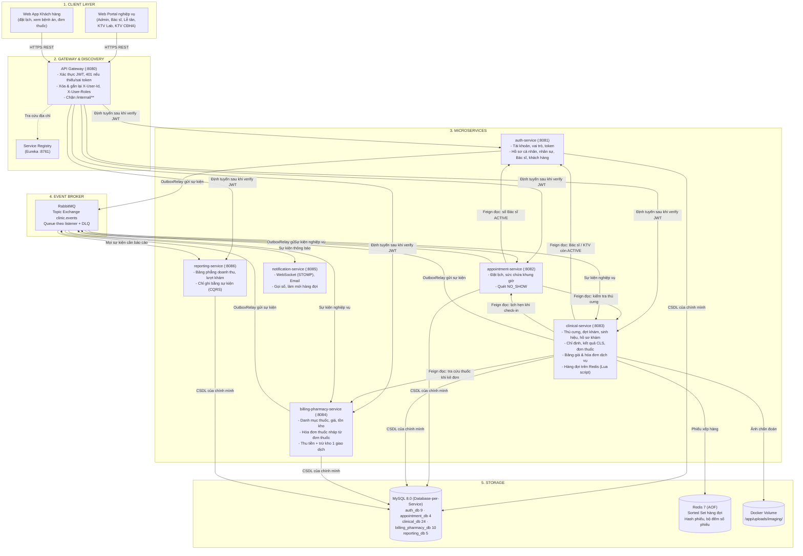
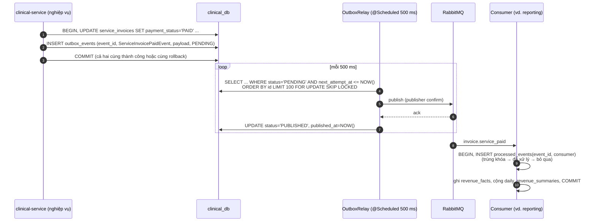
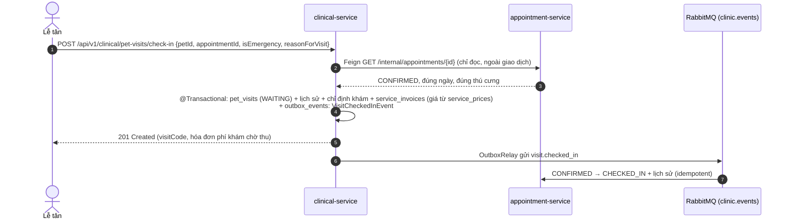
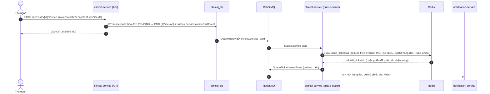
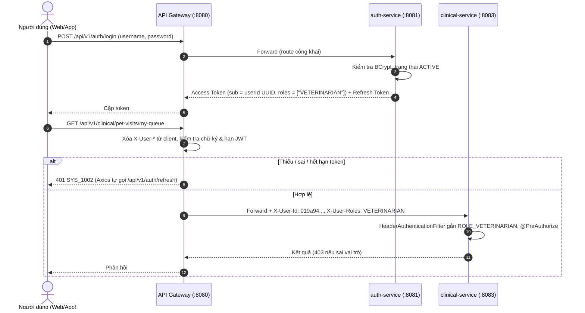

# TÀI LIỆU THIẾT KẾ KIẾN TRÚC HỆ THỐNG MICROSERVICES
## HỆ THỐNG QUẢN LÝ PHÒNG KHÁM THÚ Y (VET CLINIC MANAGEMENT SYSTEM)

> **Phiên bản:** 4.0 (18/11/2026) – đồng bộ lược đồ CSDL v4.0 (52 bảng, 5 CSDL logic + Redis), thiết kế lại theo nhận xét chi tiết của GVHD.  
> **Thay đổi chính so với v3.0:** thêm `reporting-service` (CQRS read model) và Redis (hàng đợi); Transactional Outbox ở mọi service phát sự kiện; đơn thuốc chuyển về `clinical-service`, chốt ca phát `PrescriptionCreatedEvent` để `billing-pharmacy-service` tạo hóa đơn thuốc nháp; khóa chính UUIDv7; cột snapshot chống N+1; xóa mềm dữ liệu danh mục; ảnh lưu `file_key`.  
> **Mục tiêu:** chuẩn hóa ranh giới dịch vụ (Bounded Context), cơ chế toàn vẹn dữ liệu liên dịch vụ, luồng sự kiện bất đồng bộ và cách giải quyết các bài toán phân tán thực tế.  
> **Tài liệu này là nguồn chuẩn** cho danh mục service, danh mục sự kiện RabbitMQ và danh mục lời gọi OpenFeign; `QUY_CHUAN_THIET_KE_VA_LAP_TRINH_BACKEND_SPRINGBOOT.md` và `LICH_TRINH_XAY_DUNG_MA_NGUON_VA_HUONG_DAN_TEST.md` dùng đúng các tên ở đây.

---

## 1. Tổng quan Kiến trúc

Hệ thống theo mô hình **Microservices kết hợp Event-Driven Architecture** trên **Java 21**, **Spring Boot 4.1** (4.1.1 trở lên) và **Spring Cloud 2025.1.2 (Oakwood)** trở lên, gồm các tầng:

1. **Client:** Web Portal cho Quản trị viên / Bác sĩ / Lễ tân / KTV và Web App cho Chủ thú cưng (React).
2. **API Gateway:** Spring Cloud Gateway là cổng vào duy nhất: định tuyến, xác thực JWT, trả `401` khi thiếu / sai token, gắn thông tin người dùng vào header.
3. **Service Discovery:** Netflix Eureka.
4. **Microservices nghiệp vụ:** 4 service sở hữu dữ liệu nghiệp vụ (`auth`, `appointment`, `clinical`, `billing-pharmacy`) + `reporting-service` (mô hình đọc cho báo cáo) + `notification-service` (WebSocket / Email, không CSDL).
5. **Event Broker:** RabbitMQ, Topic Exchange `clinic.events`. Sự kiện được ghi vào bảng `outbox_events` cùng giao dịch nghiệp vụ rồi mới gửi đi (Transactional Outbox).
6. **Lưu trữ:** một MySQL 8.0 Server chứa **5 CSDL logic**; **Redis 7** giữ hàng đợi đang chạy (phiếu `WAITING` / `IN_SERVICE`); tệp ảnh CĐHA trên Docker Volume, CSDL chỉ lưu đường dẫn tương đối `file_key`.

---

## 2. Sơ đồ Kiến trúc Phân tầng



---

## 3. Phân rã Dịch vụ theo Bounded Context

Hệ thống có **6 service ứng dụng** + **2 service hạ tầng**, **52 bảng** trong 5 CSDL logic:

| Service | Cổng | CSDL | Bảng phụ trách | Trách nhiệm chính |
| :--- | :---: | :--- | :--- | :--- |
| **`service-registry`** | `8761` | – | – | Eureka Server. Không phụ thuộc `common-library`. |
| **`api-gateway`** | `8080` | – | – | Điểm vào duy nhất (WebFlux); kiểm tra JWT, trả `401`; xóa rồi gắn lại `X-User-Id`, `X-User-Roles`; chặn `/internal/**`; CORS, Rate Limiting. |
| **`auth-service`** | `8081` | `pet_clinic_auth_db` | `roles`, `users`, `user_roles`, `user_profiles`, `staff_profiles`, `veterinarian_profiles`, `pet_owner_profiles`, `refresh_tokens`, `outbox_events` (9) | Đăng nhập, BCrypt, JWT (30 phút) + Refresh Token có xoay vòng (7 ngày, lưu giá trị băm); quản lý tài khoản, vai trò (bảng danh mục, nhiều vai trò / tài khoản), hồ sơ cá nhân, hồ sơ nhân sự, hồ sơ chuyên môn Bác sĩ, hồ sơ khách hàng. Phát `UserProfileUpdatedEvent`, `UserStatusChangedEvent`. Không xóa cứng tài khoản. |
| **`appointment-service`** | `8082` | `pet_clinic_appointment_db` | `appointments`, `appointment_status_histories`, `outbox_events`, `processed_events` (4) | Đặt lịch trực tuyến; sức chứa khung giờ theo số Bác sĩ `ACTIVE`; quét `NO_SHOW`; nhận `VisitCheckedInEvent` để chuyển `CHECKED_IN`; giữ snapshot tên thú cưng / chủ nuôi. |
| **`clinical-service`** | `8083` | `pet_clinic_clinical_db` + Redis | 24 bảng: danh mục & bảng giá dịch vụ, thú cưng, đợt khám, sinh hiệu, hồ sơ khám, chỉ định, kết quả CLS, ảnh, hóa đơn dịch vụ, đơn thuốc, lịch sử phiếu, outbox, processed | Khám lâm sàng 2 pha; **bảng giá dịch vụ có lịch sử**; lập hóa đơn dịch vụ lúc chỉ định (phí khám lúc tiếp đón), thu tiền, hoàn tất ca trong giao dịch cục bộ; **kê đơn thuốc**; **vận hành hàng đợi trên Redis** (phát phiếu khi nhận `ServiceInvoicePaidEvent`, gọi, bắt đầu, kết thúc bằng Lua script) và ghi lịch sử phiếu về MySQL. |
| **`billing-pharmacy-service`** | `8084` | `pet_clinic_billing_pharmacy_db` | `medicine_categories`, `medicines`, `medicine_ingredients`, `medicine_prices`, `medicine_stocks`, `medicine_invoices`, `medicine_invoice_items`, `inventory_transactions`, `outbox_events`, `processed_events` (10) | Danh mục thuốc (thành phần, quy cách), **bảng giá thuốc có lịch sử**, tồn kho; nhận `PrescriptionCreatedEvent` → **tạo hóa đơn thuốc nháp**; thu tiền + trừ kho + ghi nhật ký trong 1 giao dịch; nhập kho / cân chỉnh kho. |
| **`reporting-service`** | `8086` | `pet_clinic_reporting_db` | `visit_facts`, `revenue_facts`, `daily_revenue_summaries`, `doctor_daily_performances`, `processed_events` (5) | Mô hình đọc cho báo cáo: lắng nghe sự kiện, dựng bảng phẳng; cung cấp API báo cáo doanh thu, lượt khám, hiệu suất Bác sĩ cho Quản trị viên. Không gọi service khác, không service nào đọc CSDL này. |
| **`notification-service`** | `8085` | – (In-Memory WebSocket Broker) | – | Đẩy WebSocket (STOMP) tới màn hình Bác sĩ / Lễ tân / KTV / sảnh (gọi số, làm mới hàng đợi) và Email / thông báo ứng dụng cho khách. Không SMS. |

---

## 4. Chiến lược Cơ sở dữ liệu

### 4.1. Một MySQL Server – 5 CSDL logic
- Mỗi service chỉ kết nối CSDL của mình, không JOIN chéo CSDL. Một container MySQL 8.0 khởi tạo 5 database bằng `schema_init.sql`.
- **Khóa chính:** UUIDv7 `BINARY(16)` cho thực thể nghiệp vụ (sinh ở ứng dụng bằng `@UuidGenerator(style = VERSION_7)`), `BIGINT AUTO_INCREMENT` cho dữ liệu chỉ thêm, `SMALLINT` cho danh mục (chi tiết: `THIET_KE_CO_SO_DU_LIEU_ERD.md` Mục 1.2). Nhờ id sinh trước khi INSERT, service ghi được id vào dòng outbox ngay trong cùng giao dịch.
- **Khóa ngoại liên service:** không có `FOREIGN KEY` vật lý giữa 2 CSDL; dùng khóa ngoại logic `BINARY(16)` có index, kiểm tra bằng Feign chỉ đọc lúc tạo.
- **Xóa mềm:** tài khoản, dịch vụ, thuốc, thú cưng không bị xóa cứng, nên khóa ngoại logic cũ luôn tra được; giao diện hiện "Đã khóa" / "Ngừng sử dụng".
- **Snapshot:** tên hiển thị của dữ liệu thuộc service khác được chụp lên bản ghi (`doctor_name_snapshot`, `owner_name_snapshot`, `medicine_name_snapshot`...) và cập nhật qua sự kiện, để danh sách không phải gọi chéo N lần.
- **Không lưu giá trị dẫn xuất** trong CSDL giao dịch (tổng tiền tính bằng VIEW). Báo cáo tổng hợp đọc từ `pet_clinic_reporting_db` (mục 5.6).

### 4.2. Redis cho hàng đợi
- Phiếu xếp hàng là dữ liệu vận hành, đổi liên tục trong ngày. Redis giữ Sorted Set cho từng hàng đợi (`score` = ưu tiên + thời điểm phát), Hash cho từng phiếu, bộ đếm `INCR` cho số phiếu. Mọi thao tác thay đổi phiếu chạy bằng **Lua script** nên nguyên tử, không có xung đột phiên bản như bảng `queue_tickets` có khóa lạc quan ở v3.0.
- MySQL vẫn là nguồn sự thật của trạng thái nghiệp vụ (đợt khám, dịch vụ, hóa đơn). Khi phiếu kết thúc, một dòng `queue_ticket_histories` được ghi về MySQL. Redis bật AOF; nếu mất dữ liệu, `QueueRebuildJob` dựng lại hàng đợi từ MySQL.

---

## 5. Giao tiếp giữa các Dịch vụ

### 5.1. Đồng bộ (OpenFeign) – **chỉ dùng để ĐỌC**

Không service nào ghi dữ liệu vào service khác qua Feign; endpoint nội bộ có tiền tố `/internal/**` (Gateway chặn từ bên ngoài); lời gọi Feign đặt **ngoài** `@Transactional`, có timeout 2 giây và Circuit Breaker (Resilience4j).

| Service gọi | Service được gọi | Endpoint nội bộ | Mục đích |
| :--- | :--- | :--- | :--- |
| `appointment-service` | `auth-service` | `GET /internal/users/active-doctors/count` | Sức chứa khung giờ ($Capacity_{slot} = N_{active} \times 2$). |
| `appointment-service` | `clinical-service` | `GET /internal/pets/{id}` | Kiểm tra thú cưng tồn tại, thuộc đúng chủ nuôi; lấy tên để chụp snapshot. |
| `clinical-service` | `auth-service` | `GET /internal/users/{id}`, `GET /internal/users/doctors?status=ACTIVE` | Khi phân công / chuyển Bác sĩ: kiểm tra người được chọn có vai trò `VETERINARIAN` và đang `ACTIVE` (nguồn đúng tại thời điểm ghi, không dựa vào snapshot); lấy họ tên, `room_number`. |
| `clinical-service` | `appointment-service` | `GET /internal/appointments/{id}` | Khi check-in: lịch đang `CONFIRMED`, đúng ngày, đúng thú cưng. |
| `clinical-service` | `billing-pharmacy-service` | `GET /internal/medicines?keyword=&active=true`, `GET /internal/medicines/{id}` | Khi kê đơn: tìm thuốc đang kinh doanh, lấy tên, đơn vị, tồn kho tham khảo để chụp snapshot lên `prescription_items`. |
| `clinical-service` | `billing-pharmacy-service` | `GET /internal/medicine-invoices/status?prescriptionId=` | Khi mở lại hồ sơ (T14): hóa đơn thuốc của đơn đã `PAID` thì không cho sửa đơn thuốc; còn `PENDING` thì cho sửa, chốt lại sẽ phát `PrescriptionCreatedEvent` mới và billing dựng lại hóa đơn nháp. |

> Đã bỏ so với v3.0: `billing-pharmacy → clinical GET /internal/pet-visits/{id}/summary` (kiểm tra quyền kê đơn). Đơn thuốc nay nằm ở clinical nên quyền kê / sửa đơn được kiểm tra nội bộ; hóa đơn thuốc chỉ được tạo từ sự kiện chốt ca nên không cần kiểm tra trạng thái đợt khám.

### 5.2. Bất đồng bộ (RabbitMQ) – Danh mục sự kiện chuẩn v4.0

- **Exchange:** Topic Exchange `clinic.events`. **Routing key:** `<miền>.<sự_kiện>`.
- **Queue:** mỗi listener một queue (`<service>.<listener>`), kèm Dead Letter Queue `<queue>.dlq`; retry 3 lần với thời gian chờ tăng dần trước khi vào DLQ.
- **Phát:** qua Transactional Outbox (mục 5.3). **Nhận:** idempotent bằng bảng `processed_events` (hoặc khóa chống trùng trên Redis với listener hàng đợi).
- **Payload chung:** `eventId` (UUIDv7), `eventType`, `occurredAt`, `aggregateId` + dữ liệu riêng.

| Sự kiện | Routing key | Producer | Consumer → hành động |
| :--- | :--- | :--- | :--- |
| `UserProfileUpdatedEvent` | `user.profile_updated` | auth | **clinical:** cập nhật `pets.owner_*_snapshot`, `pet_visits.doctor_name_snapshot`; **appointment:** cập nhật `owner_*_snapshot`; **reporting:** cập nhật tên trong `visit_facts`, `doctor_daily_performances`. |
| `UserStatusChangedEvent` | `user.status_changed` | auth | **clinical:** Bác sĩ chuyển `LOCKED` / `INACTIVE` → các phiếu `WAITING` của Bác sĩ đó chuyển sang hàng đợi `UNASSIGNED`, gỡ `doctor_id` của đợt khám `WAITING`; **notification:** báo Lễ tân phân công lại. |
| `AppointmentBookedEvent` | `appointment.booked` | appointment | **notification:** gửi mã lịch hẹn cho khách. |
| `AppointmentStatusChangedEvent` | `appointment.status_changed` | appointment | **notification:** báo lịch được xác nhận / từ chối / hủy. |
| `AppointmentNoShowEvent` | `appointment.no_show` | appointment | **notification:** báo lịch bị đánh dấu vắng mặt. |
| `PetUpdatedEvent` | `pet.updated` | clinical | **appointment:** cập nhật `pet_name_snapshot`; **reporting:** cập nhật `visit_facts.pet_name`. |
| `VisitCheckedInEvent` | `visit.checked_in` | clinical | **appointment:** `CONFIRMED → CHECKED_IN`; **clinical (queue-issuer):** nếu `isEmergency` → phát phiếu `DOCTOR` `priority = 2`; **reporting:** tạo dòng `visit_facts`; **notification:** thêm mục "Chờ thu phí khám" ở màn hình Thu ngân. |
| `ServiceInvoicePaidEvent` | `invoice.service_paid` | clinical | **clinical (queue-issuer):** với các hóa đơn của nhóm có `queue_type` (khám, XN, CĐHA) → phát phiếu trên Redis (gộp các dịch vụ cùng phòng của lần thu thành 1 phiếu); **reporting:** ghi `revenue_facts` (SALE), cộng `daily_revenue_summaries`, `doctor_daily_performances`; **notification:** in phiếu thu. Payload: `visitId`, `cashierId`, danh sách hóa đơn (`invoiceId`, `serviceId`, mã, tên, nhóm, `queueType`, số lượng, tiền). |
| `ServiceInvoiceRefundedEvent` | `invoice.service_refunded` | clinical | **reporting:** ghi dòng `REFUND` (âm); **notification:** báo khách đã hoàn tiền. |
| `QueueTicketIssuedEvent` | `queue.ticket_issued` | clinical (gửi trực tiếp sau Lua script) | **notification:** làm mới hàng đợi Bác sĩ / Lab / CĐHA; gửi số phiếu, số phòng tới ứng dụng khách. Payload: `ticketId`, `queueType`, `ticketNo`, `visitId`, `doctorId`, `priority`. |
| `PatientCalledEvent` | `visit.patient_called` | clinical (gửi trực tiếp) | **notification:** hiển thị gọi số trên màn hình sảnh, báo khách vào phòng. Phát mỗi lần bấm "Gọi" / "Gọi lại"; payload có `ticketNo`, `roomNumber`, `calledCount`. |
| `ParaclinicalResultsReadyEvent` | `visit.results_ready` | clinical | **clinical (queue-issuer):** phát phiếu `DOCTOR` `priority = 1` cho Bác sĩ khám chính; **notification:** huy hiệu "Có kết quả", báo khách chờ tại sảnh. |
| `PrescriptionCreatedEvent` | `prescription.created` | clinical | **billing-pharmacy:** tạo `medicine_invoices` `PENDING` (nháp) + `medicine_invoice_items` theo đơn, chụp tên khách / thú cưng / Bác sĩ. Phát khi Bác sĩ chốt ca (đơn thuốc bị khóa từ đây). Payload: `prescriptionId`, `visitId`, `customerName`, `customerPhone`, `petName`, `doctorName`, các dòng (`medicineId`, `quantity`). |
| `VisitCompletedEvent` | `visit.completed` | clinical | **reporting:** cập nhật `visit_facts` (`completed_at`, Bác sĩ), tăng `completed_visits`; **notification:** gửi phiếu thu điện tử, báo bệnh án đã có trên Portal. |
| `VisitCancelledEvent` | `visit.cancelled` | clinical | **reporting:** cập nhật trạng thái, tăng `cancelled_visits`; **notification:** báo các màn hình liên quan. |
| `MedicineInvoicePaidEvent` | `pharmacy.medicine_invoice_paid` | billing-pharmacy | **reporting:** ghi `revenue_facts` (MEDICINE); **notification:** gửi hóa đơn thuốc và hướng dẫn dùng thuốc. Không làm đổi trạng thái đợt khám. |
| `MedicineLowStockEvent` | `pharmacy.low_stock` | billing-pharmacy | **notification:** cảnh báo Quản trị viên khi `quantity_on_hand <= min_stock_alert`. |

**Vì sao `QueueTicketIssuedEvent` và `PatientCalledEvent` được gửi trực tiếp, không qua outbox:** hai sự kiện này sinh ra từ thao tác trên Redis (không có giao dịch MySQL để ghi outbox cùng) và chỉ dùng để làm mới màn hình. Nếu một sự kiện bị mất, màn hình vẫn đúng ở lần tải lại kế tiếp (client gọi lại API hàng đợi khi kết nối WebSocket lại và mỗi 30 giây). Mọi sự kiện làm thay đổi dữ liệu ở service khác đều đi qua outbox.

### 5.3. Transactional Outbox (nhận xét #2 của GVHD)

Vấn đề của v3.0: sự kiện gửi ở `AFTER_COMMIT`. Nếu service sập hoặc RabbitMQ mất kết nối ngay sau commit, sự kiện mất vĩnh viễn (ví dụ thu tiền xong nhưng không bao giờ có phiếu xếp hàng, hoặc đơn thuốc không có hóa đơn nháp).



- **Bảo đảm:** at-least-once (sự kiện có thể đến 2 lần nếu relay gửi xong mà chưa kịp đánh dấu) + consumer idempotent = hiệu quả như exactly-once.
- **Lỗi gửi:** tăng `attempt_count`, `next_attempt_at` lùi dần (1s, 2s, 4s... tối đa 5 phút); quá 10 lần → `FAILED`, hiện ở trang quản trị để gửi lại.
- **Thứ tự:** relay đọc theo `id` tăng dần, mỗi service một relay, nên sự kiện của cùng một đợt khám đi đúng thứ tự phát sinh.
- **Dọn dẹp:** dòng `PUBLISHED` quá 7 ngày bị xóa định kỳ.

### 5.4. Luồng Check-in liên service



### 5.5. Luồng Thu tiền → Phát phiếu xếp hàng trên Redis



- Phiếu thường xuất hiện trong hàng đợi chưa tới 1 giây sau khi thu tiền. Màn hình Thu ngân in phiếu thu ngay; số phiếu hiện trên ứng dụng khách và màn hình sảnh khi phiếu được phát.
- **Redis gặp sự cố:** việc thu tiền vẫn thành công (chỉ ghi MySQL); sự kiện được RabbitMQ giữ và thử lại cho đến khi Redis hoạt động lại, nên không mất lượt xếp hàng nào.
- **Thứ tự công bằng:** `score` dùng thời điểm thu tiền (`paidAt` trong payload), không dùng thời điểm phát, nên trễ xử lý không làm khách bị tụt hạng.

### 5.6. Luồng Chốt ca → Hóa đơn thuốc nháp

1. Bác sĩ chốt ca: trong một giao dịch, đợt khám `IN_PROGRESS → WAITING_PAYMENT`, khóa `medical_records` và `prescriptions`, ghi outbox `PrescriptionCreatedEvent` (nếu có đơn) và các thay đổi khác.
2. `billing-pharmacy-service` nhận sự kiện, kiểm tra `processed_events`, tạo `medicine_invoices` `PENDING` với `prescription_id` (UNIQUE: nhận trùng không tạo hóa đơn thứ hai) và các dòng `medicine_invoice_items` (`prescribed_quantity = quantity` = số kê, giá lấy từ `medicine_prices` đang hiệu lực).
3. Tại quầy, Thu ngân hỏi khách mua những thuốc nào: đổi số lượng (được nhiều hơn / ít hơn số kê, không vượt tồn kho – BR-32) hoặc bỏ dòng, rồi thu tiền → `PAID` + trừ `medicine_stocks` + ghi `inventory_transactions` trong một giao dịch. Khách mua ngoài → `CANCELLED`.
4. Bác sĩ mở lại hồ sơ (T14) khi hóa đơn thuốc còn `PENDING`: sửa đơn, chốt lại → `PrescriptionCreatedEvent` mới (`eventId` khác) → billing dựng lại các dòng của hóa đơn nháp. Hóa đơn đã `PAID` thì clinical không cho sửa đơn (kiểm tra bằng Feign đọc).

### 5.7. Báo cáo qua reporting-service (nhận xét #1 của GVHD)

- v3.0 làm báo cáo doanh thu tổng bằng cách gọi API của nhiều service rồi cộng ở ứng dụng; báo cáo theo Bác sĩ phải gọi `auth-service` để lấy tên từng người (N+1).
- v4.0: `reporting-service` nhận các sự kiện đợt khám và thanh toán, ghi vào bảng phẳng đã có sẵn tên, nhóm, số tiền. Báo cáo chỉ là một truy vấn `SELECT ... GROUP BY` trên một CSDL, không ảnh hưởng hiệu năng của các service đang phục vụ khám bệnh.
- Dữ liệu báo cáo trễ vài giây so với giao dịch (chấp nhận được với báo cáo quản trị). Nếu cần dựng lại, xóa các bảng reporting và phát lại sự kiện từ outbox (giữ 7 ngày) hoặc chạy job đồng bộ ban đầu đọc dữ liệu qua API nội bộ.

---

## 6. Giao dịch và Toàn vẹn dữ liệu

### 6.1. Tiền và kho chỉ dùng giao dịch cục bộ, không cần Saga

| Nghiệp vụ | Service | Ghi trong cùng một giao dịch |
| :--- | :--- | :--- |
| Tiếp đón + lập hóa đơn phí khám | clinical | `pet_visits`, `pet_visit_status_histories`, `visit_service_details`, `service_invoices`, `outbox_events` |
| Bác sĩ bắt đầu khám | clinical | `pet_visits` (`IN_PROGRESS`), `medical_records` (tạo), lịch sử; sau commit: Lua `start_ticket` |
| Ghi sinh hiệu / hồ sơ khám | clinical | `vital_signs` / `medical_records` (`@Version`) |
| Chỉ định dịch vụ + lập hóa đơn | clinical | `visit_service_details`, `service_invoices`, `visit_service_detail_histories`, `pet_visits`, `queue_ticket_histories` (phiếu Bác sĩ `DONE`) |
| Thu phí khám / XN / CĐHA | clinical | `service_invoices`, `outbox_events` (`ServiceInvoicePaidEvent` → phát phiếu) |
| Hủy dịch vụ + hủy / hoàn hóa đơn | clinical | `visit_service_details`, `service_invoices`, `outbox_events` (`ServiceInvoiceRefundedEvent` nếu hoàn); sau commit: Lua gỡ dịch vụ khỏi phiếu |
| Chốt ca | clinical | `pet_visits`, lịch sử, `queue_ticket_histories`, `outbox_events` (`PrescriptionCreatedEvent`) |
| Thu hóa đơn cuối + hoàn tất ca | clinical | `service_invoices`, `pet_visits`, lịch sử, `outbox_events` (`ServiceInvoicePaidEvent`, `VisitCompletedEvent`) |
| Thu tiền thuốc + trừ kho | billing-pharmacy | `medicine_invoices`, `medicine_stocks`, `inventory_transactions`, `outbox_events` |
| Đổi giá dịch vụ / thuốc | clinical / billing-pharmacy | đóng dòng giá đang mở (`effective_to`) + thêm dòng mới |

- **Thuốc và kho chung CSDL:** trừ kho bằng `UPDATE medicine_stocks SET quantity_on_hand = quantity_on_hand - :qty WHERE medicine_id = :id AND quantity_on_hand >= :qty`; thiếu thuốc thì rollback toàn bộ, hóa đơn giữ `PENDING`.
- **Hóa đơn dịch vụ và đợt khám chung CSDL:** thu hóa đơn cuối và chuyển `COMPLETED` là một giao dịch.

### 6.2. Nhất quán sau (Eventual Consistency) – chỉ ở những chỗ không làm sai tiền

| Điểm nhất quán sau | Độ trễ thường gặp | Vì sao chấp nhận được |
| :--- | :--- | :--- |
| Lịch hẹn `CHECKED_IN` sau khi tạo đợt khám | < 1 giây | Đếm sức chứa tính cả `CONFIRMED` và `CHECKED_IN` |
| Phiếu xếp hàng xuất hiện sau khi thu tiền | < 1 giây | Tiền đã ghi chắc chắn; sự kiện không mất nhờ outbox; thứ tự theo thời điểm thu |
| Hóa đơn thuốc nháp sau khi chốt ca | < 1 giây | Khách còn phải ra quầy; màn hình Thu ngân tự làm mới |
| Snapshot tên sau khi sửa hồ sơ | vài giây | Chỉ ảnh hưởng hiển thị |
| Báo cáo sau giao dịch | vài giây | Báo cáo quản trị không cần tức thời |
| Bác sĩ bị khóa → gỡ khỏi hàng đợi | < 1 giây | Phân công mới luôn kiểm tra trạng thái Bác sĩ qua Feign tại thời điểm ghi |

### 6.3. Chống cập nhật đồng thời
- **Hàng đợi (Redis):** Lua script nguyên tử; `start_ticket.lua` kiểm tra phiếu còn `WAITING` và (với hàng đợi Bác sĩ) Bác sĩ chưa có phiếu `IN_SERVICE` khác. Hai người bấm cùng lúc thì một người nhận `CLIN_1313` (phiếu không còn ở trạng thái chờ). Không còn khóa lạc quan trên phiếu.
- **Khóa lạc quan (`@Version`)** trên `pet_visits`, `medical_records`, `visit_service_details`, `service_invoices`, `medicine_invoices`, `medicine_stocks`, `appointments`, `users`: bấm đúp hoặc hai người cùng sửa → một giao dịch thành công, giao dịch kia nhận `SYS_1005`.
- **Ràng buộc CSDL:** `service_invoices.visit_service_detail_id UNIQUE`, `medicine_invoices.prescription_id UNIQUE`, `queue_ticket_histories.ticket_id UNIQUE`, `processed_events` PK, `CHECK (quantity_on_hand >= 0)`.

---

## 7. Bảo mật & Xác thực



- JWT tự triển khai (HMAC-SHA256) + Refresh Token lưu CSDL **dạng băm SHA-256**, có xoay vòng. Không dùng OAuth2 Authorization Server.
- Claim `roles` (danh sách, vì một tài khoản có thể nhiều vai trò) và header `X-User-Roles` (phân tách bằng dấu phẩy) chứa mã vai trò không tiền tố; tiền tố `ROLE_` thêm một lần ở `HeaderAuthenticationFilter`.
- `401` khi chưa xác thực; `403` khi sai vai trò. Tài khoản `LOCKED` / `INACTIVE` không làm mới được token.
- Ảnh CĐHA không có URL cố định: API trả URL có chữ ký HMAC và hạn 1 giờ, sinh từ `file_key`.

---

## 8. Triển khai Docker Compose

```bash
docker compose up -d
```

1. `mysql-server`: MySQL 8.0 (5 database logic, chạy `schema_init.sql` khi khởi tạo).
2. `redis`: Redis 7 (`--appendonly yes --appendfsync everysec`), volume `redis-data`; chỉ `clinical-service` kết nối.
3. `rabbitmq-broker`: RabbitMQ (Management UI cổng `15672`).
4. Volume `imaging-uploads` gắn vào `clinical-service` tại `/app/uploads/imaging/`.
5. `service-registry` (`8761`), `api-gateway` (`8080`, cổng duy nhất mở ra ngoài).
6. `auth-service` (`8081`), `appointment-service` (`8082`), `clinical-service` (`8083`), `billing-pharmacy-service` (`8084`), `notification-service` (`8085`), `reporting-service` (`8086`).

---

## 9. Câu hỏi & Trả lời chuẩn bị Bảo vệ (Defense Q&A)

| Câu hỏi từ Hội đồng | Câu trả lời |
| :--- | :--- |
| *Vì sao chọn Microservices cho phòng khám quy mô vừa? Có over-engineering không?* | "Dạ, mục tiêu là (1) làm chủ kỹ thuật phân tán (Gateway, Registry, Event-Driven, Outbox, CQRS); (2) tách ranh giới: cổng đặt lịch hướng khách co giãn độc lập với phân hệ khám nội bộ, báo cáo nặng không làm chậm quầy thu ngân; (3) em vẫn thiết kế thực dụng: dữ liệu phải đổi cùng nhau đặt cùng một service (hóa đơn dịch vụ cùng đợt khám, hóa đơn thuốc cùng kho) để tiền và kho chỉ cần giao dịch cục bộ, không cần Saga." |
| *Tại sao dùng UUID mà không dùng BIGINT tự tăng? UUID có làm chậm chỉ mục không?* | "Dạ, khóa thực thể được tham chiếu chéo service và đi trong sự kiện, nên cần duy nhất toàn hệ thống và sinh được trước khi INSERT để ghi ngay vào outbox; số tự tăng còn lộ quy mô dữ liệu và đoán được URL. Em dùng UUID phiên bản 7: 48 bit đầu là thời gian nên giá trị mới luôn lớn hơn, được chèn vào cuối chỉ mục giống số tự tăng, không gây tách trang như UUIDv4. Lưu `BINARY(16)` chỉ 16 byte. Dữ liệu chỉ thêm, nhiều dòng như lịch sử, nhật ký kho, dòng giá thì em vẫn dùng BIGINT vì không ai tham chiếu từ ngoài." |
| *Thông tin Bác sĩ, nhân viên lưu ở đâu? Vì sao tách nhiều bảng?* | "Dạ, `users` chỉ giữ thông tin đăng nhập; `user_profiles` giữ thông tin chung; mỗi loại người dùng có bảng hồ sơ riêng: `staff_profiles` (mã NV, CCCD, chức danh, bộ phận, phòng, ngày vào làm), `veterinarian_profiles` (chứng chỉ hành nghề, nơi cấp, học vị, chuyên khoa, năm hành nghề), `pet_owner_profiles` (mã khách, kênh đăng ký). Khách hàng không có cột nhân sự rỗng, Bác sĩ bắt buộc có chứng chỉ. Bảng xác thực nhỏ, đọc mỗi lần đăng nhập; hồ sơ ít đọc hơn và có thể mở rộng mà không chạm tới phần bảo mật." |
| *Giá dịch vụ, giá thuốc thay đổi thì hóa đơn cũ có bị sai không?* | "Dạ không. Giá nằm ở `service_prices` / `medicine_prices` có `effective_from`, `effective_to`; đổi giá là đóng dòng cũ, thêm dòng mới, không sửa số tiền cũ, nên tra được giá ở bất kỳ thời điểm nào. Hóa đơn chụp đơn giá và thuế suất tại lúc phát sinh, nên chứng từ đã lập không đổi. Bảng giá trả lời 'giá niêm yết thay đổi thế nào', hóa đơn trả lời 'khách đã trả bao nhiêu'." |
| *Vì sao `pet_visits` lại tách thành 3 bảng?* | "Dạ, ba nhóm thông tin do ba người nhập ở ba thời điểm: Lễ tân nhập phần hành chính lúc tiếp đón (`pet_visits`), sinh hiệu đo ở tiền trạm hoặc đầu buổi khám và có thể đo lại (`vital_signs`, nhiều dòng), Bác sĩ ghi chuyên môn suốt 2 pha (`medical_records`, 1–1). Tách ra thì bảng hành chính không bị khóa khi Bác sĩ đang lưu hồ sơ, phân quyền theo bảng rõ ràng, và lưu được nhiều lần đo thay vì ghi đè." |
| *Hàng đợi đặt ở Redis thì có mất dữ liệu không? Sao không dùng khóa bi quan trong MySQL?* | "Dạ, phiếu đổi liên tục và chỉ có ý nghĩa trong ngày. Ở MySQL với khóa lạc quan, hai thu ngân phát phiếu cùng lúc hay Bác sĩ bấm gọi đúng lúc phiếu được cập nhật thì bị lỗi xung đột; khóa bi quan `FOR UPDATE` thì hết lỗi nhưng các thao tác phải xếp hàng chờ khóa. Redis chạy mỗi Lua script trọn vẹn nên nguyên tử mà không cần khóa, lại nhanh vì ở bộ nhớ. Về mất dữ liệu: Redis bật AOF ghi mỗi giây; trạng thái nghiệp vụ (đã thu tiền, dịch vụ chưa làm, ca chờ kết quả) vẫn ở MySQL, nên nếu Redis mất dữ liệu em dựng lại hàng đợi từ MySQL bằng `QueueRebuildJob`. Phiếu kết thúc được ghi `queue_ticket_histories` để tra cứu và thống kê thời gian chờ." |
| *Thu tiền xong nhưng service sập trước khi gửi sự kiện thì sao?* | "Dạ, em dùng Transactional Outbox: dòng sự kiện được ghi vào bảng `outbox_events` trong cùng giao dịch với việc chuyển hóa đơn sang `PAID`, nên hoặc cả hai cùng có, hoặc cả hai cùng không. Tiến trình `OutboxRelay` đọc các dòng chưa gửi và gửi lại đến khi RabbitMQ xác nhận. Gửi có thể lặp, nên bên nhận ghi `processed_events` theo `eventId` trong cùng giao dịch để bỏ qua bản trùng; listener phát phiếu dùng khóa chống trùng trên Redis." |
| *Bác sĩ vừa bị khóa tài khoản nhưng clinical chưa biết, Lễ tân vẫn gán ca cho Bác sĩ đó?* | "Dạ không. Khi phân công, clinical gọi Feign đọc trạng thái Bác sĩ ngay lúc ghi (nguồn đúng là auth), không dựa vào bản sao. Sự kiện `UserStatusChangedEvent` dùng để xử lý các ca đã gán trước đó: phiếu chờ của Bác sĩ chuyển sang danh sách chờ phân công và báo Lễ tân. Tài khoản không bao giờ bị xóa cứng, nên các ca cũ vẫn hiện tên Bác sĩ kèm nhãn 'Đã khóa'." |
| *Vì sao đơn thuốc chuyển về clinical-service?* | "Dạ, kê đơn là hành vi chuyên môn của Bác sĩ trong lúc khám, cùng vòng đời với hồ sơ khám: sửa được khi đang khám, khóa khi chốt ca. Để ở billing thì mỗi lần kê phải gọi chéo để kiểm tra trạng thái ca khám. Nay `prescriptions.visit_id` là khóa ngoại thật. Khi chốt ca, clinical phát `PrescriptionCreatedEvent`, billing tự tạo hóa đơn thuốc nháp; hai bên chỉ nối với nhau qua `medicine_invoices.prescription_id`. Dòng hóa đơn trỏ thẳng `medicines` để lấy giá và trừ kho, không trỏ sang dòng đơn thuốc nữa." |
| *Báo cáo doanh thu lấy dữ liệu từ nhiều service thế nào?* | "Dạ, qua `reporting-service` theo mô hình CQRS: service này nghe các sự kiện thu tiền, hoàn tiền, hoàn tất ca và ghi vào bảng phẳng đã có tên, nhóm, số tiền. Báo cáo chỉ là một truy vấn trên một CSDL, không JOIN chéo, không gọi API hàng loạt, và không làm chậm các service đang khám bệnh. Đổi lại dữ liệu báo cáo trễ vài giây, chấp nhận được với báo cáo quản trị." |
| *Khách được vào hàng đợi trước hay sau khi thanh toán?* | "Dạ, sau khi thanh toán, giống bệnh viện. Nộp phí khám xong mới có phiếu vào hàng đợi Bác sĩ; nộp tiền XN / CĐHA xong mới có phiếu vào phòng đó; dịch vụ làm tại phòng như tiêm vắc-xin làm ngay, thu khi chốt ca. Nhóm nào thu trước, vào hàng đợi nào là thuộc tính của bảng danh mục `service_categories`. Thanh toán và hàng đợi gặp nhau qua sự kiện `ServiceInvoicePaidEvent`. Ngoại lệ: cấp cứu khám trước thu sau; ca có kết quả cận lâm sàng được phát phiếu ưu tiên không thu thêm." |
| *Vì sao bỏ kiểu ENUM?* | "Dạ, thêm một vai trò hay một nhóm dịch vụ mà phải `ALTER TABLE` là cứng nhắc. Những danh sách người quản trị cần mở rộng em làm bảng danh mục (`roles`, `service_categories`, `species`, `medicine_categories`); các trạng thái vòng đời gắn với code thì lưu `VARCHAR` và kiểm tra bằng enum Java." |
| *Ảnh X-quang lưu thế nào?* | "Dạ, CSDL chỉ lưu `file_key` là đường dẫn tương đối như `imaging/2026/11/<uuid>.jpg`. Khi trả về, ứng dụng ghép với địa chỉ kho lưu trữ hiện tại và ký URL có hạn 1 giờ. Đổi tên miền hay chuyển sang kho đối tượng chỉ cần đổi cấu hình, không phải cập nhật hàng nghìn dòng." |
| *Các service giao tiếp thế nào? Khi nào Feign, khi nào RabbitMQ?* | "Dạ, Feign chỉ để đọc dữ liệu cần ngay và có Circuit Breaker. Mọi thay đổi ở service khác đi qua RabbitMQ bằng outbox, consumer idempotent, có retry và DLQ; không service nào ghi thẳng vào dữ liệu của service khác." |
| *Xác thực, phân quyền hoạt động ra sao?* | "Dạ, JWT tự triển khai kèm Refresh Token xoay vòng (lưu giá trị băm). Gateway kiểm tra chữ ký, thiếu / hết hạn thì 401 để Frontend tự làm mới; hợp lệ thì gắn `X-User-Id`, `X-User-Roles`. Service gắn quyền `ROLE_<vai trò>` và dùng `@PreAuthorize`; sai vai trò thì 403." |

---

## PHỤ LỤC: LỊCH SỬ THAY ĐỔI

| Phiên bản / ngày | Thay đổi chính | Lý do |
| :--- | :--- | :--- |
| **4.0 (18/11/2026)** | Thêm `reporting-service` (:8086) và Redis; 5 CSDL, 52 bảng; Transactional Outbox + `processed_events`; đơn thuốc về clinical, `PrescriptionCreatedEvent` → hóa đơn thuốc nháp; bỏ Feign billing → clinical, thêm Feign clinical → billing (tra thuốc); hàng đợi trên Redis (bỏ `queue_tickets`); thêm 7 sự kiện (`UserProfileUpdatedEvent`, `UserStatusChangedEvent`, `PetUpdatedEvent`, `ServiceInvoicePaidEvent`, `ServiceInvoiceRefundedEvent`, `PrescriptionCreatedEvent`, `VisitCancelledEvent`), tổng 17; claim `roles` dạng danh sách, header `X-User-Roles`; UUIDv7; snapshot; xóa mềm; `file_key` + URL ký tạm; viết lại Q&A | Nhận xét chi tiết của GVHD (Notes.pdf và góp ý bổ sung) |
| 3.0 – cập nhật 17/11/2026 | 27 bảng, clinical 16 bảng (thêm `queue_tickets`, `queue_ticket_items`); thu tiền + phát phiếu cùng giao dịch; thêm `QueueTicketIssuedEvent` | Tách thanh toán khỏi khám, tách hàng đợi khỏi hồ sơ khám |
| 3.0 – rà soát 11/11/2026 | Hàng đợi riêng từng Bác sĩ, bỏ "Khóa ưu tiên" | Mô hình hàng đợi |
| 3.0 (10/11/2026) | Hóa đơn dịch vụ ở clinical, hóa đơn thuốc ở billing; danh mục sự kiện chuẩn; Feign chỉ đọc; 401/403; không OAuth2 | Góp ý GVHD lần 1 |
