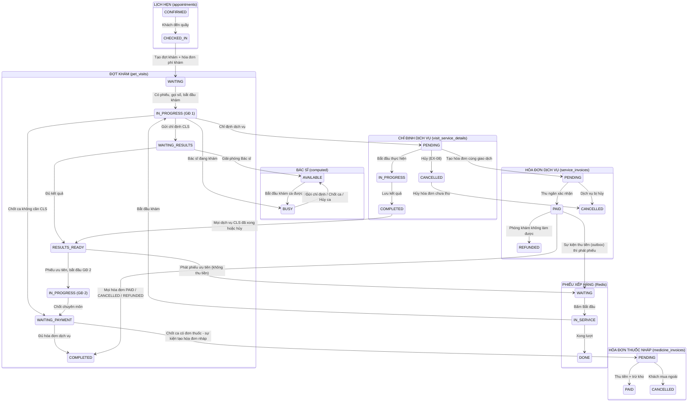
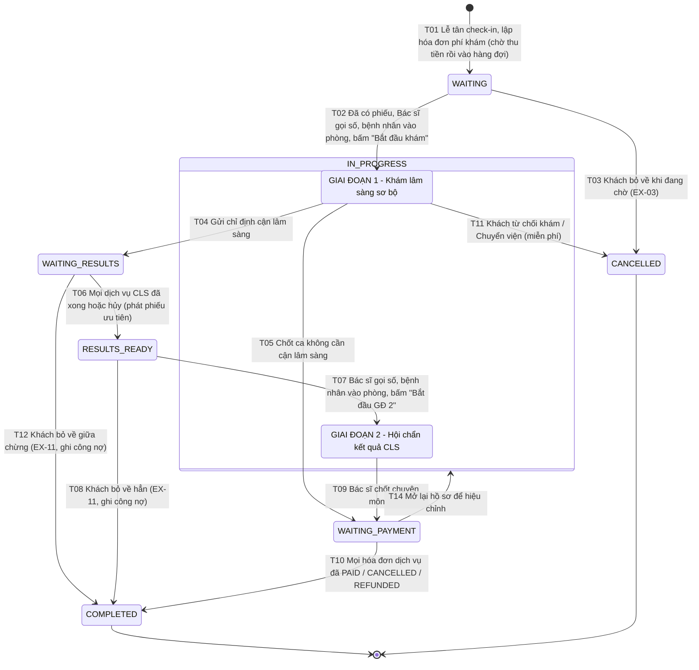
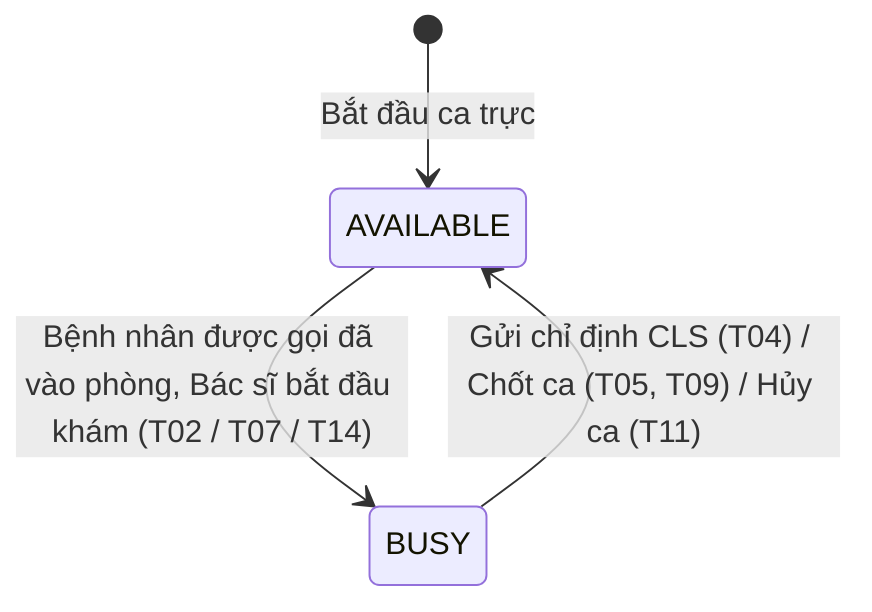
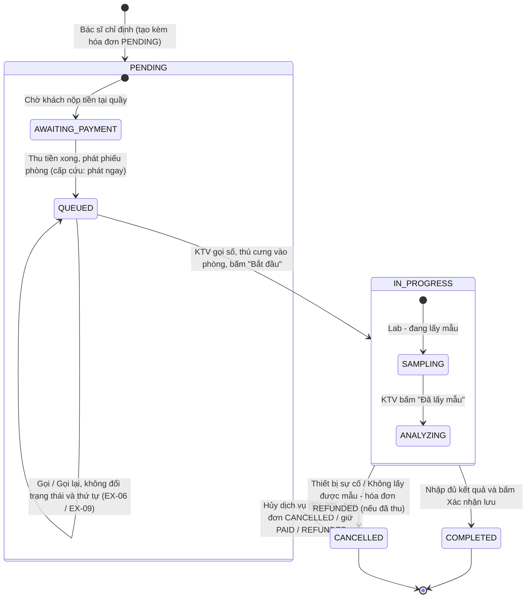
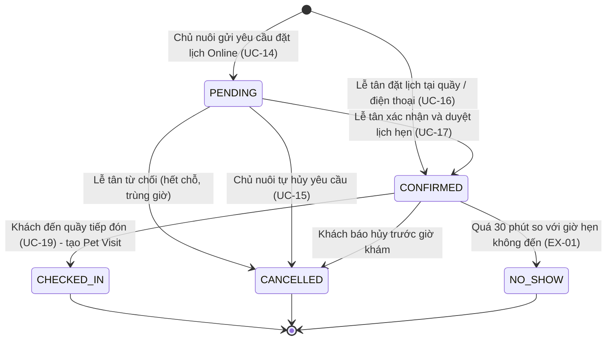
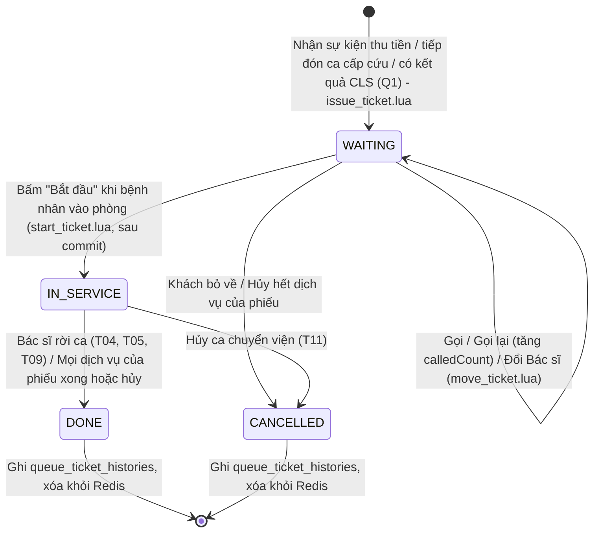

# THIẾT KẾ SƠ ĐỒ TRẠNG THÁI (STATE MACHINE DIAGRAMS)
## HỆ THỐNG QUẢN LÝ PHÒNG KHÁM THÚ Y

> **Tài liệu chuẩn UML / RUP phục vụ Báo cáo & Bảo vệ Đồ án tốt nghiệp**  
> **Phiên bản:** 4.0 (18/11/2026 – đồng bộ lược đồ CSDL v4.0: phiếu xếp hàng trên Redis, hóa đơn thuốc nháp từ sự kiện chốt ca, hồ sơ khám / sinh hiệu tách khỏi đợt khám, sự kiện qua outbox)  
> **Cập nhật 17/11/2026:** tách hàng đợi khỏi hồ sơ khám thành **phiếu xếp hàng** (SM-07; v4.0 chuyển phiếu đang chạy lên Redis); khách **thu tiền trước rồi mới vào hàng đợi** với phí khám, Xét nghiệm, CĐHA; dịch vụ làm tại phòng thu khi chốt ca.  
> **Mục tiêu:** Mô tả chi tiết không gian trạng thái, sự kiện kích hoạt (Trigger Events), điều kiện canh (Guard Conditions) và hành động chuyển đổi (State Transitions) của các thực thể nghiệp vụ cốt lõi và thực thể hỗ trợ trong hệ thống; kèm theo sơ đồ điều phối đồng bộ liên thực thể (Cross-Entity State Orchestration).

---

## MỤC LỤC TỔNG QUAN

1. [Sơ đồ Điều phối Đồng bộ Trạng thái Đa thực thể (Cross-Entity State Orchestration)](#1-sơ-đồ-điều-phối-đồng-bộ-trạng-thái-đa-thực-thể)
2. [State Machine 1: Đợt khám bệnh (Pet Visit)](#2-state-machine-1-đợt-khám-bệnh-pet-visit)
3. [State Machine 2: Trạng thái phục vụ tức thời của Bác sĩ (Doctor Serving Status)](#3-state-machine-2-trạng-thái-phục-vụ-tức-thời-của-bác-sĩ-doctor-serving-status)
4. [State Machine 3: Chi tiết Chỉ định Dịch vụ (Visit Service Detail)](#4-state-machine-3-chi-tiết-chỉ-định-dịch-vụ-visit-service-detail)
5. [State Machine 4: Lịch hẹn khám (Appointment)](#5-state-machine-4-lịch-hẹn-khám-appointment)
6. [State Machine 5: Hóa đơn Dịch vụ (Service Invoice)](#6-state-machine-5-hóa-đơn-dịch-vụ-service-invoice)
7. [State Machine 6: Hóa đơn Thuốc (Medicine Invoice)](#7-state-machine-6-hóa-đơn-thuốc-medicine-invoice)
8. [State Machine 7: Phiếu xếp hàng (Queue Ticket)](#8-state-machine-7-phiếu-xếp-hàng-queue-ticket)
9. [Tổng kết tính nhất quán toàn hệ thống](#tổng-kết-tính-nhất-quán-toàn-hệ-thống)
10. [Phụ lục: Thay đổi so với phiên bản 2.0](#phụ-lục-thay-đổi-so-với-phiên-bản-20)

### Quy ước chung áp dụng cho mọi State Machine
- **Mọi lần đổi trạng thái đều ghi 1 dòng lịch sử** trong cùng giao dịch: `appointment_status_histories`, `pet_visit_status_histories`, `visit_service_detail_histories`. Người thao tác ghi vào `changed_by_user_id` (`NULL` = hệ thống tự chuyển), lý do hủy / ghi chú ghi vào `notes` (hoặc `reason`).
- **Thời điểm bắt đầu khám, chốt ca, hoàn tất, hủy** không lưu thành cột riêng trên `pet_visits` mà lấy từ `created_at` của dòng lịch sử tương ứng.
- **Không có trạng thái đơn thuốc.** Bảng `prescriptions` (clinical) chỉ là chỉ định chuyên môn, khóa khi chốt ca; khách được quyền mua thuốc tại phòng khám hoặc mua ngoài. Việc mua thuốc thể hiện qua vòng đời của hóa đơn thuốc nháp `medicine_invoices` (SM-06).
- **Sự kiện liên service đi qua Transactional Outbox:** dòng sự kiện được ghi cùng giao dịch với bước chuyển trạng thái (cột "Hành động" ghi "outbox …"); listener ở bên nhận idempotent. Thao tác phiếu trên Redis chạy **sau commit** hoặc trong listener sự kiện.
- **Nhóm dịch vụ** (bảng danh mục `service_categories`, `services.category_id`):
  - *Dịch vụ cận lâm sàng (CLS):* `LABORATORY` → hàng đợi Phòng Xét nghiệm; `IMAGING` → hàng đợi Phòng CĐHA.
  - *Dịch vụ thực hiện tại phòng khám:* `EXAMINATION`, `VACCINATION`, `DEWORMING`, `EXTERNAL_PARASITE`, `INJECTION_INFUSION`, `PROCEDURE`, `SURGERY` – do Bác sĩ khám chính thực hiện, không đi qua hàng đợi CLS.
- **Phí khám là một dịch vụ, thu ngay khi tiếp đón.** Lúc check-in (T01), hệ thống tạo 1 dòng chỉ định dịch vụ khám (`EXAMINATION`, mặc định "Khám tổng quát", `PENDING`) kèm hóa đơn dịch vụ `PENDING`. Khách nộp phí khám tại quầy thì mới được phát phiếu vào hàng đợi Bác sĩ.
- **Tách quy trình thanh toán khỏi quy trình khám (góp ý GVHD).** Bác sĩ, KTV chỉ làm việc trên **phiếu xếp hàng** (trên Redis, SM-07), không cần biết khách đã trả tiền hay chưa. Thu ngân thu tiền xong thì hệ thống phát phiếu. Chính sách "dịch vụ nào phải thu trước" và "vào hàng đợi nào" nằm ở danh mục nhóm dịch vụ (`service_categories.requires_prepayment`, `queue_type`):

  | Nhóm dịch vụ | `requires_prepayment` | Thời điểm thu tiền | Vào hàng đợi khi nào |
  | :--- | :---: | :--- | :--- |
  | Khám lâm sàng (`EXAMINATION`) | `TRUE` | Tại quầy, ngay sau check-in | Thu xong → phiếu hàng đợi Bác sĩ |
  | Xét nghiệm (`LABORATORY`), CĐHA (`IMAGING`) | `TRUE` | Tại quầy, sau khi Bác sĩ chỉ định | Thu xong → phiếu hàng đợi phòng XN / CĐHA |
  | Làm tại phòng (`VACCINATION`, `DEWORMING`, `EXTERNAL_PARASITE`, `INJECTION_INFUSION`, `PROCEDURE`, `SURGERY`) | `FALSE` | Khi chốt ca (`WAITING_PAYMENT`) | Không qua hàng đợi, Bác sĩ làm ngay |

- **Ngoại lệ không thu trước:** ca cấp cứu (khám trước, thu sau) và ca quay lại với kết quả CLS (đã thu ở lượt trước) được phát phiếu ngay.
- **Không hoàn tiền khi khách tự bỏ.** Phí khám đã thu không hoàn trong mọi trường hợp. Khách tự bỏ về hoặc tự hủy dịch vụ đã thu thì hóa đơn giữ `PAID`. Chỉ hoàn (`REFUNDED`) khi **phòng khám không thực hiện được** dịch vụ CLS đã thu (thiết bị hỏng, không lấy được mẫu, Bác sĩ hủy chỉ định trước khi làm).

---

## 1. SƠ ĐỒ ĐIỀU PHỐI ĐỒNG BỘ TRẠNG THÁI ĐA THỰC THỂ

Trong thực tế vận hành phòng khám thú y, các thực thể dữ liệu không biến đổi độc lập mà có sự ràng buộc, đồng bộ và kích hoạt lẫn nhau theo mô hình **Sự kiện - Ràng buộc (Event-Driven State Machine)**. Điểm cốt lõi của phiên bản 3.0:
- **Hóa đơn dịch vụ sinh ra cùng lúc với chỉ định dịch vụ** (phí khám sinh lúc check-in), hủy dịch vụ chưa thu tiền thì hủy luôn hóa đơn của dịch vụ đó.
- **Thanh toán và khám chỉ gặp nhau ở một điểm: thu tiền xong thì phát phiếu xếp hàng** (`service_invoices` `PAID` → outbox `ServiceInvoicePaidEvent` → phiếu `WAITING` trên Redis). Nhờ outbox, đã thu tiền thì chắc chắn có phiếu.
- **Ca khám hoàn tất khi mọi hóa đơn dịch vụ đã `PAID`, `CANCELLED` hoặc `REFUNDED`**. Việc mua thuốc là tùy chọn, nằm ngoài điều kiện hoàn tất ca.



> **Đọc sơ đồ:** khối phiếu xếp hàng chỉ vẽ luồng chính (đủ ở SM-07). Các mũi tên trong từng khối là vòng đời của thực thể; các mũi tên nối giữa hai khối là quan hệ kích hoạt (sự kiện ở thực thể nguồn gây ra chuyển trạng thái ở thực thể đích). Hóa đơn thuốc nháp sinh từ sự kiện chốt ca (khi vào `WAITING_PAYMENT`) và có thể thu sau khi ca đã `COMPLETED`; không có mũi tên nào từ hóa đơn thuốc quay về đợt khám.

---

## 2. STATE MACHINE 1: ĐỢT KHÁM BỆNH (PET VISIT)

### 2.1. Ý nghĩa & Vai trò nghiệp vụ
Bảng `pet_visits` là **thực thể trung tâm (Core Aggregate Root)** của toàn bộ phần mềm. Vòng đời của một đợt khám được thiết kế theo mô hình **Chu kỳ Y tế Bất đồng bộ (Asynchronous Clinical Cycle)** để tối ưu hóa công suất phòng khám và loại bỏ điểm nghẽn thời gian thực.

Từ v4.0, `pet_visits` chỉ giữ **thông tin hành chính** (Lễ tân nhập) và trạng thái vòng đời; sinh hiệu ở `vital_signs`, nội dung chuyên môn ở `medical_records` (tạo ở T02, khóa ở T05 / T09); mọi thông tin xếp hàng (số phiếu, thứ tự, số lần gọi, ai đang được khám) là phiếu trên Redis (SM-07). `WAITING` nghĩa là "đã tiếp đón, chưa khám": ca có thể đang chờ nộp phí khám (chưa có phiếu) hoặc đã có phiếu trong hàng đợi.

Hai giai đoạn của `IN_PROGRESS` không phải là 2 giá trị enum khác nhau. Hệ thống phân biệt bằng lịch sử: ca đã từng đi qua `WAITING_RESULTS` thì đang ở **Giai đoạn 2**, ngược lại là **Giai đoạn 1**.

### 2.2. Sơ đồ Trạng thái (Mermaid State Machine)



### 2.3. Bảng Ma trận Chuyển đổi Trạng thái (State Transition Table)

Mọi dòng dưới đây đều kèm hành động chung: **ghi 1 dòng `pet_visit_status_histories` (`from_status`, `to_status`, `changed_by_user_id`, `notes`) trong cùng giao dịch**. Cột "Hành động" chỉ liệt kê phần phát sinh thêm.

| STT | Trạng thái nguồn | Sự kiện kích hoạt (Trigger) | Điều kiện canh (Guard Condition) | Hành động CSDL & Tác động hệ thống | Trạng thái đích |
| :---: | :--- | :--- | :--- | :--- | :--- |
| **T01** | `[*] (None)` | Lễ tân tiếp đón khách tại quầy (UC-19) | Hồ sơ thú cưng hợp lệ; thú cưng không có đợt khám nào khác đang mở (khác `COMPLETED`, `CANCELLED`); nếu đến từ lịch hẹn thì lịch phải `CONFIRMED` và đúng ngày. **Không yêu cầu cân nặng, thân nhiệt** (Bác sĩ đo trong phòng khám). | Tạo `pet_visits` (`checked_in_at = NOW()`, `receptionist_id`, `appointment_id` nếu có, `is_emergency`, `doctor_id` nếu Lễ tân chọn ngay – hệ thống gợi ý Bác sĩ ít người chờ nhất). Tạo dịch vụ khám (`visit_service_details`, nhóm `EXAMINATION`, `PENDING`) + `service_invoices` (`PENDING`, giá & thuế từ `service_prices` đang hiệu lực). Outbox `VisitCheckedInEvent`. **Chưa phát phiếu**: ca hiện trên màn hình Thu ngân ở mục "Chờ thu phí khám"; thu xong mới phát phiếu `DOCTOR` (SM-05, Q1). Ca cấp cứu: listener nhận `VisitCheckedInEvent` phát phiếu ngay `priority = 2`, phí khám thu sau. Nếu từ lịch hẹn: `appointment-service` nhận sự kiện, chuyển lịch sang `CHECKED_IN`. | `WAITING` |
| **T02** | `WAITING` | Bác sĩ đã gọi số (mục 2.4), bệnh nhân vào phòng, Bác sĩ bấm *"Bắt đầu khám"* trên phiếu (UC-22) | Ca có phiếu `DOCTOR` đang `WAITING` thuộc hàng đợi của Bác sĩ đang thao tác (nghĩa là đã nộp phí khám, hoặc là ca cấp cứu); Bác sĩ không có ca nào khác đang `IN_PROGRESS`. | Tạo `medical_records` (bệnh sử nếu nhập); ghi `vital_signs` nếu Bác sĩ nhập ngay. Dịch vụ khám `PENDING → IN_PROGRESS` (`START_PROCESSING`). Sau commit: phiếu → `IN_SERVICE` (SM-07). Mở Bệnh án điện tử. | `IN_PROGRESS` (GĐ 1) |
| **T03** | `WAITING` | Lễ tân hủy ca khám (EX-03) | Khách xin về hoặc chờ quá lâu bỏ về; bắt buộc nhập lý do. | Lý do ghi vào `notes` của dòng lịch sử. Phiếu `DOCTOR` đang `WAITING` (nếu có) → `CANCELLED`, ca rời khỏi hàng đợi. Dịch vụ khám → `CANCELLED`; hóa đơn phí khám: chưa thu → `CANCELLED`; **đã thu → giữ `PAID`, không hoàn tiền**. | `CANCELLED` |
| **T04** | `IN_PROGRESS` (GĐ 1) | Bác sĩ xác nhận chỉ định cận lâm sàng (UC-23) | Có ít nhất 1 dịch vụ `LABORATORY` hoặc `IMAGING` được chỉ định; đã có ít nhất một lần đo `vital_signs` có cân nặng và thân nhiệt (`CLIN_1308`); các dịch vụ thực hiện tại phòng đã chỉ định trong GĐ 1 đều `COMPLETED` hoặc `CANCELLED`. | Với mỗi dịch vụ CLS: tạo `visit_service_details` (`PENDING`) + `service_invoices` (`PENDING`, snapshot giá & thuế). Dịch vụ khám chuyển `COMPLETED`; phiếu `DOCTOR` → `DONE` (ghi `queue_ticket_histories`, xóa khỏi Redis sau commit). Dịch vụ CLS **chưa vào hàng đợi**: khách ra quầy nộp tiền, thu xong hệ thống phát phiếu phòng XN / CĐHA (Q1). Ca cấp cứu: phát phiếu phòng ngay (`priority = 2`), thu sau. Bác sĩ được giải phóng và gọi ca tiếp theo. | `WAITING_RESULTS` |
| **T05** | `IN_PROGRESS` (GĐ 1) | Bác sĩ chốt ca khám thông thường / tiêm phòng (UC-30_33) | Không có dịch vụ CLS; đã nhập chẩn đoán trên `medical_records` (EX-12) và có lần đo sinh hiệu (cân nặng, thân nhiệt); mọi dịch vụ thực hiện tại phòng đều `COMPLETED` hoặc `CANCELLED`. | Dịch vụ khám chuyển `COMPLETED`; phiếu `DOCTOR` → `DONE` (ghi lịch sử phiếu). Khóa `medical_records` và đơn thuốc (`prescriptions` + `prescription_items`, không có giá, không có trạng thái); nếu có đơn: outbox `PrescriptionCreatedEvent` → quầy thuốc tạo hóa đơn nháp (SM-06). Bác sĩ được giải phóng. Ca hiện trên màn hình Thu ngân để thu các dịch vụ làm tại phòng (nếu có). | `WAITING_PAYMENT` |
| **T06** | `WAITING_RESULTS` | Phòng Lab / CĐHA lưu kết quả hoặc khách hủy dịch vụ CLS (UC-25_26, EX-08) | Không còn dịch vụ CLS nào của ca ở `PENDING` hoặc `IN_PROGRESS`. | Hệ thống tự chuyển (`changed_by_user_id = NULL`). Outbox `ParaclinicalResultsReadyEvent`; listener phát **phiếu `DOCTOR` mới** trên Redis cho Bác sĩ khám chính với `priority = 1` (đứng trước ca thường, sau ca cấp cứu), người phát = hệ thống, **không thu tiền** (đã thu ở lượt trước). Hiển thị Notification Badge cho Bác sĩ. | `RESULTS_READY` |
| **T07** | `RESULTS_READY` | Bác sĩ đã gọi số (mục 2.4), bệnh nhân vào phòng, Bác sĩ bấm *"Bắt đầu Giai đoạn 2"* (UC-30) | Phiếu `DOCTOR` của ca đang `WAITING`; Bác sĩ không có ca `IN_PROGRESS` khác. | Sau commit: phiếu → `IN_SERVICE`; Bác sĩ chuyển `BUSY`. Mở giao diện Giai đoạn 2 với toàn bộ kết quả CLS. | `IN_PROGRESS` (GĐ 2) |
| **T08** | `RESULTS_READY` | Thao tác *"Đóng ca / Khách bỏ về"* (EX-11) | Lễ tân đã liên hệ xác nhận khách bỏ về, hoặc đã hết ngày làm việc. | Phiếu `DOCTOR` đang `WAITING` → `CANCELLED`. **Không tạo hóa đơn mới, không hoàn tiền.** Hóa đơn đã `PAID` (phí khám, CLS) giữ nguyên; hóa đơn của dịch vụ đã làm mà chưa thu (ca cấp cứu, dịch vụ tại phòng) giữ `PENDING` làm công nợ, thu ở lần sau. Khóa bệnh án, lưu kết quả vĩnh viễn. | `COMPLETED` (Khóa) |
| **T09** | `IN_PROGRESS` (GĐ 2) | Bác sĩ chốt đợt khám & kê đơn (UC-30_33) | Đã nhập `medical_records.final_diagnosis` (EX-12); mọi dịch vụ thực hiện tại phòng đã chỉ định trong GĐ 2 đều `COMPLETED` hoặc `CANCELLED`. | Phiếu `DOCTOR` → `DONE` (ghi lịch sử phiếu). Khóa hồ sơ khám và đơn thuốc; nếu có đơn: outbox `PrescriptionCreatedEvent` (hóa đơn thuốc nháp). Bác sĩ được giải phóng. Ca hiển thị trên màn hình Thu ngân. | `WAITING_PAYMENT` |
| **T10** | `WAITING_PAYMENT` | Thu ngân xác nhận thanh toán hóa đơn dịch vụ (UC-35) | Sau lần xác nhận này, **mọi `service_invoices` của ca đều `PAID`, `CANCELLED` hoặc `REFUNDED`**. Không xét hóa đơn thuốc. Thường chỉ còn hóa đơn dịch vụ làm tại phòng (phí khám, XN, CĐHA đã thu trước). | Thực hiện trong cùng giao dịch cục bộ của `clinical-service` với việc chuyển hóa đơn sang `PAID` (hệ thống ghi lịch sử, `changed_by_user_id` = thu ngân); outbox `ServiceInvoicePaidEvent`, `VisitCompletedEvent` (báo cáo, thông báo). Giải phóng ca khỏi màn hình Thu ngân. | `COMPLETED` |
| **T11** | `IN_PROGRESS` (GĐ 1) | Khách từ chối khám tiếp / Chuyển viện cấp cứu | Bắt buộc nhập lý do. Áp dụng khi **chưa có dịch vụ tại phòng nào `COMPLETED`**; nếu đã thực hiện dịch vụ tại phòng, Bác sĩ chốt ca bình thường theo T05 với chẩn đoán "chuyển viện". | Phiếu `DOCTOR` → `CANCELLED`. Mọi dịch vụ của ca (dịch vụ khám `IN_PROGRESS`, dịch vụ tại phòng `PENDING`) → `CANCELLED`. Hóa đơn chưa thu → `CANCELLED`; **phí khám đã thu giữ `PAID`, không hoàn**. Riêng ca cấp cứu chưa thu phí khám thì hóa đơn khám → `CANCELLED` (không thu). Ca hủy không còn hóa đơn `PENDING`. Bác sĩ được giải phóng. | `CANCELLED` |
| **T12** | `WAITING_RESULTS` | Thao tác *"Đóng ca / Khách bỏ về"* khi CLS chưa làm xong (EX-11) | Không có dịch vụ CLS nào đang `IN_PROGRESS` (KTV phải hoàn tất hoặc hủy dịch vụ đang làm trước). | Dịch vụ CLS còn `PENDING` → `CANCELLED`: hóa đơn chưa thu → `CANCELLED`, **đã thu → giữ `PAID`** (khách tự bỏ, không hoàn). Phiếu phòng XN / CĐHA đang `WAITING` → `CANCELLED`. Hóa đơn của dịch vụ đã làm mà chưa thu (ca cấp cứu) giữ `PENDING` làm công nợ. Khóa bệnh án. | `COMPLETED` (Khóa) |
| **T13** | *(Bỏ ở rà soát 11/11)* | – | – | Trước đây: GĐ 2 gọi không thấy khách thì chuyển ngược `IN_PROGRESS → RESULTS_READY`. Nay Bác sĩ gọi số **trước khi** chuyển trạng thái; gọi không thấy thì Bác sĩ gọi ca khác (mục 2.4, EX-10), ca vẫn `RESULTS_READY` và giữ nguyên vị trí, không có bước chuyển nào. Giữ số hiệu T13 để không đổi tham chiếu T14. | – |
| **T14** | `WAITING_PAYMENT` | Bác sĩ phụ trách (hoặc `ADMIN`) bấm *"Mở lại hồ sơ"* | Ca chưa `COMPLETED`; Bác sĩ không đang `BUSY` với ca khác; bắt buộc nhập lý do. Đơn thuốc: hệ thống đọc (Feign) trạng thái hóa đơn thuốc của đơn; đã `PAID` thì không được sửa đơn thuốc, còn `PENDING` thì được sửa (chốt lại sẽ phát `PrescriptionCreatedEvent` mới để cập nhật nháp). Không phát phiếu (Bác sĩ mở trực tiếp từ hồ sơ). | Lý do ghi vào `notes`. Mở khóa `medical_records` (và đơn thuốc nếu được phép). Hóa đơn dịch vụ đã `PAID` giữ nguyên; dịch vụ bị bỏ thì hủy theo SM-03 (hóa đơn chưa thu đi theo); dịch vụ thêm mới sinh hóa đơn mới. Sau khi sửa, Bác sĩ chốt lại theo T05 / T09. | `IN_PROGRESS` (giữ nguyên giai đoạn trước đó) |

### 2.4. Phiếu xếp hàng & gọi số theo từng dòng (không phải bước chuyển trạng thái của đợt khám)

Hàng đợi không đọc từ `pet_visits` mà từ **phiếu xếp hàng trên Redis** (vòng đời ở SM-07; v4.0 chuyển từ bảng `queue_tickets` sang Redis). Các thao tác dưới đây chỉ phát / đổi phiếu, trạng thái đợt khám giữ nguyên nên **không ghi** `pet_visit_status_histories`.

| Mã | Quy tắc | Chi tiết |
| :---: | :--- | :--- |
| **Q1** | Phát phiếu (thu tiền xong mới xếp hàng) | Phiếu do listener `QueueIssuerListener` của `clinical-service` phát trên Redis khi nhận sự kiện (gửi qua outbox, nên không mất): (a) `ServiceInvoicePaidEvent` có phí khám → phiếu `DOCTOR` (Bác sĩ đã chọn, hoặc `UNASSIGNED` = danh sách chờ phân công), `priority = 0`; (b) có dịch vụ XN / CĐHA → phiếu `LABORATORY` / `IMAGING` cho mỗi phòng, các dịch vụ cùng phòng của lần thu gộp vào **một phiếu**; (c) `VisitCheckedInEvent` ca cấp cứu → phát ngay, `priority = 2`, thu sau; (d) `ParaclinicalResultsReadyEvent` (T06) → phiếu `DOCTOR` mới `priority = 1`, không thu tiền. Số phiếu do `INCR queue:seq:{ngày}:{loại}` cấp (nguyên tử, không trùng). Khóa `queue:dedupe:{eventId}` bảo đảm nhận lại sự kiện không phát phiếu thứ hai. |
| **Q2** | Thứ tự hàng đợi | Mỗi hàng đợi là một Sorted Set (`queue:{ngày}:DOCTOR:{doctorId}`, `queue:{ngày}:LABORATORY:ALL`...), `score = (2 − priority) × 10^13 + thời điểm nộp tiền (ms)`; đọc tăng dần: cấp cứu → ca có kết quả CLS → ca thường theo giờ nộp tiền. Màn hình hiển thị số phiếu cạnh hai nút "Gọi" và "Bắt đầu". |
| **Q3** | Phân công / đổi Bác sĩ | Lễ tân chọn Bác sĩ lúc check-in hoặc sau đó, cho **bất kỳ Bác sĩ `ACTIVE` nào, bất cứ lúc nào** (hệ thống gợi ý Bác sĩ ít phiếu chờ nhất). Phân công kiểm tra Bác sĩ còn `ACTIVE` qua `auth-service` tại thời điểm ghi. Đổi Bác sĩ cập nhật `pet_visits.doctor_id`, `doctor_name_snapshot` rồi chuyển phiếu sang Sorted Set của Bác sĩ mới; **số phiếu và `score` giữ nguyên**, ca đến trước vẫn đứng trước. Phiếu `priority = 1` luôn thuộc Bác sĩ khám chính. |
| **Q4** | Gọi | Bác sĩ / KTV bấm *"Gọi"* ở **một phiếu bất kỳ** trong hàng đợi của mình (hoặc *"Gọi số tiếp theo"* để gọi phiếu đứng đầu): hệ thống chỉ tăng `calledCount`, ghi `lastCalledAt` trên phiếu Redis (hiển thị "Đã gọi HH:mm") và phát `PatientCalledEvent` (màn hình sảnh + ứng dụng chủ nuôi). Phiếu vẫn `WAITING`, thứ tự không đổi. Bệnh nhân vào phòng → bấm *"Bắt đầu"*: phiếu `IN_SERVICE` và kích hoạt T02 / T07 (phòng Bác sĩ) hoặc SM-03 `PENDING → IN_PROGRESS` (phòng XN / CĐHA). |
| **Q5** | Khách vắng / quay lại | Gọi 2–3 lần không thấy, Bác sĩ / KTV **bấm "Gọi" phiếu khác**; phiếu vắng giữ nguyên vị trí và trạng thái, không đếm số lần vắng. Khách quay lại thì bấm *"Gọi lại"* ở đúng phiếu đó. Hệ thống **không theo dõi** việc khách quay lại. Phiếu cấp cứu luôn giữ ưu tiên. |
| **Q6** | Ca vừa có kết quả CLS | T06 phát phiếu `priority = 1` cho Bác sĩ khám chính, nên ca có kết quả được gọi trước ca mới mà không chặn Lễ tân xếp thêm ca. |

> **Vì sao tách phiếu khỏi hồ sơ khám và đưa lên Redis:** hồ sơ khám là dữ liệu ít thay đổi, lưu lâu dài; hàng đợi đổi theo từng phút và chỉ có ý nghĩa trong ngày. v3.0 tách thành bảng `queue_tickets` nhưng vẫn dùng khóa lạc quan nên dễ xung đột khi nhiều người bấm cùng lúc (nhận xét #4); v4.0 đưa phiếu đang chạy lên Redis, chỉ lưu lịch sử phiếu đã kết thúc vào MySQL. Bản trước để `queue_order`, `last_called_at` ngay trên `pet_visits` / `visit_service_details`, nên mỗi lần gọi số phải sửa dòng bệnh án và không biết ca vào hàng đợi lúc nào (trước hay sau khi trả tiền). Phiếu xếp hàng giống tờ phiếu số thứ tự ở bệnh viện: bốc ở quầy thu ngân sau khi đóng tiền, một đợt khám có thể có nhiều phiếu nối tiếp (Bác sĩ → phòng XN → Bác sĩ lần 2). *(Cơ chế "Đẩy lùi 1 bậc" cùng `skip_count` đã bỏ từ 13/11/2026.)*

---

## 3. STATE MACHINE 2: TRẠNG THÁI PHỤC VỤ TỨC THỜI CỦA BÁC SĨ (DOCTOR SERVING STATUS)

### 3.1. Ý nghĩa & Vai trò nghiệp vụ
Hệ thống **không sử dụng cột trạng thái tĩnh trong CSDL** để quản lý bác sĩ, nhằm tránh rủi ro sai lệch dữ liệu (Desynchronization) khi có sự cố mạng. Trạng thái phục vụ của Bác sĩ được **tính toán động theo thời gian thực (Computed State)** từ các ca khám mà Bác sĩ đó đang phụ trách (`pet_visits.doctor_id`); số người chờ đếm từ phiếu xếp hàng trên Redis.

Mỗi Bác sĩ có **hàng đợi riêng** gồm các phiếu `DOCTOR` (mục 2.4) nên trạng thái Bác sĩ **không còn dùng để quyết định Lễ tân có được phân công hay không**. Lễ tân xếp ca vào hàng đợi của Bác sĩ bất cứ lúc nào; trạng thái chỉ cho biết Bác sĩ có đang khám hay không (hiển thị trên bảng điều phối và chặn Bác sĩ gọi thêm người khi đang khám dở). Còn hai trạng thái:
- `BUSY`: Bác sĩ đang khám một ca (`IN_PROGRESS`, Giai đoạn 1 hoặc 2).
- `AVAILABLE`: Bác sĩ không khám ca nào, được bấm *"Gọi"* (hoặc *"Gọi số tiếp theo"*).

Trạng thái `AVAILABLE_PRIORITY_CALLBACK` và cơ chế "Khóa ưu tiên" của bản trước được bỏ: ca vừa có kết quả CLS được phát phiếu ưu tiên (Q6), nên không cần chặn Lễ tân.

### 3.2. Sơ đồ Trạng thái (Mermaid State Machine)



### 3.3. Quy tắc Suy diễn Trạng thái (Inference Logic)

```sql
-- Công thức tính trạng thái Bác sĩ :doctor_id tại thời điểm t
SELECT CASE WHEN COUNT(*) > 0 THEN 'BUSY' ELSE 'AVAILABLE' END AS computed_doctor_status
FROM pet_visits
WHERE doctor_id = :doctor_id
  AND status = 'IN_PROGRESS';

-- Tương đương trên Redis: khóa queue:busy:{doctorId} tồn tại (phiếu IN_SERVICE)
-- Số người đang chờ của Bác sĩ (bảng điều phối, gợi ý phân công – Q3): ZCARD queue:{yyyyMMdd}:DOCTOR:{doctorId}
```

Index hỗ trợ: `idx_visits_doctor_status (doctor_id, status)`; số người chờ đọc bằng `ZCARD` trên Redis. Ca đã tiếp đón nhưng **chưa nộp phí khám** chưa có phiếu nên không tính vào số người chờ.

**Kiểm chứng công thức:**

| Tình huống của Bác sĩ | Trạng thái | Lễ tân có xếp thêm ca vào hàng đợi được không? |
| :--- | :--- | :--- |
| Chưa có ca nào | `AVAILABLE` | Được |
| Có 3 ca đang chờ trong hàng đợi, chưa gọi ai | `AVAILABLE` | Được |
| Đang khám 1 ca, 2 ca khác đang chờ | `BUSY` | Được |
| Có 1 ca vừa đủ kết quả CLS | `AVAILABLE` (phiếu `priority = 1` đứng đầu hàng đợi) | Được |
| Ca đã chọn Bác sĩ nhưng khách chưa nộp phí khám | Không ảnh hưởng (chưa có phiếu, chưa hiện trên màn hình Bác sĩ) | Được |
| Đã gọi số nhưng bệnh nhân chưa vào phòng | `AVAILABLE` (chưa bấm "Bắt đầu khám") | Được |

### 3.4. Bảng Chi tiết Chuyển đổi Trạng thái Bác sĩ

| Trạng thái nguồn | Sự kiện kích hoạt | Cơ chế nghiệp vụ & Ràng buộc bảo vệ | Trạng thái đích |
| :--- | :--- | :--- | :--- |
| `AVAILABLE` | Bác sĩ đã gọi số (Q4), bệnh nhân vào phòng, Bác sĩ bấm *"Bắt đầu khám"* (T02) hoặc *"Bắt đầu Giai đoạn 2"* (T07); hoặc mở lại hồ sơ (T14) | Bác sĩ không có ca `IN_PROGRESS` nào khác (BR-12). | `BUSY` |
| `BUSY` | Bác sĩ gửi chỉ định CLS (T04), chốt ca (T05 / T09) hoặc hủy ca chuyển viện (T11) | Ca rời trạng thái `IN_PROGRESS`; Bác sĩ gọi số tiếp theo trong hàng đợi của mình. | `AVAILABLE` |

> **Thay đổi ở rà soát 11/11:** bản trước tính ca đã phân công nhưng chưa vào phòng là `BUSY` và chỉ cho phân công khi Bác sĩ `AVAILABLE`, nên mỗi Bác sĩ chỉ giữ được 1 ca và Lễ tân phải chờ Bác sĩ rảnh mới phân tiếp. Mô hình hàng đợi riêng bỏ ràng buộc đó; Lễ tân phân bổ đều ngay khi tiếp nhận.

---

## 4. STATE MACHINE 3: CHI TIẾT CHỈ ĐỊNH DỊCH VỤ (VISIT SERVICE DETAIL)

### 4.1. Ý nghĩa & Vai trò nghiệp vụ
Bảng `visit_service_details` quản lý tiến độ thực hiện của từng dịch vụ được chỉ định cho một đợt khám. Mỗi dòng chỉ định luôn đi kèm **đúng 1 hóa đơn dịch vụ** (`service_invoices`, quan hệ 1–1), tạo trong cùng giao dịch. Bất biến: **hóa đơn `CANCELLED` ⇒ dịch vụ `CANCELLED`**; dịch vụ bị hủy thì hóa đơn chưa thu → `CANCELLED`, đã thu → giữ `PAID` (khách tự bỏ) hoặc `REFUNDED` (phòng khám không làm được). Bảng này không có cột hàng đợi: dịch vụ XN / CĐHA vào hàng đợi qua phiếu trên Redis (danh sách `vsdIds` của phiếu), lịch sử ở `queue_ticket_history_items`.

Có 3 cách một dịch vụ đi qua vòng đời:

| Nhóm | Nhóm dịch vụ (`service_categories.code`) | Người thực hiện | Đặc điểm |
| :--- | :--- | :--- | :--- |
| **Dịch vụ khám** (thu trước) | `EXAMINATION` | Bác sĩ khám chính | Hệ thống tự tạo ở T01 (`PENDING`, hóa đơn `PENDING`); khách nộp phí thì được phát phiếu `DOCTOR`; `IN_PROGRESS` ở T02; `COMPLETED` khi kết thúc GĐ 1 (T04 / T05); bị hủy ở T03 / T11. |
| **Dịch vụ tại phòng khám** (thu sau) | `VACCINATION`, `DEWORMING`, `EXTERNAL_PARASITE`, `INJECTION_INFUSION`, `PROCEDURE`, `SURGERY` | Bác sĩ khám chính | Không qua hàng đợi, không thu trước. Bác sĩ chỉ định rồi thực hiện ngay trong phòng, bấm *"Đã thực hiện"* (hệ thống ghi lần lượt `START_PROCESSING`, `COMPLETED`). Phải xong hoặc hủy trước khi Bác sĩ rời giai đoạn khám. Thu tiền khi chốt ca. |
| **Dịch vụ cận lâm sàng** (thu trước) | `LABORATORY`, `IMAGING` | KTV Xét nghiệm / KTV – Bác sĩ CĐHA | Chờ khách nộp tiền, thu xong mới vào hàng đợi phòng tương ứng (phiếu trên Redis); có các trạng thái con bên dưới. |

**Trạng thái con không lưu thành cột** mà suy ra từ `action` của dòng `visit_service_detail_histories` mới nhất:

| Trạng thái chính | Trạng thái con | `action` mới nhất | Ý nghĩa |
| :--- | :--- | :--- | :--- |
| `PENDING` | `AWAITING_PAYMENT` | `ORDERED` | Đã chỉ định, hóa đơn còn `PENDING`, chưa thuộc phiếu nào: chờ khách ra quầy nộp tiền (hiện trên màn hình Thu ngân, chưa hiện ở phòng XN / CĐHA). |
| `PENDING` | `QUEUED` | `ORDERED` | Đã thu tiền (hoặc ca cấp cứu), thuộc một phiếu `WAITING` trên Redis: chờ gọi số trong hàng đợi phòng theo Q2. KTV bấm "Gọi" ở phiếu bất kỳ; gọi không đổi thứ tự hay trạng thái (Q4, Q5). |
| `IN_PROGRESS` (Lab) | `SAMPLING` | `START_PROCESSING` | Thú cưng đang ở phòng Lab để lấy mẫu. |
| `IN_PROGRESS` (Lab) | `ANALYZING` | `SAMPLE_COLLECTED` | Đã lấy mẫu xong, thú cưng được tự do; máy đang phân tích. |

> Giá trị `SAMPLE_COLLECTED` được bổ sung vào danh sách `action` (cột `VARCHAR(50)`, không cần đổi cấu trúc bảng). Nhờ nó, phòng CĐHA biết chính xác thú cưng có **đang ở phòng Lab** hay không (EX-09): chỉ hiện huy hiệu *"Đang lấy máu bên phòng Lab"* khi ca có dịch vụ `LABORATORY` ở trạng thái con `SAMPLING`.

### 4.2. Sơ đồ Trạng thái (Mermaid State Machine) – Dịch vụ cận lâm sàng



> Với dịch vụ CĐHA, `IN_PROGRESS` không có trạng thái con (thú cưng ở phòng máy suốt quá trình chụp / siêu âm).

### 4.3. Bảng Ma trận Chuyển đổi Trạng thái Dịch vụ

Mọi dòng đều ghi 1 dòng `visit_service_detail_histories` (`from_status`, `to_status`, `action`, `changed_by_user_id`, `reason`).

| Trạng thái nguồn | Sự kiện kích hoạt | Điều kiện / Nghiệp vụ | Tác động CSDL & Hóa đơn | Trạng thái đích |
| :--- | :--- | :--- | :--- | :--- |
| `[*] (None)` | Bác sĩ chỉ định dịch vụ (T04, hoặc dịch vụ tại phòng trong GĐ 1 / GĐ 2) | Dịch vụ đang `is_active = TRUE` trong `services` | Tạo `visit_service_details` (`PENDING`, `action = ORDERED`) **và** `service_invoices` (`PENDING`, snapshot `unit_price`, `vat_rate` từ dòng `service_prices` đang hiệu lực) trong cùng giao dịch. Dịch vụ XN / CĐHA ở trạng thái con `AWAITING_PAYMENT` (cấp cứu: phát phiếu ngay → `QUEUED`). | `PENDING` |
| `[*] (None)` | Lễ tân check-in (T01) | Tự động, chỉ áp dụng cho dịch vụ khám | Tạo dòng dịch vụ khám `PENDING` và hóa đơn `PENDING` (chờ thu phí khám). | `PENDING` |
| `PENDING` (`AWAITING_PAYMENT`) | Thu ngân xác nhận thu tiền dịch vụ XN / CĐHA (SM-05) | Hóa đơn chuyển `PAID` | Không đổi `status`; outbox `ServiceInvoicePaidEvent` → listener phát phiếu phòng chứa dịch vụ này (Q1). | `PENDING` (`QUEUED`) |
| `PENDING` (`QUEUED`) | KTV bấm *"Gọi"* / *"Gọi lại"* một phiếu (EX-06, EX-09) | Phiếu đang `WAITING` | Giữ `status = PENDING`, không ghi lịch sử; chỉ tăng `calledCount`, ghi `lastCalledAt` trên phiếu Redis và phát `PatientCalledEvent` (`CALLED`). | `PENDING` (`QUEUED`) |
| `PENDING` | KTV bấm *"Bắt đầu"* trên phiếu (hoặc Bác sĩ bắt đầu khám – T02) | Thú cưng đã vào phòng lấy mẫu / lên bàn chụp / vào phòng khám | Mọi dịch vụ `PENDING` của phiếu: `status = IN_PROGRESS`, `action = START_PROCESSING`; sau commit phiếu → `IN_SERVICE` (Lua). | `IN_PROGRESS` |
| `IN_PROGRESS` (Lab, `SAMPLING`) | KTV bấm *"Đã lấy mẫu"* | Mẫu đã nạp máy | Giữ `status = IN_PROGRESS`, `action = SAMPLE_COLLECTED`. Thú cưng có thể sang phòng CĐHA. | `IN_PROGRESS` (`ANALYZING`) |
| `PENDING` | Khách xin hủy / không nộp tiền dịch vụ (EX-08) hoặc Bác sĩ bỏ chỉ định (T14) | Bắt buộc nhập lý do | `status = CANCELLED`, `action = CANCELLED`. Hóa đơn: chưa thu → `CANCELLED`; đã thu và **khách tự hủy → giữ `PAID`** (không hoàn); đã thu và **Bác sĩ hủy chỉ định → `REFUNDED`**. Dịch vụ rời phiếu; phiếu không còn dịch vụ chờ thì → `CANCELLED`. Nếu đây là dịch vụ CLS cuối cùng còn dở, kích hoạt T06. | `CANCELLED` |
| `IN_PROGRESS` | Lưu kết quả chuyên môn (UC-25_26) hoặc Bác sĩ bấm *"Đã thực hiện"* | Lab: nhập đủ các chỉ số thuộc gói (`service_lab_test_items`); CĐHA: có kết luận và tệp ảnh | `status = COMPLETED`. Lưu `lab_test_results` (kèm snapshot `min/max`) hoặc `imaging_results` + `imaging_attachments`. Hóa đơn không đổi (XN / CĐHA đã `PAID`; dịch vụ tại phòng còn `PENDING`, thu khi chốt ca). Mọi dịch vụ của phiếu xong / hủy thì phiếu → `DONE`. Kiểm tra điều kiện T06. | `COMPLETED` |
| `IN_PROGRESS` | Thiết bị gặp sự cố / Không lấy được mẫu (lỗi phía phòng khám) | Bắt buộc nhập lý do | `status = CANCELLED`; hóa đơn: đã thu → `REFUNDED` (Thu ngân trả lại tiền), chưa thu → `CANCELLED`. Kiểm tra phiếu và điều kiện T06. | `CANCELLED` |

---

## 5. STATE MACHINE 4: LỊCH HẸN KHÁM (APPOINTMENT)

### 5.1. Ý nghĩa & Vai trò nghiệp vụ
Bảng `appointments` quản lý vòng đời của yêu cầu đặt lịch hẹn trước của chủ nuôi (qua Cổng trực tuyến hoặc đặt tại quầy / điện thoại). Hệ thống duy trì liên kết lỏng (Loose Coupling) giữa Lịch hẹn (`appointment-service`) và Ca khám thực tế (`clinical-service`) qua khóa ngoại logic `pet_visits.appointment_id`. Mỗi lần đổi trạng thái đều ghi 1 dòng `appointment_status_histories`; người duyệt / người hủy ghi ở `changed_by_user_id`, lý do ghi ở `notes`.

### 5.2. Sơ đồ Trạng thái (Mermaid State Machine)



### 5.3. Bảng Ma trận Chuyển đổi Trạng thái Lịch hẹn

| Trạng thái nguồn | Sự kiện kích hoạt | Điều kiện canh (Guard) | Tác động hệ thống & CSDL | Trạng thái đích |
| :--- | :--- | :--- | :--- | :--- |
| `[*] (None)` | Khách đặt lịch qua Portal (UC-14) | Khung giờ còn chỗ: số lịch `PENDING` / `CONFIRMED` / `CHECKED_IN` có cùng `appointment_date` + `start_time` < sức chứa khung giờ (= số Bác sĩ đang hoạt động × 2). Đếm bằng index `idx_appointments_slot`. | Tạo `appointments` (`status = PENDING`, `booking_channel = ONLINE`). Tạm giữ chỗ. Ghi lịch sử (`from_status = NULL`). | `PENDING` |
| `[*] (None)` | Lễ tân tạo lịch tại quầy / điện thoại (UC-16) | Thông tin khách hàng và thú cưng hợp lệ; khung giờ còn chỗ | Tạo bản ghi `status = CONFIRMED`, `booking_channel = PHONE` hoặc `WALK_IN`. | `CONFIRMED` |
| `PENDING` | Lễ tân duyệt lịch hẹn (UC-17) | Lễ tân xác thực thành công | `status = CONFIRMED`; `changed_by_user_id` = Lễ tân duyệt. Gửi thông báo xác nhận đến Portal. | `CONFIRMED` |
| `PENDING` | Lễ tân từ chối hoặc khách tự hủy (UC-15) | Bắt buộc nhập lý do | `status = CANCELLED`; lý do ghi vào `notes`. Giải phóng chỗ của khung giờ. | `CANCELLED` |
| `CONFIRMED` | Khách báo hủy hẹn trước giờ khám | Bắt buộc nhập lý do | `status = CANCELLED`; lý do ghi vào `notes`. Giải phóng chỗ. | `CANCELLED` |
| `CONFIRMED` | Khách đến phòng khám tiếp nhận (UC-19) | Khách có mặt tại quầy đúng `appointment_date` | `clinical-service` tạo `pet_visits` (`WAITING`) với `appointment_id` = lịch này (T01) trong giao dịch của mình, sau commit phát `VisitCheckedInEvent`; `appointment-service` nhận sự kiện rồi chuyển `status = CHECKED_IN` và ghi lịch sử trong giao dịch riêng (nhất quán sau, vài trăm mili giây). | `CHECKED_IN` |
| `CONFIRMED` | Tác vụ định kỳ quét vắng mặt (EX-01) | Thời điểm hiện tại > `appointment_date` + `start_time` + 30 phút | `status = NO_SHOW`; dòng lịch sử có `changed_by_user_id = NULL` (hệ thống). Hủy giữ chỗ, nhường lượt cho khách vãng lai. | `NO_SHOW` |

---

## 6. STATE MACHINE 5: HÓA ĐƠN DỊCH VỤ (SERVICE INVOICE)

### 6.1. Ý nghĩa & Vai trò nghiệp vụ
Bảng `service_invoices` (thuộc `clinical-service`) lưu **hóa đơn riêng cho từng dịch vụ** được chỉ định (`visit_service_detail_id UNIQUE`, quan hệ 1–1). Một đợt khám có bao nhiêu dịch vụ thì có bấy nhiêu hóa đơn dịch vụ. Hóa đơn được tạo **ngay lúc chỉ định** (phí khám: lúc check-in), không đợi chốt ca. **Thời điểm thu tiền** do nhóm dịch vụ (`service_categories.requires_prepayment`) quyết định: phí khám, XN, CĐHA thu ngay để phát phiếu xếp hàng; dịch vụ làm tại phòng thu khi chốt ca. Hóa đơn và không lưu tổng tiền: số tiền phải trả tính bằng `quantity × unit_price × (1 + vat_rate) − discount_amount` (VIEW `v_service_invoice_amounts`).

Hóa đơn dịch vụ và đợt khám nằm chung một CSDL nên việc **thu hóa đơn cuối cùng + chuyển đợt khám sang `COMPLETED`** (T10) là **một giao dịch cục bộ**. Việc **phát phiếu** sau khi thu tiền đi qua sự kiện `ServiceInvoicePaidEvent` ghi outbox cùng giao dịch thu tiền (phiếu nằm trên Redis, không thể ghi chung giao dịch MySQL), nên vẫn bảo đảm đã thu tiền thì chắc chắn có phiếu.

### 6.2. Sơ đồ Trạng thái (Mermaid State Machine)

```mermaid
stateDiagram-v2
    [*] --> PENDING : Bác sĩ chỉ định dịch vụ (cùng giao dịch tạo visit_service_details)

    PENDING --> PAID : Khách thanh toán, Thu ngân bấm "Xác nhận thanh toán" (UC-35)
    PENDING --> CANCELLED : Dịch vụ chưa thu bị hủy (T03, EX-08, T11, T12, T14)
    PAID --> REFUNDED : Phòng khám không thực hiện được dịch vụ XN / CĐHA đã thu

    PAID --> [*] : Phí khám / XN / CĐHA thì phát phiếu xếp hàng; hóa đơn cuối của ca thì T10
    CANCELLED --> [*]
    REFUNDED --> [*]
```



### 6.3. Bảng Ma trận Chuyển đổi Trạng thái Hóa đơn Dịch vụ

| Trạng thái nguồn | Sự kiện kích hoạt | Điều kiện canh (Guard) | Tác động hệ thống & CSDL | Trạng thái đích |
| :--- | :--- | :--- | :--- | :--- |
| `[*] (None)` | Tạo dòng `visit_service_details` (T02, T04, dịch vụ tại phòng) | Luôn đi cùng dòng chỉ định | Sinh mã `invoice_code` duy nhất (`SINV-YYYY-XXXX`). Snapshot `unit_price`, `vat_rate` từ `services`. `discount_amount = 0`. | `PENDING` |
| `PENDING` | Thu ngân bấm *"Xác nhận thanh toán"* (UC-35) | Dịch vụ thuộc nhóm thu trước (`service_categories.requires_prepayment = TRUE`): thu được ngay khi đã chỉ định (phí khám: ca `WAITING`; XN / CĐHA: ca `WAITING_RESULTS`). Dịch vụ thu sau: ca `WAITING_PAYMENT` (hoặc đã `COMPLETED` với công nợ theo EX-11). `discount_amount` ≤ số tiền trước giảm của chính hóa đơn này (EX-14); đã nhận đủ tiền; `version` khớp (khóa lạc quan, chống thu trùng). | `payment_status = PAID`, `paid_at = NOW()`, `cashier_id = :id`; outbox `ServiceInvoicePaidEvent` (phát phiếu `DOCTOR` / phiếu phòng – Q1; ghi doanh thu ở reporting); kiểm tra T10. In phiếu thu; số thứ tự hiện ngay khi phiếu được phát (thường < 1 giây). | `PAID` |
| `PENDING` | Dịch vụ tương ứng chuyển `CANCELLED` (SM-03) | Không có thao tác hủy hóa đơn độc lập: muốn bỏ một khoản tiền thì hủy dịch vụ (sai sót sau chốt ca → mở lại hồ sơ theo T14) | `payment_status = CANCELLED` trong cùng giao dịch với dịch vụ. Không tính vào doanh thu. | `CANCELLED` |
| `PAID` | Dịch vụ XN / CĐHA đã thu bị hủy vì **lỗi phía phòng khám** (thiết bị hỏng, không lấy được mẫu, Bác sĩ hủy chỉ định trước khi làm – SM-03) | Dịch vụ chưa `COMPLETED`; bắt buộc nhập lý do. **Không áp dụng cho phí khám** và không áp dụng khi khách tự bỏ / tự hủy. | `payment_status = REFUNDED` trong cùng giao dịch với việc hủy dịch vụ; outbox `ServiceInvoiceRefundedEvent` (reporting ghi dòng âm); Thu ngân trả lại tiền cho khách. | `REFUNDED` |

> `PAID` chỉ chuyển tiếp sang `REFUNDED` trong trường hợp phòng khám không thực hiện được dịch vụ. **Phí khám đã thu không hoàn**; khách tự bỏ về hoặc tự hủy dịch vụ đã thu thì hóa đơn giữ `PAID`.

---

## 7. STATE MACHINE 6: HÓA ĐƠN THUỐC (MEDICINE INVOICE)

### 7.1. Ý nghĩa & Vai trò nghiệp vụ
**Đơn thuốc (`prescriptions`, thuộc `clinical-service` từ v4.0) không có trạng thái**: Bác sĩ kê đơn là chỉ định chuyên môn, khách hàng **được quyền mua tại phòng khám hoặc mua ngoài**. Bảng `medicine_invoices` thuộc `billing-pharmacy-service`:
- **Hóa đơn nháp tự tạo** khi nhận `PrescriptionCreatedEvent` (phát lúc Bác sĩ chốt ca, T05 / T09). Hai phân hệ chỉ nối với nhau qua `prescription_id` (khóa ngoại logic, `UNIQUE`); dòng hóa đơn trỏ thẳng `medicines`, không trỏ dòng đơn thuốc.
- Tối đa **1 hóa đơn thuốc cho 1 đơn thuốc** (`prescription_id UNIQUE` + `processed_events`) → nhận sự kiện 2 lần cũng không tạo 2 hóa đơn.
- Khách mua **nhiều hơn / ít hơn / bằng** số kê (BR-32), không vượt tồn kho; `prescribed_quantity` chỉ để đối chiếu.
- **Thu tiền và trừ kho (`medicine_stocks`) trong cùng một giao dịch.** Thiếu kho (EX-15) thì rollback toàn bộ.
- Trạng thái đợt khám **không phụ thuộc** hóa đơn thuốc.

### 7.2. Sơ đồ Trạng thái (Mermaid State Machine)

```mermaid
stateDiagram-v2
    [*] --> PENDING : PrescriptionCreatedEvent (Bác sĩ chốt ca) - tạo hóa đơn nháp theo đơn

    PENDING --> PENDING : Sửa số lượng / bỏ dòng; chốt lại sau khi mở hồ sơ (T14) thì cập nhật lại nháp
    PENDING --> PAID : Thu ngân "Xác nhận thanh toán & xuất thuốc" - trừ kho cùng giao dịch
    PENDING --> CANCELLED : Khách mua ngoài (kết thúc)

    PAID --> [*]
    CANCELLED --> [*]
```



### 7.3. Bảng Ma trận Chuyển đổi Trạng thái Hóa đơn Thuốc

| Trạng thái nguồn | Sự kiện kích hoạt | Điều kiện canh (Guard) | Tác động hệ thống & CSDL | Trạng thái đích |
| :--- | :--- | :--- | :--- | :--- |
| `[*] (None)` | Nhận `PrescriptionCreatedEvent` (T05 / T09 có đơn thuốc) | `processed_events` chưa có `eventId`; đơn chưa có hóa đơn (`prescription_id UNIQUE`) | Tạo `medicine_invoices` (`PENDING`, mã `MINV-YYYY-XXXX`, `prescription_id`, `visit_id`, snapshot tên khách / SĐT / thú cưng / Bác sĩ) và một `medicine_invoice_items` cho mỗi thuốc (`medicine_id`, `prescribed_quantity` = `quantity` = số kê, `unit_price`, `vat_rate` từ `medicine_prices` đang hiệu lực). Màn hình Thu ngân hiện hóa đơn nháp của ca. | `PENDING` |
| `PENDING` | Thu ngân bấm *"Sửa hóa đơn thuốc"* (`PUT /api/v1/billing/medicine-invoices/{id}/items`) | Hóa đơn `PENDING`, `version` khớp; mỗi dòng còn lại `quantity` ≤ tồn kho; còn ít nhất 1 dòng; `discount_amount` ≤ tổng tiền thuốc mới (EX-14). | Cập nhật / xóa dòng. Không đụng tồn kho. | `PENDING` |
| `PENDING` | Nhận lại `PrescriptionCreatedEvent` với `eventId` mới sau khi Bác sĩ mở hồ sơ (T14) và chốt lại | Hóa đơn còn `PENDING` | Dựng lại các dòng theo đơn mới (giá theo bảng giá hiện hành). Nếu hóa đơn đã `PAID` thì clinical đã chặn sửa đơn từ trước (T14). | `PENDING` |
| `PENDING` | Thu ngân bấm *"Xác nhận thanh toán & xuất thuốc"* (UC-35, UC-36) | `discount_amount` ≤ tổng tiền thuốc (EX-14); đã lấy thuốc, kiểm tra hạn dùng; `version` khớp. | Giao dịch `@Transactional`: cập nhật giá theo `medicine_prices` hiện hành; với mỗi dòng `UPDATE medicine_stocks SET quantity_on_hand = quantity_on_hand - :qty WHERE medicine_id = :id AND quantity_on_hand >= :qty`; ghi `inventory_transactions` (`EXPORT_SALE`, `quantity = -:qty`); `payment_status = PAID`, `paid_at`, `cashier_id`; outbox `MedicineInvoicePaidEvent` (+ `MedicineLowStockEvent`). | `PAID` |
| `PENDING` | Như dòng trên nhưng có câu `UPDATE` ảnh hưởng 0 dòng (EX-15) | Tồn kho không đủ tại thời điểm xác nhận | **Rollback toàn bộ**, hóa đơn giữ `PENDING`; Thu ngân sửa hóa đơn hoặc hủy để khách mua ngoài. | `PENDING` |
| `PENDING` | Khách mua ngoài | Hóa đơn chưa `PAID` | `payment_status = CANCELLED`. Tồn kho không đổi. Hủy là kết thúc; khách mua theo đơn in. | `CANCELLED` |
| `PAID` | Cố tình xác nhận lại hoặc tạo hóa đơn thứ hai (EX-16) | – | Bị chặn: hóa đơn không còn `PENDING` (và `version` đã tăng); hóa đơn mới vi phạm `prescription_id UNIQUE`. | (giữ `PAID`) |

---

## 8. STATE MACHINE 7: PHIẾU XẾP HÀNG (QUEUE TICKET – REDIS)

### 8.1. Ý nghĩa & Vai trò nghiệp vụ
Phiếu xếp hàng là **dữ liệu vận hành, đổi liên tục trong ngày**. Từ v4.0 (nhận xét #4 của GVHD), phiếu đang `WAITING` / `IN_SERVICE` **nằm trên Redis** (Sorted Set cho thứ tự từng hàng đợi, Hash cho từng phiếu); mọi thao tác thay đổi phiếu chạy bằng **Lua script nguyên tử**, nên không còn lỗi xung đột phiên bản như bảng `queue_tickets` có khóa lạc quan của v3.0. Khi phiếu **kết thúc** (`DONE` / `CANCELLED`), một dòng `queue_ticket_histories` (+ `queue_ticket_history_items`) được ghi về MySQL trong cùng giao dịch với thay đổi nghiệp vụ, rồi phiếu bị xóa khỏi Redis. Quy tắc phát phiếu, thứ tự, gọi số ở mục 2.4 (Q1–Q6).

Một ca khám có cận lâm sàng thường có 3 phiếu nối tiếp: **Bác sĩ lần 1** (sau khi nộp phí khám) → **phòng XN / CĐHA** (sau khi nộp tiền CLS) → **Bác sĩ lần 2** (`priority = 1`, không thu tiền).

### 8.2. Sơ đồ Trạng thái (Mermaid State Machine)



### 8.3. Bảng Ma trận Chuyển đổi Trạng thái Phiếu

| Trạng thái nguồn | Sự kiện kích hoạt | Điều kiện canh (Guard) | Tác động hệ thống | Trạng thái đích |
| :--- | :--- | :--- | :--- | :--- |
| `[*] (None)` | Nhận `ServiceInvoicePaidEvent` có dòng phí khám | Khóa chống trùng `queue:dedupe:{eventId}:DOCTOR` chưa có | `issue_ticket.lua`: `INCR` số phiếu ngày, `HSET` phiếu (`queueType = DOCTOR`, Bác sĩ của ca hoặc `UNASSIGNED`, `priority = 0`, người phát = Thu ngân, tên thú cưng / chủ nuôi), `ZADD` vào hàng đợi với `score` theo thời điểm thu tiền. Gửi `QueueTicketIssuedEvent` (hiển thị số phiếu). | `WAITING` |
| `[*] (None)` | Nhận `ServiceInvoicePaidEvent` có dòng XN / CĐHA | Như trên (khóa theo `eventId` + loại phòng) | Một phiếu `LABORATORY` / `IMAGING` cho mỗi phòng, chứa danh sách dịch vụ (`vsdIds`) của lần thu đó. | `WAITING` |
| `[*] (None)` | Nhận `VisitCheckedInEvent` có `isEmergency = true` / `ParaclinicalResultsReadyEvent` (T06) | Hệ thống tự phát, không thu tiền | Phiếu `DOCTOR` `priority = 2` (cấp cứu) hoặc `priority = 1` (ca có kết quả, Bác sĩ khám chính). | `WAITING` |
| `WAITING` | Bấm *"Gọi"* / *"Gọi lại"* (Q4, Q5) | Người bấm là Bác sĩ của phiếu (phiếu `DOCTOR`) hoặc KTV của phòng; Bác sĩ không có ca `IN_PROGRESS` | `HINCRBY calledCount`, `HSET lastCalledAt`; gửi `PatientCalledEvent`. Không đổi thứ tự, không ghi CSDL. | `WAITING` |
| `WAITING` | Lễ tân đổi / gỡ Bác sĩ (Q3) | Phiếu `DOCTOR`, `priority` ≠ 1; Bác sĩ đích `ACTIVE` (kiểm tra qua auth) | Giao dịch MySQL cập nhật `pet_visits.doctor_id`, `doctor_name_snapshot`; sau commit `move_ticket.lua` chuyển phiếu sang Sorted Set của Bác sĩ mới, **giữ `score` và số phiếu**. | `WAITING` |
| `WAITING` | Nhận `UserStatusChangedEvent` (Bác sĩ `LOCKED` / `INACTIVE`) | Phiếu `DOCTOR` của Bác sĩ đó | Chuyển phiếu sang `UNASSIGNED`, gỡ `doctor_id` của đợt khám `WAITING`; báo Lễ tân (BR-39). | `WAITING` |
| `WAITING` | Bấm *"Bắt đầu"* | Phòng Bác sĩ: T02 / T07 thành công trong MySQL; `start_ticket.lua` kiểm tra phiếu còn `WAITING` và Bác sĩ chưa có phiếu `IN_SERVICE` (khóa `queue:busy:{doctorId}`). Phòng XN / CĐHA: SM-03 `PENDING → IN_PROGRESS` cho mọi dịch vụ của phiếu. | `status = IN_SERVICE`, `startedAt`; phiếu rời danh sách chờ. Hai người bấm cùng lúc: một người nhận `CLIN_1313`. | `IN_SERVICE` |
| `WAITING` | Khách bỏ về (T03, T08, T12) hoặc mọi dịch vụ của phiếu bị hủy (EX-08) | – | Ghi `queue_ticket_histories` (`final_status = CANCELLED`, lý do) cùng giao dịch hủy; sau commit `finish_ticket.lua`. | `CANCELLED` |
| `IN_SERVICE` | Phiếu `DOCTOR`: T04, T05, T09. Phiếu phòng: dịch vụ cuối cùng của phiếu `COMPLETED` / `CANCELLED` | – | Ghi `queue_ticket_histories` (`final_status = DONE`, `started_at`, `ended_at`, `called_count`) cùng giao dịch; sau commit `finish_ticket.lua`. | `DONE` |
| `IN_SERVICE` | T11 (khách từ chối / chuyển viện) | – | Ghi lịch sử `CANCELLED`; xóa khỏi Redis. | `CANCELLED` |

**Ràng buộc nghiệp vụ:** mỗi đợt khám có tối đa 1 phiếu `DOCTOR` đang mở (`queue:visit:{visitId}`); mỗi Bác sĩ có tối đa 1 phiếu `IN_SERVICE`; một sự kiện thu tiền chỉ phát tối đa 1 phiếu cho mỗi loại hàng đợi (khóa chống trùng); `queue_ticket_histories.ticket_id UNIQUE` chặn ghi lịch sử 2 lần. Mất dữ liệu Redis → `QueueRebuildJob` dựng lại từ MySQL.

---

## TỔNG KẾT TÍNH NHẤT QUÁN TOÀN HỆ THỐNG

| Mã | Thực thể CSDL | Service | Cột trạng thái | Số trạng thái | Enum tham chiếu (`DANH_SACH_KIEU_ENUM_HE_THONG.md` v4.0, lưu `VARCHAR`) |
| :--- | :--- | :--- | :--- | :---: | :--- |
| **SM-01** | `pet_visits` | clinical | `status` | 7 | #9 `VisitStatus` |
| **SM-02** | *Computed Doctor* (không lưu) | clinical | `doctor_serving_status` (tính toán) | 2 | – (xem `THIET_KE_CO_SO_DU_LIEU_ERD.md`, mục Giá trị tính toán) |
| **SM-03** | `visit_service_details` | clinical | `status` | 4 (+3 trạng thái con suy ra từ lịch sử) | #10 `ServiceDetailStatus` |
| **SM-04** | `appointments` | appointment | `status` | 5 | #8 `AppointmentStatus` |
| **SM-05** | `service_invoices` | clinical | `payment_status` | 4 | #12 `PaymentStatus` |
| **SM-06** | `medicine_invoices` | billing-pharmacy | `payment_status` | 3 (không dùng `REFUNDED`) | #12 `PaymentStatus` |
| **SM-07** | Phiếu trên Redis (`ticket:{id}.status`); lịch sử `queue_ticket_histories.final_status` | clinical | `status` / `final_status` | 4 (`WAITING`, `IN_SERVICE` trên Redis; `DONE`, `CANCELLED` ở lịch sử) | #14 `TicketStatus` (loại hàng đợi: #13 `QueueType`) |

Tài liệu liên quan (cùng thư mục): [DAC_TA_USE_CASE_CORE.md](DAC_TA_USE_CASE_CORE.md) · [THIET_KE_CO_SO_DU_LIEU_ERD.md](THIET_KE_CO_SO_DU_LIEU_ERD.md) · [DANH_SACH_KIEU_ENUM_HE_THONG.md](DANH_SACH_KIEU_ENUM_HE_THONG.md) · [TONG_HOP_NGOAI_LE_VA_XU_LY_HE_THONG.md](TONG_HOP_NGOAI_LE_VA_XU_LY_HE_THONG.md)

---

## PHỤ LỤC: THAY ĐỔI SO VỚI PHIÊN BẢN 2.0

| Vị trí | Bản cũ | Bản mới | Lý do |
| :--- | :--- | :--- | :--- |
| Quy ước chung, mục 1, SM-01 (T01, T02, T04, T05, T06, T07, T09, T10, T14), mục 2.4 (Q1–Q4), 3.3, SM-06, SM-07, Tổng kết (**v4.0, 18/11/2026**) | Phiếu là bảng `queue_tickets` (khóa lạc quan), phát bởi `TicketIssuer` trong giao dịch thu tiền, `ticket_no = MAX + 1`; điều kiện chốt ca dùng `diagnosis`, `weight_at_visit`; hóa đơn thuốc do Thu ngân lập khi khách đồng ý mua, dòng ≤ số kê; enum số cũ | Phiếu trên Redis (Lua script nguyên tử, Sorted Set, `INCR` số phiếu, chống trùng theo `eventId`), phát khi nhận `ServiceInvoicePaidEvent` / `VisitCheckedInEvent` / `ParaclinicalResultsReadyEvent` qua outbox; phiếu kết thúc ghi `queue_ticket_histories`; T02 tạo `medical_records`; điều kiện dùng `vital_signs`, `medical_records.final_diagnosis`; T05 / T09 phát `PrescriptionCreatedEvent`; SM-06 bắt đầu từ hóa đơn nháp tự tạo, mua khác số kê; enum đánh số lại theo v4.0 | Nhận xét chi tiết của GVHD (#4 khóa lạc quan ở hàng đợi, #5 đơn thuốc, tách `pet_visits`) |
| Sơ đồ điều phối | `PAID → DISPENSED → COMPLETED` | Mọi hóa đơn dịch vụ `PAID` / `CANCELLED` → `COMPLETED`; hóa đơn thuốc là nhánh tùy chọn | Khách được mua thuốc ngoài; hóa đơn tách theo dịch vụ |
| SM-01 bảng chuyển trạng thái | Ghi `started_at`, `closed_at`, `completed_at`, `cancel_reason` | Ghi 1 dòng `pet_visit_status_histories` | Các cột này đã bỏ khỏi `pet_visits` (dữ liệu trùng với lịch sử) |
| SM-01 T01 | Guard "cân nặng, nhiệt độ > 0" | Bỏ; Bác sĩ nhập ở GĐ 1 (guard T04 / T05) | Cân đo do Bác sĩ thực hiện trong phòng khám |
| SM-01 T02 | – | Tự tạo dịch vụ khám + hóa đơn | Phí khám là dịch vụ; đảm bảo mọi ca có hóa đơn |
| SM-01 T08 | Tạo hóa đơn mới để ghi nợ | Giữ các hóa đơn dịch vụ đã có ở `PENDING` | Hóa đơn đã sinh lúc chỉ định |
| SM-01 T10 | Hóa đơn `PAID` **và** đơn thuốc `DISPENSED` | Mọi `service_invoices` `PAID` / `CANCELLED` | Thuốc không còn ràng buộc hoàn tất ca |
| SM-01 | `WAITING_RESULTS → CANCELLED` (mất doanh thu dịch vụ đã làm) | Thay bằng T12 `WAITING_RESULTS → COMPLETED` (ghi công nợ) | Không thất thoát tiền dịch vụ đã thực hiện |
| SM-01 | – | Thêm T13 (tạm hoãn EX-10) và T14 (mở lại hồ sơ) | Bản cũ nhắc tới nhưng thiếu chuyển trạng thái |
| SM-01 T11 | Gắn nhãn EX-03 ở sơ đồ hoạt động | Không gắn EX-03 (EX-03 là khách bỏ về ở sảnh) | Sai mã ngoại lệ |
| SM-02 công thức | Chỉ đếm `IN_PROGRESS` / `RESULTS_READY` | Đếm cả ca `WAITING` đã gán; loại ca đã hoãn khỏi Khóa ưu tiên | Chống phân công trùng; hết mâu thuẫn với EX-10 |
| SM-02 sơ đồ | `PRIORITY → AVAILABLE` bằng "Tạm hoãn" | Gọi trước (`→ BUSY`), vắng thì hoãn (`→ AVAILABLE`); thêm `AVAILABLE → PRIORITY` | Khớp công thức SQL và EX-10 |
| SM-03 | Snapshot `unit_price` vào `visit_service_details` | Tạo `service_invoices` kèm snapshot giá & thuế | `unit_price` chuyển sang hóa đơn dịch vụ |
| SM-03 | Chỉ mô tả dịch vụ Lab / CĐHA | Thêm dịch vụ khám và dịch vụ tại phòng (tiêm, thủ thuật) | Bản cũ bỏ sót |
| SM-03 | – | Trạng thái con suy ra từ `action`; thêm `SAMPLE_COLLECTED` | Phân biệt "đang lấy máu" với "máy đang chạy" cho EX-09 |
| SM-04 | `appointment_time`, `current_booked < max_capacity` | `appointment_date + start_time`; đếm lịch cùng khung giờ | Tên cột thực tế; CSDL không có cột sức chứa |
| SM-05 | 1 hóa đơn gộp / ca (`visit_id UNIQUE`), tạo lúc chốt ca | 1 hóa đơn / dịch vụ, tạo lúc chỉ định; hủy dịch vụ → hủy hóa đơn | Góp ý của GVHD |
| SM-06 | Vòng đời đơn thuốc `PRESCRIBED → DISPENSED / CANCELLED` | Vòng đời hóa đơn thuốc `PENDING → PAID (trừ kho) / CANCELLED` | Bỏ `PrescriptionStatus`; mua thuốc là tùy chọn |
| Bảng tổng kết | Enum #13, #12, #9 | Enum #8, #9 (theo danh sách v3.0) | Đánh số lại enum |
| SM-01 T11 (rà soát 10/11) | Hủy ca kể cả khi đã có dịch vụ tại phòng `COMPLETED` | Chỉ hủy khi chưa có dịch vụ tại phòng `COMPLETED`; ngược lại chốt ca T05 | Tránh hóa đơn `PENDING` treo ở ca `CANCELLED` |
| SM-01 T14 (rà soát 10/11) | Chỉ chặn sửa đơn khi hóa đơn thuốc `PAID` | Chặn khi có hóa đơn thuốc `PENDING` hoặc `PAID` | Tránh hóa đơn thuốc vượt số lượng kê |
| SM-04 (rà soát 10/11) | `CONFIRMED → CHECKED_IN` như cùng thao tác tạo đợt khám | Qua `VisitCheckedInEvent`, giao dịch riêng của `appointment-service` | Khớp Kiến trúc mục 5.3 |
| SM-06 (rà soát 10/11) | Tự chuyển `PENDING → PENDING` "sửa số lượng" không có thao tác cụ thể | Thêm thao tác "Sửa hóa đơn thuốc" (API, guard, tác động); hủy là kết thúc | EX-15 thực hiện được |
| SM-02 (rà soát 10/11) | Không có thao tác đổi / gỡ phân công | `BUSY → AVAILABLE` khi Lễ tân đổi Bác sĩ hoặc gỡ phân công ca `WAITING` | Khách tạm ra ngoài không khóa Bác sĩ |
| SM-01, mục 2.4 (rà soát 11/11) | Một hàng đợi chung ở sảnh; Lễ tân chỉ phân ca khi Bác sĩ rảnh | Mỗi Bác sĩ có hàng đợi riêng (Q1–Q5); Lễ tân xếp ca vào hàng đợi của Bác sĩ bất kỳ lúc nào; Bác sĩ "Gọi số tiếp theo"; gọi không thấy thì "Đẩy lùi 1 bậc" | Lễ tân không phải chờ Bác sĩ rảnh; phân bổ đều ngay khi tiếp nhận |
| SM-01 T06, T07, T13 (rà soát 11/11) | T06 bật Khóa ưu tiên; T07 "Mời vào phòng" chuyển ngay `IN_PROGRESS`; T13 hoãn ngược `IN_PROGRESS → RESULTS_READY` | T06 đưa ca lên đầu hàng đợi Bác sĩ; T07 chỉ chuyển khi bệnh nhân đã vào phòng; bỏ T13 (thay bằng Đẩy lùi 1 bậc) | Gọi số trước, đổi trạng thái sau như phòng CLS |
| SM-02 (rà soát 11/11) | 3 trạng thái, `BUSY` gồm ca `WAITING` đã gán; Khóa ưu tiên chặn phân công | 2 trạng thái: `BUSY` = đang khám (`IN_PROGRESS`), `AVAILABLE`; bỏ `AVAILABLE_PRIORITY_CALLBACK` | Trạng thái Bác sĩ không còn quyết định việc phân công |
| SM-03 (rà soát 11/11) | `POSTPONED` (tab Hoãn), `RECALL` (ghim ưu tiên kế tiếp) | Đẩy lùi 1 bậc (`SKIPPED`), dịch vụ vẫn ở trong hàng đợi; bỏ trạng thái con `POSTPONED`, `NEXT_IN_LINE` | Cùng cơ chế với hàng đợi Bác sĩ |
| SM-01 mục 2.4 (Q3, Q4, T13), SM-03 (cập nhật 13/11) | Q3 "Gọi số tiếp theo" chỉ gọi người đứng đầu; Q4 "Đẩy lùi 1 bậc" (`skip_count + 1`, xếp ngay sau người kế tiếp); mỗi dịch vụ CLS là một dòng hàng đợi | Q3 "Gọi" ca bất kỳ (không đổi thứ tự/trạng thái); Q4 "Khách vắng / quay lại" = gọi ca khác rồi gọi lại; dịch vụ cùng đợt khám, cùng phòng gộp thành một ca | Đẩy lùi 1 bậc làm hai ca đầu hàng đổi chỗ mãi mãi và làm ca cấp cứu mất ưu tiên; gọi theo từng dòng giống thực tế |
| Quy ước chung, SM-01, mục 2.4, SM-02, SM-03, SM-05, thêm SM-07 (cập nhật 17/11) | Phí khám tạo lúc "Bắt đầu khám"; dịch vụ CLS tự vào hàng đợi ngay khi chỉ định; hàng đợi đọc từ `pet_visits.queue_order` / `visit_service_details.queue_order`; `PAID` là trạng thái cuối | Phí khám tạo lúc check-in, **thu xong mới phát phiếu vào hàng đợi Bác sĩ**; XN / CĐHA **thu xong mới phát phiếu phòng**; dịch vụ tại phòng thu khi chốt ca; hàng đợi đọc từ `queue_tickets` (Q1–Q6, SM-07, thứ tự `priority DESC, issued_at`); T06 phát phiếu `priority = 1`; thêm `REFUNDED` khi phòng khám không làm được dịch vụ đã thu; phí khám không hoàn, khách tự bỏ không hoàn | Góp ý GVHD: tách dữ liệu hay thay đổi (hàng đợi) khỏi dữ liệu ít thay đổi (hồ sơ khám); tách quy trình thanh toán khỏi quy trình khám như bệnh viện |
