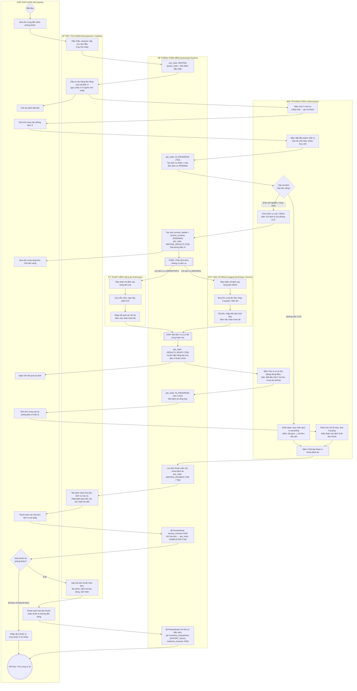
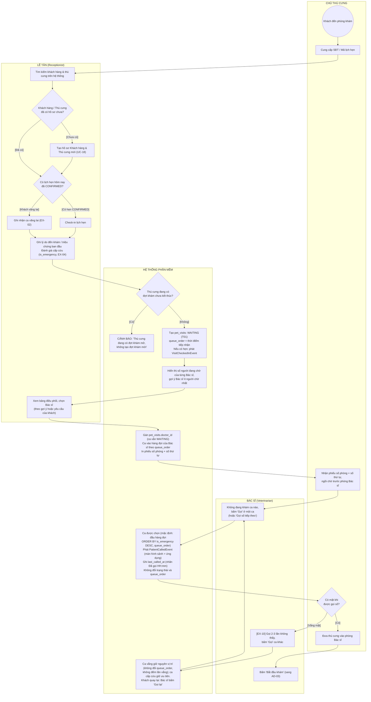
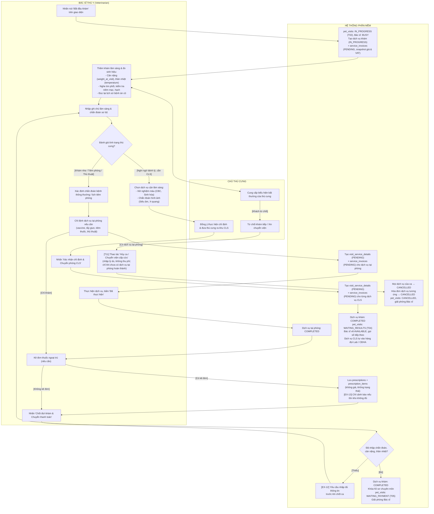
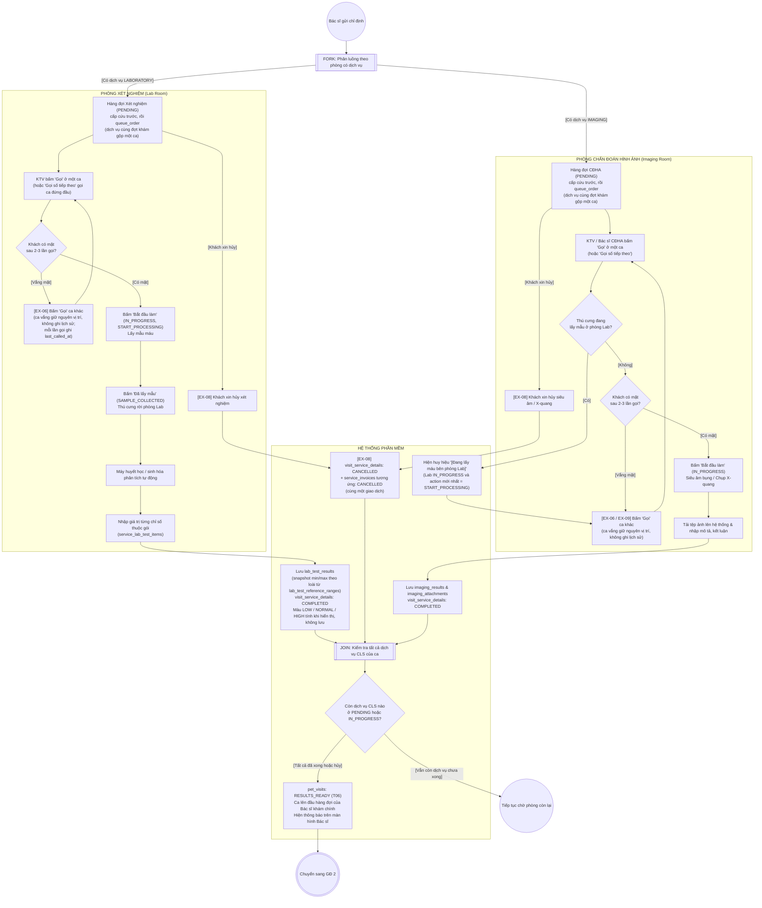
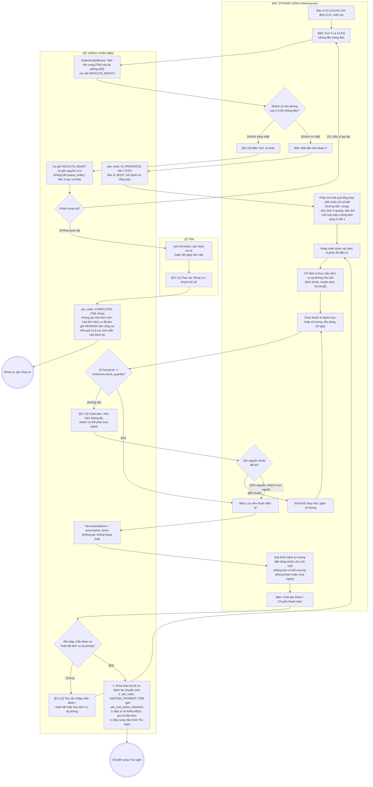
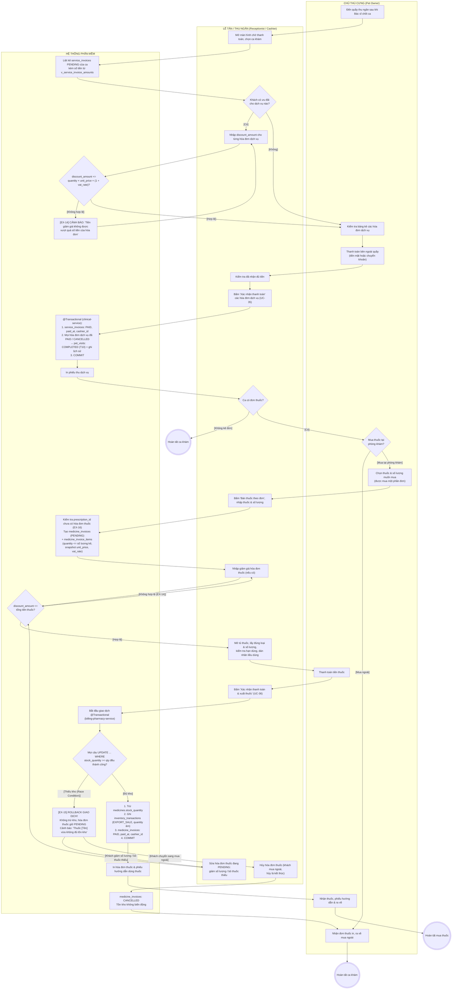

# THIẾT KẾ SƠ ĐỒ HOẠT ĐỘNG (UML ACTIVITY DIAGRAMS)
## HỆ THỐNG QUẢN LÝ PHÒNG KHÁM THÚ Y

> **Tài liệu chuẩn UML 2.5 / RUP phục vụ Thuyết minh & Bảo vệ Đồ án tốt nghiệp**  
> **Phiên bản:** 3.0 (đồng bộ với lược đồ CSDL v3.0 và `THIET_KE_SO_DO_TRANG_THAI_STATE_MACHINE.md` v3.0)  
> **Mục tiêu:** Mô tả chi tiết các luồng công việc (Workflows), sự phân làn trách nhiệm đa tác nhân (Swimlanes / Partitions), các điểm phân tách và đồng bộ song song (Fork & Join Nodes), các điều kiện rẽ nhánh (Decision Nodes) và cơ chế xử lý ngoại lệ trong hệ thống quản lý phòng khám thú y ngoại trú.

---

## MỤC LỤC TỔNG QUAN

1. [Quy chuẩn Ký hiệu & Nguyên tắc Thiết kế UML Activity Diagram](#1-quy-chuẩn-ký-hiệu--nguyên-tắc-thiết-kế-uml-activity-diagram)
2. [AD-01: Chu trình Khám chữa bệnh Ngoại trú Hai pha Tổng thể (End-to-End Clinical Cycle)](#2-ad-01-chu-trình-khám-chữa-bệnh-ngoại-trú-hai-pha-tổng-thể)
3. [AD-02: Quy trình Tiếp đón, Xếp hàng đợi riêng từng Bác sĩ & Gọi số (Patient Reception & Doctor Queues)](#3-ad-02-tiếp-đón-xếp-hàng-đợi-riêng-từng-bác-sĩ--gọi-số)
4. [AD-03: Quy trình Khám Lâm sàng Sơ bộ & Chỉ định Dịch vụ Giai đoạn 1 (Initial Assessment & Ordering)](#4-ad-03-khám-lâm-sàng-sơ-bộ--chỉ-định-dịch-vụ-giai-đoạn-1)
5. [AD-04: Quy trình Thực hiện Cận lâm sàng Song song & Xử lý Ngoại lệ Hàng đợi (Parallel Paraclinical Execution)](#5-ad-04-thực-hiện-cận-lâm-sàng-song-song--xử-lý-ngoại-lệ-hàng-đợi)
6. [AD-05: Quy trình Hội chẩn Kết quả, Chẩn đoán Xác định & Kê đơn Giai đoạn 2 (Post-diagnostic Consultation & Rx)](#6-ad-05-hội-chẩn-kết-quả-chẩn-đoán-xác-định--kê-đơn-giai-đoạn-2)
7. [AD-06: Quy trình Thu tiền Hóa đơn Dịch vụ & Bán thuốc theo Đơn (Billing & Optional Medicine Sale)](#7-ad-06-thu-tiền-hóa-đơn-dịch-vụ--bán-thuốc-theo-đơn-tùy-chọn)
8. [Ma trận Truy vết Nghiệp vụ Tổng hợp (Traceability Matrix)](#8-ma-trận-truy-vết-nghiệp-vụ-tổng-hợp-traceability-matrix)
9. [Phụ lục: Thay đổi so với phiên bản 2.0](#phụ-lục-thay-đổi-so-với-phiên-bản-20)

---

## 1. QUY CHUẨN KÝ HIỆU & NGUYÊN TẮC THIẾT KẾ UML ACTIVITY DIAGRAM

### 1.1. Bảng tra cứu ký hiệu chuẩn UML 2.5 áp dụng trong tài liệu

| Thành phần UML 2.5 | Ký hiệu đồ họa chuẩn | Biểu diễn trên Mermaid | Ý nghĩa nghiệp vụ |
| :--- | :---: | :---: | :--- |
| **Initial Node** | Hình tròn đặc đen `●` | `((Bắt đầu))` | Điểm khởi phát luồng thực thi nghiệp vụ. |
| **Activity Final Node** | Hình tròn có viền ngoài `◉` | `(((Kết thúc)))` | Điểm kết thúc toàn bộ quy trình công việc. |
| **Flow Final Node** | Hình tròn có dấu X `⊗` | `((x))` | Kết thúc một nhánh rẽ phụ mà không hủy toàn bộ luồng. |
| **Action Node** | Hình chữ nhật bo góc | `["Tên hành động"]` | Thao tác đơn vị do một vai trò hoặc hệ thống thực hiện. |
| **Decision / Merge Node** | Hình thoi `<>` | `{"Điều kiện kiểm tra?"}` | Điểm rẽ nhánh có điều kiện canh `[Guard]` hoặc gộp các nhánh rẽ. |
| **Fork Node** | Thanh ngang/dọc đậm | `[[FORK: ...]]` | Phân tách một luồng thực thi thành 2 hay nhiều luồng song song độc lập. |
| **Join Node** | Thanh ngang/dọc đậm | `[[JOIN: ...]]` | Điểm hội tụ, chờ tất cả các luồng song song hoàn tất mới đi tiếp. |
| **Swimlane / Partition** | Cột / Hàng phân cách | `subgraph VaiTrò` | Ranh giới trách nhiệm của từng Actor hoặc Hệ thống. |
| **Object Node / Pin** | Hình chữ nhật vuông | `[Entity: State]` | Trạng thái của thực thể CSDL tại một thời điểm then chốt. |

### 1.2. Danh sách 6 Phân làn trách nhiệm (Swimlanes / Partitions) chuẩn

Hệ thống được thiết kế theo mô hình phân quyền của CSDL (`roles`) và tác nhân tự động:
1. **Chủ thú cưng (Pet Owner):** Người mang thú cưng đến, cung cấp triệu chứng, đưa thú cưng vào các phòng, thanh toán hóa đơn dịch vụ, **tự chọn mua thuốc tại phòng khám hoặc mua ngoài** theo đơn của Bác sĩ.
2. **Lễ tân / Thu ngân (Receptionist / Cashier):** Tiếp đón tại quầy, kiểm tra lịch hẹn, phân công bác sĩ, thu tiền các hóa đơn dịch vụ, và bán thuốc theo đơn khi khách chọn mua (lấy thuốc từ tủ, lập hóa đơn thuốc).
3. **Bác sĩ khám chính (`VETERINARIAN`):** Phụ trách ca khám tại phòng khám cố định: cân đo sinh hiệu và khám lâm sàng sơ bộ (GĐ 1), thực hiện các dịch vụ tại phòng (tiêm, tẩy giun, thủ thuật), chỉ định cận lâm sàng, đọc kết quả tổng hợp (GĐ 2), chẩn đoán xác định và kê đơn thuốc.
4. **Kỹ thuật viên Xét nghiệm (`LAB_TECHNICIAN`):** Phụ trách phòng Xét nghiệm, lấy mẫu máu/bệnh phẩm, nạp máy phân tích, nhập kết quả các chỉ số thuộc gói xét nghiệm.
5. **Kỹ thuật viên / Bác sĩ CĐHA (`IMAGING_TECHNICIAN`):** Phụ trách phòng Chẩn đoán hình ảnh, siêu âm, chụp X-quang, tải ảnh lên hệ thống và đưa ra kết luận hình thái học.
6. **Hệ thống phần mềm (Automated System):** Tính trạng thái bác sĩ thời gian thực, sắp xếp hàng đợi riêng từng Bác sĩ và hàng đợi phòng CLS, thông báo gọi số theo từng dòng (không đổi thứ tự), ghi lịch sử trạng thái và thực hiện giao dịch CSDL an toàn (`@Transactional`).

### 1.3. Quy ước dữ liệu xuyên suốt các sơ đồ
- **Mọi lần đổi trạng thái** của lịch hẹn, đợt khám, chỉ định dịch vụ đều ghi 1 dòng lịch sử tương ứng (`*_status_histories`, `visit_service_detail_histories`). Sơ đồ không vẽ lại bước này ở từng nút.
- **Mỗi dịch vụ được chỉ định có 1 hóa đơn dịch vụ riêng** (`service_invoices`), tạo cùng lúc với chỉ định. Phí khám cũng là một dịch vụ, được tạo tự động khi Bác sĩ bấm "Bắt đầu khám".
- **Đơn thuốc không có trạng thái và không có giá.** Giá thuốc chỉ được chốt khi khách mua tại phòng khám (`medicine_invoice_items`).
- Mã chuyển trạng thái `T01`–`T14` tham chiếu bảng SM-01 trong tài liệu State Machine.

---

## 2. AD-01: CHU TRÌNH KHÁM CHỮA BỆNH NGOẠI TRÚ HAI PHA TỔNG THỂ

### 2.1. Ý nghĩa & Bối cảnh nghiệp vụ
Đây là **sơ đồ hoạt động cốt lõi** của phần mềm, mô tả trọn vẹn chu trình một thú cưng từ khi bước vào phòng khám cho đến khi ra về. Quy trình phản ánh mô hình **Chu kỳ Y tế Bất đồng bộ (Asynchronous Clinical Cycle)**: giải phóng bác sĩ khi bệnh nhân đi làm cận lâm sàng, và khi có kết quả thì đưa ca lên đầu hàng đợi riêng của bác sĩ khám chính.

Điểm khác biệt của phiên bản 3.0 nằm ở cuối quy trình: **ca khám hoàn tất ngay khi khách thanh toán xong các hóa đơn dịch vụ**. Mua thuốc là một **nhánh tùy chọn** sau đó; khách mua ngoài thì chỉ nhận đơn thuốc in và ra về.

### 2.2. Sơ đồ Hoạt động Swimlane (Mermaid Diagram)

> **Ghi chú:** Nhánh "Không" của nút `CL_BUY` gồm cả trường hợp Bác sĩ không kê đơn (khách ra về ngay). Chi tiết thu tiền và bán thuốc ở AD-06.

---

## 3. AD-02: TIẾP ĐÓN, XẾP HÀNG ĐỢI RIÊNG TỪNG BÁC SĨ & GỌI SỐ

### 3.1. Ý nghĩa & Bối cảnh nghiệp vụ
Biểu diễn quy trình tiếp đón tại sảnh (UC-18, UC-19, UC-20, UC-21), xử lý hai nguồn khách hàng (Khách đặt lịch trước và Khách vãng lai Walk-in), việc Lễ tân **xếp ca vào hàng đợi riêng của từng Bác sĩ** và cách Bác sĩ **gọi theo từng dòng** (khách vắng thì gọi ca khác) trong hàng đợi của mình. Lễ tân không phải chờ Bác sĩ rảnh mới phân ca. Lễ tân **không cân đo sinh hiệu** tại quầy; việc này do Bác sĩ thực hiện trong phòng khám (AD-03).

### 3.2. Sơ đồ Hoạt động Phân làn

> **Lưu ý:** Lễ tân xếp ca vào hàng đợi của bất kỳ Bác sĩ nào, kể cả Bác sĩ đang khám; trạng thái Bác sĩ chỉ chặn Bác sĩ gọi số khi đang khám dở (BR-12). Lễ tân có thể chuyển ca chưa bắt đầu khám sang hàng đợi Bác sĩ khác (giữ `queue_order`) hoặc gỡ về danh sách chờ phân công. Khách bỏ về khi đang chờ: Lễ tân hủy ca theo EX-03, ca rời khỏi hàng đợi. Ca vắng giữ nguyên vị trí và ca cấp cứu luôn giữ ưu tiên (từ 13/11/2026 không còn "Đẩy lùi 1 bậc").

---

## 4. AD-03: KHÁM LÂM SÀNG SƠ BỘ & CHỈ ĐỊNH DỊCH VỤ GIAI ĐOẠN 1

### 4.1. Ý nghĩa & Bối cảnh nghiệp vụ
Mô tả nghiệp vụ chuyên môn trong phòng khám tại Giai đoạn 1 (UC-22 & UC-23). Bác sĩ cân đo sinh hiệu, thăm khám thực thể, đưa ra chẩn đoán sơ bộ và rẽ nhánh:
- **Ca khám nhẹ / tiêm phòng / thủ thuật:** Bác sĩ chỉ định và **thực hiện ngay dịch vụ tại phòng** (tiêm vaccine, tẩy giun, tiêm thuốc, thay băng...), kê đơn nếu cần rồi chốt ca.
- **Ca phức tạp:** chỉ định cận lâm sàng, bệnh nhân sang phòng Lab / CĐHA, Bác sĩ được giải phóng để đón ca khác.

Mỗi dịch vụ được chỉ định (kể cả dịch vụ khám tạo tự động lúc bắt đầu) đều sinh **1 hóa đơn dịch vụ `PENDING`** trong cùng giao dịch.

### 4.2. Sơ đồ Hoạt động Phân làn

> **Ghi chú:** Nếu khách từ chối nhưng phòng khám vẫn thu phí khám (Bác sĩ đã khám xong), **hoặc đã thực hiện dịch vụ tại phòng** (hóa đơn của dịch vụ đó phải được thu), Bác sĩ dùng luồng chốt ca bình thường (T05) với chẩn đoán "chuyển viện" thay vì hủy ca. Guard cân nặng / thân nhiệt cũng áp dụng cho nút "Xác nhận chỉ định CLS" (T04).

---

## 5. AD-04: THỰC HIỆN CẬN LÂM SÀNG SONG SONG & XỬ LÝ NGOẠI LỆ HÀNG ĐỢI

### 5.1. Ý nghĩa & Bối cảnh nghiệp vụ
Mô tả tiến trình thực hiện song song tại 2 phòng độc lập: **Phòng Xét nghiệm (Lab)** và **Phòng Chẩn đoán hình ảnh (CĐHA)** (UC-25 & UC-26). Nhánh của phòng nào chỉ chạy khi ca có dịch vụ thuộc phòng đó. Dịch vụ **tự vào hàng đợi** phòng tương ứng ngay khi Bác sĩ chỉ định. Sơ đồ đặc tả Fork / Join, cơ chế "Gọi" theo từng dòng (các dịch vụ cùng đợt khám, cùng phòng gộp thành một ca) và các ngoại lệ: Khách vắng mặt khi gọi số → gọi ca khác, ca vắng giữ nguyên vị trí (EX-06; khách quay lại thì "Gọi lại" – EX-07), Khách xin hủy 1 dịch vụ (EX-08), CĐHA gọi số đúng lúc thú cưng đang lấy máu (EX-09).

**Dữ liệu cho huy hiệu EX-09:** sau khi lấy mẫu, KTV Lab bấm *"Đã lấy mẫu"*; hệ thống ghi `action = SAMPLE_COLLECTED` vào `visit_service_detail_histories`. Huy hiệu *"Đang lấy máu bên phòng Lab"* chỉ hiện khi dịch vụ Lab của ca đang `IN_PROGRESS` **và** `action` mới nhất là `START_PROCESSING` (chưa lấy mẫu xong). Khi máy đang chạy (`SAMPLE_COLLECTED`), thú cưng đã tự do nên CĐHA gọi bình thường.

### 5.2. Sơ đồ Hoạt động Phân làn

> **Khách bỏ về giữa chừng:** nếu khách rời phòng khám khi CLS chưa xong, Lễ tân thực hiện *"Đóng ca / Khách bỏ về"* (T12, EX-11): dịch vụ CLS còn `PENDING` bị hủy (kèm hóa đơn), hóa đơn của dịch vụ đã làm giữ `PENDING` làm công nợ, đợt khám chuyển `COMPLETED`. Thao tác chỉ được phép khi không có dịch vụ nào đang `IN_PROGRESS`.

---

## 6. AD-05: HỘI CHẨN KẾT QUẢ, CHẨN ĐOÁN XÁC ĐỊNH & KÊ ĐƠN GIAI ĐOẠN 2

### 6.1. Ý nghĩa & Bối cảnh nghiệp vụ
Mô tả quy trình Bác sĩ đón lại bệnh nhân sau khi có kết quả cận lâm sàng (UC-30, UC-31, UC-33). Ca có kết quả đã tự lên đầu hàng đợi của Bác sĩ (T06). Bác sĩ hội chẩn, chẩn đoán xác định, có thể thực hiện thêm dịch vụ tại phòng, kê đơn thuốc điện tử và khóa bệnh án.

Hai điểm cần lưu ý:
- **Gọi số trước, đổi trạng thái sau (EX-10):** "Gọi" (hoặc "Gọi số tiếp theo") chỉ phát thông báo, ca vẫn `RESULTS_READY` và thứ tự không đổi; thú cưng vào phòng thì Bác sĩ mới bấm "Bắt đầu Giai đoạn 2" (T07). Gọi 2–3 lần không vào thì Bác sĩ bấm "Gọi" ca khác: ca vắng giữ nguyên vị trí (vẫn đứng đầu hàng đợi), khách quay lại thì "Gọi lại".
- **Kê đơn không bị chặn bởi tồn kho (EX-13):** vì khách được mua thuốc ngoài, hệ thống chỉ cảnh báo khi số lượng kê vượt tồn kho; Bác sĩ quyết định giữ nguyên hay đổi thuốc.

### 6.2. Sơ đồ Hoạt động Phân làn

> Không kê đơn thuốc cũng là trường hợp hợp lệ: Bác sĩ bỏ qua bước chọn thuốc và chốt ca trực tiếp.

---

## 7. AD-06: THU TIỀN HÓA ĐƠN DỊCH VỤ & BÁN THUỐC THEO ĐƠN (TÙY CHỌN)

### 7.1. Ý nghĩa & Bối cảnh nghiệp vụ
Mô tả quy trình tài chính và bán thuốc tại quầy (UC-34, UC-35, UC-36). Quy trình chia làm **2 phần độc lập**:

| Phần | Thực thể | Service | Kết quả |
| :--- | :--- | :--- | :--- |
| **A. Thu tiền hóa đơn dịch vụ** (bắt buộc) | `service_invoices` | `clinical-service` | Hóa đơn cuối cùng `PAID` thì đợt khám `COMPLETED` **trong cùng giao dịch cục bộ** (T10). |
| **B. Bán thuốc theo đơn** (tùy chọn) | `medicine_invoices`, `medicine_invoice_items`, `inventory_transactions` | `billing-pharmacy-service` | Chuyển `PAID` và trừ kho trong **cùng một giao dịch**; không ảnh hưởng trạng thái đợt khám. |

Phần B chỉ diễn ra khi Bác sĩ có kê đơn **và** khách chọn mua tại phòng khám. Khách có thể mua một phần đơn. Số tiền của mỗi hóa đơn không lưu thành cột mà tính từ VIEW `v_service_invoice_amounts` / `v_medicine_invoice_amounts`.

### 7.2. Sơ đồ Hoạt động Phân làn

> **Sửa hóa đơn thuốc thay vì lập lại:** mỗi đơn thuốc chỉ có một hóa đơn thuốc (`prescription_id UNIQUE`), nên sau EX-15 Thu ngân sửa chính hóa đơn đang `PENDING` (`PUT /api/v1/billing/medicine-invoices/{id}/items`), các dòng còn lại giữ nguyên snapshot giá. Hóa đơn đã hủy không lập lại được: khách mua ngoài theo đơn in.

> **Vì sao EX-15 không còn gây rắc rối hoàn tiền:** tiền thuốc và tiền dịch vụ nằm ở hai hóa đơn tách biệt. Khi giao dịch bán thuốc rollback, chưa có hóa đơn thuốc nào ở trạng thái `PAID`, nên hệ thống không ghi nhận khoản thu nào cần hoàn; Thu ngân chỉ trả lại khách số tiền thuốc vừa nhận (hoặc thu theo số lượng mới). Đợt khám đã `COMPLETED` từ Phần A và không bị ảnh hưởng.

> **Thu công nợ (EX-11):** với đợt khám đã `COMPLETED` do khách bỏ về, ở lần đến sau Thu ngân mở lại danh sách hóa đơn dịch vụ còn `PENDING` của ca cũ và thu theo Phần A; trạng thái đợt khám giữ nguyên `COMPLETED`.

---

## 8. MA TRẬN TRUY VẾT NGHIỆP VỤ TỔNG HỢP (TRACEABILITY MATRIX)

Ma trận dưới đây thể hiện sự liên kết giữa các Sơ đồ Hoạt động với Ca sử dụng (Use Cases), Sơ đồ Trạng thái (State Machines v3.0) và Danh mục Ngoại lệ:

| Mã Activity Diagram | Tên Quy trình nghiệp vụ | Use Case liên quan | State Machine & Thực thể CSDL | Mã Ngoại lệ xử lý |
| :---: | :--- | :---: | :---: | :---: |
| **AD-01** | Chu trình Khám Ngoại trú Hai pha Tổng thể | UC-19, 22, 23, 25, 26, 30, 31, 34, 35, 36 | `pet_visits` (SM-01) `doctor_serving_status` (SM-02) `service_invoices` (SM-05) `medicine_invoices` (SM-06) | EX-03, EX-06, EX-08, EX-10, EX-15 |
| **AD-02** | Tiếp đón, Xếp hàng đợi riêng từng Bác sĩ & Gọi số | UC-14, 16, 17, 18, 19, 20, 21 | `appointments` (SM-04) `pet_visits` (T01) `doctor_serving_status` (SM-02) | EX-01, EX-02, EX-03, EX-04, EX-05, EX-10 |
| **AD-03** | Khám Lâm sàng Sơ bộ & Chỉ định Dịch vụ Giai đoạn 1 | UC-22, UC-23 | `pet_visits` (T02, T04, T05, T11) `visit_service_details` (SM-03) `service_invoices` (SM-05) `prescriptions` | EX-12, EX-13 |
| **AD-04** | Thực hiện Cận lâm sàng Song song & Hàng đợi | UC-25, UC-26 | `visit_service_details` (SM-03) `service_invoices` (SM-05) `pet_visits` (T06, T12) | EX-06, EX-07, EX-08, EX-09, EX-11 |
| **AD-05** | Hội chẩn Kết quả, Chẩn đoán & Kê đơn Giai đoạn 2 | UC-30, UC-31, UC-33 | `pet_visits` (T07, T08, T09) `doctor_serving_status` (SM-02) `prescriptions` | EX-10, EX-11, EX-12, EX-13 |
| **AD-06** | Thu tiền Hóa đơn Dịch vụ & Bán thuốc theo Đơn | UC-34, UC-35, UC-36 | `service_invoices` (SM-05) `pet_visits` (T10) `medicine_invoices` (SM-06) `inventory_transactions` | EX-11, EX-14, EX-15, EX-16 |

---

## PHỤ LỤC: THAY ĐỔI SO VỚI PHIÊN BẢN 2.0

| Vị trí | Bản 2.0 | Bản 3.0 | Lý do |
| :--- | :--- | :--- | :--- |
| AD-01 phần cuối | Thu viện phí → `PAID` mở khóa xuất thuốc → trừ kho → `COMPLETED` | Thu hóa đơn dịch vụ → `COMPLETED`; mua thuốc là nhánh tùy chọn, thu tiền thuốc và trừ kho là cùng một bước | Mỗi dịch vụ có hóa đơn riêng; khách được mua thuốc ngoài |
| AD-01, AD-03 | Không có dịch vụ tại phòng | Thêm nhánh dịch vụ thực hiện tại phòng (tiêm, tẩy giun, thủ thuật) | Bản cũ chỉ có Lab / CĐHA |
| AD-02 | Phân công xong vẫn tính Bác sĩ `AVAILABLE` | Gán `doctor_id` → Bác sĩ `BUSY` ngay; thêm kiểm tra thú cưng đang có đợt khám mở | Chống phân công trùng |
| AD-03 | `started_at = NOW()`; snapshot `unit_price` vào `visit_service_details` | Ghi lịch sử; tạo `visit_service_details` + `service_invoices` (`PENDING`) | Cột đã bỏ; giá chuyển sang hóa đơn dịch vụ |
| AD-03 | Hủy ca gắn nhãn EX-03 | Gắn T11 (hủy không thu phí) | EX-03 là khách bỏ về ở sảnh |
| AD-04 | Huy hiệu EX-09 không có dữ liệu phân biệt | Thêm thao tác "Đã lấy mẫu" (`action = SAMPLE_COLLECTED`) | Phân biệt "đang lấy máu" với "máy đang chạy" |
| AD-04 | Hủy dịch vụ: "hóa đơn tự loại trừ" | Hủy dịch vụ và hóa đơn của dịch vụ đó trong cùng giao dịch | Hóa đơn tách theo dịch vụ |
| AD-05 | `prescriptions (PRESCRIBED)`, snapshot giá vào `prescription_items`; `closed_at` | Đơn thuốc không giá, không trạng thái; ghi lịch sử | Bỏ `PrescriptionStatus` và cột giá trùng |
| AD-05 | Kê vượt tồn kho bị chặn | Chỉ cảnh báo (EX-13), Bác sĩ được giữ nguyên | Khách có thể mua ngoài |
| AD-05 | Tạm hoãn khi chưa gọi; "Đóng ca" tạo hóa đơn nợ | Gọi trước rồi mới hoãn (T13); "Đóng ca" giữ hóa đơn dịch vụ sẵn có làm công nợ (T08) | Khớp công thức trạng thái Bác sĩ; hóa đơn đã sinh lúc chỉ định |
| AD-06 | `invoices`, `completed_at`, `EXPORT_PRESCRIPTION`, `prescriptions: DISPENSED` | `service_invoices`, `medicine_invoices`, `EXPORT_SALE`; lịch sử trạng thái | Đồng bộ lược đồ v3.0 |
| AD-06 EX-15 | Rollback sau khi đã thu viện phí, "báo Bác sĩ đổi thuốc" | Rollback chỉ ảnh hưởng hóa đơn thuốc; khách giảm số lượng hoặc mua ngoài | Đơn thuốc đã khóa; không còn vấn đề hoàn tiền |
| Ma trận truy vết | `invoices` (SM-05), `prescriptions` (SM-06) | `service_invoices` (SM-05), `medicine_invoices` (SM-06) | SM-06 đổi thành hóa đơn thuốc |
| AD-02 (rà soát 10/11) | "Nếu có hẹn: appointments → CHECKED_IN" trong cùng nút tạo đợt khám | Ghi rõ qua `VisitCheckedInEvent` | Khớp Kiến trúc mục 5.3 |
| AD-03 (rà soát 10/11) | Hủy ca T11 không có điều kiện về dịch vụ tại phòng | Chỉ khi chưa có dịch vụ tại phòng hoàn thành | Đồng bộ guard T11 |
| AD-06 (rà soát 10/11) | Sau EX-15 quay lại "Lập hóa đơn thuốc" (bị `prescription_id UNIQUE` chặn) | Nút "Sửa hóa đơn thuốc đang PENDING" | Luồng thực hiện được |
| AD-01, AD-02 (rà soát 11/11) | Xếp vào hàng đợi sảnh chung; "Phân công Bác sĩ đang AVAILABLE"; cảnh báo Khóa ưu tiên / Bác sĩ bận | Lễ tân xếp ca vào hàng đợi riêng của Bác sĩ (gợi ý Bác sĩ ít người chờ), không chặn khi Bác sĩ bận; thêm nhánh Bác sĩ "Gọi số tiếp theo" / "Đẩy lùi 1 bậc" | Lễ tân không phải chờ Bác sĩ rảnh |
| AD-04 (rà soát 11/11) | "Tạm hoãn" (POSTPONED) rồi "Có mặt" (RECALL, ghim ưu tiên kế tiếp) | "Gọi số tiếp theo"; vắng mặt → "Đẩy lùi 1 bậc" (SKIPPED), quay lại gọi người kế tiếp | Cùng cơ chế với hàng đợi Bác sĩ |
| AD-05 (rà soát 11/11) | Hộp thoại "Mời vào phòng" chuyển ngay `IN_PROGRESS`; tạm hoãn T13 về tab đã hoãn, Recall | "Gọi số tiếp theo" (ca có KQ đứng đầu), thú cưng vào phòng mới bấm "Bắt đầu GĐ 2" (T07); vắng → "Đẩy lùi 1 bậc"; bỏ T13 | Gọi số trước, đổi trạng thái sau |
| AD-02, AD-04, AD-05 (cập nhật 13/11) | "Đẩy lùi 1 bậc" (`skip_count + 1`, `action = SKIPPED`, xếp sau người kế tiếp); mỗi dịch vụ CLS một dòng hàng đợi | "Gọi" ở ca bất kỳ; ca vắng giữ nguyên vị trí, khách quay lại thì "Gọi lại"; dịch vụ cùng đợt khám, cùng phòng gộp một ca | Đẩy lùi 1 bậc làm hai ca đầu hàng đổi chỗ mãi mãi và làm ca cấp cứu mất ưu tiên; gọi theo từng dòng giống thực tế |
| AD-02, AD-04 (rà soát 13/11) | Gọi chỉ phát thông báo | Gọi ghi `last_called_at` để đánh dấu ca "Đã gọi HH:mm"; vẫn không đổi trạng thái / thứ tự | Lưu lại thú cưng đã từng được gọi |
