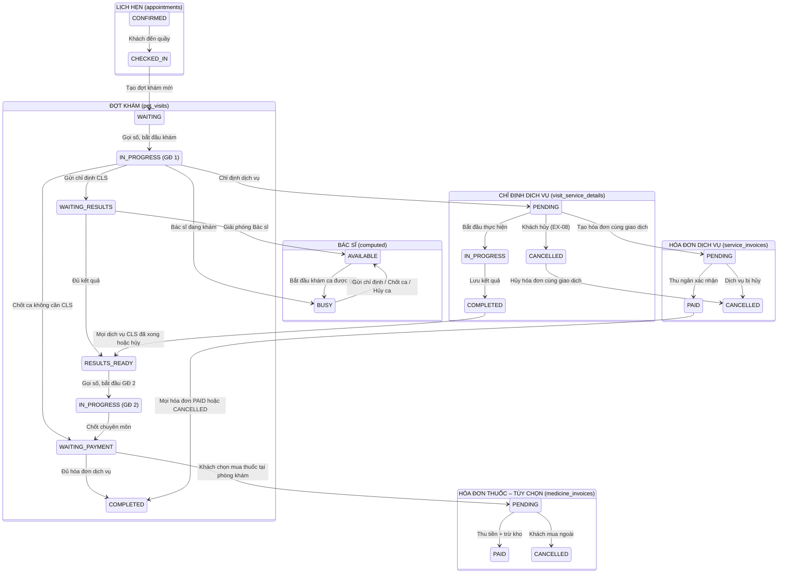
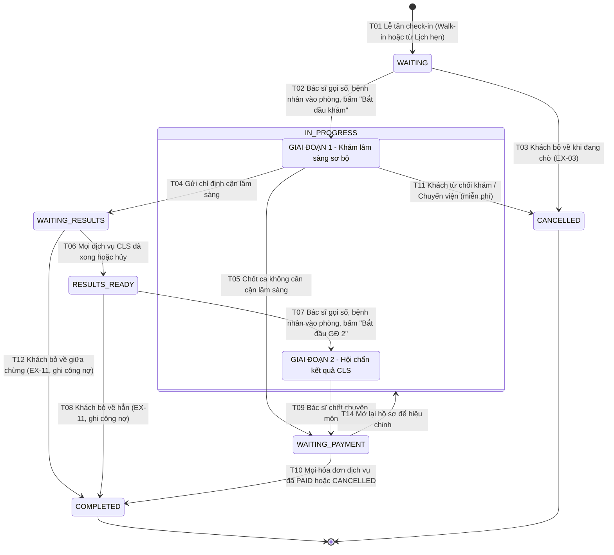
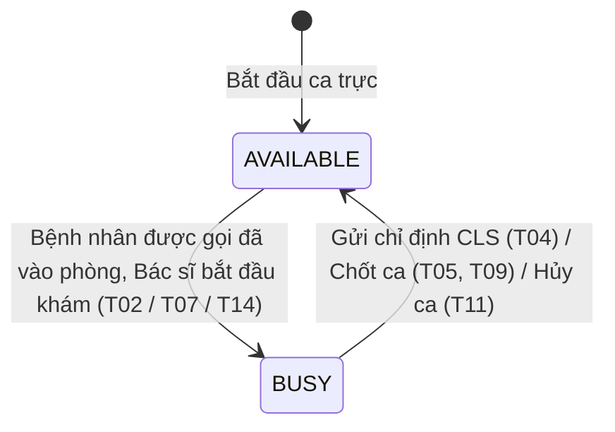
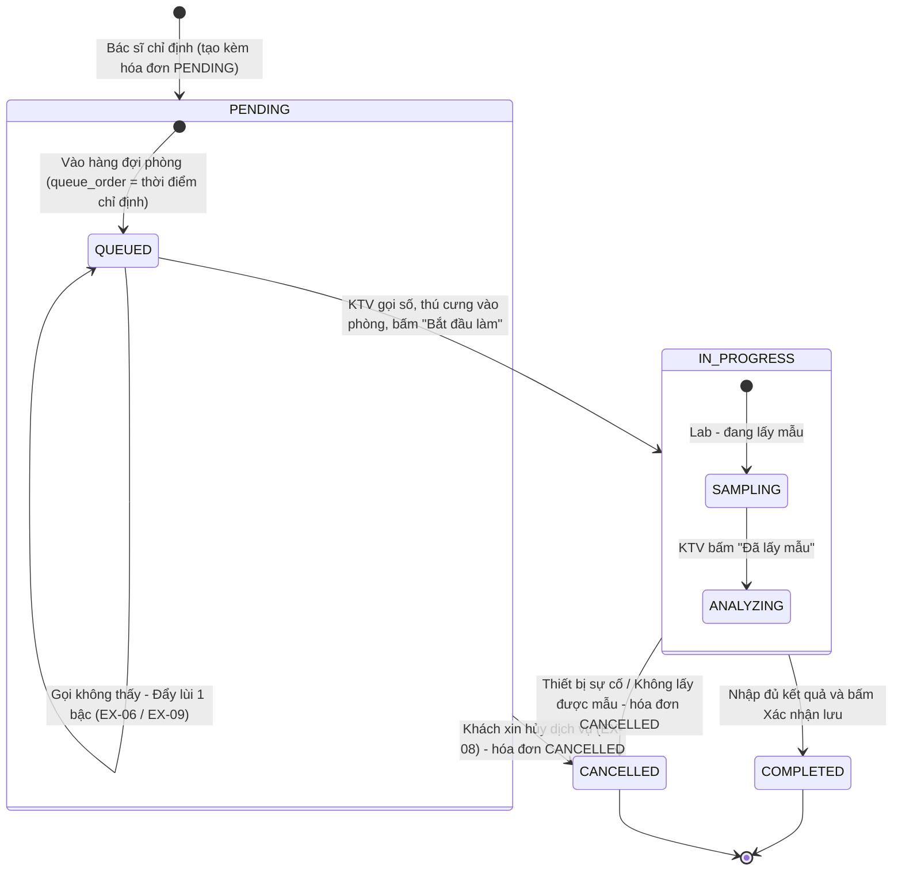
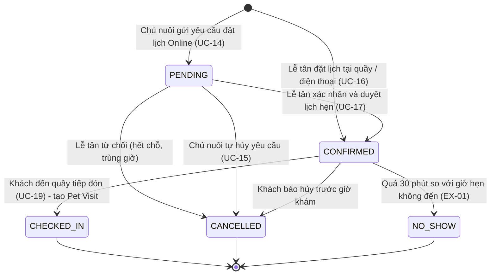
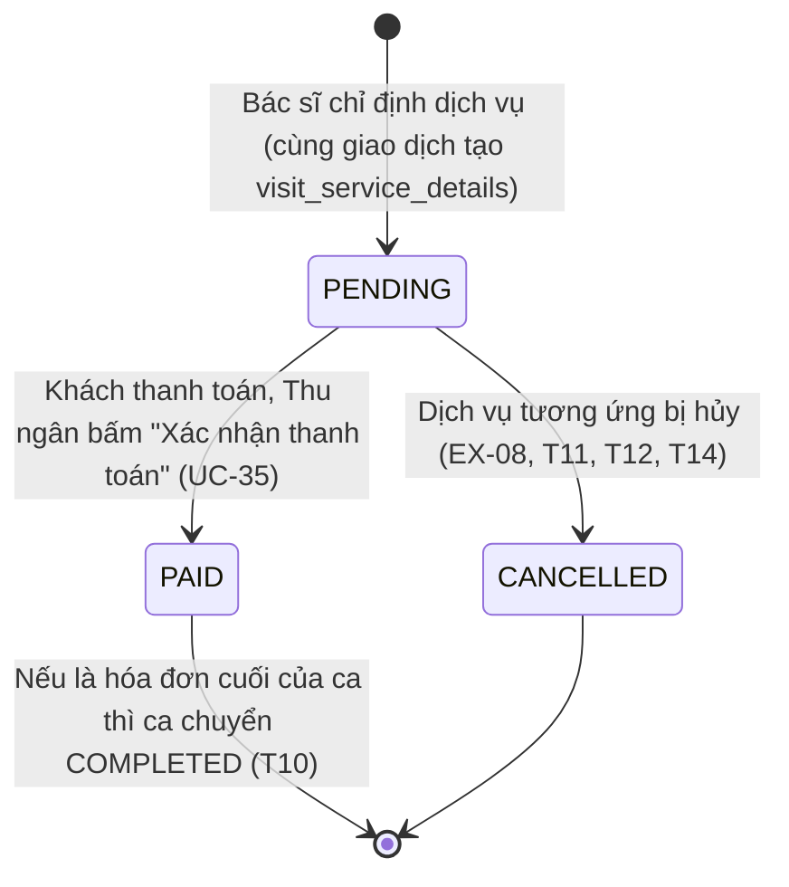
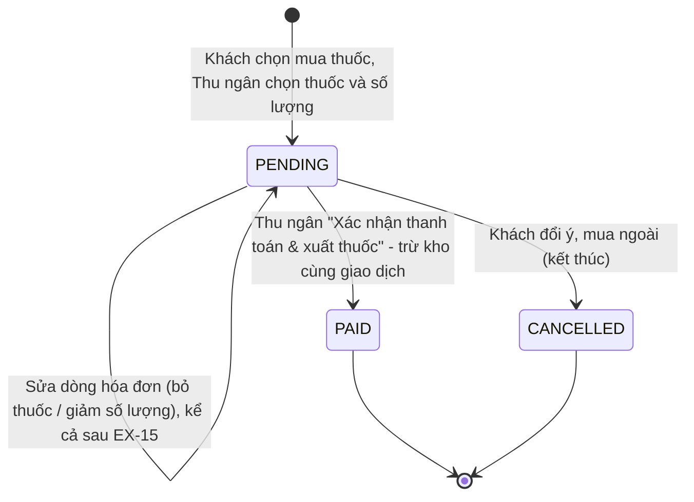

# THIẾT KẾ SƠ ĐỒ TRẠNG THÁI (STATE MACHINE DIAGRAMS)
## HỆ THỐNG QUẢN LÝ PHÒNG KHÁM THÚ Y

> **Tài liệu chuẩn UML / RUP phục vụ Báo cáo & Bảo vệ Đồ án tốt nghiệp**  
> **Phiên bản:** 3.0 (đồng bộ với lược đồ CSDL v3.0 – `schema_init.sql`)  
> **Mục tiêu:** Mô tả chi tiết không gian trạng thái, sự kiện kích hoạt (Trigger Events), điều kiện canh (Guard Conditions) và hành động chuyển đổi (State Transitions) của các thực thể nghiệp vụ cốt lõi và thực thể hỗ trợ trong hệ thống; kèm theo sơ đồ điều phối đồng bộ liên thực thể (Cross-Entity State Orchestration).

---

## MỤC LỤC TỔNG QUAN

1. [Sơ đồ Điều phối Đồng bộ Trạng thái Đa thực thể (Cross-Entity State Orchestration)](#1-sơ-đồ-điều-phối-đồng-bộ-trạng-thái-đa-thực-thể)
2. [State Machine 1: Đợt khám bệnh (Pet Visit)](#2-state-machine-1-đợt-khám-bệnh-pet-visit)
3. [State Machine 2: Trạng thái phục vụ tức thời của Bác sĩ (Doctor Serving Status)](#3-state-machine-2-trạng-thái-phục-vụ-tức-thời-của-bác-sĩ-doctor-serving-status)
4. [State Machine 3: Chi tiết Chỉ định Dịch vụ (Visit Service Detail)](#4-state-machine-3-chi-tiết-chỉ-định-dịch-vụ-visit-service-detail)
5. [State Machine 4: Lịch hẹn khám (Appointment)](#5-state-machine-4-lịch-hẹn-khám-appointment)
6. [State Machine 5: Hóa đơn Dịch vụ (Service Invoice)](#6-state-machine-5-hóa-đơn-dịch-vụ-service-invoice)
7. [State Machine 6: Hóa đơn Thuốc (Medicine Invoice)](#7-state-machine-6-hóa-đơn-thuốc-medicine-invoice)
8. [Tổng kết tính nhất quán toàn hệ thống](#tổng-kết-tính-nhất-quán-toàn-hệ-thống)
9. [Phụ lục: Thay đổi so với phiên bản 2.0](#phụ-lục-thay-đổi-so-với-phiên-bản-20)

### Quy ước chung áp dụng cho mọi State Machine
- **Mọi lần đổi trạng thái đều ghi 1 dòng lịch sử** trong cùng giao dịch: `appointment_status_histories`, `pet_visit_status_histories`, `visit_service_detail_histories`. Người thao tác ghi vào `changed_by_user_id` (`NULL` = hệ thống tự chuyển), lý do hủy / ghi chú ghi vào `notes` (hoặc `reason`).
- **Thời điểm bắt đầu khám, chốt ca, hoàn tất, hủy** không lưu thành cột riêng trên `pet_visits` mà lấy từ `created_at` của dòng lịch sử tương ứng.
- **Không có trạng thái đơn thuốc.** Bảng `prescriptions` chỉ là chỉ định chuyên môn; khách được quyền mua thuốc tại phòng khám hoặc mua ngoài. Việc mua thuốc thể hiện qua vòng đời của `medicine_invoices` (SM-06).
- **Nhóm dịch vụ** (theo `services.category`):
  - *Dịch vụ cận lâm sàng (CLS):* `LABORATORY` → hàng đợi Phòng Xét nghiệm; `IMAGING` → hàng đợi Phòng CĐHA.
  - *Dịch vụ thực hiện tại phòng khám:* `EXAMINATION`, `VACCINATION`, `DEWORMING`, `EXTERNAL_PARASITE`, `INJECTION_INFUSION`, `PROCEDURE`, `SURGERY` – do Bác sĩ khám chính thực hiện, không đi qua hàng đợi CLS.
- **Phí khám là một dịch vụ.** Khi Bác sĩ bấm "Bắt đầu khám", hệ thống tự tạo 1 dòng chỉ định dịch vụ khám (`EXAMINATION`, mặc định "Khám tổng quát") kèm hóa đơn dịch vụ. Nhờ vậy mọi ca khám đã vào phòng đều có ít nhất 1 hóa đơn dịch vụ.

---

## 1. SƠ ĐỒ ĐIỀU PHỐI ĐỒNG BỘ TRẠNG THÁI ĐA THỰC THỂ

Trong thực tế vận hành phòng khám thú y, các thực thể dữ liệu không biến đổi độc lập mà có sự ràng buộc, đồng bộ và kích hoạt lẫn nhau theo mô hình **Sự kiện - Ràng buộc (Event-Driven State Machine)**. Điểm cốt lõi của phiên bản 3.0:
- **Hóa đơn dịch vụ sinh ra cùng lúc với chỉ định dịch vụ** (không đợi chốt ca), hủy dịch vụ thì hủy luôn hóa đơn của dịch vụ đó.
- **Ca khám hoàn tất khi mọi hóa đơn dịch vụ đã `PAID` hoặc `CANCELLED`**. Việc mua thuốc là tùy chọn, nằm ngoài điều kiện hoàn tất ca.



> **Đọc sơ đồ:** các mũi tên trong từng khối là vòng đời của thực thể; các mũi tên nối giữa hai khối là quan hệ kích hoạt (sự kiện ở thực thể nguồn gây ra chuyển trạng thái ở thực thể đích). Hóa đơn thuốc được nối từ `WAITING_PAYMENT` nhưng cũng có thể lập khi ca đã `COMPLETED`; không có mũi tên nào từ hóa đơn thuốc quay về đợt khám.

---

## 2. STATE MACHINE 1: ĐỢT KHÁM BỆNH (PET VISIT)

### 2.1. Ý nghĩa & Vai trò nghiệp vụ
Bảng `pet_visits` là **thực thể trung tâm (Core Aggregate Root)** của toàn bộ phần mềm. Vòng đời của một đợt khám được thiết kế theo mô hình **Chu kỳ Y tế Bất đồng bộ (Asynchronous Clinical Cycle)** để tối ưu hóa công suất phòng khám và loại bỏ điểm nghẽn thời gian thực.

Hai giai đoạn của `IN_PROGRESS` không phải là 2 giá trị enum khác nhau. Hệ thống phân biệt bằng lịch sử: ca đã từng đi qua `WAITING_RESULTS` thì đang ở **Giai đoạn 2**, ngược lại là **Giai đoạn 1**.

### 2.2. Sơ đồ Trạng thái (Mermaid State Machine)



### 2.3. Bảng Ma trận Chuyển đổi Trạng thái (State Transition Table)

Mọi dòng dưới đây đều kèm hành động chung: **ghi 1 dòng `pet_visit_status_histories` (`from_status`, `to_status`, `changed_by_user_id`, `notes`) trong cùng giao dịch**. Cột "Hành động" chỉ liệt kê phần phát sinh thêm.

| STT | Trạng thái nguồn | Sự kiện kích hoạt (Trigger) | Điều kiện canh (Guard Condition) | Hành động CSDL & Tác động hệ thống | Trạng thái đích |
| :---: | :--- | :--- | :--- | :--- | :--- |
| **T01** | `[*] (None)` | Lễ tân tiếp đón khách tại quầy (UC-19) | Hồ sơ thú cưng hợp lệ; thú cưng không có đợt khám nào khác đang mở (khác `COMPLETED`, `CANCELLED`); nếu đến từ lịch hẹn thì lịch phải `CONFIRMED` và đúng ngày. **Không yêu cầu cân nặng, thân nhiệt** (Bác sĩ đo trong phòng khám). | Tạo `pet_visits` (`checked_in_at = NOW()`, `receptionist_id`, `appointment_id` nếu có, `is_emergency`). Nếu từ lịch hẹn: phát sự kiện để `appointment-service` chuyển lịch sang `CHECKED_IN`. Gán `queue_order` = thời điểm tiếp nhận (epoch micro giây). Lễ tân chọn Bác sĩ ngay khi tiếp nhận (hệ thống gợi ý Bác sĩ có ít người chờ nhất) → ca vào hàng đợi riêng của Bác sĩ đó; chưa chọn thì ca nằm trong danh sách chờ phân công (mục 2.4). | `WAITING` |
| **T02** | `WAITING` | Bác sĩ đã gọi số (mục 2.4), bệnh nhân vào phòng, Bác sĩ bấm *"Bắt đầu khám"* (UC-22) | Ca nằm trong hàng đợi của Bác sĩ đang thao tác (`pet_visits.doctor_id`); Bác sĩ không có ca nào khác đang `IN_PROGRESS`. | Tự tạo 1 `visit_service_details` cho dịch vụ khám (`EXAMINATION`, `status = IN_PROGRESS`) và 1 `service_invoices` (`PENDING`, snapshot `unit_price`, `vat_rate`). Mở Bệnh án điện tử. | `IN_PROGRESS` (GĐ 1) |
| **T03** | `WAITING` | Lễ tân hủy ca khám (EX-03) | Khách xin về hoặc chờ quá lâu bỏ về; bắt buộc nhập lý do. | Lý do ghi vào `notes` của dòng lịch sử. Ca rời khỏi hàng đợi (của Bác sĩ hoặc danh sách chờ phân công). | `CANCELLED` |
| **T04** | `IN_PROGRESS` (GĐ 1) | Bác sĩ xác nhận chỉ định cận lâm sàng (UC-23) | Có ít nhất 1 dịch vụ `LABORATORY` hoặc `IMAGING` được chỉ định; đã nhập `weight_at_visit`, `temperature` (> 0); các dịch vụ thực hiện tại phòng đã chỉ định trong GĐ 1 đều `COMPLETED` hoặc `CANCELLED`. | Với mỗi dịch vụ CLS: tạo `visit_service_details` (`PENDING`) + `service_invoices` (`PENDING`, snapshot giá & thuế). Dịch vụ khám chuyển `COMPLETED`. Dịch vụ CLS tự vào hàng đợi phòng Lab / CĐHA (`visit_service_details.queue_order` = thời điểm chỉ định). Bác sĩ được giải phóng và gọi số tiếp theo trong hàng đợi của mình. | `WAITING_RESULTS` |
| **T05** | `IN_PROGRESS` (GĐ 1) | Bác sĩ chốt ca khám thông thường / tiêm phòng (UC-30_33) | Không có dịch vụ CLS; đã nhập `diagnosis` (EX-12), `weight_at_visit`, `temperature`; mọi dịch vụ thực hiện tại phòng đều `COMPLETED` hoặc `CANCELLED`. | Dịch vụ khám chuyển `COMPLETED`. Lưu đơn thuốc nếu có (`prescriptions` + `prescription_items`, không có giá, không có trạng thái). Khóa hồ sơ chuyên môn. Bác sĩ được giải phóng. | `WAITING_PAYMENT` |
| **T06** | `WAITING_RESULTS` | Phòng Lab / CĐHA lưu kết quả hoặc khách hủy dịch vụ CLS (UC-25_26, EX-08) | Không còn dịch vụ CLS nào của ca ở `PENDING` hoặc `IN_PROGRESS`. | Hệ thống tự chuyển (`changed_by_user_id = NULL`). Ca quay về **đầu hàng đợi của Bác sĩ khám chính**, chỉ sau ca cấp cứu: `queue_order` = giá trị nhỏ nhất trong hàng đợi của Bác sĩ − 1, `skip_count` = 0. Hiển thị Notification Badge cho Bác sĩ. | `RESULTS_READY` |
| **T07** | `RESULTS_READY` | Bác sĩ đã gọi số (mục 2.4), bệnh nhân vào phòng, Bác sĩ bấm *"Bắt đầu Giai đoạn 2"* (UC-30) | Bác sĩ không có ca `IN_PROGRESS` khác. | Bác sĩ chuyển `BUSY`. Mở giao diện Giai đoạn 2 với toàn bộ kết quả CLS. | `IN_PROGRESS` (GĐ 2) |
| **T08** | `RESULTS_READY` | Thao tác *"Đóng ca / Khách bỏ về"* (EX-11) | Lễ tân đã liên hệ xác nhận khách bỏ về, hoặc đã hết ngày làm việc. | **Không tạo hóa đơn mới.** Các hóa đơn của dịch vụ đã thực hiện (khám, CLS đã `COMPLETED`) giữ `PENDING` làm công nợ, thu ở lần sau. Khóa bệnh án, lưu kết quả vĩnh viễn. | `COMPLETED` (Khóa) |
| **T09** | `IN_PROGRESS` (GĐ 2) | Bác sĩ chốt đợt khám & kê đơn (UC-30_33) | Đã nhập `diagnosis` (EX-12); mọi dịch vụ thực hiện tại phòng đã chỉ định trong GĐ 2 đều `COMPLETED` hoặc `CANCELLED`. | Lưu đơn thuốc nếu có. Khóa bệnh án. Bác sĩ được giải phóng. Ca hiển thị trên màn hình Thu ngân. | `WAITING_PAYMENT` |
| **T10** | `WAITING_PAYMENT` | Thu ngân xác nhận thanh toán hóa đơn dịch vụ (UC-35) | Sau lần xác nhận này, **mọi `service_invoices` của ca đều `PAID` hoặc `CANCELLED`**. Không xét hóa đơn thuốc. | Thực hiện trong cùng giao dịch cục bộ của `clinical-service` với việc chuyển hóa đơn sang `PAID` (hệ thống ghi lịch sử, `changed_by_user_id` = thu ngân). Giải phóng ca khỏi màn hình Thu ngân. | `COMPLETED` |
| **T11** | `IN_PROGRESS` (GĐ 1) | Khách từ chối khám tiếp / Chuyển viện cấp cứu | Bắt buộc nhập lý do. Áp dụng khi phòng khám **không thu phí** và **chưa có dịch vụ tại phòng nào `COMPLETED`**; nếu có thu phí khám hoặc đã thực hiện dịch vụ tại phòng, Bác sĩ chốt ca bình thường theo T05 với chẩn đoán "chuyển viện". | Mọi dịch vụ của ca (dịch vụ khám `IN_PROGRESS`, dịch vụ tại phòng `PENDING`) → `CANCELLED`, kéo theo hóa đơn dịch vụ → `CANCELLED`, nên ca hủy không còn hóa đơn `PENDING`. Bác sĩ được giải phóng. | `CANCELLED` |
| **T12** | `WAITING_RESULTS` | Thao tác *"Đóng ca / Khách bỏ về"* khi CLS chưa làm xong (EX-11) | Không có dịch vụ CLS nào đang `IN_PROGRESS` (KTV phải hoàn tất hoặc hủy dịch vụ đang làm trước). | Dịch vụ CLS còn `PENDING` → `CANCELLED` (hóa đơn tương ứng → `CANCELLED`). Hóa đơn của dịch vụ đã làm (khám, CLS đã `COMPLETED`) giữ `PENDING` làm công nợ. Khóa bệnh án. | `COMPLETED` (Khóa) |
| **T13** | *(Bỏ ở rà soát 11/11)* | – | – | Trước đây: GĐ 2 gọi không thấy khách thì chuyển ngược `IN_PROGRESS → RESULTS_READY`. Nay Bác sĩ gọi số **trước khi** chuyển trạng thái; gọi không thấy thì "Đẩy lùi 1 bậc" (mục 2.4, EX-10), ca vẫn `RESULTS_READY`, không có bước chuyển nào. Giữ số hiệu T13 để không đổi tham chiếu T14. | – |
| **T14** | `WAITING_PAYMENT` | Bác sĩ phụ trách (hoặc `ADMIN`) bấm *"Mở lại hồ sơ"* | Ca chưa `COMPLETED`; Bác sĩ không đang `BUSY` với ca khác; bắt buộc nhập lý do. Nếu đơn thuốc đã có hóa đơn thuốc chưa hủy (`PENDING` hoặc `PAID`) thì không được sửa đơn thuốc. | Lý do ghi vào `notes`. Hóa đơn dịch vụ đã `PAID` giữ nguyên; dịch vụ bị bỏ thì hủy theo SM-03 (hóa đơn đi theo); dịch vụ thêm mới sinh hóa đơn mới. Sau khi sửa, Bác sĩ chốt lại theo T05 / T09. | `IN_PROGRESS` (giữ nguyên giai đoạn trước đó) |

### 2.4. Hàng đợi riêng của Bác sĩ & "Đẩy lùi 1 bậc" (không phải bước chuyển trạng thái)

Các thao tác dưới đây chỉ đổi `doctor_id`, `queue_order`, `skip_count`; trạng thái ca giữ nguyên nên **không ghi** `pet_visit_status_histories`.

| Mã | Quy tắc | Chi tiết |
| :---: | :--- | :--- |
| **Q1** | Hàng đợi của mỗi Bác sĩ | Gồm các ca `WAITING` hoặc `RESULTS_READY` có `doctor_id` = Bác sĩ đó, sắp xếp `ORDER BY (is_emergency AND skip_count = 0) DESC, queue_order ASC` (chỉ mục `idx_visits_queue`). Ca `WAITING` có `doctor_id IS NULL` là **danh sách chờ phân công**. Số thứ tự hiển thị = vị trí trong thứ tự này. |
| **Q2** | Phân công / đổi Bác sĩ | Lễ tân gán ca `WAITING` vào hàng đợi của **bất kỳ Bác sĩ `ACTIVE` nào, bất cứ lúc nào**, không cần chờ Bác sĩ rảnh. Hệ thống hiển thị số người đang chờ của từng Bác sĩ và gợi ý Bác sĩ ít người chờ nhất; Lễ tân quyết định. Đổi Bác sĩ giữ nguyên `queue_order` (ca đến trước vẫn đứng trước). Ca `RESULTS_READY` luôn thuộc Bác sĩ khám chính, không đổi. |
| **Q3** | Gọi số tiếp theo | Bác sĩ không có ca `IN_PROGRESS` bấm *"Gọi số tiếp theo"*: hệ thống chọn ca đầu hàng, phát `PatientCalledEvent` (màn hình sảnh + ứng dụng chủ nuôi). Ca chưa đổi trạng thái. Bệnh nhân vào phòng → T02 (ca `WAITING`) hoặc T07 (ca `RESULTS_READY`). |
| **Q4** | Đẩy lùi 1 bậc | Gọi 2–3 lần không thấy, Bác sĩ bấm *"Đẩy lùi 1 bậc"*: `skip_count + 1`; `queue_order` mới = trung bình cộng của ca ngay sau và ca sau nữa (không có ca sau nữa thì = ca ngay sau + 1; nếu người kế tiếp là ca cấp cứu chưa bị lùi thì = `queue_order` của ca thường đầu tiên − 1). Ca bị lùi đứng ngay sau người kế tiếp, người kế tiếp lên đầu và được gọi. Không giới hạn số lần; `skip_count` dùng để hiển thị và để xếp ca cấp cứu đã bị lùi như ca thường. Không còn ai phía sau thì ca giữ nguyên vị trí. Thực hiện trong 1 giao dịch có kiểm tra `version`. |
| **Q5** | Ca vừa có kết quả CLS | T06 đưa ca lên đầu hàng đợi của Bác sĩ khám chính (sau ca cấp cứu). Không còn "Khóa ưu tiên" chặn Lễ tân: Lễ tân vẫn xếp ca mới vào hàng đợi, ca có kết quả tự được gọi trước. |

Phòng Xét nghiệm và CĐHA dùng cùng Q1, Q3, Q4 cho `visit_service_details` (xem SM-03, mục 4).

---

## 3. STATE MACHINE 2: TRẠNG THÁI PHỤC VỤ TỨC THỜI CỦA BÁC SĨ (DOCTOR SERVING STATUS)

### 3.1. Ý nghĩa & Vai trò nghiệp vụ
Hệ thống **không sử dụng cột trạng thái tĩnh trong CSDL** để quản lý bác sĩ, nhằm tránh rủi ro sai lệch dữ liệu (Desynchronization) khi có sự cố mạng. Trạng thái phục vụ của Bác sĩ được **tính toán động theo thời gian thực (Computed State)** từ các ca khám mà Bác sĩ đó đang phụ trách (`pet_visits.doctor_id`).

Từ rà soát 11/11, mỗi Bác sĩ có **hàng đợi riêng** (mục 2.4) nên trạng thái Bác sĩ **không còn dùng để quyết định Lễ tân có được phân công hay không**. Lễ tân xếp ca vào hàng đợi của Bác sĩ bất cứ lúc nào; trạng thái chỉ cho biết Bác sĩ có đang khám hay không (hiển thị trên bảng điều phối và chặn Bác sĩ gọi thêm người khi đang khám dở). Còn hai trạng thái:
- `BUSY`: Bác sĩ đang khám một ca (`IN_PROGRESS`, Giai đoạn 1 hoặc 2).
- `AVAILABLE`: Bác sĩ không khám ca nào, được bấm *"Gọi số tiếp theo"*.

Trạng thái `AVAILABLE_PRIORITY_CALLBACK` và cơ chế "Khóa ưu tiên" của bản trước được bỏ: ca vừa có kết quả CLS tự lên đầu hàng đợi của Bác sĩ (Q5), nên không cần chặn Lễ tân.

### 3.2. Sơ đồ Trạng thái (Mermaid State Machine)



### 3.3. Quy tắc Suy diễn Trạng thái (Inference Logic)

```sql
-- Công thức tính trạng thái Bác sĩ :doctor_id tại thời điểm t
SELECT CASE WHEN COUNT(*) > 0 THEN 'BUSY' ELSE 'AVAILABLE' END AS computed_doctor_status
FROM pet_visits
WHERE doctor_id = :doctor_id
  AND status = 'IN_PROGRESS';

-- Số người đang chờ của Bác sĩ (hiển thị trên bảng điều phối, dùng để gợi ý phân công – Q2)
SELECT COUNT(*) AS waiting_count
FROM pet_visits
WHERE doctor_id = :doctor_id
  AND status IN ('WAITING', 'RESULTS_READY');
```

Index hỗ trợ: `idx_visits_doctor_status (doctor_id, status)` và `idx_visits_queue (doctor_id, status, is_emergency, queue_order)`.

**Kiểm chứng công thức:**

| Tình huống của Bác sĩ | Trạng thái | Lễ tân có xếp thêm ca vào hàng đợi được không? |
| :--- | :--- | :--- |
| Chưa có ca nào | `AVAILABLE` | Được |
| Có 3 ca đang chờ trong hàng đợi, chưa gọi ai | `AVAILABLE` | Được |
| Đang khám 1 ca, 2 ca khác đang chờ | `BUSY` | Được |
| Có 1 ca vừa đủ kết quả CLS | `AVAILABLE` (ca đó đứng đầu hàng đợi) | Được |
| Đã gọi số nhưng bệnh nhân chưa vào phòng | `AVAILABLE` (chưa bấm "Bắt đầu khám") | Được |

### 3.4. Bảng Chi tiết Chuyển đổi Trạng thái Bác sĩ

| Trạng thái nguồn | Sự kiện kích hoạt | Cơ chế nghiệp vụ & Ràng buộc bảo vệ | Trạng thái đích |
| :--- | :--- | :--- | :--- |
| `AVAILABLE` | Bác sĩ đã gọi số (Q3), bệnh nhân vào phòng, Bác sĩ bấm *"Bắt đầu khám"* (T02) hoặc *"Bắt đầu Giai đoạn 2"* (T07); hoặc mở lại hồ sơ (T14) | Bác sĩ không có ca `IN_PROGRESS` nào khác (BR-12). | `BUSY` |
| `BUSY` | Bác sĩ gửi chỉ định CLS (T04), chốt ca (T05 / T09) hoặc hủy ca chuyển viện (T11) | Ca rời trạng thái `IN_PROGRESS`; Bác sĩ gọi số tiếp theo trong hàng đợi của mình. | `AVAILABLE` |

> **Thay đổi ở rà soát 11/11:** bản trước tính ca đã phân công nhưng chưa vào phòng là `BUSY` và chỉ cho phân công khi Bác sĩ `AVAILABLE`, nên mỗi Bác sĩ chỉ giữ được 1 ca và Lễ tân phải chờ Bác sĩ rảnh mới phân tiếp. Mô hình hàng đợi riêng bỏ ràng buộc đó; Lễ tân phân bổ đều ngay khi tiếp nhận.

---

## 4. STATE MACHINE 3: CHI TIẾT CHỈ ĐỊNH DỊCH VỤ (VISIT SERVICE DETAIL)

### 4.1. Ý nghĩa & Vai trò nghiệp vụ
Bảng `visit_service_details` quản lý tiến độ thực hiện của từng dịch vụ được chỉ định cho một đợt khám. Mỗi dòng chỉ định luôn đi kèm **đúng 1 hóa đơn dịch vụ** (`service_invoices`, quan hệ 1–1), tạo trong cùng giao dịch. Bất biến: **dịch vụ `CANCELLED` ⇔ hóa đơn `CANCELLED`**.

Có 3 cách một dịch vụ đi qua vòng đời:

| Nhóm | Danh mục (`services.category`) | Người thực hiện | Đặc điểm |
| :--- | :--- | :--- | :--- |
| **Dịch vụ khám** | `EXAMINATION` | Bác sĩ khám chính | Hệ thống tự tạo ở T02 với `status = IN_PROGRESS`; chuyển `COMPLETED` khi kết thúc GĐ 1 (T04 / T05); bị hủy ở T11. |
| **Dịch vụ tại phòng khám** | `VACCINATION`, `DEWORMING`, `EXTERNAL_PARASITE`, `INJECTION_INFUSION`, `PROCEDURE`, `SURGERY` | Bác sĩ khám chính | Không vào hàng đợi CLS. Bác sĩ chỉ định rồi thực hiện ngay trong phòng, bấm *"Đã thực hiện"* (hệ thống ghi lần lượt `START_PROCESSING`, `COMPLETED`). Phải xong hoặc hủy trước khi Bác sĩ rời giai đoạn khám. |
| **Dịch vụ cận lâm sàng** | `LABORATORY`, `IMAGING` | KTV Xét nghiệm / KTV – Bác sĩ CĐHA | Vào hàng đợi phòng tương ứng, có các trạng thái con bên dưới. |

**Trạng thái con không lưu thành cột** mà suy ra từ `action` của dòng `visit_service_detail_histories` mới nhất:

| Trạng thái chính | Trạng thái con | `action` mới nhất | Ý nghĩa |
| :--- | :--- | :--- | :--- |
| `PENDING` | `QUEUED` | `ORDERED` hoặc `SKIPPED` | Chờ gọi số trong hàng đợi phòng: `ORDER BY (is_emergency AND skip_count = 0) DESC, queue_order` (Q1). Ca bị "Đẩy lùi 1 bậc" (`SKIPPED`) vẫn ở trong hàng đợi, đứng ngay sau người kế tiếp (Q4). |
| `IN_PROGRESS` (Lab) | `SAMPLING` | `START_PROCESSING` | Thú cưng đang ở phòng Lab để lấy mẫu. |
| `IN_PROGRESS` (Lab) | `ANALYZING` | `SAMPLE_COLLECTED` | Đã lấy mẫu xong, thú cưng được tự do; máy đang phân tích. |

> Giá trị `SAMPLE_COLLECTED` được bổ sung vào danh sách `action` (cột `VARCHAR(50)`, không cần đổi cấu trúc bảng). Nhờ nó, phòng CĐHA biết chính xác thú cưng có **đang ở phòng Lab** hay không (EX-09): chỉ hiện huy hiệu *"Đang lấy máu bên phòng Lab"* khi ca có dịch vụ `LABORATORY` ở trạng thái con `SAMPLING`.

### 4.2. Sơ đồ Trạng thái (Mermaid State Machine) – Dịch vụ cận lâm sàng



> Với dịch vụ CĐHA, `IN_PROGRESS` không có trạng thái con (thú cưng ở phòng máy suốt quá trình chụp / siêu âm).

### 4.3. Bảng Ma trận Chuyển đổi Trạng thái Dịch vụ

Mọi dòng đều ghi 1 dòng `visit_service_detail_histories` (`from_status`, `to_status`, `action`, `changed_by_user_id`, `reason`).

| Trạng thái nguồn | Sự kiện kích hoạt | Điều kiện / Nghiệp vụ | Tác động CSDL & Hóa đơn | Trạng thái đích |
| :--- | :--- | :--- | :--- | :--- |
| `[*] (None)` | Bác sĩ chỉ định dịch vụ (T04, hoặc dịch vụ tại phòng trong GĐ 1 / GĐ 2) | Dịch vụ đang `is_active = TRUE` trong `services` | Tạo `visit_service_details` (`PENDING`, `action = ORDERED`) **và** `service_invoices` (`PENDING`, snapshot `unit_price = services.price`, `vat_rate = services.vat_rate`) trong cùng giao dịch. | `PENDING` |
| `[*] (None)` | Bác sĩ bấm *"Bắt đầu khám"* (T02) | Tự động, chỉ áp dụng cho dịch vụ khám | Tạo dòng dịch vụ khám với `status = IN_PROGRESS` và hóa đơn `PENDING`. | `IN_PROGRESS` |
| `PENDING` (`QUEUED`) | KTV gọi số nhưng khách không vào, bấm *"Đẩy lùi 1 bậc"* (EX-06, EX-09) | Đã gọi 2–3 lần; có ít nhất 1 dịch vụ khác phía sau trong hàng đợi phòng | Giữ `status = PENDING`, `action = SKIPPED`; `skip_count + 1`; `queue_order` = trung bình cộng của dịch vụ ngay sau và dịch vụ sau nữa (Q4). KTV gọi người kế tiếp. Khách quay lại thì chỉ cần chờ tới lượt, không cần thao tác. | `PENDING` (`QUEUED`) |
| `PENDING` | KTV bấm *"Bắt đầu làm"* | Thú cưng đã vào phòng lấy mẫu / lên bàn chụp | `status = IN_PROGRESS`, `action = START_PROCESSING`. | `IN_PROGRESS` |
| `IN_PROGRESS` (Lab, `SAMPLING`) | KTV bấm *"Đã lấy mẫu"* | Mẫu đã nạp máy | Giữ `status = IN_PROGRESS`, `action = SAMPLE_COLLECTED`. Thú cưng có thể sang phòng CĐHA. | `IN_PROGRESS` (`ANALYZING`) |
| `PENDING` | Khách xin hủy dịch vụ (EX-08) hoặc Bác sĩ bỏ chỉ định khi mở lại hồ sơ (T14) | Hóa đơn của dịch vụ chưa `PAID`; bắt buộc nhập lý do | `status = CANCELLED`, `action = CANCELLED`; hóa đơn tương ứng → `CANCELLED` trong cùng giao dịch. Nếu đây là dịch vụ CLS cuối cùng còn dở, kích hoạt T06 cho đợt khám. | `CANCELLED` |
| `IN_PROGRESS` | Lưu kết quả chuyên môn (UC-25_26) hoặc Bác sĩ bấm *"Đã thực hiện"* | Lab: nhập đủ các chỉ số thuộc gói (`service_lab_test_items`); CĐHA: có kết luận và tệp ảnh | `status = COMPLETED`. Lưu `lab_test_results` (kèm snapshot `min/max`) hoặc `imaging_results` + `imaging_attachments`. Hóa đơn giữ `PENDING`. Kiểm tra điều kiện T06. | `COMPLETED` |
| `IN_PROGRESS` | Thiết bị gặp sự cố / Không lấy được mẫu | Bắt buộc nhập lý do | `status = CANCELLED`; hóa đơn → `CANCELLED`. Kiểm tra điều kiện T06. | `CANCELLED` |

---

## 5. STATE MACHINE 4: LỊCH HẸN KHÁM (APPOINTMENT)

### 5.1. Ý nghĩa & Vai trò nghiệp vụ
Bảng `appointments` quản lý vòng đời của yêu cầu đặt lịch hẹn trước của chủ nuôi (qua Cổng trực tuyến hoặc đặt tại quầy / điện thoại). Hệ thống duy trì liên kết lỏng (Loose Coupling) giữa Lịch hẹn (`appointment-service`) và Ca khám thực tế (`clinical-service`) qua khóa ngoại logic `pet_visits.appointment_id`. Mỗi lần đổi trạng thái đều ghi 1 dòng `appointment_status_histories`; người duyệt / người hủy ghi ở `changed_by_user_id`, lý do ghi ở `notes`.

### 5.2. Sơ đồ Trạng thái (Mermaid State Machine)



### 5.3. Bảng Ma trận Chuyển đổi Trạng thái Lịch hẹn

| Trạng thái nguồn | Sự kiện kích hoạt | Điều kiện canh (Guard) | Tác động hệ thống & CSDL | Trạng thái đích |
| :--- | :--- | :--- | :--- | :--- |
| `[*] (None)` | Khách đặt lịch qua Portal (UC-14) | Khung giờ còn chỗ: số lịch `PENDING` / `CONFIRMED` / `CHECKED_IN` có cùng `appointment_date` + `start_time` < sức chứa khung giờ (= số Bác sĩ đang hoạt động × 2). Đếm bằng index `idx_appointments_slot`. | Tạo `appointments` (`status = PENDING`, `booking_channel = ONLINE`). Tạm giữ chỗ. Ghi lịch sử (`from_status = NULL`). | `PENDING` |
| `[*] (None)` | Lễ tân tạo lịch tại quầy / điện thoại (UC-16) | Thông tin khách hàng và thú cưng hợp lệ; khung giờ còn chỗ | Tạo bản ghi `status = CONFIRMED`, `booking_channel = PHONE` hoặc `WALK_IN`. | `CONFIRMED` |
| `PENDING` | Lễ tân duyệt lịch hẹn (UC-17) | Lễ tân xác thực thành công | `status = CONFIRMED`; `changed_by_user_id` = Lễ tân duyệt. Gửi thông báo xác nhận đến Portal. | `CONFIRMED` |
| `PENDING` | Lễ tân từ chối hoặc khách tự hủy (UC-15) | Bắt buộc nhập lý do | `status = CANCELLED`; lý do ghi vào `notes`. Giải phóng chỗ của khung giờ. | `CANCELLED` |
| `CONFIRMED` | Khách báo hủy hẹn trước giờ khám | Bắt buộc nhập lý do | `status = CANCELLED`; lý do ghi vào `notes`. Giải phóng chỗ. | `CANCELLED` |
| `CONFIRMED` | Khách đến phòng khám tiếp nhận (UC-19) | Khách có mặt tại quầy đúng `appointment_date` | `clinical-service` tạo `pet_visits` (`WAITING`) với `appointment_id` = lịch này (T01) trong giao dịch của mình, sau commit phát `VisitCheckedInEvent`; `appointment-service` nhận sự kiện rồi chuyển `status = CHECKED_IN` và ghi lịch sử trong giao dịch riêng (nhất quán sau, vài trăm mili giây). | `CHECKED_IN` |
| `CONFIRMED` | Tác vụ định kỳ quét vắng mặt (EX-01) | Thời điểm hiện tại > `appointment_date` + `start_time` + 30 phút | `status = NO_SHOW`; dòng lịch sử có `changed_by_user_id = NULL` (hệ thống). Hủy giữ chỗ, nhường lượt cho khách vãng lai. | `NO_SHOW` |

---

## 6. STATE MACHINE 5: HÓA ĐƠN DỊCH VỤ (SERVICE INVOICE)

### 6.1. Ý nghĩa & Vai trò nghiệp vụ
Bảng `service_invoices` (thuộc `clinical-service`) lưu **hóa đơn riêng cho từng dịch vụ** được chỉ định (`visit_service_detail_id UNIQUE`, quan hệ 1–1). Một đợt khám có bao nhiêu dịch vụ thì có bấy nhiêu hóa đơn dịch vụ. Hóa đơn được tạo **ngay lúc chỉ định**, không đợi chốt ca, và không lưu tổng tiền: số tiền phải trả tính bằng `quantity × unit_price × (1 + vat_rate) − discount_amount` (VIEW `v_service_invoice_amounts`).

Vì hóa đơn dịch vụ và đợt khám nằm chung một CSDL, việc thu tiền hóa đơn cuối cùng và chuyển đợt khám sang `COMPLETED` (T10) diễn ra trong **một giao dịch cục bộ**, không cần sự kiện bất đồng bộ.

### 6.2. Sơ đồ Trạng thái (Mermaid State Machine)



### 6.3. Bảng Ma trận Chuyển đổi Trạng thái Hóa đơn Dịch vụ

| Trạng thái nguồn | Sự kiện kích hoạt | Điều kiện canh (Guard) | Tác động hệ thống & CSDL | Trạng thái đích |
| :--- | :--- | :--- | :--- | :--- |
| `[*] (None)` | Tạo dòng `visit_service_details` (T02, T04, dịch vụ tại phòng) | Luôn đi cùng dòng chỉ định | Sinh mã `invoice_code` duy nhất (`SINV-YYYY-XXXX`). Snapshot `unit_price`, `vat_rate` từ `services`. `discount_amount = 0`. | `PENDING` |
| `PENDING` | Thu ngân bấm *"Xác nhận thanh toán"* (UC-35) | Đợt khám đang `WAITING_PAYMENT` (hoặc đã `COMPLETED` với công nợ theo EX-11); `discount_amount` ≤ số tiền trước giảm của chính hóa đơn này (EX-14); đã nhận đủ tiền; `version` khớp (khóa lạc quan, chống thu trùng). | `payment_status = PAID`, `paid_at = NOW()`, `cashier_id = :id`. Kiểm tra T10 cho đợt khám trong cùng giao dịch. In phiếu thu. | `PAID` |
| `PENDING` | Dịch vụ tương ứng chuyển `CANCELLED` (SM-03) | Không có thao tác hủy hóa đơn độc lập: muốn bỏ một khoản tiền thì hủy dịch vụ (sai sót sau chốt ca → mở lại hồ sơ theo T14) | `payment_status = CANCELLED` trong cùng giao dịch với dịch vụ. Không tính vào doanh thu. | `CANCELLED` |

> `PAID` là trạng thái cuối. Hoàn tiền dịch vụ đã thu nằm ngoài phạm vi đồ án; vì vậy SM-03 không cho hủy dịch vụ có hóa đơn đã `PAID`.

---

## 7. STATE MACHINE 6: HÓA ĐƠN THUỐC (MEDICINE INVOICE)

### 7.1. Ý nghĩa & Vai trò nghiệp vụ
Từ v3.0, **đơn thuốc (`prescriptions`) không còn trạng thái**: Bác sĩ kê đơn là chỉ định chuyên môn, khách hàng **được quyền mua tại phòng khám hoặc mua ngoài**. Bảng `medicine_invoices` (thuộc `billing-pharmacy-service`) chỉ phát sinh khi khách chọn mua thuốc tại phòng khám:
- Tối đa **1 hóa đơn thuốc cho 1 đơn thuốc** (`prescription_id UNIQUE`) → chống bán trùng (thay cho EX-16 cũ).
- Khách có thể mua **một phần** đơn thuốc: `medicine_invoice_items.quantity` ≤ `prescription_items.quantity`.
- **Thu tiền và trừ kho diễn ra trong cùng một giao dịch.** Thiếu kho (EX-15) thì rollback toàn bộ, không phát sinh khoản đã thu cần hoàn.
- Trạng thái đợt khám **không phụ thuộc** hóa đơn thuốc.

### 7.2. Sơ đồ Trạng thái (Mermaid State Machine)



### 7.3. Bảng Ma trận Chuyển đổi Trạng thái Hóa đơn Thuốc

| Trạng thái nguồn | Sự kiện kích hoạt | Điều kiện canh (Guard) | Tác động hệ thống & CSDL | Trạng thái đích |
| :--- | :--- | :--- | :--- | :--- |
| `[*] (None)` | Thu ngân bấm *"Bán thuốc theo đơn"* sau khi khách đồng ý mua | Đợt khám đã `WAITING_PAYMENT` hoặc `COMPLETED` (đơn thuốc đã khóa); đơn thuốc chưa có hóa đơn thuốc (`prescription_id UNIQUE`); mỗi dòng mua có `quantity` ≤ số lượng kê. | Tạo `medicine_invoices` (`PENDING`, mã `MINV-YYYY-XXXX`) và các `medicine_invoice_items` (snapshot `unit_price = medicines.sale_price`, `vat_rate = medicines.vat_rate`). | `PENDING` |
| `PENDING` | Thu ngân bấm *"Xác nhận thanh toán & xuất thuốc"* (UC-35, UC-36) | `discount_amount` ≤ tổng tiền thuốc trước giảm (EX-14); đã lấy thuốc và kiểm tra hạn dùng; `version` khớp. | Giao dịch `@Transactional`: với mỗi dòng `UPDATE medicines SET stock_quantity = stock_quantity - :qty WHERE id = :id AND stock_quantity >= :qty`; ghi `inventory_transactions` (`EXPORT_SALE`, `quantity = -:qty`, `medicine_invoice_id`); cập nhật `payment_status = PAID`, `paid_at`, `cashier_id`. | `PAID` |
| `PENDING` | Như dòng trên nhưng có câu `UPDATE` ảnh hưởng 0 dòng (EX-15) | Tồn kho thực tế không đủ tại thời điểm xác nhận | **Rollback toàn bộ**: không trừ kho, không ghi nhật ký, hóa đơn giữ `PENDING`. Thu ngân báo khách: giảm số lượng / bỏ thuốc thiếu (dòng "Sửa hóa đơn thuốc" bên dưới) hoặc hủy để mua ngoài. | `PENDING` |
| `PENDING` | Thu ngân bấm *"Sửa hóa đơn thuốc"* (`PUT /api/v1/billing/medicine-invoices/{id}/items`) | Hóa đơn đang `PENDING`, `version` khớp; mỗi dòng còn lại có `quantity` ≤ số lượng kê; còn ít nhất 1 dòng; `discount_amount` ≤ tổng tiền thuốc mới (EX-14). | Cập nhật / xóa `medicine_invoice_items`; các dòng giữ nguyên snapshot `unit_price`, `vat_rate` đã chốt. Không đụng tồn kho. | `PENDING` |
| `PENDING` | Khách đổi ý không mua | Hóa đơn chưa `PAID` | `payment_status = CANCELLED`. Tồn kho không biến động. Vì `prescription_id UNIQUE`, đơn thuốc này không lập thêm hóa đơn thuốc khác: hủy là kết thúc, khách mua ngoài theo đơn in. | `CANCELLED` |
| `PAID` | Cố tình xác nhận lại hoặc lập hóa đơn thứ hai (EX-16) | – | Bị chặn: hóa đơn không còn `PENDING` (và `version` đã tăng); lập hóa đơn mới vi phạm `prescription_id UNIQUE`. | (giữ `PAID`) |

---

## TỔNG KẾT TÍNH NHẤT QUÁN TOÀN HỆ THỐNG

| Mã | Thực thể CSDL | Service | Cột trạng thái | Số trạng thái | Enum tham chiếu (`DANH_SACH_KIEU_ENUM_HE_THONG.md` v3.0) |
| :--- | :--- | :--- | :--- | :---: | :--- |
| **SM-01** | `pet_visits` | clinical | `status` | 7 | #6 `VisitStatus` |
| **SM-02** | *Computed Doctor* (không lưu) | clinical | `doctor_serving_status` (tính toán) | 2 | – (xem `THIET_KE_CO_SO_DU_LIEU_ERD.md`, mục Giá trị tính toán) |
| **SM-03** | `visit_service_details` | clinical | `status` | 4 (+3 trạng thái con suy ra từ lịch sử) | #8 `ServiceDetailStatus` |
| **SM-04** | `appointments` | appointment | `status` | 5 | #5 `AppointmentStatus` |
| **SM-05** | `service_invoices` | clinical | `payment_status` | 3 | #9 `PaymentStatus` |
| **SM-06** | `medicine_invoices` | billing-pharmacy | `payment_status` | 3 | #9 `PaymentStatus` |

Tài liệu liên quan (cùng thư mục): [DAC_TA_USE_CASE_CORE.md](DAC_TA_USE_CASE_CORE.md) · [THIET_KE_CO_SO_DU_LIEU_ERD.md](THIET_KE_CO_SO_DU_LIEU_ERD.md) · [DANH_SACH_KIEU_ENUM_HE_THONG.md](DANH_SACH_KIEU_ENUM_HE_THONG.md) · [TONG_HOP_NGOAI_LE_VA_XU_LY_HE_THONG.md](TONG_HOP_NGOAI_LE_VA_XU_LY_HE_THONG.md)

---

## PHỤ LỤC: THAY ĐỔI SO VỚI PHIÊN BẢN 2.0

| Vị trí | Bản 2.0 | Bản 3.0 | Lý do |
| :--- | :--- | :--- | :--- |
| Sơ đồ điều phối | `PAID → DISPENSED → COMPLETED` | Mọi hóa đơn dịch vụ `PAID` / `CANCELLED` → `COMPLETED`; hóa đơn thuốc là nhánh tùy chọn | Khách được mua thuốc ngoài; hóa đơn tách theo dịch vụ |
| SM-01 bảng chuyển trạng thái | Ghi `started_at`, `closed_at`, `completed_at`, `cancel_reason` | Ghi 1 dòng `pet_visit_status_histories` | Các cột này đã bỏ khỏi `pet_visits` (dữ liệu trùng với lịch sử) |
| SM-01 T01 | Guard "cân nặng, nhiệt độ > 0" | Bỏ; Bác sĩ nhập ở GĐ 1 (guard T04 / T05) | Cân đo do Bác sĩ thực hiện trong phòng khám |
| SM-01 T02 | – | Tự tạo dịch vụ khám + hóa đơn | Phí khám là dịch vụ; đảm bảo mọi ca có hóa đơn |
| SM-01 T08 | Tạo hóa đơn mới để ghi nợ | Giữ các hóa đơn dịch vụ đã có ở `PENDING` | Hóa đơn đã sinh lúc chỉ định |
| SM-01 T10 | Hóa đơn `PAID` **và** đơn thuốc `DISPENSED` | Mọi `service_invoices` `PAID` / `CANCELLED` | Thuốc không còn ràng buộc hoàn tất ca |
| SM-01 | `WAITING_RESULTS → CANCELLED` (mất doanh thu dịch vụ đã làm) | Thay bằng T12 `WAITING_RESULTS → COMPLETED` (ghi công nợ) | Không thất thoát tiền dịch vụ đã thực hiện |
| SM-01 | – | Thêm T13 (tạm hoãn EX-10) và T14 (mở lại hồ sơ) | Bản cũ nhắc tới nhưng thiếu chuyển trạng thái |
| SM-01 T11 | Gắn nhãn EX-03 ở sơ đồ hoạt động | Không gắn EX-03 (EX-03 là khách bỏ về ở sảnh) | Sai mã ngoại lệ |
| SM-02 công thức | Chỉ đếm `IN_PROGRESS` / `RESULTS_READY` | Đếm cả ca `WAITING` đã gán; loại ca đã hoãn khỏi Khóa ưu tiên | Chống phân công trùng; hết mâu thuẫn với EX-10 |
| SM-02 sơ đồ | `PRIORITY → AVAILABLE` bằng "Tạm hoãn" | Gọi trước (`→ BUSY`), vắng thì hoãn (`→ AVAILABLE`); thêm `AVAILABLE → PRIORITY` | Khớp công thức SQL và EX-10 |
| SM-03 | Snapshot `unit_price` vào `visit_service_details` | Tạo `service_invoices` kèm snapshot giá & thuế | `unit_price` chuyển sang hóa đơn dịch vụ |
| SM-03 | Chỉ mô tả dịch vụ Lab / CĐHA | Thêm dịch vụ khám và dịch vụ tại phòng (tiêm, thủ thuật) | Bản cũ bỏ sót |
| SM-03 | – | Trạng thái con suy ra từ `action`; thêm `SAMPLE_COLLECTED` | Phân biệt "đang lấy máu" với "máy đang chạy" cho EX-09 |
| SM-04 | `appointment_time`, `current_booked < max_capacity` | `appointment_date + start_time`; đếm lịch cùng khung giờ | Tên cột thực tế; CSDL không có cột sức chứa |
| SM-05 | 1 hóa đơn gộp / ca (`visit_id UNIQUE`), tạo lúc chốt ca | 1 hóa đơn / dịch vụ, tạo lúc chỉ định; hủy dịch vụ → hủy hóa đơn | Góp ý của GVHD |
| SM-06 | Vòng đời đơn thuốc `PRESCRIBED → DISPENSED / CANCELLED` | Vòng đời hóa đơn thuốc `PENDING → PAID (trừ kho) / CANCELLED` | Bỏ `PrescriptionStatus`; mua thuốc là tùy chọn |
| Bảng tổng kết | Enum #13, #12, #9 | Enum #8, #9 (theo danh sách v3.0) | Đánh số lại enum |
| SM-01 T11 (rà soát 10/11) | Hủy ca kể cả khi đã có dịch vụ tại phòng `COMPLETED` | Chỉ hủy khi chưa có dịch vụ tại phòng `COMPLETED`; ngược lại chốt ca T05 | Tránh hóa đơn `PENDING` treo ở ca `CANCELLED` |
| SM-01 T14 (rà soát 10/11) | Chỉ chặn sửa đơn khi hóa đơn thuốc `PAID` | Chặn khi có hóa đơn thuốc `PENDING` hoặc `PAID` | Tránh hóa đơn thuốc vượt số lượng kê |
| SM-04 (rà soát 10/11) | `CONFIRMED → CHECKED_IN` như cùng thao tác tạo đợt khám | Qua `VisitCheckedInEvent`, giao dịch riêng của `appointment-service` | Khớp Kiến trúc mục 5.3 |
| SM-06 (rà soát 10/11) | Tự chuyển `PENDING → PENDING` "sửa số lượng" không có thao tác cụ thể | Thêm thao tác "Sửa hóa đơn thuốc" (API, guard, tác động); hủy là kết thúc | EX-15 thực hiện được |
| SM-02 (rà soát 10/11) | Không có thao tác đổi / gỡ phân công | `BUSY → AVAILABLE` khi Lễ tân đổi Bác sĩ hoặc gỡ phân công ca `WAITING` | Khách tạm ra ngoài không khóa Bác sĩ |
| SM-01, mục 2.4 (rà soát 11/11) | Một hàng đợi chung ở sảnh; Lễ tân chỉ phân ca khi Bác sĩ rảnh | Mỗi Bác sĩ có hàng đợi riêng (Q1–Q5); Lễ tân xếp ca vào hàng đợi của Bác sĩ bất kỳ lúc nào; Bác sĩ "Gọi số tiếp theo"; gọi không thấy thì "Đẩy lùi 1 bậc" | Lễ tân không phải chờ Bác sĩ rảnh; phân bổ đều ngay khi tiếp nhận |
| SM-01 T06, T07, T13 (rà soát 11/11) | T06 bật Khóa ưu tiên; T07 "Mời vào phòng" chuyển ngay `IN_PROGRESS`; T13 hoãn ngược `IN_PROGRESS → RESULTS_READY` | T06 đưa ca lên đầu hàng đợi Bác sĩ; T07 chỉ chuyển khi bệnh nhân đã vào phòng; bỏ T13 (thay bằng Đẩy lùi 1 bậc) | Gọi số trước, đổi trạng thái sau như phòng CLS |
| SM-02 (rà soát 11/11) | 3 trạng thái, `BUSY` gồm ca `WAITING` đã gán; Khóa ưu tiên chặn phân công | 2 trạng thái: `BUSY` = đang khám (`IN_PROGRESS`), `AVAILABLE`; bỏ `AVAILABLE_PRIORITY_CALLBACK` | Trạng thái Bác sĩ không còn quyết định việc phân công |
| SM-03 (rà soát 11/11) | `POSTPONED` (tab Hoãn), `RECALL` (ghim ưu tiên kế tiếp) | Đẩy lùi 1 bậc (`SKIPPED`), dịch vụ vẫn ở trong hàng đợi; bỏ trạng thái con `POSTPONED`, `NEXT_IN_LINE` | Cùng cơ chế với hàng đợi Bác sĩ |
