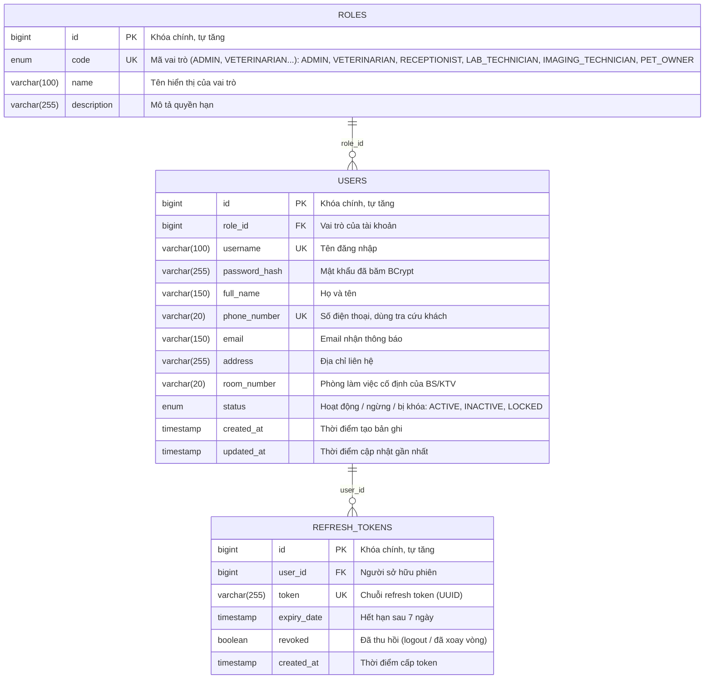
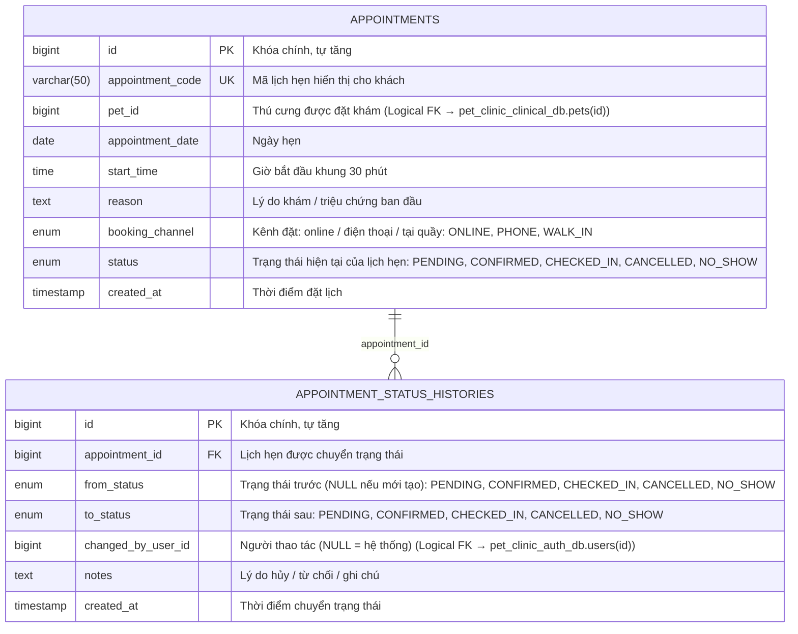

# TÀI LIỆU THIẾT KẾ CƠ SỞ DỮ LIỆU (ERD & DATA DICTIONARY)
## HỆ THỐNG QUẢN LÝ PHÒNG KHÁM THÚ Y (MICROSERVICES ARCHITECTURE)

> **Phiên bản:** 3.0 – Chuẩn hóa lại theo góp ý của Giảng viên hướng dẫn (10/11/2026)
> **Mô hình kiến trúc:** Microservices Architecture (Database-per-Service Pattern)
> **Cơ sở dữ liệu:** MySQL 8.0 Server phân vùng thành 4 Cơ sở dữ liệu logic (Logical Databases / Schemas)
> **Tổng số bảng:** 25 bảng (Auth: 3 bảng, Appointment: 2 bảng, Clinical: 14 bảng, Billing-Pharmacy: 6 bảng)
> **Tài liệu tham chiếu:** [THIET_KE_KIEN_TRUC_MICROSERVICES.md](THIET_KE_KIEN_TRUC_MICROSERVICES.md), [schema_init.sql](schema_init.sql) (v3.0), [DANH_SACH_KIEU_ENUM_HE_THONG.md](DANH_SACH_KIEU_ENUM_HE_THONG.md)

---

## 1. Nguyên tắc thiết kế kiến trúc CSDL theo Microservices

1. **Nguyên tắc Độc lập Dữ liệu & Bounded Contexts (Database-per-Service):**
   - Hệ thống không sử dụng một cơ sở dữ liệu nguyên khối (Monolithic Database) dùng chung.
   - Cơ sở dữ liệu được phân chia thành **4 Database logic** tương ứng với 4 Bounded Contexts nghiệp vụ:
     - `pet_clinic_auth_db` phụ trách bởi `auth-service` (:8081) - Quản trị, phân quyền, người dùng (3 bảng).
     - `pet_clinic_appointment_db` phụ trách bởi `appointment-service` (:8082) - Cổng đặt lịch trực tuyến & Audit Trail lịch hẹn (2 bảng).
     - `pet_clinic_clinical_db` phụ trách bởi `clinical-service` (:8083) - Bệnh nhân (Loài, Hồ sơ thú cưng), Khám lâm sàng 2 pha, Cận lâm sàng, Hóa đơn dịch vụ & Audit Trail (14 bảng).
     - `pet_clinic_billing_pharmacy_db` phụ trách bởi `billing-pharmacy-service` (:8084) - Đơn thuốc, Hóa đơn thuốc (tùy chọn), Danh mục thuốc & Nhật ký kho dược (6 bảng).
   - Mỗi Microservice chỉ được phép kết nối và thao tác trực tiếp trên Database của chính mình. Tuyệt đối không truy vấn trực tiếp (Cross-database JOIN) sang database của dịch vụ khác.

2. **Cơ chế Toàn vẹn Dữ liệu Liên Dịch vụ (Inter-Service Data Integrity):**
   - **Khóa ngoại vật lý nội bộ (Internal Physical Foreign Key):** Các bảng trong cùng một Service duy trì ràng buộc `FOREIGN KEY` (ví dụ: `pets.species_id` $\rightarrow$ `species(id)`, `service_invoices.visit_service_detail_id` $\rightarrow$ `visit_service_details(id)`, `medicine_invoice_items.medicine_invoice_id` $\rightarrow$ `medicine_invoices(id)`).
   - **Khóa ngoại logic liên dịch vụ (Cross-Service Logical Reference):** Quan hệ liên Service lưu dưới dạng `BIGINT` (ví dụ: `appointments.pet_id` tham chiếu `pets.id`, `pet_visits.doctor_id` tham chiếu `users.id`, `prescriptions.visit_id` tham chiếu `pet_visits.id`).
   - **Chỉ mục B-Tree (Index):** 100% các trường khóa ngoại logic đều được đánh index (trực tiếp, qua `UNIQUE` hoặc là cột đầu của index ghép).
   - **Đảm bảo tính toàn vẹn:** Kiểm tra hợp lệ qua **OpenFeign REST API** tại thời điểm ghi nhận và đồng bộ bất đồng bộ qua **RabbitMQ Events**.

3. **Phân tầng dữ liệu: Master Data - Transactional Data - Audit Trail:**
   - **Dữ liệu danh mục (Master Data):** `roles`, `species`, `services`, `lab_test_items`, `service_lab_test_items`, `lab_test_reference_ranges`, `medicines`. Ít biến động, chủ yếu phục vụ tra cứu.
   - **Dữ liệu giao dịch (Transactional Data):** `appointments`, `pet_visits`, `visit_service_details`, `lab_test_results`, `imaging_results`, `imaging_attachments`, `prescriptions`, `prescription_items`, `service_invoices`, `medicine_invoices`, `medicine_invoice_items`.
   - **Dữ liệu theo dõi quá trình & kiểm toán (Audit Trail):** `appointment_status_histories`, `pet_visit_status_histories`, `visit_service_detail_histories`, `inventory_transactions`.

4. **Chuẩn hóa 3NF & không lưu thuộc tính dẫn xuất:**
   - **Không lưu giá trị tính được** từ các cột khác: tổng tiền, thành tiền, tiền thuế, tồn kho sau giao dịch, đánh giá chỉ số xét nghiệm. Các giá trị này được tính bằng VIEW hoặc tại tầng ứng dụng (xem Mục 5).
   - **Không lặp lại thông tin của bảng lịch sử trạng thái:** người duyệt/hủy, thời điểm bắt đầu/chốt/hoàn tất, lý do hủy được lấy từ các bảng `*_status_histories`.
   - **Giữ các cột snapshot** (đơn giá, thuế suất, ngưỡng tham chiếu lưu tại thời điểm phát sinh): đây không phải dữ liệu thừa vì danh mục gốc có thể thay đổi về sau, không tính lại được giá trị cũ.
   - **Ngoại lệ có chủ đích:** `medicines.stock_quantity` được lưu để trừ kho nguyên tử (`UPDATE ... WHERE stock_quantity >= :qty`), chống bán âm kho khi nhiều người thao tác đồng thời. Bất biến: `stock_quantity = SUM(inventory_transactions.quantity)`.

---

## 2. Sơ đồ Thực thể - Mối quan hệ (ERD) chi tiết theo từng Microservice

Theo nguyên tắc **Database-per-Service**, mỗi Microservice sở hữu một cơ sở dữ liệu logic riêng. Dưới đây là 4 sơ đồ ERD (ký hiệu chân chim – Crow's Foot) biểu diễn đầy đủ các bảng, kiểu dữ liệu, khóa chính (PK), khóa ngoại nội bộ (FK), ràng buộc duy nhất (UK) và quan hệ, được sinh trực tiếp từ kịch bản DDL tại [schema_init.sql](schema_init.sql). Khóa ngoại logic sang service khác được ghi trong chú thích cột dạng *(Logical FK → database.bảng(id))*. Nhãn trên mỗi quan hệ là tên cột khóa ngoại.

---

### 2.1. CSDL Phân hệ Quản trị, Xác thực & Nhân sự (`pet_clinic_auth_db`)
> **Phụ trách:** `auth-service` (:8081) | **Bao gồm 3 bảng:** `roles`, `users`, `refresh_tokens`.



---

### 2.2. CSDL Phân hệ Đặt lịch hẹn Khám tiền trạm (`pet_clinic_appointment_db`)
> **Phụ trách:** `appointment-service` (:8082) | **Bao gồm 2 bảng:** `appointments`, `appointment_status_histories`.  
> *Lưu ý:* Lịch hẹn chỉ lưu thông tin gốc; người duyệt/hủy, thời điểm và lý do hủy được ghi ở `appointment_status_histories`.



---

### 2.3. CSDL Phân hệ Bệnh nhân, Khám Lâm sàng 2 Pha, Hóa đơn dịch vụ & Audit Trail (`pet_clinic_clinical_db`)
> **Phụ trách:** `clinical-service` (:8083) | **Bao gồm 14 bảng:** `species`, `pets`, `services`, `lab_test_items`, `service_lab_test_items`, `lab_test_reference_ranges`, `pet_visits`, `pet_visit_status_histories`, `visit_service_details`, `visit_service_detail_histories`, `lab_test_results`, `imaging_results`, `imaging_attachments`, `service_invoices`.  
> *Đặc điểm:* Mỗi dòng chỉ định dịch vụ có đúng 1 hóa đơn riêng (`service_invoices`, quan hệ 1–1), đặt cùng DB với dịch vụ để dùng khóa ngoại vật lý và truy xuất doanh thu theo dịch vụ bằng JOIN nội bộ.

```mermaid
erDiagram
    SPECIES ||--o{ PETS : "species_id"
    SERVICES ||--o{ SERVICE_LAB_TEST_ITEMS : "service_id"
    LAB_TEST_ITEMS ||--o{ SERVICE_LAB_TEST_ITEMS : "lab_test_item_id"
    LAB_TEST_ITEMS ||--o{ LAB_TEST_REFERENCE_RANGES : "lab_test_item_id"
    SPECIES ||--o{ LAB_TEST_REFERENCE_RANGES : "species_id"
    PETS ||--o{ PET_VISITS : "pet_id"
    PET_VISITS ||--o{ PET_VISIT_STATUS_HISTORIES : "visit_id"
    PET_VISITS ||--o{ VISIT_SERVICE_DETAILS : "visit_id"
    SERVICES ||--o{ VISIT_SERVICE_DETAILS : "service_id"
    VISIT_SERVICE_DETAILS ||--o{ VISIT_SERVICE_DETAIL_HISTORIES : "visit_service_detail_id"
    VISIT_SERVICE_DETAILS ||--o{ LAB_TEST_RESULTS : "visit_service_detail_id"
    LAB_TEST_ITEMS ||--o{ LAB_TEST_RESULTS : "lab_test_item_id"
    VISIT_SERVICE_DETAILS ||--o| IMAGING_RESULTS : "visit_service_detail_id"
    IMAGING_RESULTS ||--o{ IMAGING_ATTACHMENTS : "imaging_result_id"
    VISIT_SERVICE_DETAILS ||--o| SERVICE_INVOICES : "visit_service_detail_id"

    SPECIES {
        bigint id PK "Khóa chính, tự tăng"
        varchar(50) code UK "Mã loài (DOG, CAT)"
        varchar(100) name "Tên loài"
        varchar(255) description "Mô tả loài"
    }

    PETS {
        bigint id PK "Khóa chính, tự tăng"
        bigint owner_id "Chủ sở hữu thú cưng (Logical FK → pet_clinic_auth_db.users(id))"
        bigint species_id FK "Loài của thú cưng"
        varchar(50) pet_code UK "Mã hồ sơ thú cưng"
        varchar(100) name "Tên thú cưng"
        varchar(100) breed "Giống (Poodle, Mèo Anh...)"
        enum gender "Giới tính: MALE, FEMALE, UNKNOWN"
        date date_of_birth "Ngày sinh"
        varchar(100) color "Màu lông"
        boolean is_neutered "Đã triệt sản hay chưa"
        text identifying_characteristics "Đặc điểm nhận dạng"
        text notes "Tiền sử, dị ứng, ghi chú"
        timestamp created_at "Thời điểm tạo bản ghi"
        timestamp updated_at "Thời điểm cập nhật gần nhất"
    }

    SERVICES {
        bigint id PK "Khóa chính, tự tăng"
        varchar(50) code UK "Mã dịch vụ (EXAM_GEN, LAB_CBC...)"
        varchar(150) name "Tên dịch vụ"
        enum category "Nhóm dịch vụ (khám, xét nghiệm, CĐHA...): EXAMINATION, VACCINATION, DEWORMING, EXTERNAL_PARASITE, INJECTION_INFUSION, LABORATORY, IMAGING, SURGERY, PROCEDURE"
        decimal(12,2) price "Đơn giá niêm yết hiện tại"
        decimal(4,2) vat_rate "Thuế suất VAT hiện hành"
        text description "Mô tả dịch vụ"
        boolean is_active "Còn cung cấp hay đã ngừng"
    }

    LAB_TEST_ITEMS {
        bigint id PK "Khóa chính, tự tăng"
        varchar(50) code UK "Mã chỉ số (WBC, RBC...)"
        varchar(100) name "Tên chỉ số"
        varchar(30) unit "Đơn vị đo"
        varchar(255) description "Ý nghĩa lâm sàng"
    }

    SERVICE_LAB_TEST_ITEMS {
        bigint service_id PK, FK "Gói xét nghiệm"
        bigint lab_test_item_id PK, FK "Chỉ số thuộc gói"
    }

    LAB_TEST_REFERENCE_RANGES {
        bigint id PK "Khóa chính, tự tăng"
        bigint lab_test_item_id FK "Chỉ số xét nghiệm"
        bigint species_id FK "Loài áp dụng"
        decimal(8,2) min_value "Ngưỡng dưới bình thường"
        decimal(8,2) max_value "Ngưỡng trên bình thường"
    }

    PET_VISITS {
        bigint id PK "Khóa chính, tự tăng"
        varchar(50) visit_code UK "Mã đợt khám"
        bigint pet_id FK "Thú cưng được khám"
        bigint appointment_id UK "Lịch hẹn gốc (NULL = khách vãng lai) (Logical FK → pet_clinic_appointment_db.appointments(id))"
        bigint doctor_id "Bác sĩ được phân công (Logical FK → pet_clinic_auth_db.users(id))"
        bigint receptionist_id "Lễ tân tiếp đón (Logical FK → pet_clinic_auth_db.users(id))"
        boolean is_emergency "Ca cấp cứu, ưu tiên đầu hàng đợi"
        decimal(5,2) weight_at_visit "Cân nặng đo lúc khám (kg)"
        decimal(4,1) temperature "Thân nhiệt đo lúc khám (°C)"
        text initial_symptoms "Triệu chứng ban đầu khi tiếp đón"
        text clinical_notes "Ghi nhận khám lâm sàng"
        text diagnosis "Chẩn đoán xác định"
        text treatment_plan "Phác đồ điều trị"
        text doctor_advice "Lời dặn của bác sĩ"
        enum status "Trạng thái hiện tại của đợt khám: WAITING, IN_PROGRESS, WAITING_RESULTS, RESULTS_READY, WAITING_PAYMENT, COMPLETED, CANCELLED"
        timestamp checked_in_at "Thời điểm tiếp đón, xếp hàng đợi FIFO"
        bigint version "Khóa lạc quan, chống ghi đè đồng thời"
    }

    PET_VISIT_STATUS_HISTORIES {
        bigint id PK "Khóa chính, tự tăng"
        bigint visit_id FK "Đợt khám được chuyển trạng thái"
        enum from_status "Trạng thái trước: WAITING, IN_PROGRESS, WAITING_RESULTS, RESULTS_READY, WAITING_PAYMENT, COMPLETED, CANCELLED"
        enum to_status "Trạng thái sau: WAITING, IN_PROGRESS, WAITING_RESULTS, RESULTS_READY, WAITING_PAYMENT, COMPLETED, CANCELLED"
        bigint changed_by_user_id "Người thao tác (NULL = hệ thống) (Logical FK → pet_clinic_auth_db.users(id))"
        text notes "Ghi chú / lý do hủy"
        timestamp created_at "Thời điểm chuyển trạng thái"
    }

    VISIT_SERVICE_DETAILS {
        bigint id PK "Khóa chính, tự tăng"
        bigint visit_id FK "Đợt khám chứa chỉ định"
        bigint service_id FK "Dịch vụ được chỉ định"
        int quantity "Số lượng (VD: số tư thế chụp)"
        enum status "Chờ / đang làm / xong / hủy: PENDING, IN_PROGRESS, COMPLETED, CANCELLED"
        text notes "Ghi chú chỉ định của bác sĩ"
        timestamp created_at "Thời điểm chỉ định"
    }

    VISIT_SERVICE_DETAIL_HISTORIES {
        bigint id PK "Khóa chính, tự tăng"
        bigint visit_service_detail_id FK "Chỉ định được thao tác"
        enum from_status "Trạng thái trước: PENDING, IN_PROGRESS, COMPLETED, CANCELLED"
        enum to_status "Trạng thái sau: PENDING, IN_PROGRESS, COMPLETED, CANCELLED"
        varchar(50) action "Hành động: hoãn, gọi lại, bắt đầu..."
        bigint changed_by_user_id "Bác sĩ / KTV thao tác (Logical FK → pet_clinic_auth_db.users(id))"
        text reason "Lý do hoãn / hủy"
        timestamp created_at "Thời điểm thao tác"
    }

    LAB_TEST_RESULTS {
        bigint id PK "Khóa chính, tự tăng"
        bigint visit_service_detail_id FK "Chỉ định xét nghiệm"
        bigint lab_test_item_id FK "Chỉ số được đo"
        decimal(8,2) result_value "Giá trị đo được"
        decimal(8,2) min_value_snapshot "Ngưỡng dưới tại thời điểm xét nghiệm"
        decimal(8,2) max_value_snapshot "Ngưỡng trên tại thời điểm xét nghiệm"
        bigint performed_by "KTV xét nghiệm thực hiện (Logical FK → pet_clinic_auth_db.users(id))"
        text notes "Nhận xét chuyên môn"
        timestamp created_at "Thời điểm nhập kết quả"
    }

    IMAGING_RESULTS {
        bigint id PK "Khóa chính, tự tăng"
        bigint visit_service_detail_id FK, UK "Chỉ định CĐHA (1–1)"
        text description "Mô tả hình ảnh quan sát"
        text conclusion "Kết luận chẩn đoán hình ảnh"
        bigint performed_by "KTV / BS CĐHA thực hiện (Logical FK → pet_clinic_auth_db.users(id))"
        timestamp performed_at "Thời điểm thực hiện"
    }

    IMAGING_ATTACHMENTS {
        bigint id PK "Khóa chính, tự tăng"
        bigint imaging_result_id FK "Kết quả CĐHA chứa ảnh"
        varchar(500) file_url "Đường dẫn tệp ảnh"
        varchar(255) file_name "Tên tệp gốc"
        bigint file_size "Dung lượng (byte)"
        varchar(50) content_type "Định dạng (image/jpeg...)"
    }

    SERVICE_INVOICES {
        bigint id PK "Khóa chính, tự tăng"
        varchar(50) invoice_code UK "Mã hóa đơn hiển thị"
        bigint visit_service_detail_id FK, UK "Dịch vụ được tính tiền (1–1)"
        decimal(12,2) unit_price "Đơn giá chốt lúc chỉ định"
        decimal(4,2) vat_rate "Thuế suất chốt lúc chỉ định"
        decimal(12,2) discount_amount "Số tiền giảm giá"
        enum payment_status "Chờ thanh toán / đã trả / hủy: PENDING, PAID, CANCELLED"
        bigint cashier_id "Thu ngân thu tiền (Logical FK → pet_clinic_auth_db.users(id))"
        timestamp paid_at "Thời điểm thanh toán"
        timestamp created_at "Thời điểm lập hóa đơn"
        bigint version "Khóa lạc quan, chống ghi đè đồng thời"
    }
```

---

### 2.4. CSDL Phân hệ Đơn thuốc, Hóa đơn thuốc & Kho dược (`pet_clinic_billing_pharmacy_db`)
> **Phụ trách:** `billing-pharmacy-service` (:8084) | **Bao gồm 6 bảng:** `medicines`, `prescriptions`, `prescription_items`, `medicine_invoices`, `medicine_invoice_items`, `inventory_transactions`.  
> *Đặc điểm:* Đơn thuốc là chỉ định chuyên môn; khách được mua tại phòng khám hoặc mua ngoài. Chỉ khi mua tại phòng khám mới sinh hóa đơn thuốc (tối đa 1 hóa đơn / đơn thuốc), thu tiền và trừ kho trong cùng một giao dịch.

```mermaid
erDiagram
    PRESCRIPTIONS ||--o{ PRESCRIPTION_ITEMS : "prescription_id"
    MEDICINES ||--o{ PRESCRIPTION_ITEMS : "medicine_id"
    PRESCRIPTIONS ||--o| MEDICINE_INVOICES : "prescription_id"
    MEDICINE_INVOICES ||--o{ MEDICINE_INVOICE_ITEMS : "medicine_invoice_id"
    PRESCRIPTION_ITEMS ||--o{ MEDICINE_INVOICE_ITEMS : "prescription_item_id"
    MEDICINES ||--o{ INVENTORY_TRANSACTIONS : "medicine_id"
    MEDICINE_INVOICES |o--o{ INVENTORY_TRANSACTIONS : "medicine_invoice_id"

    MEDICINES {
        bigint id PK "Khóa chính, tự tăng"
        varchar(50) code UK "Mã thuốc"
        varchar(150) name "Tên thương mại"
        varchar(150) active_ingredient "Hoạt chất chính"
        varchar(50) dosage_form "Dạng bào chế"
        varchar(30) unit "Đơn vị tính (viên, lọ...)"
        decimal(12,2) sale_price "Giá bán niêm yết hiện tại"
        decimal(4,2) vat_rate "Thuế suất VAT hiện hành"
        int stock_quantity "Số lượng tồn kho hiện tại"
        int min_stock_alert "Ngưỡng cảnh báo sắp hết"
        boolean is_active "Còn lưu hành hay không"
        bigint version "Khóa lạc quan, chống ghi đè đồng thời"
    }

    PRESCRIPTIONS {
        bigint id PK "Khóa chính, tự tăng"
        bigint visit_id UK "Đợt khám kê đơn (tối đa 1 đơn) (Logical FK → pet_clinic_clinical_db.pet_visits(id))"
        text doctor_notes "Lời dặn chung về dùng thuốc"
        timestamp created_at "Thời điểm kê đơn"
    }

    PRESCRIPTION_ITEMS {
        bigint id PK "Khóa chính, tự tăng"
        bigint prescription_id FK "Đơn thuốc chứa dòng này"
        bigint medicine_id FK "Thuốc được kê"
        int quantity "Số lượng bác sĩ kê"
        varchar(100) dosage "Liều mỗi lần dùng"
        varchar(100) frequency "Số lần dùng mỗi ngày"
        int duration_days "Số ngày dùng"
        text instructions "Hướng dẫn sử dụng"
    }

    MEDICINE_INVOICES {
        bigint id PK "Khóa chính, tự tăng"
        varchar(50) invoice_code UK "Mã hóa đơn hiển thị"
        bigint prescription_id FK, UK "Đơn thuốc được mua (tối đa 1 HĐ)"
        decimal(12,2) discount_amount "Số tiền giảm giá"
        enum payment_status "Chờ thanh toán / đã trả / hủy: PENDING, PAID, CANCELLED"
        bigint cashier_id "Thu ngân bán thuốc (Logical FK → pet_clinic_auth_db.users(id))"
        timestamp paid_at "Thời điểm thanh toán"
        timestamp created_at "Thời điểm lập hóa đơn"
        bigint version "Khóa lạc quan, chống ghi đè đồng thời"
    }

    MEDICINE_INVOICE_ITEMS {
        bigint id PK "Khóa chính, tự tăng"
        bigint medicine_invoice_id FK "Hóa đơn thuốc chứa dòng này"
        bigint prescription_item_id FK "Dòng thuốc trong đơn được mua"
        int quantity "Số lượng khách mua (≤ số kê)"
        decimal(12,2) unit_price "Giá bán chốt lúc lập hóa đơn"
        decimal(4,2) vat_rate "Thuế suất chốt lúc lập hóa đơn"
    }

    INVENTORY_TRANSACTIONS {
        bigint id PK "Khóa chính, tự tăng"
        bigint medicine_id FK "Thuốc biến động"
        enum transaction_type "Nhập / xuất bán / điều chỉnh: IMPORT, EXPORT_SALE, ADJUSTMENT"
        int quantity "Số lượng có dấu (+ nhập, − xuất)"
        bigint medicine_invoice_id FK "Hóa đơn thuốc (khi xuất bán)"
        varchar(255) notes "Lý do điều chỉnh / ghi chú"
        bigint created_by "Người thực hiện (Logical FK → pet_clinic_auth_db.users(id))"
        timestamp created_at "Thời điểm giao dịch"
    }
```

---

## 3. Từ điển dữ liệu chi tiết theo từng Bounded Context

### 3.1. Bounded Context 1: Quản trị, Xác thực & Nhân sự (`pet_clinic_auth_db`)
> **Phụ trách:** `auth-service`

#### Bảng `roles` (Danh mục 6 vai trò người dùng)

| Tên cột | Kiểu dữ liệu | Ràng buộc | Mô tả |
| :--- | :--- | :--- | :--- |
| `id` | BIGINT | PK, AUTO_INCREMENT | Khóa chính, tự tăng |
| `code` | ENUM('ADMIN', 'VETERINARIAN', 'RECEPTIONIST', 'LAB_TECHNICIAN', 'IMAGING_TECHNICIAN', 'PET_OWNER') | UNIQUE, NOT NULL | Mã vai trò (ADMIN, VETERINARIAN...) |
| `name` | VARCHAR(100) | NOT NULL | Tên hiển thị của vai trò |
| `description` | VARCHAR(255) | NULL | Mô tả quyền hạn |

#### Bảng `users` (Tài khoản nhân sự và khách hàng (chủ thú cưng))

| Tên cột | Kiểu dữ liệu | Ràng buộc | Mô tả |
| :--- | :--- | :--- | :--- |
| `id` | BIGINT | PK, AUTO_INCREMENT | Khóa chính, tự tăng |
| `role_id` | BIGINT | FK → roles(id), NOT NULL | Vai trò của tài khoản |
| `username` | VARCHAR(100) | UNIQUE, NOT NULL | Tên đăng nhập |
| `password_hash` | VARCHAR(255) | NOT NULL | Mật khẩu đã băm BCrypt |
| `full_name` | VARCHAR(150) | NOT NULL | Họ và tên |
| `phone_number` | VARCHAR(20) | UNIQUE, NOT NULL | Số điện thoại, dùng tra cứu khách |
| `email` | VARCHAR(150) | NULL | Email nhận thông báo |
| `address` | VARCHAR(255) | NULL | Địa chỉ liên hệ |
| `room_number` | VARCHAR(20) | NULL | Phòng làm việc cố định của BS/KTV |
| `status` | ENUM('ACTIVE', 'INACTIVE', 'LOCKED') | NOT NULL, DEFAULT 'ACTIVE' | Hoạt động / ngừng / bị khóa |
| `created_at` | TIMESTAMP | NOT NULL, DEFAULT NOW() | Thời điểm tạo bản ghi |
| `updated_at` | TIMESTAMP | NOT NULL, DEFAULT NOW(), ON UPDATE NOW() | Thời điểm cập nhật gần nhất |

#### Bảng `refresh_tokens` (Phiên đăng nhập, phục vụ xoay vòng token)

| Tên cột | Kiểu dữ liệu | Ràng buộc | Mô tả |
| :--- | :--- | :--- | :--- |
| `id` | BIGINT | PK, AUTO_INCREMENT | Khóa chính, tự tăng |
| `user_id` | BIGINT | FK → users(id), ON DELETE CASCADE, NOT NULL | Người sở hữu phiên |
| `token` | VARCHAR(255) | UNIQUE, NOT NULL | Chuỗi refresh token (UUID) |
| `expiry_date` | TIMESTAMP | NOT NULL | Hết hạn sau 7 ngày |
| `revoked` | BOOLEAN | NOT NULL, DEFAULT FALSE | Đã thu hồi (logout / đã xoay vòng) |
| `created_at` | TIMESTAMP | NOT NULL, DEFAULT NOW() | Thời điểm cấp token |

### 3.2. Bounded Context 2: Đặt lịch hẹn Khám tiền trạm (`pet_clinic_appointment_db`)
> **Phụ trách:** `appointment-service`

#### Bảng `appointments` (Lịch hẹn khám đặt trước)

| Tên cột | Kiểu dữ liệu | Ràng buộc | Mô tả |
| :--- | :--- | :--- | :--- |
| `id` | BIGINT | PK, AUTO_INCREMENT | Khóa chính, tự tăng |
| `appointment_code` | VARCHAR(50) | UNIQUE, NOT NULL | Mã lịch hẹn hiển thị cho khách |
| `pet_id` | BIGINT | NOT NULL | **Logical FK** → `pet_clinic_clinical_db.pets(id)`. Thú cưng được đặt khám |
| `appointment_date` | DATE | NOT NULL | Ngày hẹn |
| `start_time` | TIME | NOT NULL | Giờ bắt đầu khung 30 phút |
| `reason` | TEXT | NOT NULL | Lý do khám / triệu chứng ban đầu |
| `booking_channel` | ENUM('ONLINE', 'PHONE', 'WALK_IN') | NOT NULL, DEFAULT 'ONLINE' | Kênh đặt: online / điện thoại / tại quầy |
| `status` | ENUM('PENDING', 'CONFIRMED', 'CHECKED_IN', 'CANCELLED', 'NO_SHOW') | NOT NULL, DEFAULT 'PENDING' | Trạng thái hiện tại của lịch hẹn |
| `created_at` | TIMESTAMP | NOT NULL, DEFAULT NOW() | Thời điểm đặt lịch |

#### Bảng `appointment_status_histories` (Lịch sử chuyển trạng thái lịch hẹn)

| Tên cột | Kiểu dữ liệu | Ràng buộc | Mô tả |
| :--- | :--- | :--- | :--- |
| `id` | BIGINT | PK, AUTO_INCREMENT | Khóa chính, tự tăng |
| `appointment_id` | BIGINT | FK → appointments(id), ON DELETE CASCADE, NOT NULL | Lịch hẹn được chuyển trạng thái |
| `from_status` | ENUM('PENDING', 'CONFIRMED', 'CHECKED_IN', 'CANCELLED', 'NO_SHOW') | NULL | Trạng thái trước (NULL nếu mới tạo) |
| `to_status` | ENUM('PENDING', 'CONFIRMED', 'CHECKED_IN', 'CANCELLED', 'NO_SHOW') | NOT NULL | Trạng thái sau |
| `changed_by_user_id` | BIGINT | NULL | **Logical FK** → `pet_clinic_auth_db.users(id)`. Người thao tác (NULL = hệ thống) |
| `notes` | TEXT | NULL | Lý do hủy / từ chối / ghi chú |
| `created_at` | TIMESTAMP | NOT NULL, DEFAULT NOW() | Thời điểm chuyển trạng thái |

### 3.3. Bounded Context 3: Bệnh nhân, Khám Lâm sàng 2 Pha, Hóa đơn dịch vụ & Audit Trail (`pet_clinic_clinical_db`)
> **Phụ trách:** `clinical-service`

#### Bảng `species` (Danh mục loài thú cưng)

| Tên cột | Kiểu dữ liệu | Ràng buộc | Mô tả |
| :--- | :--- | :--- | :--- |
| `id` | BIGINT | PK, AUTO_INCREMENT | Khóa chính, tự tăng |
| `code` | VARCHAR(50) | UNIQUE, NOT NULL | Mã loài (DOG, CAT) |
| `name` | VARCHAR(100) | NOT NULL | Tên loài |
| `description` | VARCHAR(255) | NULL | Mô tả loài |

#### Bảng `pets` (Hồ sơ thú cưng (bệnh nhân))

| Tên cột | Kiểu dữ liệu | Ràng buộc | Mô tả |
| :--- | :--- | :--- | :--- |
| `id` | BIGINT | PK, AUTO_INCREMENT | Khóa chính, tự tăng |
| `owner_id` | BIGINT | NOT NULL | **Logical FK** → `pet_clinic_auth_db.users(id)`. Chủ sở hữu thú cưng |
| `species_id` | BIGINT | FK → species(id), NOT NULL | Loài của thú cưng |
| `pet_code` | VARCHAR(50) | UNIQUE, NOT NULL | Mã hồ sơ thú cưng |
| `name` | VARCHAR(100) | NOT NULL | Tên thú cưng |
| `breed` | VARCHAR(100) | NULL | Giống (Poodle, Mèo Anh...) |
| `gender` | ENUM('MALE', 'FEMALE', 'UNKNOWN') | NOT NULL, DEFAULT 'UNKNOWN' | Giới tính |
| `date_of_birth` | DATE | NULL | Ngày sinh |
| `color` | VARCHAR(100) | NULL | Màu lông |
| `is_neutered` | BOOLEAN | NOT NULL, DEFAULT FALSE | Đã triệt sản hay chưa |
| `identifying_characteristics` | TEXT | NULL | Đặc điểm nhận dạng |
| `notes` | TEXT | NULL | Tiền sử, dị ứng, ghi chú |
| `created_at` | TIMESTAMP | NOT NULL, DEFAULT NOW() | Thời điểm tạo bản ghi |
| `updated_at` | TIMESTAMP | NOT NULL, DEFAULT NOW(), ON UPDATE NOW() | Thời điểm cập nhật gần nhất |

#### Bảng `services` (Danh mục dịch vụ khám, xét nghiệm, CĐHA...)

| Tên cột | Kiểu dữ liệu | Ràng buộc | Mô tả |
| :--- | :--- | :--- | :--- |
| `id` | BIGINT | PK, AUTO_INCREMENT | Khóa chính, tự tăng |
| `code` | VARCHAR(50) | UNIQUE, NOT NULL | Mã dịch vụ (EXAM_GEN, LAB_CBC...) |
| `name` | VARCHAR(150) | NOT NULL | Tên dịch vụ |
| `category` | ENUM('EXAMINATION', 'VACCINATION', 'DEWORMING', 'EXTERNAL_PARASITE', 'INJECTION_INFUSION', 'LABORATORY', 'IMAGING', 'SURGERY', 'PROCEDURE') | NOT NULL | Nhóm dịch vụ (khám, xét nghiệm, CĐHA...) |
| `price` | DECIMAL(12, 2) | NOT NULL | Đơn giá niêm yết hiện tại |
| `vat_rate` | DECIMAL(4, 2) | NOT NULL, DEFAULT 0.00 | Thuế suất VAT hiện hành |
| `description` | TEXT | NULL | Mô tả dịch vụ |
| `is_active` | BOOLEAN | NOT NULL, DEFAULT TRUE | Còn cung cấp hay đã ngừng |

*Ràng buộc mức bảng:* `CHECK (price >= 0)`; `CHECK (vat_rate >= 0 AND vat_rate <= 1)`

#### Bảng `lab_test_items` (Danh mục chỉ số xét nghiệm)

| Tên cột | Kiểu dữ liệu | Ràng buộc | Mô tả |
| :--- | :--- | :--- | :--- |
| `id` | BIGINT | PK, AUTO_INCREMENT | Khóa chính, tự tăng |
| `code` | VARCHAR(50) | UNIQUE, NOT NULL | Mã chỉ số (WBC, RBC...) |
| `name` | VARCHAR(100) | NOT NULL | Tên chỉ số |
| `unit` | VARCHAR(30) | NOT NULL | Đơn vị đo |
| `description` | VARCHAR(255) | NULL | Ý nghĩa lâm sàng |

#### Bảng `service_lab_test_items` (Gói xét nghiệm gồm những chỉ số nào (N–N))

| Tên cột | Kiểu dữ liệu | Ràng buộc | Mô tả |
| :--- | :--- | :--- | :--- |
| `service_id` | BIGINT | PK, FK → services(id) | Gói xét nghiệm |
| `lab_test_item_id` | BIGINT | PK, FK → lab_test_items(id) | Chỉ số thuộc gói |

*Ràng buộc mức bảng:* `PRIMARY KEY kép (service_id, lab_test_item_id)`

#### Bảng `lab_test_reference_ranges` (Khoảng tham chiếu bình thường theo loài)

| Tên cột | Kiểu dữ liệu | Ràng buộc | Mô tả |
| :--- | :--- | :--- | :--- |
| `id` | BIGINT | PK, AUTO_INCREMENT | Khóa chính, tự tăng |
| `lab_test_item_id` | BIGINT | FK → lab_test_items(id), NOT NULL | Chỉ số xét nghiệm |
| `species_id` | BIGINT | FK → species(id), NOT NULL | Loài áp dụng |
| `min_value` | DECIMAL(8, 2) | NOT NULL | Ngưỡng dưới bình thường |
| `max_value` | DECIMAL(8, 2) | NOT NULL | Ngưỡng trên bình thường |

*Ràng buộc mức bảng:* `UNIQUE (lab_test_item_id, species_id)`; `CHECK (min_value <= max_value)`

#### Bảng `pet_visits` (Đợt khám ngoại trú 2 giai đoạn)

| Tên cột | Kiểu dữ liệu | Ràng buộc | Mô tả |
| :--- | :--- | :--- | :--- |
| `id` | BIGINT | PK, AUTO_INCREMENT | Khóa chính, tự tăng |
| `visit_code` | VARCHAR(50) | UNIQUE, NOT NULL | Mã đợt khám |
| `pet_id` | BIGINT | FK → pets(id), NOT NULL | Thú cưng được khám |
| `appointment_id` | BIGINT | UNIQUE, NULL | **Logical FK** → `pet_clinic_appointment_db.appointments(id)`. Lịch hẹn gốc (NULL = khách vãng lai) |
| `doctor_id` | BIGINT | NULL | **Logical FK** → `pet_clinic_auth_db.users(id)`. Bác sĩ được phân công |
| `receptionist_id` | BIGINT | NOT NULL | **Logical FK** → `pet_clinic_auth_db.users(id)`. Lễ tân tiếp đón |
| `is_emergency` | BOOLEAN | NOT NULL, DEFAULT FALSE | Ca cấp cứu, ưu tiên đầu hàng đợi |
| `weight_at_visit` | DECIMAL(5, 2) | NULL | Cân nặng đo lúc khám (kg) |
| `temperature` | DECIMAL(4, 1) | NULL | Thân nhiệt đo lúc khám (°C) |
| `initial_symptoms` | TEXT | NULL | Triệu chứng ban đầu khi tiếp đón |
| `clinical_notes` | TEXT | NULL | Ghi nhận khám lâm sàng |
| `diagnosis` | TEXT | NULL | Chẩn đoán xác định |
| `treatment_plan` | TEXT | NULL | Phác đồ điều trị |
| `doctor_advice` | TEXT | NULL | Lời dặn của bác sĩ |
| `status` | ENUM('WAITING', 'IN_PROGRESS', 'WAITING_RESULTS', 'RESULTS_READY', 'WAITING_PAYMENT', 'COMPLETED', 'CANCELLED') | NOT NULL, DEFAULT 'WAITING' | Trạng thái hiện tại của đợt khám |
| `checked_in_at` | TIMESTAMP | NOT NULL, DEFAULT NOW() | Thời điểm tiếp đón, xếp hàng đợi FIFO |
| `version` | BIGINT | NOT NULL, DEFAULT 0 | Khóa lạc quan, chống ghi đè đồng thời |

#### Bảng `pet_visit_status_histories` (Lịch sử chuyển trạng thái đợt khám)

| Tên cột | Kiểu dữ liệu | Ràng buộc | Mô tả |
| :--- | :--- | :--- | :--- |
| `id` | BIGINT | PK, AUTO_INCREMENT | Khóa chính, tự tăng |
| `visit_id` | BIGINT | FK → pet_visits(id), ON DELETE CASCADE, NOT NULL | Đợt khám được chuyển trạng thái |
| `from_status` | ENUM('WAITING', 'IN_PROGRESS', 'WAITING_RESULTS', 'RESULTS_READY', 'WAITING_PAYMENT', 'COMPLETED', 'CANCELLED') | NULL | Trạng thái trước |
| `to_status` | ENUM('WAITING', 'IN_PROGRESS', 'WAITING_RESULTS', 'RESULTS_READY', 'WAITING_PAYMENT', 'COMPLETED', 'CANCELLED') | NOT NULL | Trạng thái sau |
| `changed_by_user_id` | BIGINT | NULL | **Logical FK** → `pet_clinic_auth_db.users(id)`. Người thao tác (NULL = hệ thống) |
| `notes` | TEXT | NULL | Ghi chú / lý do hủy |
| `created_at` | TIMESTAMP | NOT NULL, DEFAULT NOW() | Thời điểm chuyển trạng thái |

#### Bảng `visit_service_details` (Dịch vụ bác sĩ chỉ định trong đợt khám)

| Tên cột | Kiểu dữ liệu | Ràng buộc | Mô tả |
| :--- | :--- | :--- | :--- |
| `id` | BIGINT | PK, AUTO_INCREMENT | Khóa chính, tự tăng |
| `visit_id` | BIGINT | FK → pet_visits(id), NOT NULL | Đợt khám chứa chỉ định |
| `service_id` | BIGINT | FK → services(id), NOT NULL | Dịch vụ được chỉ định |
| `quantity` | INT | NOT NULL, DEFAULT 1 | Số lượng (VD: số tư thế chụp) |
| `status` | ENUM('PENDING', 'IN_PROGRESS', 'COMPLETED', 'CANCELLED') | NOT NULL, DEFAULT 'PENDING' | Chờ / đang làm / xong / hủy |
| `notes` | TEXT | NULL | Ghi chú chỉ định của bác sĩ |
| `created_at` | TIMESTAMP | NOT NULL, DEFAULT NOW() | Thời điểm chỉ định |

*Ràng buộc mức bảng:* `CHECK (quantity > 0)`

#### Bảng `visit_service_detail_histories` (Lịch sử tiến độ thực hiện dịch vụ)

| Tên cột | Kiểu dữ liệu | Ràng buộc | Mô tả |
| :--- | :--- | :--- | :--- |
| `id` | BIGINT | PK, AUTO_INCREMENT | Khóa chính, tự tăng |
| `visit_service_detail_id` | BIGINT | FK → visit_service_details(id), ON DELETE CASCADE, NOT NULL | Chỉ định được thao tác |
| `from_status` | ENUM('PENDING', 'IN_PROGRESS', 'COMPLETED', 'CANCELLED') | NULL | Trạng thái trước |
| `to_status` | ENUM('PENDING', 'IN_PROGRESS', 'COMPLETED', 'CANCELLED') | NOT NULL | Trạng thái sau |
| `action` | VARCHAR(50) | NOT NULL | Hành động: `ORDERED` (chỉ định), `START_PROCESSING` (bắt đầu), `SAMPLE_COLLECTED` (đã lấy mẫu), `COMPLETED` (hoàn tất), `CANCELLED` (hủy), `POSTPONED` (tạm hoãn), `RECALL` (gọi lại) |
| `changed_by_user_id` | BIGINT | NOT NULL | **Logical FK** → `pet_clinic_auth_db.users(id)`. Bác sĩ / KTV thao tác |
| `reason` | TEXT | NULL | Lý do hoãn / hủy |
| `created_at` | TIMESTAMP | NOT NULL, DEFAULT NOW() | Thời điểm thao tác |

#### Bảng `lab_test_results` (Kết quả từng chỉ số xét nghiệm)

| Tên cột | Kiểu dữ liệu | Ràng buộc | Mô tả |
| :--- | :--- | :--- | :--- |
| `id` | BIGINT | PK, AUTO_INCREMENT | Khóa chính, tự tăng |
| `visit_service_detail_id` | BIGINT | FK → visit_service_details(id), NOT NULL | Chỉ định xét nghiệm |
| `lab_test_item_id` | BIGINT | FK → lab_test_items(id), NOT NULL | Chỉ số được đo |
| `result_value` | DECIMAL(8, 2) | NOT NULL | Giá trị đo được |
| `min_value_snapshot` | DECIMAL(8, 2) | NOT NULL | Ngưỡng dưới tại thời điểm xét nghiệm |
| `max_value_snapshot` | DECIMAL(8, 2) | NOT NULL | Ngưỡng trên tại thời điểm xét nghiệm |
| `performed_by` | BIGINT | NOT NULL | **Logical FK** → `pet_clinic_auth_db.users(id)`. KTV xét nghiệm thực hiện |
| `notes` | TEXT | NULL | Nhận xét chuyên môn |
| `created_at` | TIMESTAMP | NOT NULL, DEFAULT NOW() | Thời điểm nhập kết quả |

*Ràng buộc mức bảng:* `UNIQUE (visit_service_detail_id, lab_test_item_id)`

#### Bảng `imaging_results` (Kết quả chẩn đoán hình ảnh)

| Tên cột | Kiểu dữ liệu | Ràng buộc | Mô tả |
| :--- | :--- | :--- | :--- |
| `id` | BIGINT | PK, AUTO_INCREMENT | Khóa chính, tự tăng |
| `visit_service_detail_id` | BIGINT | FK → visit_service_details(id), UNIQUE, NOT NULL | Chỉ định CĐHA (1–1) |
| `description` | TEXT | NOT NULL | Mô tả hình ảnh quan sát |
| `conclusion` | TEXT | NOT NULL | Kết luận chẩn đoán hình ảnh |
| `performed_by` | BIGINT | NOT NULL | **Logical FK** → `pet_clinic_auth_db.users(id)`. KTV / BS CĐHA thực hiện |
| `performed_at` | TIMESTAMP | NOT NULL, DEFAULT NOW() | Thời điểm thực hiện |

#### Bảng `imaging_attachments` (Tệp ảnh X-quang / siêu âm đính kèm)

| Tên cột | Kiểu dữ liệu | Ràng buộc | Mô tả |
| :--- | :--- | :--- | :--- |
| `id` | BIGINT | PK, AUTO_INCREMENT | Khóa chính, tự tăng |
| `imaging_result_id` | BIGINT | FK → imaging_results(id), ON DELETE CASCADE, NOT NULL | Kết quả CĐHA chứa ảnh |
| `file_url` | VARCHAR(500) | NOT NULL | Đường dẫn tệp ảnh |
| `file_name` | VARCHAR(255) | NOT NULL | Tên tệp gốc |
| `file_size` | BIGINT | NULL | Dung lượng (byte) |
| `content_type` | VARCHAR(50) | NULL | Định dạng (image/jpeg...) |

#### Bảng `service_invoices` (Hóa đơn riêng cho từng dịch vụ (1–1))

| Tên cột | Kiểu dữ liệu | Ràng buộc | Mô tả |
| :--- | :--- | :--- | :--- |
| `id` | BIGINT | PK, AUTO_INCREMENT | Khóa chính, tự tăng |
| `invoice_code` | VARCHAR(50) | UNIQUE, NOT NULL | Mã hóa đơn hiển thị |
| `visit_service_detail_id` | BIGINT | FK → visit_service_details(id), UNIQUE, NOT NULL | Dịch vụ được tính tiền (1–1) |
| `unit_price` | DECIMAL(12, 2) | NOT NULL | Đơn giá chốt lúc chỉ định |
| `vat_rate` | DECIMAL(4, 2) | NOT NULL, DEFAULT 0.00 | Thuế suất chốt lúc chỉ định |
| `discount_amount` | DECIMAL(12, 2) | NOT NULL, DEFAULT 0.00 | Số tiền giảm giá |
| `payment_status` | ENUM('PENDING', 'PAID', 'CANCELLED') | NOT NULL, DEFAULT 'PENDING' | Chờ thanh toán / đã trả / hủy |
| `cashier_id` | BIGINT | NULL | **Logical FK** → `pet_clinic_auth_db.users(id)`. Thu ngân thu tiền |
| `paid_at` | TIMESTAMP | NULL | Thời điểm thanh toán |
| `created_at` | TIMESTAMP | NOT NULL, DEFAULT NOW() | Thời điểm lập hóa đơn |
| `version` | BIGINT | NOT NULL, DEFAULT 0 | Khóa lạc quan, chống ghi đè đồng thời |

*Ràng buộc mức bảng:* `CHECK (unit_price >= 0)`; `CHECK (vat_rate >= 0 AND vat_rate <= 1)`; `CHECK (discount_amount >= 0)`

### 3.4. Bounded Context 4: Đơn thuốc, Hóa đơn thuốc & Kho dược (`pet_clinic_billing_pharmacy_db`)
> **Phụ trách:** `billing-pharmacy-service`

#### Bảng `medicines` (Danh mục thuốc và số lượng tồn kho)

| Tên cột | Kiểu dữ liệu | Ràng buộc | Mô tả |
| :--- | :--- | :--- | :--- |
| `id` | BIGINT | PK, AUTO_INCREMENT | Khóa chính, tự tăng |
| `code` | VARCHAR(50) | UNIQUE, NOT NULL | Mã thuốc |
| `name` | VARCHAR(150) | NOT NULL | Tên thương mại |
| `active_ingredient` | VARCHAR(150) | NULL | Hoạt chất chính |
| `dosage_form` | VARCHAR(50) | NOT NULL | Dạng bào chế |
| `unit` | VARCHAR(30) | NOT NULL | Đơn vị tính (viên, lọ...) |
| `sale_price` | DECIMAL(12, 2) | NOT NULL | Giá bán niêm yết hiện tại |
| `vat_rate` | DECIMAL(4, 2) | NOT NULL, DEFAULT 0.05 | Thuế suất VAT hiện hành |
| `stock_quantity` | INT | NOT NULL, DEFAULT 0 | Số lượng tồn kho hiện tại |
| `min_stock_alert` | INT | NOT NULL, DEFAULT 10 | Ngưỡng cảnh báo sắp hết |
| `is_active` | BOOLEAN | NOT NULL, DEFAULT TRUE | Còn lưu hành hay không |
| `version` | BIGINT | NOT NULL, DEFAULT 0 | Khóa lạc quan, chống ghi đè đồng thời |

*Ràng buộc mức bảng:* `CHECK (sale_price >= 0)`; `CHECK (vat_rate >= 0 AND vat_rate <= 1)`; `CHECK (stock_quantity >= 0)`

#### Bảng `prescriptions` (Đơn thuốc bác sĩ kê (chỉ định chuyên môn))

| Tên cột | Kiểu dữ liệu | Ràng buộc | Mô tả |
| :--- | :--- | :--- | :--- |
| `id` | BIGINT | PK, AUTO_INCREMENT | Khóa chính, tự tăng |
| `visit_id` | BIGINT | UNIQUE, NOT NULL | **Logical FK** → `pet_clinic_clinical_db.pet_visits(id)`. Đợt khám kê đơn (tối đa 1 đơn) |
| `doctor_notes` | TEXT | NULL | Lời dặn chung về dùng thuốc |
| `created_at` | TIMESTAMP | NOT NULL, DEFAULT NOW() | Thời điểm kê đơn |

#### Bảng `prescription_items` (Từng thuốc được kê trong đơn)

| Tên cột | Kiểu dữ liệu | Ràng buộc | Mô tả |
| :--- | :--- | :--- | :--- |
| `id` | BIGINT | PK, AUTO_INCREMENT | Khóa chính, tự tăng |
| `prescription_id` | BIGINT | FK → prescriptions(id), ON DELETE CASCADE, NOT NULL | Đơn thuốc chứa dòng này |
| `medicine_id` | BIGINT | FK → medicines(id), NOT NULL | Thuốc được kê |
| `quantity` | INT | NOT NULL | Số lượng bác sĩ kê |
| `dosage` | VARCHAR(100) | NOT NULL | Liều mỗi lần dùng |
| `frequency` | VARCHAR(100) | NOT NULL | Số lần dùng mỗi ngày |
| `duration_days` | INT | NOT NULL | Số ngày dùng |
| `instructions` | TEXT | NULL | Hướng dẫn sử dụng |

*Ràng buộc mức bảng:* `UNIQUE (prescription_id, medicine_id)`; `CHECK (quantity > 0)`; `CHECK (duration_days > 0)`

#### Bảng `medicine_invoices` (Hóa đơn thuốc khi khách mua tại phòng khám)

| Tên cột | Kiểu dữ liệu | Ràng buộc | Mô tả |
| :--- | :--- | :--- | :--- |
| `id` | BIGINT | PK, AUTO_INCREMENT | Khóa chính, tự tăng |
| `invoice_code` | VARCHAR(50) | UNIQUE, NOT NULL | Mã hóa đơn hiển thị |
| `prescription_id` | BIGINT | FK → prescriptions(id), UNIQUE, NOT NULL | Đơn thuốc được mua (tối đa 1 HĐ) |
| `discount_amount` | DECIMAL(12, 2) | NOT NULL, DEFAULT 0.00 | Số tiền giảm giá |
| `payment_status` | ENUM('PENDING', 'PAID', 'CANCELLED') | NOT NULL, DEFAULT 'PENDING' | Chờ thanh toán / đã trả / hủy |
| `cashier_id` | BIGINT | NULL | **Logical FK** → `pet_clinic_auth_db.users(id)`. Thu ngân bán thuốc |
| `paid_at` | TIMESTAMP | NULL | Thời điểm thanh toán |
| `created_at` | TIMESTAMP | NOT NULL, DEFAULT NOW() | Thời điểm lập hóa đơn |
| `version` | BIGINT | NOT NULL, DEFAULT 0 | Khóa lạc quan, chống ghi đè đồng thời |

*Ràng buộc mức bảng:* `CHECK (discount_amount >= 0)`

#### Bảng `medicine_invoice_items` (Từng thuốc khách thực sự mua)

| Tên cột | Kiểu dữ liệu | Ràng buộc | Mô tả |
| :--- | :--- | :--- | :--- |
| `id` | BIGINT | PK, AUTO_INCREMENT | Khóa chính, tự tăng |
| `medicine_invoice_id` | BIGINT | FK → medicine_invoices(id), ON DELETE CASCADE, NOT NULL | Hóa đơn thuốc chứa dòng này |
| `prescription_item_id` | BIGINT | FK → prescription_items(id), NOT NULL | Dòng thuốc trong đơn được mua |
| `quantity` | INT | NOT NULL | Số lượng khách mua (≤ số kê) |
| `unit_price` | DECIMAL(12, 2) | NOT NULL | Giá bán chốt lúc lập hóa đơn |
| `vat_rate` | DECIMAL(4, 2) | NOT NULL | Thuế suất chốt lúc lập hóa đơn |

*Ràng buộc mức bảng:* `UNIQUE (medicine_invoice_id, prescription_item_id)`; `CHECK (quantity > 0)`; `CHECK (unit_price >= 0)`; `CHECK (vat_rate >= 0 AND vat_rate <= 1)`

#### Bảng `inventory_transactions` (Nhật ký nhập / xuất / điều chỉnh kho)

| Tên cột | Kiểu dữ liệu | Ràng buộc | Mô tả |
| :--- | :--- | :--- | :--- |
| `id` | BIGINT | PK, AUTO_INCREMENT | Khóa chính, tự tăng |
| `medicine_id` | BIGINT | FK → medicines(id), NOT NULL | Thuốc biến động |
| `transaction_type` | ENUM('IMPORT', 'EXPORT_SALE', 'ADJUSTMENT') | NOT NULL | Nhập / xuất bán / điều chỉnh |
| `quantity` | INT | NOT NULL | Số lượng có dấu (+ nhập, − xuất) |
| `medicine_invoice_id` | BIGINT | FK → medicine_invoices(id), NULL | Hóa đơn thuốc (khi xuất bán) |
| `notes` | VARCHAR(255) | NULL | Lý do điều chỉnh / ghi chú |
| `created_by` | BIGINT | NOT NULL | **Logical FK** → `pet_clinic_auth_db.users(id)`. Người thực hiện |
| `created_at` | TIMESTAMP | NOT NULL, DEFAULT NOW() | Thời điểm giao dịch |

*Ràng buộc mức bảng:* `CHECK (quantity <> 0)`

---

## 4. Các Index quan trọng nhằm tối ưu hiệu năng truy vấn

Các cột `PRIMARY KEY`, `UNIQUE` và khóa ngoại vật lý được MySQL tự tạo index; danh sách dưới đây là các index bổ sung có chủ đích.

1. **`pet_clinic_auth_db`:**
   - `UNIQUE` trên `users(username)` và `users(phone_number)` phục vụ đăng nhập và tra cứu khách hàng theo số điện thoại.
   - Compound Index `users(role_id, status)` phục vụ đếm số Bác sĩ đang `ACTIVE` để tính sức chứa khung giờ đặt lịch.
   - Index `refresh_tokens(user_id)` phục vụ thu hồi toàn bộ phiên của một người dùng.

2. **`pet_clinic_appointment_db`:**
   - Compound Index `appointments(appointment_date, start_time, status)` phục vụ đếm số lịch đã đặt theo từng khung giờ và xem lịch theo ngày.
   - Index `appointments(pet_id)` phục vụ tra cứu lịch hẹn của thú cưng / của chủ nuôi trên Portal.
   - Index `appointment_status_histories(appointment_id)` và `(changed_by_user_id)` phục vụ truy xuất Audit Trail lịch hẹn và tra cứu theo người thao tác.

3. **`pet_clinic_clinical_db`:**
   - Index `pets(owner_id)` để tải danh sách thú cưng của khách hàng.
   - Compound Index `pet_visits(status, is_emergency, checked_in_at)` phục vụ hàng đợi khám ưu tiên cấp cứu rồi FIFO.
   - Compound Index `pet_visits(doctor_id, status)` phục vụ tính toán động trạng thái `BUSY` / `AVAILABLE` của Bác sĩ.
   - Index `pet_visits(pet_id)` và `pet_visits(receptionist_id)` phục vụ tra cứu bệnh án và truy vết lễ tân tiếp đón.
   - Index `pet_visit_status_histories(visit_id)`, `(changed_by_user_id)` và `visit_service_detail_histories(visit_service_detail_id)`, `(changed_by_user_id)` phục vụ kiểm toán.
   - Index `visit_service_details(visit_id)` và `(status)` phục vụ 2 hàng đợi Cận lâm sàng (Lab & CĐHA).
   - Index `lab_test_results(performed_by)`, `imaging_results(performed_by)`, `imaging_attachments(imaging_result_id)`.
   - Compound Index `service_invoices(payment_status, paid_at)` phục vụ danh sách chờ thanh toán và báo cáo doanh thu dịch vụ theo thời gian; Index `service_invoices(cashier_id)`.

4. **`pet_clinic_billing_pharmacy_db`:**
   - `UNIQUE` trên `prescriptions(visit_id)` phục vụ tra đơn thuốc theo đợt khám.
   - Compound Index `medicine_invoices(payment_status, paid_at)` phục vụ báo cáo doanh thu thuốc; Index `medicine_invoices(cashier_id)`.
   - Compound Index `inventory_transactions(medicine_id, created_at)` phục vụ kiểm toán và báo cáo biến động kho; Index `inventory_transactions(created_by)`.

---

## 5. Các giá trị tính toán (không lưu trong bảng)

Theo nguyên tắc không lưu thuộc tính dẫn xuất, các giá trị sau được tính khi truy vấn:

| Giá trị | Công thức | Nơi tính |
| :--- | :--- | :--- |
| Tiền phải trả của 1 hóa đơn dịch vụ | `quantity × unit_price × (1 + vat_rate) − discount_amount` (`quantity` lấy từ `visit_service_details`) | VIEW `v_service_invoice_amounts` |
| Tiền phải trả của 1 hóa đơn thuốc | `SUM(quantity × unit_price × (1 + vat_rate))` các dòng `− discount_amount` | VIEW `v_medicine_invoice_amounts` |
| Tổng tiền của một đợt khám | Tổng tiền các hóa đơn dịch vụ + hóa đơn thuốc (nếu có) của đợt khám | Tầng ứng dụng (màn hình thu ngân) |
| Đánh giá chỉ số xét nghiệm | `LOW` nếu `result_value < min_value_snapshot`; `HIGH` nếu `> max_value_snapshot`; ngược lại `NORMAL` | Tầng ứng dụng / truy vấn |
| Tồn kho sau mỗi giao dịch | `SUM(quantity) OVER (PARTITION BY medicine_id ORDER BY created_at, id)` | Truy vấn window function |
| Giờ kết thúc khung hẹn | `start_time + 30 phút` | Tầng ứng dụng |
| Thời điểm bắt đầu khám / chốt ca / hoàn tất | `created_at` của dòng lịch sử chuyển sang `IN_PROGRESS` / `WAITING_PAYMENT` / `COMPLETED` | `pet_visit_status_histories` |

**Ví dụ truy vấn doanh thu dịch vụ theo nhóm trong tháng 11/2026:**

```sql
SELECT category, SUM(payable_amount) AS revenue
FROM v_service_invoice_amounts
WHERE payment_status = 'PAID'
  AND paid_at >= '2026-11-01' AND paid_at < '2026-12-01'
GROUP BY category;
```

---

## 6. Tổng hợp thay đổi so với phiên bản 2.0

Phiên bản 3.0 điều chỉnh theo góp ý của Giảng viên hướng dẫn: mỗi dịch vụ có hóa đơn riêng; hóa đơn thuốc là tùy chọn (khách được mua ngoài); loại bỏ các thuộc tính thừa, dẫn xuất. Số bảng tăng từ 23 lên 25 (thêm 4, bỏ 2).

| Bảng | Thay đổi | Lý do |
| :--- | :--- | :--- |
| `service_invoices` | Thêm mới | Hóa đơn riêng cho từng dịch vụ (1–1 với `visit_service_details`); doanh thu theo dịch vụ truy xuất bằng JOIN; hủy dịch vụ chỉ hủy đúng hóa đơn đó. |
| `medicine_invoices`, `medicine_invoice_items` | Thêm mới | Hóa đơn thuốc chỉ phát sinh khi khách mua tại phòng khám; cho phép mua một phần đơn; thu tiền và trừ kho trong cùng giao dịch. |
| `service_lab_test_items` | Thêm mới | Bảng nối N–N giữa gói xét nghiệm và chỉ số xét nghiệm, để biết KTV cần nhập những chỉ số nào. |
| `invoices`, `invoice_items` | Loại bỏ | Hóa đơn gộp chứa nhiều cột tổng tiền dẫn xuất; `reference_id` đa hình không đặt được khóa ngoại; buộc khách mua thuốc tại phòng khám. |
| `appointments` | Bỏ `end_time`, `owner_id`, `confirmed_by/at`, `cancelled_by/at`, `cancel_reason`, `updated_at` | `end_time = start_time + 30 phút`; `owner_id` suy ra qua `pets` (phụ thuộc bắc cầu); thông tin duyệt/hủy đã có trong bảng lịch sử. |
| `pets` | Bỏ `weight` | Cân nặng hiện tại = `weight_at_visit` của lần khám gần nhất. |
| `services`, `medicines` | Thêm `vat_rate` (`medicines` thêm `version`) | Nguồn thuế suất hiện hành để snapshot sang hóa đơn; khóa lạc quan cho tồn kho. |
| `pet_visits` | Bỏ `assigned_room`, `started_at`, `closed_at`, `completed_at`, `cancel_reason`; thêm `version` | Phòng suy ra từ bác sĩ; thời điểm và lý do lấy từ `pet_visit_status_histories`; `version` chống cập nhật đồng thời. |
| `pet_visit_status_histories` | `changed_by_user_id` cho phép NULL; thêm index | Ghi được các bước chuyển do hệ thống tự thực hiện. |
| `visit_service_details` | Bỏ `unit_price`, `subtotal` | `subtotal` dẫn xuất; đơn giá chuyển sang `service_invoices`. |
| `visit_service_detail_histories` | Thêm index `changed_by_user_id` | Đảm bảo mọi khóa ngoại logic đều có index. |
| `lab_test_results` | Bỏ `evaluation`; thêm `UNIQUE` | `evaluation` tính từ `result_value` và ngưỡng snapshot; mỗi chỉ số một kết quả / lần xét nghiệm. |
| `prescriptions` | Bỏ `status`, `dispensed_by`, `dispensed_at` | Việc mua / xuất thuốc thể hiện qua `medicine_invoices`. |
| `prescription_items` | Bỏ `unit_price`, `subtotal`; thêm `UNIQUE` | Giá chỉ chốt khi bán (ở hóa đơn thuốc); `subtotal` dẫn xuất. |
| `inventory_transactions` | Bỏ `balance_after`, `reference_id`; thêm `medicine_invoice_id`; `EXPORT_PRESCRIPTION` → `EXPORT_SALE` | `balance_after` tính bằng tổng lũy kế; thay tham chiếu chung chung bằng khóa ngoại thật; thuốc chỉ rời kho khi bán. |
| `visit_service_detail_histories` (rà soát 10/11) | Mô tả cột `action` liệt kê đủ 7 giá trị, gồm `SAMPLE_COLLECTED` | Khớp `schema_init.sql` và EX-09 |
