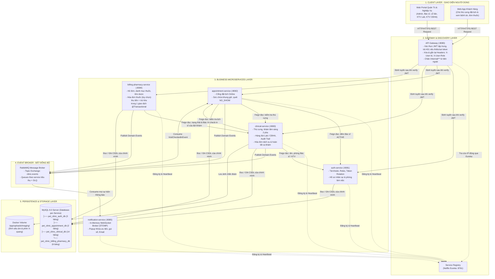
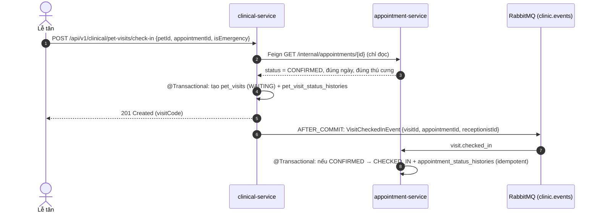
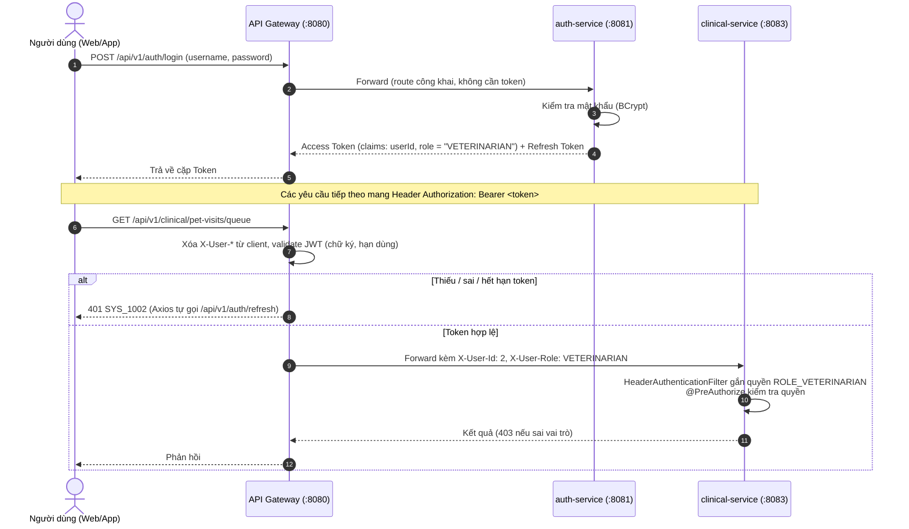

# TÀI LIỆU THIẾT KẾ KIẾN TRÚC HỆ THỐNG MICROSERVICES
## HỆ THỐNG QUẢN LÝ PHÒNG KHÁM THÚ Y (VET CLINIC MANAGEMENT SYSTEM)

> **Phiên bản:** 3.0 (đồng bộ lược đồ CSDL v3.0 – 25 bảng: hóa đơn riêng cho từng dịch vụ, mua thuốc tại phòng khám là tùy chọn)  
> **Mục tiêu:** Cung cấp tài liệu thiết kế kiến trúc phân tán toàn diện cho đồ án tốt nghiệp, chuẩn hóa ranh giới dịch vụ (Bounded Contexts), cơ chế toàn vẹn dữ liệu (Inter-Service Data Integrity), luồng điều phối sự kiện bất đồng bộ và chiến lược giải quyết các bài toán phân tán thực tế.  
> **Tài liệu này là nguồn chuẩn** cho danh mục service, danh mục sự kiện RabbitMQ và danh mục lời gọi OpenFeign; `QUY_CHUAN_THIET_KE_VA_LAP_TRINH_BACKEND_SPRINGBOOT.md` và `LICH_TRINH_XAY_DUNG_MA_NGUON_VA_HUONG_DAN_TEST.md` dùng đúng các tên ở đây.

---

## 1. Tổng quan Kiến trúc Tổng thể (High-Level Architecture)

Hệ thống được xây dựng theo mô hình **Microservices Architecture kết hợp Event-Driven Architecture (EDA)** trên nền tảng **Java 21**, **Spring Boot 4.1** (bản vá 4.1.1 trở lên) và **Spring Cloud 2025.1.2 (Oakwood)** trở lên, bao gồm các khối thành phần phân tầng:

1. **Khách hàng (Client Layer):** Web Portal cho Quản trị viên / Bác sĩ / Lễ tân / Kỹ thuật viên và Web App cho Khách hàng / Chủ thú cưng.
2. **Cổng giao tiếp (API Gateway Layer):** Spring Cloud Gateway làm cổng vào duy nhất, chịu trách nhiệm định tuyến, xác thực JWT tập trung, trả `401` khi thiếu hoặc sai token, và gắn thông tin người dùng vào HTTP Headers.
3. **Đăng ký & Phát hiện dịch vụ (Service Discovery):** Netflix Eureka Server quản lý động địa chỉ IP và cổng của tất cả các microservices.
4. **Phân hệ nghiệp vụ (Microservices Layer):** 4 service nghiệp vụ cốt lõi chạy độc lập theo nguyên tắc *Database-per-Service* + 1 Notification Service đẩy thông báo qua WebSocket / Email.
5. **Hàng đợi thông điệp (Event Broker):** RabbitMQ với Topic Exchange `clinic.events` điều phối các sự kiện thay đổi trạng thái giữa các services mà không gây nghẽn (Non-blocking).
6. **Lưu trữ dữ liệu (Data & Storage Layer):** Một MySQL 8.0 Server chứa 4 CSDL logic độc lập; tệp ảnh chẩn đoán hình ảnh lưu trên **Docker Volume** gắn vào `clinical-service` (không dùng MinIO / S3 trong phạm vi đồ án).

---

## 2. Sơ đồ Kiến trúc Phân tầng (Architectural Diagram)



---

## 3. Phân rã Dịch vụ theo Bounded Context (Domain-Driven Design)

Hệ thống được chia thành **5 Microservices nghiệp vụ** + **2 Service hạ tầng** với tổng cộng **25 bảng CSDL** trong 4 CSDL logic:

| Tên Microservice | Cổng | CSDL riêng biệt (MySQL) | Các bảng dữ liệu phụ trách | Trách nhiệm nghiệp vụ chính |
| :--- | :---: | :--- | :--- | :--- |
| **`service-registry`** | `8761` | *Không có* | *Không có* | Spring Cloud Netflix Eureka Server; quản lý đăng ký và phát hiện địa chỉ động của các service. **Không phụ thuộc `common-library`.** |
| **`api-gateway`** | `8080` | *Không có* | *Không có* | Điểm vào duy nhất (WebFlux); kiểm tra chữ ký JWT, trả `401` cho route cần đăng nhập khi thiếu / sai / hết hạn token; xóa rồi gắn lại `X-User-Id`, `X-User-Role`; chặn `/internal/**`; CORS, Rate Limiting. |
| **`auth-service`** | `8081` | `pet_clinic_auth_db` | `roles`, `users`, `refresh_tokens` (3 bảng) | Xác thực đăng nhập, mã hóa BCrypt, cấp JWT Access Token (TTL 30m) & Stateful Refresh Token (TTL 7d) có Token Rotation; quản lý tài khoản nhân sự (6 vai trò) và số phòng làm việc (`room_number`). |
| **`appointment-service`** | `8082` | `pet_clinic_appointment_db` | `appointments`, `appointment_status_histories` (2 bảng) | Cổng đặt lịch khám trực tuyến; tính sức chứa khung giờ động theo số Bác sĩ `ACTIVE`; quét `NO_SHOW` tại `start_time + 30'`; lưu vết Audit Trail trạng thái lịch hẹn; nhận `VisitCheckedInEvent` để chuyển lịch sang `CHECKED_IN`. |
| **`clinical-service`** | `8083` | `pet_clinic_clinical_db` | `species`, `pets`, `services`, `lab_test_items`, `service_lab_test_items`, `lab_test_reference_ranges`, `pet_visits`, `pet_visit_status_histories`, `visit_service_details`, `visit_service_detail_histories`, `lab_test_results`, `imaging_results`, `imaging_attachments`, `service_invoices` (14 bảng) | Quản lý thú cưng, loài, danh mục dịch vụ; vận hành khám lâm sàng 2 pha; 2 hàng đợi độc lập (Lab & CĐHA); tính trạng thái Bác sĩ & Khóa ưu tiên; **lập hóa đơn dịch vụ ngay khi chỉ định, thu tiền hóa đơn dịch vụ và hoàn tất ca khám trong cùng giao dịch cục bộ**. |
| **`billing-pharmacy-service`** | `8084` | `pet_clinic_billing_pharmacy_db` | `medicines`, `prescriptions`, `prescription_items`, `medicine_invoices`, `medicine_invoice_items`, `inventory_transactions` (6 bảng) | Kê đơn thuốc điện tử (không giá, không trạng thái); quản lý danh mục thuốc và kho dược; **bán thuốc theo đơn khi khách chọn mua**: lập hóa đơn thuốc, thu tiền và trừ kho trong 1 giao dịch `@Transactional` cục bộ; nhập kho / cân chỉnh kho. |
| **`notification-service`** | `8085` | *In-Memory (Spring WebSocket Broker)* | *Không có* | Lắng nghe sự kiện từ RabbitMQ để đẩy thông báo WebSocket (STOMP) realtime tới màn hình Bác sĩ / Lễ tân / KTV / sảnh (gọi số, popup Khóa ưu tiên) và gửi Email / thông báo ứng dụng cho khách hàng. Không lưu CSDL. **Không tích hợp SMS.** |

---

## 4. Chiến lược Cơ sở dữ liệu (Database Strategy)

### 4.1. Mô hình "Một MySQL Server - Đa Cơ sở dữ liệu Logic"
- **Đặc điểm:** Tuân thủ nghiêm ngặt nguyên tắc **Database-per-Service**: mỗi service chỉ kết nối vào đúng CSDL của mình, tuyệt đối không truy vấn chéo sang CSDL của service khác.
- **Tối ưu hóa tài nguyên:** Chỉ cần **1 container MySQL 8.0** trong Docker Compose, bên trong khởi tạo 4 database logic:
  ```sql
  CREATE DATABASE pet_clinic_auth_db CHARACTER SET utf8mb4 COLLATE utf8mb4_unicode_ci;
  CREATE DATABASE pet_clinic_appointment_db CHARACTER SET utf8mb4 COLLATE utf8mb4_unicode_ci;
  CREATE DATABASE pet_clinic_clinical_db CHARACTER SET utf8mb4 COLLATE utf8mb4_unicode_ci;
  CREATE DATABASE pet_clinic_billing_pharmacy_db CHARACTER SET utf8mb4 COLLATE utf8mb4_unicode_ci;
  ```
- **Xử lý khóa ngoại liên Service (Cross-Service References):**
  - Không có khóa ngoại vật lý (`FOREIGN KEY`) giữa các bảng thuộc 2 service khác nhau.
  - Thay bằng **khóa ngoại logic**: cột `BIGINT` có index (ví dụ `pet_visits.doctor_id`, `prescriptions.visit_id`, `appointments.pet_id`), được ghi chú `-- LFK:` trong `schema_init.sql`.
  - Tính hợp lệ của ID được kiểm tra bằng lời gọi OpenFeign **chỉ đọc** tại thời điểm tạo dữ liệu (mục 5.1).
- **Không lưu giá trị dẫn xuất:** tổng tiền hóa đơn được tính qua VIEW `v_service_invoice_amounts` (clinical) và `v_medicine_invoice_amounts` (billing-pharmacy). Báo cáo doanh thu tổng gọi API của 2 service rồi cộng ở tầng ứng dụng.

---

## 5. Cơ chế Giao tiếp giữa các Dịch vụ (Inter-Service Communication)

### 5.1. Giao tiếp Đồng bộ (Spring Cloud OpenFeign) – **chỉ dùng để ĐỌC**

**Quy tắc:** OpenFeign chỉ dùng cho truy vấn đọc hoặc kiểm tra điều kiện tiên quyết. **Không service nào ghi dữ liệu vào service khác qua Feign**; mọi thay đổi trạng thái liên service đi qua sự kiện RabbitMQ (mục 5.2). Endpoint nội bộ dùng tiền tố `/internal/**`, Gateway chặn tiền tố này từ bên ngoài. Lời gọi Feign đặt **ngoài** phạm vi `@Transactional`.

| Service gọi | Service được gọi | Endpoint nội bộ (gợi ý) | Mục đích |
| :--- | :--- | :--- | :--- |
| `appointment-service` | `auth-service` | `GET /internal/users/active-doctors/count` | Lấy số Bác sĩ `ACTIVE` để tính sức chứa khung giờ ($Capacity_{slot} = N_{active} \times 2$). |
| `appointment-service` | `clinical-service` | `GET /internal/pets/{id}` | Kiểm tra thú cưng tồn tại và thuộc đúng chủ nuôi khi đặt lịch (`appointments.pet_id` là khóa ngoại logic). |
| `clinical-service` | `auth-service` | `GET /internal/users/{id}` | Lấy họ tên, vai trò, `room_number` của Bác sĩ / KTV; kiểm tra người được phân công là `VETERINARIAN` đang `ACTIVE`. |
| `clinical-service` | `appointment-service` | `GET /internal/appointments/{id}` | Khi check-in: kiểm tra lịch hẹn đang `CONFIRMED`, đúng ngày, đúng thú cưng. **Chỉ đọc**, việc chuyển `CHECKED_IN` diễn ra qua sự kiện. |
| `billing-pharmacy-service` | `clinical-service` | `GET /internal/pet-visits/{id}/summary` | Lấy trạng thái và Bác sĩ phụ trách của đợt khám: chỉ cho kê / sửa đơn khi ca `IN_PROGRESS` và đúng Bác sĩ; chỉ cho bán thuốc khi ca `WAITING_PAYMENT` hoặc `COMPLETED`. |

### 5.2. Giao tiếp Bất đồng bộ (RabbitMQ) – Danh mục sự kiện chuẩn v3.0

- **Exchange:** một Topic Exchange duy nhất **`clinic.events`**.
- **Routing key:** `<miền>.<sự_kiện>` (chữ thường, gạch dưới).
- **Queue:** mỗi service tiêu thụ có queue riêng, kèm Dead Letter Queue (`<queue>.dlq`) để giữ sự kiện xử lý lỗi sau khi retry.
- **Nguyên tắc:** sự kiện chỉ được gửi **sau khi giao dịch CSDL đã commit** (`@TransactionalEventListener(AFTER_COMMIT)`); consumer phải **idempotent** (nhận trùng không gây sai dữ liệu).

| Tên Sự kiện (Event Class) | Routing Key | Producer | Consumer | Hành động khi nhận |
| :--- | :--- | :--- | :--- | :--- |
| `AppointmentBookedEvent` | `appointment.booked` | `appointment-service` | `notification-service` | Gửi thông báo / Email mã lịch hẹn cho chủ nuôi. |
| `AppointmentStatusChangedEvent` | `appointment.status_changed` | `appointment-service` | `notification-service` | Báo khách lịch đã được xác nhận / từ chối / hủy. |
| `AppointmentNoShowEvent` | `appointment.no_show` | `appointment-service` | `notification-service` | Báo khách lịch hẹn đã bị đánh dấu vắng mặt. |
| `VisitCheckedInEvent` | `visit.checked_in` | `clinical-service` | `appointment-service`, `notification-service` | `appointment-service`: chuyển lịch `CONFIRMED → CHECKED_IN` và ghi lịch sử (bỏ qua nếu đã xử lý). `notification-service`: cập nhật bảng hàng đợi sảnh. |
| `PatientCalledEvent` | `visit.patient_called` | `clinical-service` | `notification-service` | Hiển thị gọi số trên màn hình sảnh và gửi thông báo ứng dụng (mời vào phòng Bác sĩ / Lab / CĐHA, báo tạm hoãn lượt). |
| `ParaclinicalResultsReadyEvent` | `visit.results_ready` | `clinical-service` | `notification-service` | Bật popup và huy hiệu Khóa ưu tiên trên màn hình Bác sĩ; báo chủ nuôi chờ tại sảnh. |
| `VisitCompletedEvent` | `visit.completed` | `clinical-service` | `notification-service` | Gửi phiếu thu dịch vụ điện tử; báo bệnh án đã có trên Portal. |
| `MedicineInvoicePaidEvent` | `pharmacy.medicine_invoice_paid` | `billing-pharmacy-service` | `notification-service` | Gửi hóa đơn thuốc điện tử và hướng dẫn dùng thuốc về ứng dụng khách hàng. **Không** làm thay đổi trạng thái đợt khám. |
| `MedicineLowStockEvent` | `pharmacy.low_stock` | `billing-pharmacy-service` | `notification-service` | Cảnh báo lên màn hình Quản trị viên khi `stock_quantity <= min_stock_alert`. |

**Đã bỏ so với bản 2.0:**
- `VisitClosedToPaymentEvent`: hóa đơn dịch vụ được `clinical-service` lập ngay lúc chỉ định, không cần billing tạo hóa đơn khi chốt ca.
- `PaymentAndDispenseCompletedEvent` (vai trò đóng ca khám): ca khám hoàn tất trong giao dịch cục bộ của `clinical-service` khi thu đủ hóa đơn dịch vụ. Sự kiện thông báo bán thuốc được đổi tên thành `MedicineInvoicePaidEvent` và chỉ phục vụ thông báo.
- Các tên cũ không thống nhất (`AppointmentCreatedEvent`, `DoctorPriorityCallbackEvent`, `LowStockEvent`, `PaymentCompletedEvent`, `ServicesPrescribedEvent`, `ServicesCompletedEvent`, `ClinicalCompletedEvent`) được thay bằng danh mục trên; exchange `clinic.exchange` thống nhất thành `clinic.events`.

### 5.3. Luồng Check-in liên service (ví dụ điển hình)



Lịch hẹn chuyển `CHECKED_IN` chậm hơn đợt khám vài trăm mili giây (Eventual Consistency); trong khoảng đó lịch vẫn tính là chiếm chỗ (đếm slot gồm cả `CONFIRMED` và `CHECKED_IN`) nên không ảnh hưởng nghiệp vụ. Nếu consumer lỗi, sự kiện được retry rồi vào DLQ để xử lý tay.

---

## 6. Chiến lược Xử lý Giao dịch Toàn vẹn (Transaction & Data Integrity)

### 6.1. Tại sao KHÔNG cần Saga cho tiền và kho?

Mọi nghiệp vụ liên quan đến tiền và kho đều nằm **trọn trong CSDL của một service**, nên dùng giao dịch ACID cục bộ (`@Transactional`) là đủ:

| Nghiệp vụ | Service | Các bảng trong cùng giao dịch |
| :--- | :--- | :--- |
| Chỉ định dịch vụ + lập hóa đơn dịch vụ | `clinical-service` | `visit_service_details`, `service_invoices`, `visit_service_detail_histories` |
| Hủy dịch vụ + hủy hóa đơn dịch vụ | `clinical-service` | `visit_service_details`, `service_invoices`, (`pet_visits` nếu kích hoạt `RESULTS_READY`) |
| Thu tiền hóa đơn dịch vụ + hoàn tất ca khám | `clinical-service` | `service_invoices`, `pet_visits`, `pet_visit_status_histories` |
| Thu tiền hóa đơn thuốc + trừ kho + ghi nhật ký kho | `billing-pharmacy-service` | `medicine_invoices`, `medicines`, `inventory_transactions` |

- **Hóa đơn thuốc và kho chung một CSDL:** thu tiền thuốc và trừ tồn kho nằm trong cùng một phương thức `@Transactional`. Trừ kho bằng câu lệnh có điều kiện `UPDATE ... WHERE stock_quantity >= :qty`; nếu thiếu thuốc thì toàn bộ giao dịch rollback, hóa đơn thuốc giữ `PENDING`. **Không bao giờ xảy ra "đã ghi nhận thu tiền thuốc nhưng kho không trừ"** và không cần Compensating Transaction của Saga.
- **Hóa đơn dịch vụ và đợt khám chung một CSDL:** việc thu hóa đơn dịch vụ cuối cùng và chuyển ca sang `COMPLETED` là một giao dịch duy nhất, không còn phụ thuộc sự kiện từ billing như bản 2.0.

### 6.2. Nhất quán sau (Eventual Consistency) chỉ ở những chỗ không ảnh hưởng tiền
- Check-in → lịch hẹn `CHECKED_IN` (mục 5.3).
- Toàn bộ thông báo (WebSocket, Email, ứng dụng).

### 6.3. Chống cập nhật đồng thời
- **Khóa lạc quan (`@Version`)** trên `pet_visits`, `service_invoices`, `medicine_invoices`, `medicines`: hai thu ngân cùng bấm xác nhận, hoặc bấm đúp, thì chỉ một giao dịch thành công, giao dịch còn lại rollback và nhận lỗi `SYS_1005`.
- **Ràng buộc CSDL:** `service_invoices.visit_service_detail_id UNIQUE`, `medicine_invoices.prescription_id UNIQUE`, `CHECK (stock_quantity >= 0)`.

---

## 7. Thiết kế Bảo mật & Xác thực (Security Architecture)



- **Cơ chế:** JWT tự triển khai (HMAC-SHA256, `jwt.secret`) kết hợp Refresh Token lưu CSDL có xoay vòng (Token Rotation). Hệ thống **không triển khai OAuth2 Authorization Server / Resource Server**.
- **Quy ước vai trò:** claim `role` và header `X-User-Role` chứa mã vai trò **không có tiền tố** (`VETERINARIAN`); tiền tố `ROLE_` chỉ được thêm **một lần** tại `HeaderAuthenticationFilter` của service nghiệp vụ.
- **Mã lỗi:** `401` khi chưa xác thực (thiếu / sai / hết hạn token) để Frontend tự làm mới token; `403` khi đã xác thực nhưng sai vai trò.
- **Phân tách trách nhiệm:** `auth-service` ký token; `api-gateway` xác thực token trước khi forward; các service bên trong mạng nội bộ tin tưởng header do Gateway gắn, không truy vấn lại bảng `users` ở mỗi request.

---

## 8. Cấu trúc Triển khai Docker Compose

Toàn bộ hệ thống được khởi chạy chỉ bằng 1 lệnh:
```bash
docker compose up -d
```

### Cấu trúc các thành phần trong `docker-compose.yml`:
1. `mysql-server`: MySQL 8.0 (chứa 4 database logic, chạy `schema_init.sql` khi khởi tạo).
2. `rabbitmq-broker`: RabbitMQ Server (kèm Management UI trên port `15672`).
3. Volume `imaging-uploads`: gắn vào `clinical-service` tại `/app/uploads/imaging/` để lưu tệp ảnh.
4. `service-registry`: Eureka Server (port `8761`).
5. `api-gateway`: Spring Cloud Gateway (port `8080` – port duy nhất public ra ngoài).
6. `auth-service`: Port `8081`.
7. `appointment-service`: Port `8082`.
8. `clinical-service`: Port `8083`.
9. `billing-pharmacy-service`: Port `8084`.
10. `notification-service`: Port `8085`.

---

## 9. Bộ Câu hỏi & Trả lời chuẩn bị Bảo vệ trước Hội đồng chấm Đồ án (Defense Q&A)

| Câu hỏi từ Hội đồng | Câu trả lời chuẩn mực & Tự tin |
| :--- | :--- |
| **Hội đồng hỏi:** *Tại sao hệ thống phòng khám quy mô vừa lại chọn Microservices thay vì Monolith? Có bị over-engineering không?* | **Sinh viên trả lời:** "Dạ thưa Thầy/Cô, việc áp dụng Microservices trong đồ án nhằm: (1) Nghiên cứu và làm chủ các kỹ thuật phân tán chuẩn công nghiệp như API Gateway, Service Registry và Event-Driven Messaging; (2) Phân định ranh giới nghiệp vụ: phân hệ Đặt lịch hướng khách hàng có thể co giãn độc lập mà không ảnh hưởng phân hệ Khám lâm sàng nội bộ; (3) Em áp dụng tư duy thiết kế thực dụng: đặt những dữ liệu phải thay đổi cùng nhau vào cùng một service (hóa đơn dịch vụ cùng đợt khám, hóa đơn thuốc cùng kho dược) để mọi nghiệp vụ tiền và kho chỉ cần giao dịch cục bộ, không phải dùng Saga." |
| **Hội đồng hỏi:** *Vì sao lại chuyển Hồ sơ thú cưng (`pets`, `species`) sang `clinical-service` thay vì để ở `appointment-service`?* | **Sinh viên trả lời:** "Dạ, Bác sĩ đọc và cập nhật bệnh án thú cưng với tần suất rất cao trong lúc khám. Nếu `pets` nằm ở `appointment-service`, mỗi ca khám phải gọi mạng sang service khác và dễ bị ảnh hưởng khi cổng đặt lịch quá tải. Đặt `species`, `pets` trong `clinical-service` giúp truy vấn bệnh án là truy vấn nội bộ. `appointment-service` chỉ lưu `pet_id` dạng khóa ngoại logic và gọi Feign đọc để kiểm tra khi đặt lịch; nếu cổng đặt lịch gặp sự cố thì phòng khám bên trong vẫn tiếp nhận và khám bệnh bình thường." |
| **Hội đồng hỏi:** *CSDL phân biệt dữ liệu cố định và biến động thế nào? Tại sao cần bảng lưu vết lịch sử (Audit Trail)?* | **Sinh viên trả lời:** "Dạ, CSDL phân 3 tầng: (1) Danh mục (Master Data): `roles`, `species`, `services`, `lab_test_items`, `service_lab_test_items`, `lab_test_reference_ranges`, `medicines`. (2) Giao dịch (Transactional): `appointments`, `pet_visits`, `visit_service_details`, `lab_test_results`, `imaging_results`, `prescriptions`, `service_invoices`, `medicine_invoices`… Những bảng chứng từ có **snapshot** đơn giá, thuế suất và khoảng tham chiếu tại thời điểm phát sinh để lịch sử không sai khi danh mục đổi giá. (3) Lưu vết (Audit Trail): `appointment_status_histories`, `pet_visit_status_histories`, `visit_service_detail_histories` và `inventory_transactions`. Nhờ bảng lịch sử, em bỏ được các cột thời điểm và lý do hủy khỏi bảng chính (`started_at`, `completed_at`, `cancel_reason`…) vì chúng trùng với dữ liệu lịch sử, đúng chuẩn 3NF." |
| **Hội đồng hỏi:** *Vì sao hóa đơn dịch vụ lại nằm ở `clinical-service` chứ không ở service thanh toán?* | **Sinh viên trả lời:** "Dạ thưa Thầy/Cô, theo góp ý, mỗi dịch vụ có một hóa đơn riêng, quan hệ 1–1 với dòng chỉ định `visit_service_details`. Đặt `service_invoices` cùng CSDL với chỉ định và đợt khám mang lại 3 lợi ích: (1) **Khóa ngoại vật lý** `service_invoices.visit_service_detail_id → visit_service_details(id)` thay vì khóa ngoại logic; (2) **Giao dịch cục bộ**: chỉ định dịch vụ thì tạo hóa đơn, hủy dịch vụ thì hủy hóa đơn, thu đủ hóa đơn thì hoàn tất ca khám, tất cả trong một `@Transactional`, không cần sự kiện bất đồng bộ hay Saga; (3) **Doanh thu theo dịch vụ** chỉ cần JOIN `service_invoices` với `visit_service_details` và `services` trong cùng CSDL. Nếu để ở billing, mỗi lần chỉ định hay hủy dịch vụ đều phải đồng bộ qua mạng và có nguy cơ lệch giữa dịch vụ đã hủy và hóa đơn còn thu tiền." |
| **Hội đồng hỏi:** *Vì sao hóa đơn thuốc nằm ở service kho dược? Thuế VAT và doanh thu được bóc tách thế nào?* | **Sinh viên trả lời:** "Dạ, hóa đơn thuốc (`medicine_invoices`, `medicine_invoice_items`) và kho (`medicines`, `inventory_transactions`) chung một CSDL, nên khi khách chọn mua thuốc tại phòng khám, việc chuyển hóa đơn sang `PAID`, trừ kho có điều kiện và ghi nhật ký `EXPORT_SALE` nằm trong cùng một giao dịch. Thiếu kho thì rollback toàn bộ, hóa đơn vẫn `PENDING`, khách giảm số lượng hoặc mua ngoài, không phát sinh hoàn tiền. Về VAT: mỗi dòng hóa đơn lưu snapshot `unit_price` và `vat_rate` (dịch vụ ở `service_invoices`, thuốc ở `medicine_invoice_items`); tiền thuế và tổng tiền là giá trị dẫn xuất nên em không lưu cột mà tính qua VIEW. Doanh thu dịch vụ và doanh thu thuốc tách tự nhiên vì nằm ở hai loại hóa đơn khác nhau." |
| **Hội đồng hỏi:** *Các service giao tiếp với nhau như thế nào? Khi nào dùng OpenFeign, khi nào dùng RabbitMQ?* | **Sinh viên trả lời:** "Dạ, OpenFeign **chỉ dùng để đọc** dữ liệu cần ngay, ví dụ `appointment-service` đếm số Bác sĩ `ACTIVE` để tính sức chứa khung giờ, hay `clinical-service` kiểm tra lịch hẹn còn `CONFIRMED` khi check-in. Mọi thay đổi trạng thái ở service khác đều đi qua **RabbitMQ**: ví dụ check-in xong, `clinical-service` phát `VisitCheckedInEvent` và `appointment-service` tự chuyển lịch sang `CHECKED_IN` trong giao dịch của chính nó. Sự kiện chỉ phát sau khi commit, consumer idempotent và có Dead Letter Queue, nên không có tình trạng một service ghi thẳng vào dữ liệu của service khác." |
| **Hội đồng hỏi:** *Cơ chế xác thực và phân quyền hoạt động ra sao? Có dùng OAuth2 không?* | **Sinh viên trả lời:** "Dạ, hệ thống dùng **JWT tự triển khai kèm Refresh Token có xoay vòng**, không triển khai OAuth2. Người dùng đăng nhập qua Gateway tới `auth-service` để nhận Access Token (30 phút) và Refresh Token (7 ngày, lưu CSDL). Ở các request sau, API Gateway xác thực chữ ký JWT; thiếu hoặc hết hạn token thì trả `401` để Frontend tự gọi `/refresh`. Token hợp lệ thì Gateway xóa header giả mạo từ client, gắn `X-User-Id`, `X-User-Role` rồi chuyển xuống service. Service nghiệp vụ gắn quyền `ROLE_<vai trò>` một lần và dùng `@PreAuthorize` để phân quyền theo 6 vai trò; sai vai trò thì trả `403`." |
| **Hội đồng hỏi:** *Check-in vừa tạo đợt khám vừa đổi trạng thái lịch hẹn ở 2 CSDL khác nhau, làm sao đảm bảo nhất quán?* | **Sinh viên trả lời:** "Dạ, em không ghi chéo 2 CSDL trong một request. `clinical-service` chỉ đọc lịch hẹn qua Feign để kiểm tra, tạo đợt khám trong giao dịch của mình, sau khi commit mới phát `VisitCheckedInEvent`. `appointment-service` nhận sự kiện và chuyển lịch sang `CHECKED_IN`. Consumer kiểm tra trạng thái trước khi cập nhật nên nhận trùng không sao; nếu lỗi thì retry và vào DLQ. Độ trễ chỉ vài trăm mili giây và không ảnh hưởng sức chứa khung giờ vì lịch `CONFIRMED` và `CHECKED_IN` đều được tính là chiếm chỗ." |

---

## PHỤ LỤC: THAY ĐỔI SO VỚI PHIÊN BẢN 2.0

| Vị trí | Bản 2.0 | Bản 3.0 | Lý do |
| :--- | :--- | :--- | :--- |
| Mục 1 | Spring Boot "4.1.11" | Spring Boot 4.1 (4.1.1+), Spring Cloud 2025.1.2 (Oakwood)+ | Không có bản 4.1.11; Spring Cloud 2025.1.2 là bản đầu tiên hỗ trợ Boot 4.1 |
| Mục 1, 2, 8 | Docker Volume / MinIO | Chỉ Docker Volume | Hệ thống không dùng MinIO |
| Mục 2, 3 | 23 bảng; clinical 12 bảng; billing có `invoices`, `invoice_items` | 25 bảng; clinical 14 bảng (thêm `service_lab_test_items`, `service_invoices`); billing có `medicine_invoices`, `medicine_invoice_items` | Lược đồ v3.0 |
| Mục 2, 5.2 | Exchange `clinic.exchange` | `clinic.events` | Thống nhất với Quy chuẩn và Lộ trình mã nguồn |
| Mục 5.1 | Feign "billing → clinical lấy dịch vụ COMPLETED"; quy tắc chỉ đọc nhưng check-in ghi chéo | Bỏ lời gọi này; danh mục Feign chỉ đọc; check-in đổi trạng thái lịch qua sự kiện | Hóa đơn dịch vụ ở clinical; tránh ghi chéo CSDL |
| Mục 5.2 | `VisitClosedToPaymentEvent`; `PaymentAndDispenseCompletedEvent` đóng ca khám | Bỏ cả hai; thêm danh mục 9 sự kiện chuẩn; `MedicineInvoicePaidEvent` chỉ để thông báo | Ca khám hoàn tất bằng giao dịch cục bộ ở clinical |
| Mục 6 | Lý do không cần Saga: viện phí và kho chung DB; hoàn tất ca qua event | Lý do: hóa đơn thuốc và kho chung DB, hóa đơn dịch vụ và đợt khám chung DB; bảng 4 nhóm giao dịch | Lược đồ v3.0 |
| Mục 7 | Không nói mã 401/403; claim `roles` có tiền tố | Gateway trả 401; claim `role` không tiền tố, thêm `ROLE_` một lần | Sửa lỗi `ROLE_ROLE_` và lỗi 403 khiến Axios không refresh |
| Mục 9 | "invoices có khóa ngoại tới prescriptions", "invoice_items bóc tách VAT"; gọi là "OAuth2" | Viết lại theo 2 loại hóa đơn và VIEW; nói rõ không dùng OAuth2; thêm câu hỏi về hóa đơn dịch vụ và check-in | Lược đồ v3.0; mô tả đúng cơ chế xác thực |
| Mục 7 (rà soát 10/11) | `X-User-Id: 5` cho Bác sĩ | `X-User-Id: 2` | Khớp dữ liệu demo (id 2 = `bs_tien`, id 5 là Lễ tân) |
